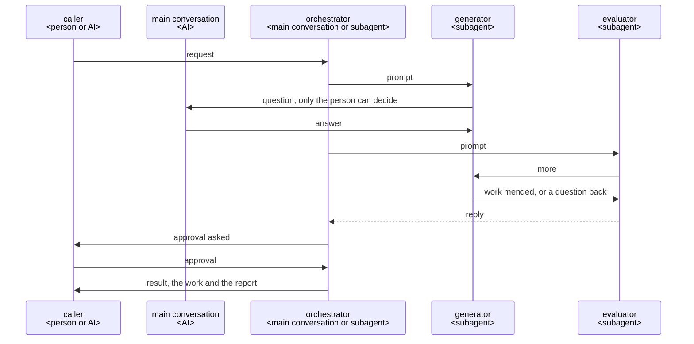

# Best practice for building a Claude Code plugin

This is the best practice for a Claude Code plugin whose roles work together to make something,
such as a document or code. A plugin is built on it, taking what its requirements call for.

## Structure

### Components


- **caller**: the person or the AI that calls the plugin, and decides what is theirs.
- **main conversation**: the Claude Code conversation the person talks in, the only one that can ask
  the person.
- **orchestrator**: the AI that runs the work from the call to the result: the main conversation, or
  a subagent where an AI calls the plugin.
- **generator**: a subagent that makes the work. A subagent started for one job, such as the
  generator or the evaluator, is a role.
- **evaluator**: a subagent that did not make the work, and checks it in its user's place.
- **router**: a script that gives the orchestrator each next move, where the run goes in fixed
  steps.
- **guard**: the plugin's hooks, which tell a subagent its step again when it drifts.

### Sequence



### Directory structure

```text
<repository>/
├── .claude-plugin/marketplace.json     the marketplace: the plugins it lists <JSON>
├── README.md                           leads users to each plugin's README, and developers to dev/ <Markdown>
├── plugins/                            what runs on users' machines, installed by Claude Code
│   └── <plugin>/
│       ├── .claude-plugin/plugin.json  the manifest, holding the version <JSON>
│       ├── skills/<command>/SKILL.md   a skill's entry <Markdown>
│       ├── agents/<name>.md            an agent's entry <Markdown>
│       ├── hooks/
│       │   ├── hooks.json              the hooks' entries <JSON>
│       │   └── <hook>.py               the hooks' code, the guard among them <Python 3>
│       ├── scripts/                    what runs as a command and depends on Claude Code <Python 3>
│       ├── core/                       the plugin's own logic, apart from Claude Code
│       │   ├── domain/                 the knowledge and rules of the plugin's work
│       │   └── roles/                  each role's flow, which uses the domain
│       ├── README.md                   for the plugin's users <Markdown>
│       └── CHANGELOG.md                what changed for users in each version <Markdown>
└── dev/                                what only the developers need, never installed
    ├── plugin-best-practice.md         this document
    └── <plugin>/                       one for each folder in plugins/
        ├── ux.md                       the plugin's UX <Markdown>
        ├── architecture.md             the plugin's architecture <Markdown>
        └── tests/                      unit/, architecture/ and ux/, as Test says
```

An entry is a file whose form Claude Code fixes: a skill, an agent, a hook or a command line. Its
part is the file in `core/` that does the entry's job.

Installing a plugin copies only its folder, so what only developers need stays in `dev/`. A
repository of one plugin keeps the same tree with one folder in `plugins/`.

## Principles

A plugin takes the principles its requirements call for, and its architecture names them. Each
gives its rule, then why; *When* marks one a plugin takes only where it says.

### The core apart from Claude Code

An entry, a skill, an agent, a hook or a command line, holds only the form Claude Code fixes and
hands the job to its part in `core/`. `core/` names no tool of an agent, such as the Agent tool or
`AskUserQuestion`; only the entries do.

*Why*: a job is then found where the logical view puts it, not by the command that calls it, and
two entries to one job do not drift apart. What the plugin knows outlives the agent it runs on
([ports and adapters](https://alistair.cockburn.us/hexagonal-architecture/)).

### An entry points to its part

A skill's or an agent's body points to its part and says where each file the part names lies; the
part names each by its name alone, never by where it is installed. An agent reads its part in full
before anything else, and a hook holds it to this.

*Why*: Claude Code makes an agent's body its system prompt and takes in no other file. After
`/compact`, a part a skill links comes back in full, while the skill's own body survives only as
the summary retells it. `${CLAUDE_PLUGIN_ROOT}` is replaced only in an entry's own body, not in what
the Bash tool runs nor in a file read with Read
([environment variables](https://code.claude.com/docs/en/plugins/manifest-reference#environment-variables)).

### What a machine can see of the work

What a machine can check, a script, a hook or the project's own tools check: for code, a formatter,
a linter and a type checker. An AI reads only for what no machine can check.

*Why*: a tool finds the same thing every time, at once; an AI finds only some, and spends a round
on each.

### No check passes what it did not check

A check ends in no problem, a problem, or could not check; what follows each is decided and tested
beforehand. A hook whose script fails stops the call; a skipped test, a job that did not run or a
command that failed is no pass.

*Why*: a check silent when it could not check is read as one that found nothing.

### The guard tells each role its steps again

A step that an instruction alone does not hold gets a hook that tells the role the step again when
it drifts, or stops what would break a rule. Branch protection or permission rules hold what is
hard to undo.

*Why*: a hook runs every time, while an instruction is only advice. A plugin's agent ignores
`hooks`, `mcpServers` and `permissionMode` in its own frontmatter, so its hooks live in the plugin's
`hooks/hooks.json`
([plugin agents](https://code.claude.com/docs/en/plugins/components#frontmatter-fields-in-plugin-agents)).

### Where a plugin writes its files

What may be kept goes in `.<plugin>/<yyyymmdd>-<name>/` at the root of the repository; what is used
only while the plugin runs, its tests' and trials' included, in `<plugin>/<yyyymmdd>-<name>/` in the
system's temporary folder, the one `tempfile.gettempdir()` gives, as TMPDIR moves it; what must
outlast an update in `${CLAUDE_PLUGIN_DATA}`. Nothing is written in `${CLAUDE_PLUGIN_ROOT}`.

*Why*: one folder named after the plugin lets the user choose with one line of `.gitignore` whether
git keeps it. The system clears its temporary folder, so a stopped run leaves nothing behind. An
agent reads without asking only inside the working folder
([working directories](https://code.claude.com/docs/en/permissions#working-directories)), and
`${CLAUDE_PLUGIN_ROOT}` changes with each update.

### Asking for what lies outside the work

When something outside the work stops it, such as a permission or a tool, the role asks for it and
goes on with the rest meanwhile; it never looks for a way round.

*Why*: the person clears such a cause in a moment; a way round leaves the work checked under other
terms than the purpose set.

### The caller approves what is theirs

What the caller decides, and what is hard to undo, such as a merge, goes to the caller, and counts
as approved only by their own action, such as a skill the AI cannot call
(`disable-model-invocation: true`).

*Why*: an AI deciding for the caller leaves them answerable for what they never saw, and an approval
an agent can give itself stops nothing.

### Languages

A plugin talks in the person's language and writes the repository in the repository's, proposing
both first, and shows the person what it writes with nothing added or left out.

*When*: a plugin that talks with a person.

*Why*: the person approves what they read, and others read the repository later.

### The orchestrator holds the whole and decides

One orchestrator talks with the caller, keeps all the run has found, and decides each move.

*When*: a run of steps that depend on what the last one found.

*Why*: only who holds the whole run can weigh what each move brings, and answer the caller's "why"
([building effective agents](https://www.anthropic.com/engineering/building-effective-agents)).

### Where the orchestrator runs

A plugin a person calls runs its orchestrator in the main conversation, started by a skill; one an
AI calls runs it as an agent. A role that needs the person asks the main conversation directly.

*When*: a plugin with an orchestrator and roles.

*Why*: only the main conversation can ask the person
([subagents](https://code.claude.com/docs/en/sub-agents#available-tools)).

### A plugin that uses another

A plugin that has another do a job starts that plugin's orchestrator as one of its roles.

*When*: a job another plugin already does.

*Why*: the other plugin runs as it was built and tested, and nothing of it is written again.

### One agent for each job

Each job has its own role, given only what the job needs.

*When*: a work with jobs that need different context or tools.

*Why*: a role starts in a fresh context, so nothing from other work leads it astray
([subagents](https://code.claude.com/docs/en/sub-agents)).

### Messages

Nobody relays. Whoever needs something asks whoever has it. Roles run in the background, and one
that has ended is sent further work with SendMessage, which resumes it with its whole conversation
([resume subagents](https://code.claude.com/docs/en/sub-agents#resume-subagents)).

*When*: a plugin with an orchestrator and roles.

*Why*: a go-between adds a move to every exchange and holds nothing of it; a resumed role does not
start again from nothing.

### JSON between agents

What agents pass on as data is JSON, in files.

*When*: a plugin with an orchestrator and roles.

*Why*: an agent changes only the part it needs and leaves the rest, and a script checks the form.

### Asking until nothing is left to decide

The orchestrator asks the caller every point only they can decide, one at a time, with a
recommendation. It finds facts itself and shows each one the work rests on. Everything else it
decides and reports.

*When*: a plugin with an orchestrator and roles.

*Why*: a point settled before the work does not return as rework, and a question about what the
caller does not care about spends their time on the plugin's job
([grilling](https://github.com/mattpocock/skills/blob/main/skills/productivity/grilling/SKILL.md)).

### Read by those who did not make it

A work is checked first by an evaluator that did not make it, standing in for the work's user:
each question of the checklist goes in `good`, with the lines that meet it, or in `more`, with
`good_when`, what the user gets once it is good, never how to make it. When the caller reads the
work in full to approve it, the caller reads it first.

*When*: a work whose user gets something no machine can check.

*Why*: the generator reads what it meant; a defect hunt finds something in every work and never
ends; how to mend is the generator's call, as the generator holds the sources
([harness design](https://www.anthropic.com/engineering/harness-design-long-running-apps)).

### Where the router keeps the course

A run that goes in a fixed loop keeps its course in a router, a script that gives the orchestrator
each next move from the role that ended and its result. A run whose course changes with what it
finds keeps it in its skill's steps. A run that keeps a state writes it to a file before each move.

*Why*: a course in code is followed the same way every time, and a course fixed in code has no move
for what it did not foresee. A conversation can end or be compacted; with the state in a file, a
stopped run goes on from its last move.

### Learning from each run

Once the caller approves the work, the orchestrator looks once through what the run kept for what
fell short and why, each cause quoted from the records. A project's own lesson goes into its rules;
a general one goes to the plugin's repository as an issue, only on the user's yes.

*When*: a plugin a person calls.

*Why*: a lesson met once improves every later run, and the user chooses what leaves their project.

## Development

### Python 3.9 and the standard library

What runs on users' machines is Python 3.9 or later with the standard library only.

*When*: users' machines may lack other runtimes or packages.

*Why*: python3 is wherever git is; a plugin installs no packages.

### Code kept once

Code more than one plugin needs is kept once, in the plugin whose job it is, and taken in by the
others through a relative symbolic link.

*Why*: installing copies a link's target into the plugin
([symlinks in a marketplace](https://code.claude.com/docs/en/plugins/host-marketplace#share-files-within-a-marketplace-with-symlinks)),
so the code is written, tested and fixed in one place.

## Test

A plugin is tested at three levels, each named by what its tests check against. Each test is drawn
from one rule, path or scenario of that one thing, never chosen by its writer, and is designed
before the code or the prompt and seen to fail first.

*Why*: no test is left to its writer's taste, and a failing test names the rule, path or scenario
it breaks.


### Unit: code

Drawn from the classes, edges and decision-table rules of the part's contract. Passes when every
test passes, every line and branch runs and every mutant is caught. Runs before each push and in
CI.

Coverage, mutation testing and property tests confirm that the unit tests hold the contract; each
gap they find becomes a unit test. Mutation and property tests run in CI on what changed.

*Why*: the tests designed first hold the behavior; these only confirm the design, and run before
every push they would make every change wait.

### Unit: prompts

Drawn from the cases of the role's contract, one case at a time. Passes when each case's
expectation holds in every run. Runs as the prompt is made.

Each role, a skill or an agent, is tried alone, on the model its users run, and judged from the
run's records. Each part of a trial, such as its judge, is checked on a kept record before a run
trusts it. A prompt is changed only for a cause the records confirm.

*Why*: a role tried with its neighbours does not show which went wrong; another model makes other
slips than the ones users meet; a line added for one run's slip meets a different slip in the next,
and the additions never settle.

### Architecture: the parts joined

Drawn from every path through each sequence: the main flow, each branch, each send-back and each
question. Passes when every test passes, with the role and the data checked at each step. Runs
before each push and in CI.

*Why*: a fault of a sequence lies between parts whose unit tests pass; with no model called, every
push checks every path in seconds.

### ux: the plugin in real use

Drawn from each objective's scenario, on a subject as big as a real request. Passes when the
stand-in gets what the objective says. Runs once every lower level passes.

It confirms what no lower level can measure, such as the lead time, and does not aim to cover
cases. Each Claude Code it starts runs on a configuration folder of its own, holding only the
plugins under test and given the developer's login as `CLAUDE_CODE_OAUTH_TOKEN`
([multiple accounts](https://code.claude.com/docs/en/authentication#log-in-with-multiple-accounts)).
Where Claude Code asks to allow a call, the stand-in chooses from what the screen shows, as a person
would.

*Why*: every part can pass while the user's objective is missed; a trial is slow and calls the
model each move, so it only confirms; the developer's own settings would change what is tried.

### Where a double's results come from

A double gives only what the part's contract allows, checked by the same check as the part's own
files; a double of Claude Code sends what its documentation says, or what a recorded try of the
real one showed.

*Why*: a double that gives what the part never would passes a test the real part fails.

### A fault is tested at the level that must catch it

A fault a higher level finds is first given a test at the lowest level whose check it breaks, seen
to fail, then fixed: a broken contract at unit, a broken handoff at architecture, what shows only in
real use at ux.

*Why*: a fault fixed only where a trial found it comes back unseen, as no trial runs on every push.

### Results that vary from run to run

A trial passes only when its expectation holds in every run, three of three by default; a run that
did not try what the trial invites does not count
([plugin evals](https://code.claude.com/docs/en/plugin-evals#how-a-case-is-scored)).

*Why*: a user meets every run, not most of them.

## Release

### The manifests checked

Each plugin and the marketplace pass `claude plugin validate --strict`.

*Why*: a malformed manifest fails every user at install.

### The version and the CHANGELOG

A plugin is released only on the word of whoever decides what reaches users. `version` is set once,
in `plugin.json`, in semver, raised by the largest change users see. The CHANGELOG, in
[Keep a Changelog](https://keepachangelog.com) form, gives each change users notice one line with
why it helps them. Each release is tagged `<plugin>--v<version>` with `claude plugin tag --push`
and listed in `.claude-plugin/marketplace.json` and the root README.

*Why*: users get an update only when the version rises; `plugin.json` wins over the marketplace
entry; a dependency's version range resolves against these tags.
