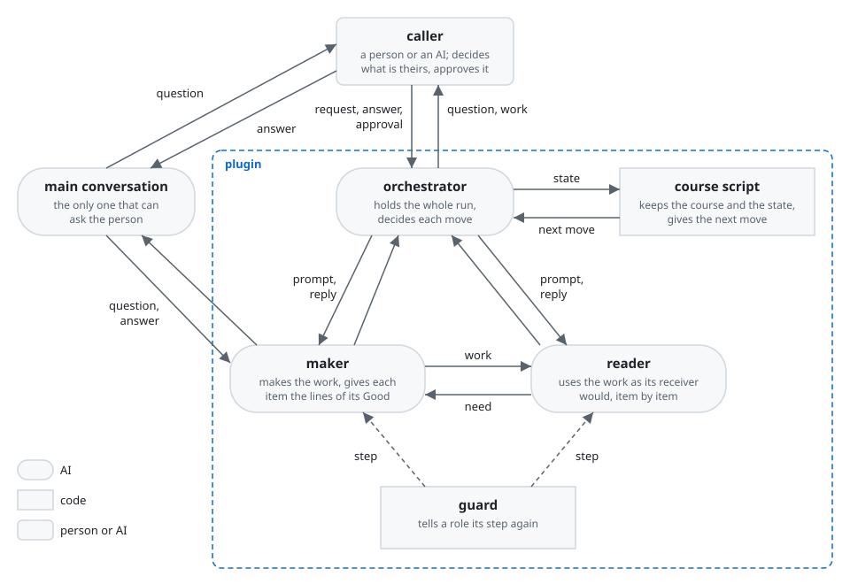
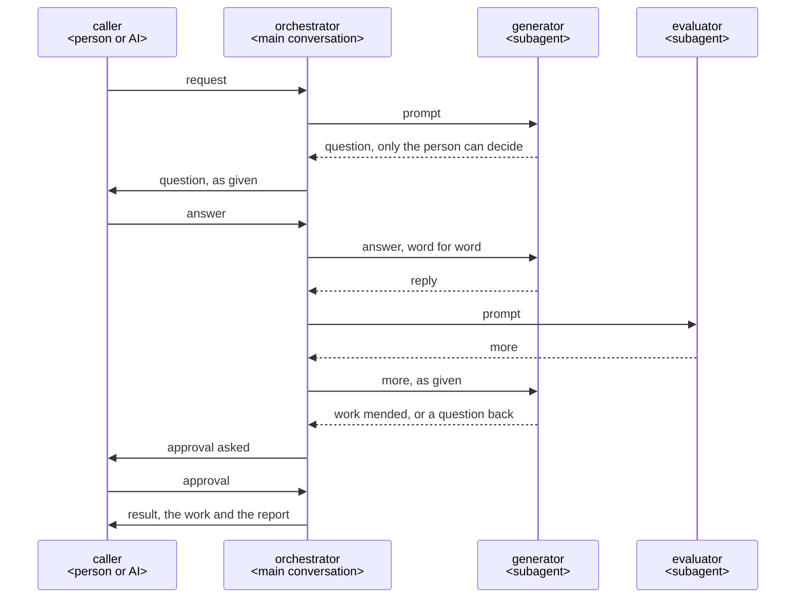

# Plugin development guide

This guide is for a Claude Code plugin whose roles work together to make a document, code,
or another work. A plugin takes from it what its requirements call for.

## Structure

### Components



- **caller**: the person, or the orchestrator of another plugin, that calls the plugin. The caller
  decides what is theirs.
- **orchestrator**: the AI that runs the work from the call to the result: the main conversation,
  the Claude Code conversation the person talks in, following the plugin's skill. Only it can ask
  the person.
- **generator**: a subagent that makes the work. A subagent started for one job, such as the
  generator or the evaluator, is a role.
- **evaluator**: a subagent that checks the work in its user's place. It did not make the work.
- **routes**: the order of the roles' starts, which Lane lays in `hooks/lanes.json`. They give the
  orchestrator each next start, or the moves it may choose among where its course turns on what it
  finds.
- **guard**: the plugin's hooks, which Lane lays. They hold the orchestrator to the routes, and
  tell a role its step again when it drifts.

### Sequence



### Directory structure

```text
<repository>/
├── .claude-plugin/marketplace.json     the marketplace: the plugins it lists <JSON>
├── README.md                           leads users to each plugin's README, and developers to dev/ <Markdown>
├── LICENSE                             the repository's license
├── plugins/                            what runs on users' machines, installed by Claude Code
│   └── <plugin>/
│       ├── .claude-plugin/plugin.json  the manifest, holding the version <JSON>
│       ├── skills/<command>/SKILL.md   a typed command's entry, with the steps of its moment <Markdown>
│       ├── agents/<role>.md            an agent's entry <Markdown>
│       ├── hooks/                      the guard, which Lane lays
│       │   ├── hooks.json              the hooks' entries <JSON>
│       │   ├── lanes.json              the lanes and the routes <JSON>
│       │   └── lane/                   Lane's code <Python 3>
│       ├── scripts/                    what runs as a command and depends on Claude Code <Python 3>
│       ├── domain/                     the knowledge and rules of the plugin's work, apart from Claude Code
│       │   └── <role>.md               a role's part: the steps it follows <Markdown>
│       ├── images/                     the README's figures <SVG>
│       ├── LICENSE                     the plugin's own copy of the repository's license
│       ├── README.md                   for the plugin's users <Markdown>
│       └── CHANGELOG.md                what changed for users in each version <Markdown>
└── dev/                                what only the developers need, never installed
    ├── README.md                       how to build and check the plugins <Markdown>
    ├── plugin-development-guide.md         this document
    ├── plugin-template/                the files a plugin starts from
    ├── images/                         the figures' style, and this document's figures <CSS, SVG>
    ├── scripts/                        the checks, and e2e.py, which runs an E2E test <Python 3>
    ├── tests/                          the double of Claude Code that the plugins' tests share <Python 3>
    └── <plugin>/                       one for each folder in plugins/
        ├── product-vision.md           the plugin's product vision <Markdown>
        ├── architecture.md             the plugin's architecture <Markdown>
        ├── images/                     the architecture's figures <SVG>
        └── tests/                      the test cases, by when each runs, as Test says <Python 3>
```

An entry is a file whose form Claude Code fixes: a skill, an agent, a hook, or a command line. Its
part is the file in `domain/` that does the entry's job. An entry is named as its caller calls it,
such as the command a person types. A part is named by the role it holds, so a role's agent
`agents/<role>.md` points to `domain/<role>.md`, and the orchestrator's skill points to
`domain/orchestrator.md`. [The template](plugin-template/) holds the first form of each entry, of
each role's part, of the forms that pass between the main conversation and a role, and of a role's
record.

Installing a plugin copies only its folder, so what only developers need stays in `dev/`. A
repository of one plugin keeps the same tree with one folder in `plugins/`.

## Principles

A plugin takes the principles its requirements call for, and its architecture names the ones it
takes. Each principle gives its rule, then why. *When* marks a principle that a plugin takes only
in the case it names.

### The domain apart from Claude Code

An entry holds only the form Claude Code fixes, and, for a command the person types, the steps of
its moment. It hands the rest of the job to its part in `domain/`. `domain/` names no tool of an
agent, such as the Agent tool or `AskUserQuestion`. Only the entries name them.

*Why*: a developer finds a job where the structure puts it, not by the command that calls it. Two
entries to one job do not drift apart. What the plugin knows outlives the agent it runs on
([ports and adapters](https://alistair.cockburn.us/hexagonal-architecture/)).

### An entry points to its part

A skill's or an agent's body points to its part, and says where each file the part names lies. A
command that the person types holds the steps of its moment besides, as [Each moment's steps in its
command](#each-moments-steps-in-its-command) says. The part names each file by its name alone, never
by where it is installed. An agent reads its part in full before anything else, and a hook holds the
agent to this.

*Why*: Claude Code makes an agent's body its system prompt, and reads no other file into it. After
`/compact`, a part that a skill links comes back in full. The skill's own body survives only as the
summary retells it. Claude Code replaces `${CLAUDE_PLUGIN_ROOT}` only in an entry's own body. It
does not replace it in what the Bash tool runs, nor in a file that Read reads
([environment variables](https://code.claude.com/docs/en/plugins/manifest-reference#environment-variables)).

### What a machine can see of the work

A script, a hook or the project's own tools check what a machine can check. For code, these are a
formatter, a linter, and a type checker. An AI reads only for what no machine can check.

*Why*: a tool finds the same thing every time, at once. An AI finds only some, and spends a round
on each.

### No check passes what it did not check

A check ends in one of three results: no problem, a problem, or could not check. The developer
decides beforehand what follows each result, and tests it. A hook whose script fails stops the
call. A skipped test, a job that did not run or a command that failed counts as no pass.

*Why*: a reader takes a check that stays silent when it could not check for one that found nothing.

### A record of each step and practice

Each role and the orchestrator record each step of their prompt, for the orchestrator each step of
its command and of its part, and each practice of the best practice they work by, at the time each
names: a step once its result holds, and a practice while they carry it out, in the phase that its
mark names, such as *While deciding*. Each records by a command of the plugin's own, in a file of
the run's folder, `.<plugin>/<yyyymmdd>-<name>/`, that its run values name, or, for the
orchestrator, its part. Each start of a role has a record of its own, and so has the orchestrator.
The plugin's own check reads the record against the prompt's steps and the best practice's
practices. The guard runs that check by a lane of [Lane](../plugins/lane/README.md) at a role's end,
and at the end of the orchestrator's turn that puts work up for the caller. It passes the end only
where the check gives 0, and gives the role or the orchestrator what the check says where it
doesn't. [The template](plugin-template/domain/record.schema.json) holds the record's form.

*Why*: an AI that lists at its end the practices it carried out makes a claim that no one checks,
and a practice skipped leaves its condition unmet in the work. A record made at the time shows each
step and practice in the order the AI took them, which a list at the end can't. Only the plugin
knows its prompts and its best practices, so its own check judges the record, and the guard runs the
check on every run. The run's folder keeps the record for the lessons of
[Learning from each run](#learning-from-each-run).

### The guard tells each role its steps again

Where an instruction alone does not hold a step, a hook tells the role the step again when it
drifts. A hook also stops what would break a rule. Branch protection or permission rules hold what
is hard to undo. The guard holds the orchestrator in the main conversation to the routes the same
way: it stops a start the routes do not name, tells the next start as a role's end reaches the main
conversation, and keeps the orchestrator going while a start is due and no role runs. It holds each
end to the plugin's check of the record, as [A record of each step and
practice](#a-record-of-each-step-and-practice) says. The plugin's hooks are its guard, laid by
[Lane](../plugins/lane/README.md) from the plugin's proposal as lanes and routes, as [Where the
routes keep the course](#where-the-routes-keep-the-course) says.

*Why*: a hook runs every time, while an instruction is only advice. Hooks fire on the main
conversation's calls and its end too, with no `agent_type`, while a role's start and end carry the
role's ([hooks](https://code.claude.com/docs/en/hooks)). A plugin's agent ignores
`hooks`, `mcpServers` and `permissionMode` in its own frontmatter, and a `SubagentStop` hook in a
skill's frontmatter did not fire in a run of Claude Code 2.1.318, so the plugin keeps its hooks in
`hooks/hooks.json`
([plugin agents](https://code.claude.com/docs/en/plugins/components#frontmatter-fields-in-plugin-agents)).

### Where a plugin writes its files

A plugin writes what may be kept in `.<plugin>/<yyyymmdd>-<name>/` at the root of the repository.
It writes what it uses only while it runs in `<plugin>/<yyyymmdd>-<name>/` in the system's
temporary folder, its tests' files included. That folder is the one `tempfile.gettempdir()` gives,
and TMPDIR moves it. The plugin writes what must outlast an update in `${CLAUDE_PLUGIN_DATA}`. It
writes nothing in `${CLAUDE_PLUGIN_ROOT}`.

*Why*: one folder named after the plugin lets the user choose with one line of `.gitignore` whether
git keeps it. The system clears its temporary folder, so a stopped run leaves nothing behind. An
agent reads without asking only inside the working folder
([working directories](https://code.claude.com/docs/en/permissions#working-directories)).
`${CLAUDE_PLUGIN_ROOT}` changes with each update.

### Asking for what lies outside the work

When something outside the work stops it, such as a permission or a tool, the role asks for it. The
role goes on with the rest meanwhile, and never looks for a way round.

*Why*: the person clears such a cause in a moment. A way round leaves the work checked on other
terms than its purpose set.

### The caller approves what is theirs

The caller decides what is theirs, and what is hard to undo, such as a merge. Such a point counts as
approved only by the caller's own action, such as a skill the AI cannot call
(`disable-model-invocation: true`).

*Why*: an AI that decides for the caller leaves them answerable for what they never saw. An approval
that an agent can give itself stops nothing.

### Languages

A plugin talks in the person's language, and writes the repository in the repository's language.
It proposes both languages first. It shows the person exactly what it writes.

*When*: a plugin that talks with a person.

*Why*: the person approves what they read. Others read the repository later.

### The orchestrator holds the whole and decides

One orchestrator talks with the caller, keeps all that the run has found, and decides each move.
It starts each role, so it carries each point that a role has for the caller, as
[Messages](#messages) says.

*When*: a run of steps that depend on what the last one found.

*Why*: only the one who holds the whole run can weigh what each move brings, and answer the caller's
"why"
([building effective agents](https://www.anthropic.com/engineering/building-effective-agents)).

### Where the orchestrator runs

The orchestrator runs in the main conversation, started by the plugin's skill
`skills/<command>/SKILL.md`, whose part is `domain/orchestrator.md`. A person calls it by typing
the command. An AI calls it by the same skill, as the orchestrator of its own plugin runs in the
main conversation too. A role that needs the person ends with its point, and the orchestrator puts
the point to the person, as [Messages](#messages) says.

*When*: a plugin with an orchestrator and roles.

*Why*: only the main conversation can ask the person
([subagents](https://code.claude.com/docs/en/sub-agents#available-tools)). An orchestrator run as
an agent would leave the main conversation a layer that only carries its points, and each answer
would resume the orchestrator before the role. The guard holds the main conversation to the routes
as it holds a role, as [The guard tells each role its steps again](#the-guard-tells-each-role-its-steps-again)
says, and the state in a file lets a compacted conversation go on, as
[Where the routes keep the course](#where-the-routes-keep-the-course) says.

### Each moment's steps in its command

Each command that the person types, such as one that starts the run, approves what it put up, or
pauses it, holds in its `skills/<command>/SKILL.md` the steps of the moment when the person types
it. `domain/orchestrator.md` holds only the steps that every moment shares. A command's steps go on
by the orchestrator's steps, as a controller hands a request to the domain logic.

*When*: a plugin with an orchestrator and roles.

*Why*: Claude Code loads a skill's body into the conversation when the person types its command
([skills](https://code.claude.com/docs/en/skills)), so the steps of a moment arrive at that moment.
An orchestrator's part that held each moment's steps would grow with each command, and the AI would
lose the steps that every moment needs among those of one moment. The guard reads a skill's steps as
it reads a part's ([Lane's data model](lane/architecture.md#data-model)), so it holds both.

### A plugin that uses another

A plugin that has another plugin do a job takes the part of it that does the job. Where one role
of the other plugin does the job, the orchestrator starts that role as one of its own, and puts its
points to the person as [Messages](#messages) says. Where the job is the other plugin's whole run,
the orchestrator calls the other plugin's skill, follows its steps in the same main conversation,
and goes back to its own steps once the other hands its work back. Its own course counts that call
as one move, so its guard stays out while the other's run lasts, and the other's guard holds it
meanwhile.

*When*: a job another plugin already does.

*Why*: the other plugin runs as it was built and tested. Nobody writes any of it again. Two guards
holding one conversation at once would each stop the other's moves.

### One agent for each job

Each job has its own role, and the role gets only what the job needs.

*When*: a work with jobs that need different context or tools.

*Why*: a role starts in a fresh context, so nothing from other work leads it astray
([subagents](https://code.claude.com/docs/en/sub-agents)).

### Messages

The orchestrator puts each point that a role has for the person to the person, as given. It
carries the person's answer back to the role word for word. Roles run in the background.
The orchestrator sends further work to a role that has ended with SendMessage, which resumes the
role with its whole conversation
([resume subagents](https://code.claude.com/docs/en/sub-agents#resume-subagents)).

*When*: a plugin with an orchestrator and roles.

*Why*: a subagent's last message reaches only the one who started it, and only the main
conversation can ask the person ([subagents](https://code.claude.com/docs/en/sub-agents)). So the
orchestrator, which starts every role, puts each point to the person. A point reworded on the way is a question that
the role did not ask, and an answer summed up loses what the person meant. A resumed role does not
start again from nothing.

### The form of a file

A file that a plugin reads is JSON with a schema, and a script checks its form. Its nesting follows
how its parts relate: a part that belongs to one other sits inside it, and a part that several
others rest on is named by its path or ID, as a design tree names each deliverable's inputs. After
the AI changes a part, a script lists the parts that the change touches, and the AI reads each, as
[the design tree best practice](../plugins/rn/domain/best-practices/design-tree/best-practice.md)
asks after a change to a node. A file that shows the form of a deliverable, such as a template, is
in the deliverable's own format.

*When*: every plugin.

*Why*: a script finds a file out of form before anyone reads it. A part changed by finding an ID or
a word leaves the parts around it unread, and they drift. Nesting puts a part where its one parent
is read with it, and the list of the parts a change touches brings each one that several rest on
before the AI. A template in another format would show a form that the deliverable cannot take.

### Asking until nothing is left to decide

The orchestrator asks the caller every point that only they can decide, one at a time, with a
recommendation. It finds facts itself, and shows each fact the work rests on. It decides everything
else, and reports it.

*When*: a plugin with an orchestrator and roles.

*Why*: a point settled before the work does not come back as rework. A question about what the
caller does not care about spends their time on the plugin's job
([grilling](https://github.com/mattpocock/skills/blob/main/skills/productivity/grilling/SKILL.md)).

### Read by those who did not make it

An evaluator that did not make the work checks it first, in the place of the work's user. The
evaluator puts each question of the checklist in `good`, with the lines that meet it, or in `more`,
with `good_when`. `good_when` says what the user gets once the work is good, never how to make it.
Where the caller reads the whole work to approve it, such as a plan, no evaluator reads it first:
the caller is its first reader.

*When*: a work whose user gets something no machine can check.

*Why*: the generator reads what it meant, not what it wrote. A hunt for defects finds something in
every work, and never ends. The generator holds the sources, so how to mend is its call
([harness design](https://www.anthropic.com/engineering/harness-design-long-running-apps)). An
evaluator before the caller adds a reading the caller makes anyway.

### Where the routes keep the course

Where a run goes in a fixed loop, its routes keep the course. Where a run's course changes with
what it finds, its routes list the moves the orchestrator may choose among after each result, and
the orchestrator's part says which one it takes. The developer runs `/lane:up` on
the plugin, and reads the proposal it shows. They check that it lays the routes and the lanes that
the plugin's steps call for, and that it found each role's part, and say what to change where it
doesn't. They approve the proposal once it holds them. Lane lays the routes in
`hooks/lanes.json`, gives the main conversation each next start from the role that ended and the
result it gave, and keeps each run's state in a file. The plugin writes no router or hooks of its
own for what a lane holds.

*Why*: code follows a course the same way every time. A course fixed in code has no move for what
it did not foresee. A conversation can end or be compacted. With the state in a file, a stopped run
goes on from its last move. Lane holds the routes and the guard for every plugin, so each check is
written and tested once.

### Learning from each run

Once the caller approves the work, the orchestrator looks once through what the run kept for what
fell short, and finds why. It quotes each cause from the records. It puts a lesson of the project's own
into the project's rules. It sends a general lesson to the plugin's repository as an issue, only
when the user says yes.

*When*: a plugin that a person calls.

*Why*: a lesson met once improves every later run. The user chooses what leaves their project.

## Development

### Python 3.9 and the standard library

What runs on users' machines needs only Python 3.9 or later and its standard library.

*When*: users' machines may lack other runtimes or packages.

*Why*: python3 is wherever git is. A plugin installs no packages.

CI runs the checks on Python 3.9 and on the newest Python.

*Why*: only a run on 3.9 shows that the code still runs there, and 3.9 runs some lines otherwise,
such as which lines coverage counts. Only a run on the newest shows what a new Python breaks, and
the tools that check the tests need it.

### Code kept once

A plugin keeps code that more than one plugin needs once, in the plugin whose job it is. The other
plugins take it in through a relative symbolic link.

*Why*: installing copies a link's target into the plugin
([symlinks in a marketplace](https://code.claude.com/docs/en/plugins/host-marketplace#share-files-within-a-marketplace-with-symlinks)).
So the developer writes, tests and fixes the code in one place.

### A folder that holds all the plugin needs

The plugin's folder holds everything that the plugin needs, its own LICENSE among them, and reaches
anything else only by a URL or through a plugin that it depends on. A plugin uses another only one
way: it names the other in `dependencies` of its `plugin.json`, and the other uses nothing of it.
It takes a part of a plugin it depends on through a relative symbolic link, as
[Code kept once](#code-kept-once) says.

*Why*: Claude Code copies only the plugin's folder when it installs the plugin
([in-place and copied plugins](https://code.claude.com/docs/en/plugins/loading#in-place-and-copied-plugins)),
and a person may share the folder alone, so a file outside it isn't there for the user. Two plugins
that depend on each other can't change or install alone.

## Test

A plugin is tested at the test levels of
[the architecture best practice](../plugins/rn/domain/best-practices/architecture/best-practice.md):
unit, integration, and end-to-end (E2E) tests. The unit tests of its code follow
[the code best practice](../plugins/rn/domain/best-practices/code/best-practice.md), and those of
its prompts [the prompt best practice](../plugins/rn/domain/best-practices/prompt/best-practice.md).
Its architecture's Test strategy sets the tools and the criteria. This section holds only what
every plugin adds to them.

### Each case a test that names what it supports

Each test case is a pytest test. Its docstring states its Given, When, and Then, a line each, and
`@pytest.mark.supports("<name>")` names what it supports one level up: a key result, such as
`KR1.1`, for an E2E case, an element of the architecture by its name, such as `S1` or a principle's
heading, for an integration case, and an integration case by its test's name for a unit case. A
plugin's cases lie in `dev/<plugin>/tests/`: the unit tests of its code in `unit/`, its
property-based tests in `properties/`, the unit tests of its prompts in `prompts/`, the integration
tests in `integration/`, and the E2E tests in `e2e/`, with the E2E test files that
`dev/scripts/e2e.py` runs. `python3 dev/scripts/trace.py check <plugin>` reads the cases and the
elements of the plugin's architecture by their names. It gives 0 only where each case names what
exists one level up, each element has an integration case, and each case of a principle fails as
[A principle's test seen to fail](#a-principles-test-seen-to-fail) says. `trace.py doubles` and
`trace.py sources` check the doubles, as
[Each result of a double from a record](#each-result-of-a-double-from-a-record) says.

*Why*: one form lets one script check the trace of every plugin, as every architecture names its
elements by the template of the architecture best practice. A folder for each time a test runs lets
each check run the tests it times: `check.sh` runs `unit/` and `integration/` on each push,
`quality.sh` runs `properties/` in CI, and the developer runs `prompts/` and `e2e/` on the model when
the Test strategy says.

### A principle's test seen to fail

Each integration case that names a principle takes the fixture `broken`, which takes out the part
that holds the principle where the environment variable `TRACE_BROKEN` is `1`, and does nothing
otherwise. The plugin defines `broken` beside the case, in its test file or in a `conftest.py` of
`integration/`. `trace.py check <plugin>` runs each such case alone with `TRACE_BROKEN=1`, and gives 0
only where each fails.

*Why*: a test of a principle that still passes with the part that holds it taken out checks
nothing of the principle, and only a run without the part shows that, as the architecture best
practice says of a check trusted only once seen to fail. Only the plugin knows which part holds each
principle, so its fixture takes the part out, and one form lets one script run the cases of every
plugin. An environment variable reaches the fixture of each plugin, where an option of pytest that
two plugins' `conftest.py` both added would stop the run that `check.sh` makes of their cases
together.

### Each result of a double from a record

A double of something outside the product, such as Claude Code or `gh`, gives each result from one
line of a JSONL file in the `recorded/` folder beside it. It takes the line by
`line("<record>", "<event>")`, or a run of lines by `lines("<record>", "<first>", "<last>")`, each
name written out as a string or as a name that its module sets to one. Each line names itself by
`event`, once in its file. A record of a run of the real thing names that run by its file's name,
`<thing>-<version>[-<what>].jsonl`. A line taken from the documentation lies in a file whose name
holds no version, and carries `source`, the URL of its page, and `shows`, the words of the page that
show it. `trace.py doubles`, which `check.sh` runs on each push, checks each line of each record and
each name that a double gives. `trace.py sources`, which `quality.sh` runs in CI, checks that each
page still shows its words.

*Why*: a double that gives what the real thing never would passes a test that the real one fails,
as the architecture best practice says of a double's source. A result taken from a line by names
that a script reads leaves no result whose source no one can check, where a result written in code
or named in a comment leaves one. A page changes apart from any push, so a check of it on each push
would fail for a change that the push didn't make, and it runs with the checks of the tests.

### A prompt's unit tests on the model

Each prompt, a skill or an agent with its part, has unit tests that start its role alone on the
model its users run, in a throwaway copy of a repository that the test sets up, with its inputs
given as files. Each case runs k times, as the plugin's Test strategy sets, and passes only where
every run passes. The guard holds each rule of a role's steps that must hold on every run, and the
integration tests try the guard, so a prompt's unit tests try what only the AI's judgment holds.

*Why*: a prompt is a part whose results vary from run to run, so only runs on the model show that it
gives what the double in its place gives in the integration tests, and only k runs that all pass
show a slip that comes on some runs. A hook holds a rule on every run, which a prompt's words cannot
([best practices](https://code.claude.com/docs/en/best-practices)). A unit test meets only the cases
that its developer set up, so the E2E tests confirm the prompt on real requests. The cost: each
change of a prompt waits on k runs of each of its cases on the model.

### The parts joined in the test's own process

The integration tests run with a double of Claude Code that runs each hook's entry and script in
the test's own process, as a new process of Python would run it, and sends what its documentation
says or what a recorded run of the real Claude Code showed. `claude plugin validate` checks each
configuration written by hand, such as `hooks.json`, since no test runs its commands.

*Why*: a process started for each call checks nothing a call does not, and a path would wait on
hundreds of them.

### The Claude Code of a test on the model

Each Claude Code that a prompt's unit test or an E2E test starts runs on a configuration folder of
its own that holds only the plugins under test, with the developer's login as
`CLAUDE_CODE_OAUTH_TOKEN`
([multiple accounts](https://code.claude.com/docs/en/authentication#log-in-with-multiple-accounts)).
It runs on Opus, the model the plugins' users run. Where Claude Code
asks to allow a call, the stand-in answers from what the screen shows, as a person would.

*Why*: the developer's own settings would change what the test tries. Another model makes other
slips than the ones users meet.

## Release

### The manifests checked

Each plugin and the marketplace pass `claude plugin validate --strict`.

*Why*: a malformed manifest fails every user at install.

### The version and the CHANGELOG

A plugin is released only when whoever decides what reaches users says so. `plugin.json` holds
`version` once, in semver. The largest change that users see decides which part of it rises. The
CHANGELOG, in [Keep a Changelog](https://keepachangelog.com) form, gives each change that users
notice one line, with why it helps them. `claude plugin tag --push` tags each release
`<plugin>--v<version>`. `.claude-plugin/marketplace.json` and the root README list each release.

*Why*: users get an update only when the version rises. `plugin.json` wins over the marketplace
entry. A dependency's version range resolves against these tags.
