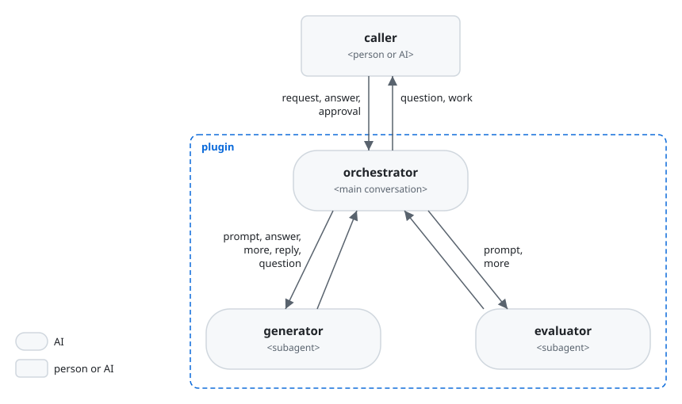
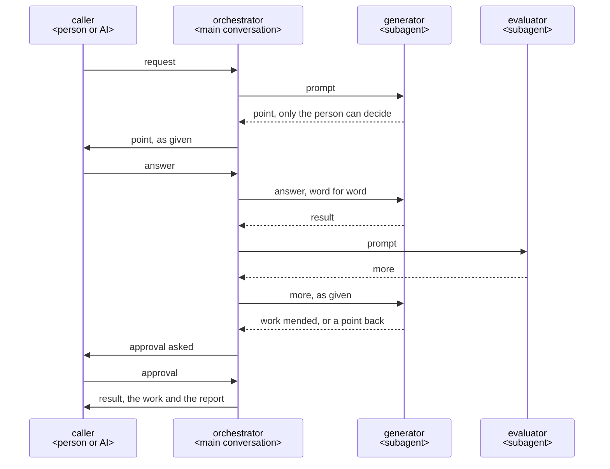

# Plugin development guide

This guide is for a Claude Code plugin whose roles work together to make a document, code, or
another work. A plugin takes from it what its requirements call for.

## Structure

### Components



- **caller**: the person, or the orchestrator of another plugin, that calls the plugin. The caller
  decides what is theirs.
- **orchestrator**: the AI that runs the work from the call to the result: the main conversation,
  the Claude Code conversation the person talks in, following the plugin's skill. Only it can ask
  the person.
- **generator**: a subagent that makes the work. A subagent started for one job, such as the
  generator or the evaluator, is a role.
- **evaluator**: a subagent that checks the work in its user's place. It did not make the work.

### Sequence



### Directory structure

```text
<repository>/
├── .claude-plugin/marketplace.json     the marketplace: the plugins it lists <JSON>
├── README.md                           leads users to each plugin's README, and developers to dev/ <Markdown>
├── LICENSE                             the repository's license
├── plugins/                            what runs on users' machines, installed by Claude Code
│   └── <plugin>/
│       ├── .claude-plugin/plugin.json  the manifest, holding the version and the dependencies <JSON>
│       ├── skills/<command>/SKILL.md   a typed command's entry, pointing to the orchestrator's part <Markdown>
│       ├── agents/<role>.md            an agent's entry <Markdown>
│       ├── scripts/                    each command that a role runs, pointing to its code in domain/ <Python 3>
│       ├── domain/                     the knowledge and rules of the plugin's work, apart from Claude Code
│       │   └── <role>.md               a role's part: the steps it follows <Markdown>
│       ├── images/                     the README's figures <SVG>
│       ├── LICENSE                     the plugin's own copy of the repository's license
│       ├── README.md                   for the plugin's users <Markdown>
│       └── CHANGELOG.md                what changed for users in each version <Markdown>
└── dev/                                what only the developers need, never installed
    ├── README.md                       how to build and check the plugins <Markdown>
    ├── plugin-development-guide.md     this document
    ├── images/                         the figures' style, and this document's figures <CSS, SVG>
    ├── scripts/                        the checks <Python 3>
    └── <plugin>/                       one for each folder in plugins/
        ├── README.md                   how to build and check the plugin <Markdown>
        ├── product-vision.md           the plugin's product vision, where it keeps one <Markdown>
        ├── architecture.md             the plugin's architecture <Markdown>
        ├── images/                     the architecture's figures <SVG>
        └── tests/                      the test cases, by when each runs, as Test says <Python 3>
```

An entry is a file whose form Claude Code fixes: a skill, an agent, a hook, or a command line. Its
part is the file in `domain/` that does the entry's job. An entry is named as its caller calls it,
such as the command a person types. A part is named by the role it holds, so a role's agent
`agents/<role>.md` points to `domain/<role>.md`, and the orchestrator's skill points to
`domain/orchestrator.md`.

Installing a plugin copies only its folder, so what only developers need stays in `dev/`. A
repository of one plugin keeps the same tree with one folder in `plugins/`.

## Principles

A plugin takes the principles its requirements call for. Each principle gives its rule, then why.
*When* marks a principle that a plugin takes only in the case it names.

### The domain apart from Claude Code

An entry holds only the form Claude Code fixes. It hands the rest of the job to its part in
`domain/`.

*Why*: a developer finds a job where the structure puts it, not by the command that calls it. Two
entries to one job do not drift apart. What the plugin knows outlives the agent it runs on
([ports and adapters](https://alistair.cockburn.us/hexagonal-architecture/)).

### An entry points to its part

A skill's or an agent's body points to its part, and says where each file the part names lies. The
part names each file by its name alone, never
by where it is installed. An agent reads its part in full before anything else.

*Why*: Claude Code makes an agent's body its system prompt, and reads no other file into it. After
`/compact`, a part that a skill links comes back in full. The skill's own body survives only as the
summary retells it. Claude Code replaces `${CLAUDE_PLUGIN_ROOT}` only in an entry's own body. It
does not replace it in what the Bash tool runs, nor in a file that Read reads
([environment variables](https://code.claude.com/docs/en/plugins/manifest-reference#environment-variables)).

### What a machine can see of the work

A script, a hook or the project's own tools check what a machine can check. For code, these are a
formatter, a linter, and a type checker. An AI reads only for what no machine can check.

*Why*: a tool finds the same thing every time, at once. An AI finds only some, and spends a round
on each.

### No check passes what it did not check

A check ends in one of three results: no problem, a problem, or could not check. The developer
decides beforehand what follows each result, and tests it. A hook whose script fails stops the
call, by `"onFailure": "block"` on its entry. A skipped test, a job that did not run or a command
that failed counts as no pass.

*Why*: a reader takes a check that stays silent when it could not check for one that found nothing.
Claude Code reads a hook that fails with no `onFailure` as no answer, which stops nothing.

### A rule that holds on every run

A hook of the plugin's own `hooks/hooks.json` holds each rule that must hold on every run, such as
a path that a role never writes. A permission rule or branch protection holds what is hard to undo.
The role's steps hold the rest.

*Why*: a hook runs every time, while an instruction is only advice
([best practices](https://code.claude.com/docs/en/best-practices)). A plugin's agent ignores
`hooks` in its own frontmatter
([plugin agents](https://code.claude.com/docs/en/plugins/components#frontmatter-fields-in-plugin-agents)),
so the hooks live in the plugin's `hooks/hooks.json`.

### Where a plugin writes its files

A plugin writes the files of its own run in these places. It writes what may be kept in the run's
folder, `.<plugin>/<yyyymmdd>-<name>/` at the root of the repository or of the plugin's own
worktree. It writes what it uses only while it runs in the system's temporary folder, under a name
that starts with the plugin's, its tests' files included. That folder is the one
`tempfile.gettempdir()` gives, and TMPDIR moves it. The plugin writes what must outlast an update in
`${CLAUDE_PLUGIN_DATA}`. It writes nothing in `${CLAUDE_PLUGIN_ROOT}`.

A deliverable that a run makes for the user is not a file of the run. It lies where the
repository's layout or the tool that reads it puts it. For example, rn writes a best practice that
it makes in `.rn/best-practices/<kind>/`, where every later run looks for it.

*Why*: one folder named after the plugin lets the user choose with one line of `.gitignore` whether
git keeps it. The system clears its temporary folder, so a stopped run leaves nothing behind. An
agent reads without asking only inside the working folder
([working directories](https://code.claude.com/docs/en/permissions#working-directories)).
`${CLAUDE_PLUGIN_ROOT}` changes with each update. The user and their tools look for a deliverable
where the layout or the tool puts it, and would not find it in the run's folder.

### Asking for what lies outside the work

When something outside the work stops it, such as a permission or a tool, the role asks for it. The
role goes on with the rest meanwhile, and never looks for a way round.

*Why*: the person clears such a cause in a moment. A way round leaves the work checked on other
terms than its purpose set.

### The caller approves what is theirs

The caller decides what is theirs, and what is hard to undo, such as a merge. Such a point counts as
approved only by the caller's own action, such as a skill the AI cannot call
(`disable-model-invocation: true`). Only a skill that approves, or whose work is hard to undo, is
kept from the AI; a skill that starts, picks up, or pauses work stays one that an AI can call, so
that an AI can give out work.

*Why*: an AI that decides for the caller leaves them answerable for what they never saw. An approval
that an agent can give itself stops nothing.

### Languages

A plugin talks in the person's language, and writes the repository in the repository's language.
It proposes both languages first. It shows the person exactly what it writes.

*When*: a plugin that talks with a person.

*Why*: the person approves what they read. Others read the repository later.

### The orchestrator holds the whole and decides

One orchestrator talks with the caller, holds the run's state, and decides each move. It starts
each role, so it carries each point that a role has for the caller, as [Messages](#messages) says.
Where the plugin's work runs over many turns, the main conversation holds the talk with the caller
and the review of the run's state, runs a script for each step with one right result, and starts
each role, so that its context holds the talk, the scripts' short results, and the roles' results.

*When*: a run of steps that depend on what the last one found.

*Why*: only the one who holds the whole run can weigh what each move brings, and answer the caller's
"why"
([building effective agents](https://www.anthropic.com/engineering/building-effective-agents)). A
talk about the plan needs both the talk and the run's state, and a subagent started afresh at each
event holds neither from one reply to the next. What fills a main conversation's context over many
turns is the work that a script or a role does in its place, so the main conversation hands that
on.

### Where the orchestrator runs

The orchestrator runs in the main conversation, started by the plugin's skill
`skills/<command>/SKILL.md`, whose part is `domain/orchestrator.md`. A person calls it by typing
the command. An AI calls it by the same skill, as the orchestrator of its own plugin runs in the
main conversation too. A role that needs the person ends with its point, and the orchestrator puts
the point to the person, as [Messages](#messages) says.

*When*: a plugin with an orchestrator and roles.

*Why*: only the main conversation can ask the person
([subagents](https://code.claude.com/docs/en/sub-agents#available-tools)). An orchestrator run as
an agent would leave the main conversation a layer that only carries its points, and each answer
would resume the orchestrator before the role. The run keeps its state in its files, so a
compacted or new conversation goes on from them.

### Each event's steps in the orchestrator's part

Each command that the person types, such as one that starts the run, approves what it put up, or
pauses it, is an entry alone: its `skills/<command>/SKILL.md` points to `domain/orchestrator.md`.
That part holds the steps of each event, a command, an answer, or a role's end, and the steps that
every event shares.

*When*: a plugin with an orchestrator and roles.

*Why*: a skill of such a plugin converts and checks nothing that comes from outside, so it has no
job of its own. An answer and a role's end call no skill, so the orchestrator finds their steps
only in its part, and one part that holds every event's steps shows the whole course in one place.
A part that a skill names comes back whole after `/compact`.

### A plugin that uses another

A plugin that has another plugin do a job takes the part of it that does the job. Where one role
of the other plugin does the job, the orchestrator starts that role as one of its own, and puts its
points to the person as [Messages](#messages) says. Where the job is the other plugin's whole run,
the orchestrator calls the other plugin's skill, follows its steps in the same main conversation,
and goes back to its own steps once the other hands its work back.

*When*: a job another plugin already does.

*Why*: the other plugin runs as it was built and tested. Nobody writes any of it again.

### One agent for each job

Each job has its own role, and the role gets only what the job needs.

*When*: a work with jobs that need different context or tools.

*Why*: a role starts in a fresh context, so nothing from other work leads it astray
([subagents](https://code.claude.com/docs/en/sub-agents)).

### Messages

The orchestrator puts each point that a role has for the person to the person, as given, and gives
the role the person's answer word for word: within a session by SendMessage, which resumes the role
with its whole conversation
([resume subagents](https://code.claude.com/docs/en/sub-agents#resume-subagents)), and in a new
conversation in what it gives the role's fresh start from the run's files.

*When*: a plugin with an orchestrator and roles.

*Why*: a subagent's last message reaches only the one who started it, and only the main
conversation can ask the person ([subagents](https://code.claude.com/docs/en/sub-agents)). So the
orchestrator, which starts every role, puts each point to the person. A point reworded on the way is
a question that the role did not ask, and an answer summed up loses what the person meant.

### The form of a file

A file that a plugin reads is JSON with a schema, and a script checks its form. Its nesting follows
how its parts relate: a part that belongs to one other sits inside it, and a part that several
others rest on is named by its path or ID, as a design tree names each deliverable's inputs. After
the AI changes a part, a script lists the parts that the change touches, and the AI reads each, as
[the design tree best practice](../plugins/rn/domain/best-practices/design-tree/best-practice.json)
asks after a change to a node. A file that shows the form of a deliverable, such as a template, is
in the deliverable's own format.

*When*: every plugin.

*Why*: a script finds a file out of form before anyone reads it. A part changed by finding an ID or
a word leaves the parts around it unread, and they drift. Nesting puts a part where its one parent
is read with it, and the list of the parts a change touches brings each one that several rest on
before the AI. A template in another format would show a form that the deliverable cannot take.

### Asking until nothing is left to decide

The orchestrator asks the caller every point that only they can decide, one at a time, with a
recommendation. It finds facts itself, and shows each fact the work rests on. It decides everything
else, and reports it.

*When*: a plugin with an orchestrator and roles.

*Why*: a point settled before the work does not come back as rework. A question about what the
caller does not care about spends their time on the plugin's job
([grilling](https://github.com/mattpocock/skills/blob/main/skills/productivity/grilling/SKILL.md)).

### Read by those who did not make it

An evaluator that did not make the work checks it first, in the place of the work's user, toward
that user's aim. The evaluator puts each question of the checklist in `good`, with the lines that
meet it, or in `more`, with `good_when`, by what that aim needs. `good_when` says what the user gets
once the work is good, never how to make it.
Where the caller reads the whole work to approve it, such as a plan, no evaluator reads it first:
the caller is its first reader.

*When*: a work whose user gets something no machine can check.

*Why*: the generator reads what it meant, not what it wrote. A hunt for defects finds something in
every work, and never ends, while the user's aim says which questions matter how far. The generator holds the sources, so how to mend is its call
([harness design](https://www.anthropic.com/engineering/harness-design-long-running-apps)). An
evaluator before the caller adds a reading the caller makes anyway.

### Learning from each run

Once the caller approves the work, the orchestrator looks once through what the run kept for what
fell short, and finds why. It quotes each cause from the run's files. It puts a lesson of the
project's own into the project's rules. It sends a general lesson to the plugin's repository as an
issue, only when the user says yes.

*When*: a plugin that a person calls.

*Why*: a lesson met once improves every later run. The user chooses what leaves their project.

## Development

### Python 3.9 and the standard library

What runs on users' machines needs only Python 3.9 or later and its standard library.

*When*: users' machines may lack other runtimes or packages.

*Why*: python3 is wherever git is. A plugin installs no packages.

CI runs the checks on Python 3.9 and on the newest Python.

*Why*: only a run on 3.9 shows that the code still runs there, and 3.9 runs some lines otherwise,
such as which lines coverage counts. Only a run on the newest shows what a new Python breaks, and
the tools that check the tests need it.

### A script that a role runs

A step that has one right result runs a script, which the step names with its exact command and the
form of its output, so that the role runs it and never reads it. Each script acts on one thing, such
as the run's design tree, and takes each operation on it as a subcommand, named `noun verb`, such as
`tree.py commit`. It handles each error it can meet, and its message says what's wrong, where, and
how to fix the input. Where a role changes many things at once, it writes the plan as a file, and a
script checks the plan before another applies it. Each constant of a script carries its reason
beside it.

*When*: a plugin whose roles take a step that has one right result.

*Why*: a script does the step the same way every run, and only its short output enters the role's
context
([skill authoring best practices](https://platform.claude.com/docs/en/agents-and-tools/agent-skills/best-practices#provide-utility-scripts)).
An error left to the role costs it a turn to work out, while a message that says how to fix the
input lets it go on at once
([solve, don't defer](https://platform.claude.com/docs/en/agents-and-tools/agent-skills/best-practices#solve-dont-defer);
[Command Line Interface Guidelines](https://clig.dev/#errors)). A plan checked before it applies
catches a wrong change before it touches anything
([verifiable intermediate outputs](https://platform.claude.com/docs/en/agents-and-tools/agent-skills/best-practices#create-verifiable-intermediate-outputs)).
Subcommands of one script for one thing keep related operations together and easy to find, and
`noun verb` is the common order ([subcommands](https://clig.dev/#subcommands)). A constant with no
reason leaves the next developer, or the role, no way to tell its right value.

### Code kept once

A plugin keeps code that more than one plugin needs once, in the plugin whose job it is, and the
other plugins depend on that plugin.

*Why*: the developer writes, tests and fixes the code in one place.

### A folder that holds all the plugin needs

The plugin's folder holds everything that the plugin needs, its own LICENSE among them, and reaches
anything else only by a URL or through a plugin that it depends on. A plugin uses another only one
way: it names the other in `dependencies` of its `plugin.json`, and the other uses nothing of it.
Where the other lies in another marketplace, the plugin's marketplace names that one in
`allowCrossMarketplaceDependenciesOn`.

*Why*: Claude Code copies only the plugin's folder when it installs the plugin
([in-place and copied plugins](https://code.claude.com/docs/en/plugins/loading#in-place-and-copied-plugins)),
and a person may share the folder alone, so a file outside it isn't there for the user. Two plugins
that depend on each other can't change or install alone.

## Test

A plugin's code is checked on each push: the unit tests of its scripts, the static analysis of its
code, and the coverage of every line and branch of it by the unit tests. Its prompts are checked by
an end-to-end (E2E) run alone: the user runs a real request through the plugin, and the developer
watches the run and proposes each fix with its cause. Its architecture's Test strategy sets the
tools and the criteria. This section holds only what every plugin adds to them.

*Why*: a script gives one right result for each input, so a unit test checks it whole and in a
moment. A prompt's result varies from run to run, and a test that plays a prompt's part checks
only what its writer copied of the prompt, so only a real run checks the prompts and how the
scripts serve them.

### Each case a test with its Given, When, and Then

Each test case is a pytest test of the plugin's code. Its docstring states its Given, When, and
Then, a line each. A plugin's cases lie in `dev/<plugin>/tests/unit/`.

*Why*: the docstring says what the case holds in the words of the requirement, so a reader sees
what breaks where it fails without reading its code.

### Each result of a double from a record

A double of something outside the product, such as `gh`, gives each result from one
line of a JSONL file in the `recorded/` folder beside it. It takes the line by
`line("<record>", "<event>")`, or a run of lines by `lines("<record>", "<first>", "<last>")`, each
name written out as a string or as a name that its module sets to one. Each line names itself by
`event`, once in its file. A record of a run of the real thing names that run by its file's name,
`<thing>-<version>[-<what>].jsonl`. A line taken from the documentation lies in a file whose name
holds no version, and carries `source`, the URL of its page, and `shows`, the words of the page that
show it. `trace.py doubles`, which `check.sh` runs on each push, checks each line of each record and
each name that a double gives. `trace.py sources`, which CI runs each night, checks that each
page still shows its words.

*Why*: a double that gives what the real thing never would passes a test that the real one fails,
as the architecture best practice says of a double's source. A result taken from a line by names
that a script reads leaves no result whose source no one can check, where a result written in code
or named in a comment leaves one. A page changes apart from any push, so a check of it on each push
would fail for a change that the push didn't make, and it runs with the checks of the tests.

## Release

### The manifests checked

Each plugin and the marketplace pass `claude plugin validate --strict`.

*Why*: a malformed manifest fails every user at install.

### The version and the CHANGELOG

A plugin is released only when whoever decides what reaches users says so. `plugin.json` holds
`version` once, in semver. The largest change that users see decides which part of it rises. The
CHANGELOG, in [Keep a Changelog](https://keepachangelog.com) form, gives each change that users
notice one line, with why it helps them. `claude plugin tag --push` tags each release
`<plugin>--v<version>`. `.claude-plugin/marketplace.json` and the root README list each release.

*Why*: users get an update only when the version rises. `plugin.json` wins over the marketplace
entry. A dependency's version range resolves against these tags.
