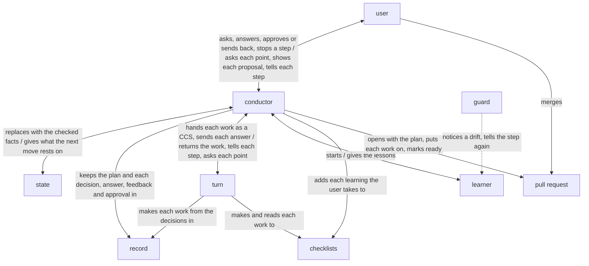

# rn architecture

rn is built on [how a plugin works](../architecture.md) so that a piece of work asked for in rough
words reaches the user's purpose while they only answer, against two drifts: the work drifting from
the purpose, and the AI itself drifting as the work goes on. The conductor, the one AI that talks
with the user, decides every move from a short state it replaces at each one, and has each work
made through turn; the user, the goal, the key results, and what a point to decide, a sign-off, a
task and a learning are, are in [rn's UX](ux.md).

rn holds the [principles every plugin holds](../architecture.md#principles), named below
Principle 1 to 8, and its own, named below rn's Principle 1 and 2:

1. Every task traces back to the purpose, through the acceptance criteria it serves.
2. At every move the conductor replaces a short state with the checked facts alone, and replans
   from that state alone.

## User stories

- As the user, I want to ask for a piece of work in rough words with `/rn:up <what I want>`.
- As the user, I want to answer each point to decide and each learning rn puts to me, one per
  message, with an option's letter or in my own words.
- As the user, I want to approve the proposal at each sign-off with `/rn:ty`, or ask for a change
  with `/rn:gm <feedback>`.
- As the user, I want to be told before and after each step what rn does, and to stop a step going
  a way I do not want.
- As the user, I want to go on from where I stopped with `/rn:up` in a fresh conversation.
- As the user, I want to merge the pull request rn marks ready.

## Architecture

### Logical view



- The arrows run in the order of the UX's From asking to the merge; the user meets only the
  conductor and the pull request.
- The work is kept from drifting from the purpose in two ways: each task names the acceptance
  criteria it serves and its result is checked against them (rn's Principle 1), and after every
  move the conductor replans from the facts that move brought (rn's Principle 2).

  A task that serves no criterion is work the purpose did not ask for, and a plan kept from what
  was expected drifts from the purpose while every move looks done.
- The AI is kept from drifting itself in two ways: the conductor carries only the state from move
  to move, and each rule a machine can judge is held where the AI acts, as
  [The guard tells each role its steps again](../architecture.md#the-guard-tells-each-role-its-steps-again)
  says: the conductor, in the main conversation, by rn's scripts that keep the plan, the state and
  the record, an approval by `/rn:ty`, and the default branch by GitHub's branch protection; each
  subagent by the guard, laid with lane.

  A conversation that carries the whole of a long piece of work swells, and a fresh one starts
  from nothing; a rule written only in words is followed by chance.
- The state is ACC's CCS, the shape [ACC](https://arxiv.org/abs/2601.11653) gives an AI's state,
  kept in `state.json`; at every move the conductor replaces it whole with the facts that move
  brought, each checked, such as the user's answer, turn's result and the output of what was run,
  and decides the next move from it and the files it names alone (rn's Principle 2).

  A fact taken unchecked carries a slip into every move after it, and a state added to rather than
  replaced swells as the conversation would.
- Each work, the plan, each document, each task's result, each checklist made and the finished
  work, goes to turn as a CCS holding the work, its receiver, what they use it for and have with it,
  its checklists, the decisions it is made from, the plan for every work but the plan itself, and
  rn's checklist for a fix; turn's first user uses it in the receiver's place before it comes back
  (Principle 4).

  turn takes its task as a CCS and makes the work from it and the files it names alone, so the work
  does not stray from what was decided.
- No work turn returns is fixed by the conductor: what would be a fix is settled before turn runs,
  as a decision, and a change the user asks at a sign-off goes into the decisions, and turn goes on
  from its last step.

  The conductor only talks and decides (Principle 1); a fix of its own would be work no guard keeps
  and no first user reads.
- While turn runs, the conductor passes each line turn tells on to the user and each point turn
  asks to the user as a point to decide, keeps the answer in the decisions, and sends it back; it
  judges none of turn's lines, and stops the run when the user stops a step.

  Only the main conversation talks with the user
  ([Where the orchestrator runs](../architecture.md#where-the-orchestrator-runs)); a conductor that
  judged each way turn takes would ask the user more than what is theirs (Principle 2).
- Every decision, answer, feedback and approval is in the record before the move after it, so any
  stop is a place to go on from, and rn has no command to pause (Principle 6).
- An approval is the user's `/rn:ty`, and feedback their `/rn:gm`, both skills the AI cannot call
  ([The caller approves what is theirs](../architecture.md#the-caller-approves-what-is-theirs)).
- At a sign-off, the conductor shows the proposal the UX's Sign-offs gives, made from the record
  alone.

  So it says nothing turn's first user did not read.
- At each sign-off, once the user answers it, the learner of
  [Principle 8](../architecture.md#learning-from-each-run) reads the stretch of the record since the
  sign-off before whole, its history on the branch and the files as they are now, and searches the
  conductor's conversations of that stretch for what only they show, such as the form of each
  message to the user; its lessons are kept in the record, and once the user approves the finished
  work, they and those turn returned with each run of each work, read from every result kept on
  the branch, are the learnings the conductor puts to the user.

  turn's learner reads turn's runs alone, so a slip of rn's own steps shows only to a learner of
  rn's; a stretch ends where the user sent the work back or approved it, so what led there is near,
  and is small enough to read whole, where a whole piece of work is not; the learnings wait for the
  end, as each put to the user mid-way is a stop in the work.

### Physical view

```
rn/                                  the plugin, installed by Claude Code with turn
├── skills/
│   ├── up/SKILL.md                  the conductor for /rn:up <skill>
│   ├── ty/SKILL.md                  the conductor for /rn:ty, which the AI cannot call <skill>
│   └── gm/SKILL.md                  the conductor for /rn:gm, which the AI cannot call <skill>
├── agents/
│   └── learner.md                   the learner <agent>
├── scripts/                         a work's CCS, the state, a kind's checklists, the proposal, the user's answer, the learner's records <Python 3>
├── forms/learnt.json                the learner's reply, a link to turn's <JSON Schema>
├── hooks/
│   ├── hooks.json                   the lanes, laid by lane:up
│   └── lane/                        lane's code, the guard, a link to lane's <Python 3>
└── checklists/                      rn's own, one per kind <Markdown>

<the user's repository>, on the piece of work's own branch
└── .rn/
    ├── checklists/<kind>.md         the user's addition for a kind <Markdown>
    └── <yyyymmdd>-<slug>/           the record of one piece of work
        ├── steering.md              the plan <Markdown>
        ├── decisions/<work>.decisions.md
        ├── ccs/<work>.json          the CCS each work goes to turn as <JSON>
        ├── ccs/<work>-result.json   what turn returned for it <JSON>
        ├── learnt/<n>.json          the learner's lessons of each stretch, each ground named by where it is <JSON>
        └── state.json               the state, ACC's CCS <JSON>
```

- rn runs on Claude Code, python3 3.9 or later, jq, git and `gh` logged in to an account that can
  push to the repository; turn is installed with rn as its dependency, and the guard is
  [lane](../../lane/README.md)'s.
- The conductor is rn's skills, run in the user's main conversation on the model they run it on.
- The conductor starts `turn:up` in the background with the CCS's path, its kinds and where the
  result goes, answers turn's points by SendMessage, and stops a run with TaskStop, as
  [turn](../../turn/README.md) is called.
- The record is kept by a commit and a push to the piece of work's branch, made by the conductor
  alone, through rn's scripts; the states before the current one are in the history of
  `state.json`, and the options weighed with their reasons and each feedback with its answer in the
  commit messages.

  A push is what a fresh conversation, or another machine, reads from.
- The texts the learner reads are written in the repository's git folder, where nothing is
  committed, and removed once its lessons are kept.
- The pull request is a draft pull request on GitHub of that branch, opened and marked ready with
  `gh`; a learning's issue is opened with it on `lovaizu/ccpm`, on the user's yes.
- rn's checklists are read-only in the plugin; the user's additions are in their repository and go
  into the piece of work's pull request.

## Verification

### Units

Each skill and agent is checked on Claude Code's default model, the one users run rn on, with
`bypassPermissions` in a Docker Sandbox as rn's README has its users run it, and judged from the
records of every conversation and agent the check started.

- rn's scripts: each gives what this architecture says it gives, for every input it may receive.
  - Flow: unittest in `dev/rn/tests/`, fed the record, turn's results and the checklists each
    reads, by [`dev/check.sh`](../check.sh) with lines and branches 100% covered and by
    [`dev/mutate.sh`](../mutate.sh) with no mutant surviving, with Hypothesis wherever an input
    varies.
- The lanes: `hooks/hooks.json` holds the lanes the steps call for, and each step its sentence.
  - Flow: unittest reading the agents and `hooks/hooks.json`; each lane's check is tested in lane.
- The conductor: takes each move in this architecture's order, from `/rn:up` to the pull request
  marked ready.
  - Flow: on the smallest request that reaches each of the skills' moves, one point to decide, one
    acceptance criterion, one document and one task, with turn stood in for by an agent giving a
    result set beforehand and the user by answers set beforehand; passes when the records show each
    move in this architecture's order, each lane stopping where its check should, and the branch
    holding a new `state.json` after each move.
  - Content: the messages, decisions, states, plans and proposals it makes on the real requests;
    passes when each message is in the UX's form, each decision is as the user answered, each
    state and replan rests only on the checked facts of the move before it, and each proposal says
    only what the record holds, read against the records.
- The learner: each lesson quotes from the records the words it rests on.
  - Flow: started on its own on a piece of work of two stretches set beforehand, the first's
    lessons kept, the second holding a slip of the conductor's steps the record shows and one only
    a conversation shows; passes when each is a lesson with its words quoted and nothing of the
    first stretch is shown.
- rn's checklists: what is made with them on the real requests.
  - Content: each change sent back at the deliverable sign-off is traced to the checklist or the
    skill it comes from, and fixed there; the fix passes when, on the same real requests run again,
    that change is not sent back and every story is still achieved.
- turn and lane are checked by their own architectures.

### Acceptance

Each trial runs in `lovaizu/playground`, one at a time, on a branch of its own, removed with its
pull requests after, from code kept in `dev/rn/trials/`. The real requests are kept there too, the
same for each version compared: pieces of work asked of rn in a user's rough words, each with the
purpose a stand-in user, an AI, holds behind them and does not write in the request.

- Flow: from `/rn:up` to the pull request marked ready, on the smallest request above, with
  stand-ins for turn and the user; each move shows in the records and in the commits on the branch,
  in this architecture's order.
- Asking in rough words: from a request of a few words, the points to decide reach the stand-in
  user, and the plan holds its purpose; played with real turn.
- Answering each point: every point and every learning came one per message, and each answer shows
  in the decisions and in the work it settles.
  - The stand-in user answers with letters and in its own words, and the record is read against
    the conversation.
- Approving or asking for a change: `/rn:ty` passes the sign-off, and `/rn:gm` brings the same
  sign-off back with what changed.
  - The stand-in user sends back once at each sign-off, then approves.
- Told and stopped: a line reaches the user before and after each step of the tasks, and a step the
  stand-in user stops goes the way it then says.
  - Read from the stand-in's conversation against the conductor's moves.
- Going on: from each place the user may stop, while asking, at a sign-off and during the tasks,
  `/rn:up` in a fresh conversation goes on with nothing asked again and nothing lost.
  - The stand-in user's conversation is closed at each, and a fresh one started.
- Merging: the pull request marked ready holds the finished work and every addition taken, and
  merges.
  - The stand-in user merges it.
- KR1.1: the changes the stand-in user sends back at the deliverable sign-off, as the UX's KR1.1
  says.
  - Counted for rn and for the version in use, the latest released rn, on the real requests.
- KR1.2: the user's time from asking to the purpose achieved.
  - Read from the timestamps of the stand-in user's conversation in its parts, answering, checking
    proposals, sending back and doing by hand, and compared with the version in use on the real
    requests; a part that adds nothing to the stories or KR1.1 is cut first.

A change is taken when every story is still achieved and KR1.2 does not come closer at the cost of
KR1.1.
