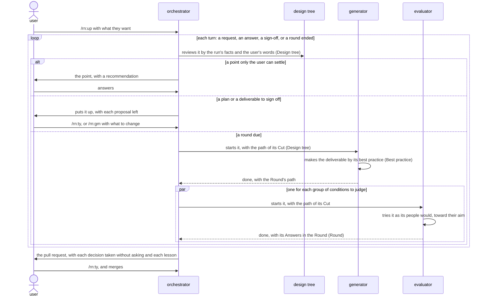

# rn architecture

## User stories

- S1: the user wants to ask in their own words, so that they get what they mean with no specification.
- S2: the user wants to decide only their own points, one at a time, so that their time goes there.
- S3: the user wants to approve or ask a change at each sign-off, so that nothing rests on a
  misreading.
- S4: the user wants to pause a run at any moment, so that they lose neither time nor work.
- S5: the user wants to resume a paused run in any conversation, so that it goes on where it stopped.
- S6: the user wants one pull request with rn's decisions and lessons, so that they merge knowing
  its content.
- S7: each of rn's developers wants each signed-off lesson in rn's issues, so that they improve rn.

## Solution strategy

### Principles

rn piles up the vital few that bring a deliverable's people to their aim, and cuts the trivial many.


#### Toward the people's aim

At each turn, the orchestrator reviews the design tree by the run's facts, asking the user only
theirs.

*Why*: a tree kept as first laid out piles up work that the people never use, raising KR1.1 and
KR1.2.

#### Judged as its people would

Each evaluator, given only what the people have, answers each condition with what's good and what
would make it good.

*Why*: an evaluator with the maker's intent judges for someone else, raising KR1.1.

#### Content, then structure, two rounds each

Rounds make content by the kind's best practice, then structure by the refactor one, two rounds each
at most.

*Why*: a third round ends as the second did, so a `more` left goes to the user, keeping KR1.2 short.

#### Each role from its own cut

Each generator and evaluator starts from its Cut alone, and keeps its content in files, handing back
a short result.

*Why*: a role that reads others' decisions makes what the user didn't mean, raising KR1.1.

#### Held by Lane where a skip costs the people

Lane holds each role to its best practice and the evaluator from the design tree, leaving sign-offs
to the user.

*Why*: an AI that skipped a step once skips it again, raising KR1.1.

#### The work lives in files

The run's state lives only in its folder, committed at each change, so `/rn:up` goes on in any
conversation.

*Why*: work kept only in a conversation that ends makes the user answer or wait again, adding to
KR1.2.

### Components

- user\
  Gives the request and each point, sign-off, and lesson that's theirs, pauses the run, and merges.
- rn's developers\
  Change rn's own best practices by each lesson that reaches rn's repository.
- orchestrator\
  At each turn, the main conversation reviews the design tree, asks the user, and starts each round
  due.
- generator\
  Makes a deliverable from its Cut with only what brings its people closer.
- evaluator\
  Finds, as the deliverable's people toward their aim, what's good and what would make it good.
- design tree\
  Holds the goal, the deliverables with their decisions, and the work order, each edit checked by
  `tree.py`.

Strategies:

- The main conversation as the orchestrator\
  The talk and the run share one context, so no part relays between them, keeping KR1.2 short.
- One generator for each deliverable, and one evaluator for each group of conditions\
  The evaluators judge side by side, each group in its own context, keeping KR1.1 low and KR1.2
  short.
- A later round judging only the conditions whose decisions changed\
  A condition judged again with nothing changed ends as before, adding to KR1.2.

### Data model


- Design tree\
  The run's decisions in
  [the design tree best practice](../../plugins/rn/domain/best-practices/design-tree/best-practice.md)'s
  form, a role's Cut being its part.
- Best practice\
  The field's established way of making a deliverable of one kind: its necessary conditions, and
  the practices that meet them.
- Round\
  One making of a deliverable and its judging: what the generator made, and each evaluator's
  Answers, `good` or `more`.

### Sequences

#### S1: a turn and a round



Strategies:

- `/rn:dn` committing and pushing the run's folder, and `/rn:up` picking up from it\
  Each role stopped starts again from its kept Cut, so the user loses neither time nor work,
  keeping KR1.2 short.

### Deployment


The user installs rn as [the README](../../plugins/rn/README.md#installation) says, which installs
Lane, and types `/rn:up` at their repository's root.

Strategies:

- rn's own git worktree for each run\
  The user goes on with their work, and a pause leaves nothing of theirs to set right, keeping KR1.2
  short.
- A best practice made on a run in `.rn/best-practices/<kind>/`\
  Every later run finds it and takes it over rn's own of its kind, keeping KR1.1 low.

### Directory structure

rn's folder holds what Claude Code installs for the user. `dev/rn/` holds what only rn's developers
use. `.claude/worktrees/` holds rn's worktree of each run. `.rn/` holds what rn writes on the work's
branch: [the run's folder](../plugin-development-guide.md#where-a-plugin-writes-its-files) and each best practice made on a run.

```text
plugins/rn/
├── skills/                        /rn:up, /rn:dn, /rn:ty, and /rn:gm
├── agents/                        the generator's and the evaluator's starts
├── domain/
│   ├── orchestrator.md            what the main conversation does as the orchestrator
│   ├── generator.md               what the generator does
│   ├── evaluator.md               what the evaluator does
│   ├── schemas/                   the form of each Cut, result, Sign-off, and Start
│   ├── tree/                      the code of tree.py, which checks the design tree
│   ├── check/                     the code of check.py, which checks each result
│   └── best-practices/            rn's own best practice of each kind
├── scripts/                       runs each part's code
└── hooks/                         Lane's rules laid from each role's steps

dev/rn/
└── tests/                         the test cases, from unit to E2E

.claude/worktrees/
└── rn-<yyyymmdd>-<goal>/          rn's worktree of one run, on the work's branch

.rn/
├── <yyyymmdd>-<goal>/             one run
│   ├── design-tree.json           the design tree
│   └── rounds/                    each Round
└── best-practices/                each best practice made on a run
```

## Test strategy

Each test case lies in `dev/rn/tests/`, written as Given, When, and Then before anyone builds a part.
`dev/scripts/trace.py` checks that each names an element or a case one level up.

| Check | Test target | Kind | Exit criteria or measure |
|---|---|---|---|
| Lint | Parts | Quality | ruff: 0 findings. |
| Static analysis | Parts | Quality | pyrefly, and pylint's duplicate-code and cyclic-import checks: 0 findings. |
| Complexity analysis | Parts | Quality | complexipy and ruff: per function, McCabe 10, cognitive 15, 6 returns, 12 branches, 5 arguments, 50 statements at most. |
| Unit testing | Parts | Quality | pytest, with the double of Claude Code: every case passes. |
| Unit testing | Parts that hold a prompt | Benchmark | `claude -p` on Opus: each case's results over several runs, read by code from each run's record. Runs per case: 3, as no case's runs differed. |
| Code coverage | Parts | Quality | coverage: 100% statement (C0) and branch (C1) coverage. |
| Property-based testing | Parts | Quality | hypothesis: 0 counterexamples in reading the design tree, the records, and the adapters' input. |
| Mutation testing | Parts | Quality | cosmic-ray: 0 surviving mutants. |
| Integration testing | Architecture | Quality | pytest, with the double of Claude Code: every case passes, each handoff giving the data the data model names. |
| Contract testing | Architecture | Quality | `dev/rn/tests/gh/compatibility.py` on each new gh: each recorded command gives what its line shows. Claude Code's is Lane's test. |
| Traceability | Architecture | Quality | `dev/scripts/trace.py`: every element tested, every case naming one level up, each rule's case failing broken. A review: 0 cases that miss what their element says. |
| Scenario testing | Product | Benchmark | `dev/scripts/e2e.py` on the walkthrough, the key results KR1.1, then KR1.2, over several runs. A stand-in of each deliverable's people tries it, and code checks. Runs: added until one more moves no mean by a step. |
| Installation testing | Product | Quality | `dev/scripts/e2e.py`: rn installs by the README's commands in a fresh home, and `/rn:up` answers. |
| Configuration testing | Product | Quality | CI's Tests on Python 3.9 and the newest Python: every case passes on each. |
| Conformance and compliance testing | Product | Quality | `claude plugin validate --strict`: passes. |
