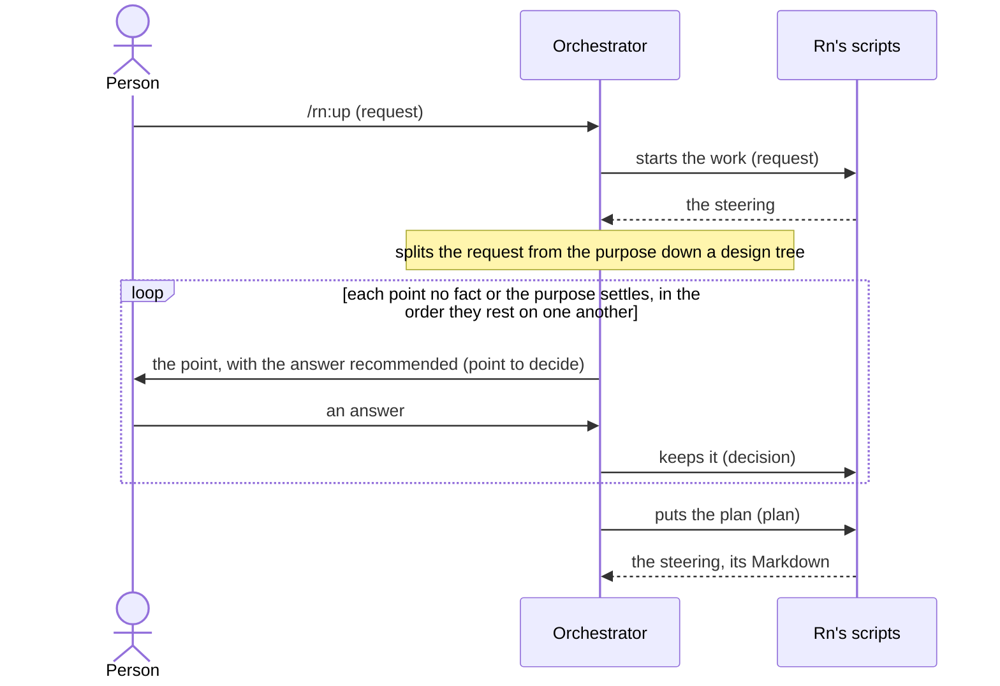
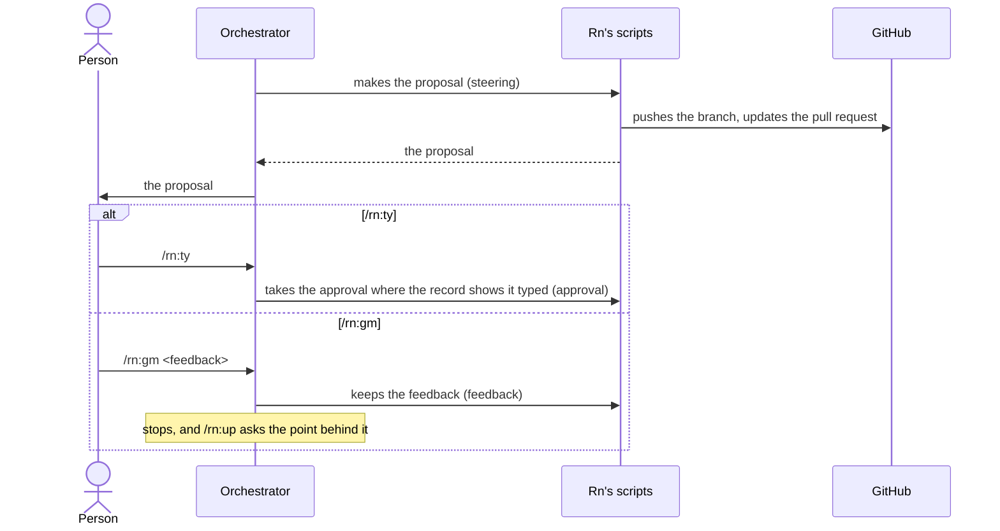
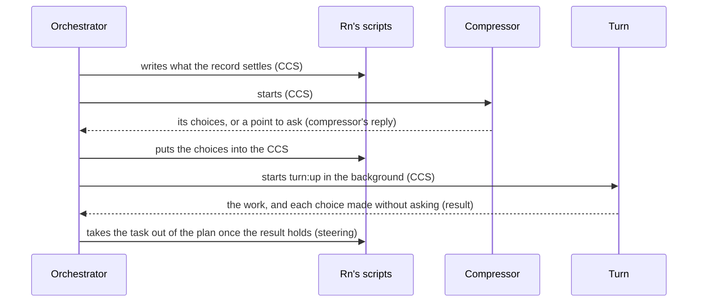
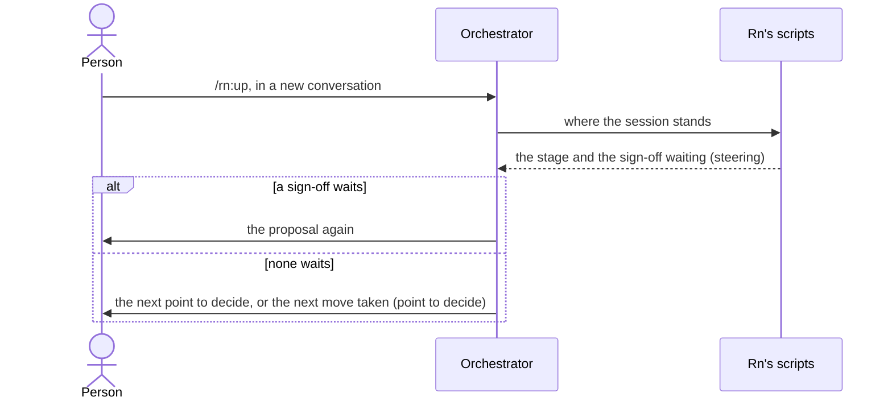
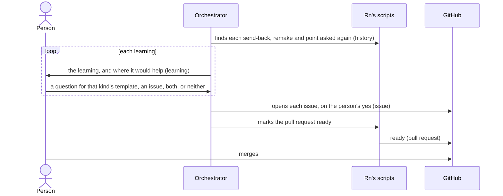

# Rn architecture

The orchestrator, Rn's one AI that talks with the person, decides every move from the steering, a
short record of the plan kept by Rn's scripts, and has Turn make every work but the plan and the
learnings. Rn is built against two drifts: the work drifting from the purpose, and the AI drifting as
the work goes on. The experience this delivers is in [Rn's UX](ux.md).

## Principles

Rn follows [the plugin best practice](../plugin-best-practice.md#principles), and adds these.

### Every task traces back to the purpose

Each task names the goal or the acceptance criteria it serves, and its result is checked against
them.

A task that serves no criterion is work the purpose did not ask for.

### The points are asked down a design tree

The orchestrator splits the request from the purpose down, each point joined to what it serves and
to what it rests on, and asks the person, one per message, only the points that no fact or the
purpose settles, in the order they rest on one another.

A point asked as it comes to mind leaves a gap that shows only at a sign-off, and one asked before
what it rests on is asked again.

### The plan is made again from the facts

After each task the orchestrator sets where the work stands from the checked facts alone, and writes
the plan again where they change it.

A plan kept from what was expected drifts from the purpose while every move looks done.

### Only the steering is carried from move to move

The orchestrator carries the steering alone, and what each work is made from is taken from the
record, not chosen by the orchestrator's conversation.

A conversation that carries days of work swells and drifts, and a fresh one starts from nothing.

### An approval is what the person typed

An approval is the person's `/rn:ty` and feedback their `/rn:gm`, skills the AI cannot call, and
Rn's scripts take either only where Claude Code's record shows the person typed it after the
proposal
([The caller approves what is theirs](../plugin-best-practice.md#the-caller-approves-what-is-theirs)).

The orchestrator runs Rn's scripts itself, so a script that took its word would take an approval
never given.

### The orchestrator fixes no work Turn returns

A point where Turn's work falls short is settled as a decision, and Turn makes the work again.

A fix of the orchestrator's own is work that no AI other than its maker has read.

## User stories

- As the person, I want to ask for a piece of work in rough words with `/rn:up`. Carries O1's
  request.
- As the person, I want to answer each point to decide, one per message, with a letter or my own
  words. Carries O1's points.
- As the person, I want to approve each proposal with `/rn:ty`, or ask for a change with `/rn:gm`.
  Carries O1's sign-offs.
- As the person, I want each document and the finished work made to the goal while I do not watch.
  Carries O1's documents and finished work.
- As the person, I want to type `/rn:up` alone in a new conversation another day, and go on where
  the work stands, asked nothing again. Carries O1's going on another day.
- As the person, I want to decide where each learning goes, and get the pull request marked ready.
  Carries O1's learnings and the merge.

## Logical view

### Components


- The orchestrator alone talks with the person and decides each move. It writes the plan and the
  learnings itself, with Turn's plan template open.
- The compressor alone gives the part of a work's CCS that needs judgment, from the steering, the
  works made and the work's latest call. It decides no place or rule itself: a point no file or
  decision settles goes back to the orchestrator, which asks the person.
- Rn's scripts alone write the steering and each CCS, make each proposal, and take an answer only
  where it was typed.
- Turn makes every other work from its CCS, and has it used in its receiver's place before it
  returns it.

### Data model


- The steering holds only what is left and where the session stands: what the work is, the plan, and
  the stage, whether a sign-off waits, the next step and what is open. Rn's scripts write it as JSON
  held to its form, with its Markdown for the person, in one write. What is done stays in the calls,
  the repository and the history.
- The orchestrator lays the tasks backward from the acceptance criteria, a few at a time for the
  stage at hand, each one result made by one call to Turn. A task's completion criteria say only
  what the result must do, never the means.
- A CCS holds what one call's work is made from, in the shape
  [ACC](https://arxiv.org/abs/2601.11653) gives an AI's state: what it serves, the results it builds
  on, its decisions, the templates, the stage and the languages. Each point the person decides is
  kept as a decision in the CCS of the next call it settles.
- A task's CCS names the receiver and what they have at that stage: before the build, the person
  approving the document and whoever builds to it; after, the product's users. A document made
  before the build is made again once the product is built, where its template asks what the built
  product does.

### Sequences

Asking, and the points to decide:



A sign-off:



A work made by Turn:



Going on another day:



The learnings and the merge:



## Physical view

### Deployment


- Rn runs on Claude Code, python3 3.9 or later, git, `jq` and `gh`; Claude Code installs Turn with
  Rn.
- The person starts the orchestrator with `/rn:up`, `/rn:ty` or `/rn:gm`; each skill hands to
  `prompts/orchestrator.md`, which runs in the person's main conversation.
- The orchestrator starts the compressor in the foreground, as its work is short, and `turn:up` in
  the background, as [Turn](../../plugins/turn/README.md) is called.
- Rn's scripts commit and push each step to the work's branch. A fresh conversation goes on from
  those files, and the commit messages keep the options weighed and each feedback with its answer.

### Directory structure

```text
plugins/rn/
├── skills/up, ty, gm/SKILL.md       /rn:up, /rn:ty, /rn:gm <skill>
├── agents/compressor.md             the compressor, allowed only the tools that read <agent>
├── prompts/                         the orchestrator's and the compressor's steps <Markdown>
├── scripts/rn.py, <part>.py         Rn's scripts <Python 3.9>
└── forms/steering.json, compressor.json   the forms of the steering and the compressor's reply <JSON Schema>

<the person's repository>, on the work's own branch
├── .turn/templates/<kind>.json      the person's addition for a kind, kept by Turn <JSON>
└── .rn/
    └── <yyyymmdd>-<slug>/           one work's record: steering.json, steering.md, learnings.md,
                                     the documents kept here alone, and calls/ with each call's CCS
                                     and result <JSON, Markdown>
```

## Test

Rn is tested as [Test](../plugin-best-practice.md#test) says.

| Deployment unit | unit | architecture | ux |
|---|---|---|---|
| Rn's scripts [Python 3.9] | unittest, Cosmic Ray, Hypothesis · ●●● · the steering, each CCS, each proposal and answer | ▨[^1] | ▨[^2] |
| the orchestrator and the compressor [Claude Code · Markdown] | a trial of each move · ●●○ · the move from a state made beforehand | ▨[^1] | ▨[^2] |
| Rn with Turn [Claude Code] | ▨[^3] | ▨[^3] | the acceptance test · ●●○ · KR1.1 and KR1.2 |

[^1]: Empty: no test yet runs rn's sequences with its scripts real and the orchestrator and the compressor as doubles. The trial of each move checks, with the model, how the moves follow one another.
[^2]: ux tests run on the whole, in the last row.
[^3]: Its units are tested in their own rows.

- Rn's scripts get unit tests, property tests and mutation testing in full: a failure loses the
  record of days of work, or takes an approval never given.
- Each move of the orchestrator is tried alone, from a session state made beforehand, with Turn, gh
  and the person stood in for, in a Docker Sandbox with `bypassPermissions`.
- Rn's acceptance test runs Rn whole with the real Turn on `lovaizu/playground`, on a request of
  about an hour with documents and code. An AI stands in for the person, holding what they truly
  want, written beforehand and never shown to Rn; its send-backs and its time are Rn's key results.
