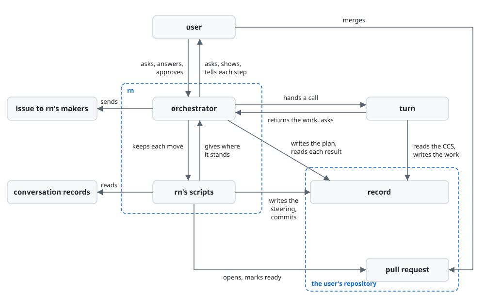

# rn architecture

rn is built on [how a plugin works](../architecture.md) so that a piece of work asked for in rough
words reaches the user's purpose while they only answer, against two drifts: the work drifting from
the purpose, and the AI itself drifting as the work goes on. The orchestrator, the one AI that talks
with the user, decides every move from the steering, which holds the plan and where the session
stands and which rn's scripts rewrite at each move, writes the plan and the learnings itself, and
has every other work made through turn; the user, the goal, the key results, and what a point to
decide, a sign-off, a task and a learning are, are in [rn's UX](ux.md).

rn holds the [principles every plugin holds](../architecture.md#principles), named below
Principle 1 to 9, and its own, named below rn's Principle 1 and 2:

1. Every task traces back to the purpose, through the goal or the acceptance criteria it serves.
2. At every move the orchestrator sets where the session stands from the checked facts alone, and
   replans from the steering and what each done task served, decided and made.

## User stories

- As the user, I want to ask for a piece of work in rough words with `/rn:up <what I want>`.
- As the user, I want to answer each point to decide and each learning rn puts to me, one per
  message, with an option's letter or in my own words.
- As the user, I want to approve the proposal at each sign-off with `/rn:ty`, or ask for a change
  with `/rn:gm <feedback>`.
- As the user, I want to be told before and after each step what rn does, and to stop a step going
  a way I do not want.
- As the user, I want to go on from where I stopped with `/rn:up` in a fresh conversation.
- As the user, I want to merge the pull request rn marks ready.

## Architecture

### Logical view



- The arrows run in the order of the UX's From asking to the merge; the user meets only the
  orchestrator and the pull request.
- The work is kept from drifting from the purpose in two ways: each task names the goal or the
  acceptance criteria it serves and its result is checked against them (rn's Principle 1), and after
  each task the orchestrator weighs the facts it brought and has the plan made again where they
  change it (rn's Principle 2).

  A task that serves no criterion is work the purpose did not ask for, and a plan kept from what
  was expected drifts from the purpose while every move looks done.
- The AI is kept from drifting itself in two ways: the orchestrator carries only the steering from
  move to move, and each rule a machine can judge is held where the AI acts, as
  [The guard tells each role its steps again](../architecture.md#the-guard-tells-each-role-its-steps-again)
  says: the orchestrator, in the main conversation, by rn's scripts that keep the steering and the
  calls, an approval by `/rn:ty`, and the default branch by GitHub's branch protection; each
  of turn's subagents by the guard, laid with lane.

  A conversation that carries the whole of a long piece of work swells, and a fresh one starts
  from nothing; a rule written only in words is followed by chance.
- The steering is one file, the map to the purpose kept current, from which and from what each move
  found the orchestrator decides the next move; it holds only what is left and where it stands: the
  plan in the form of [rn's plan checklist](../../rn/checklists/session/plan.md)'s F-1, under the
  front matter, which holds the stage, the sign-off waiting and the two languages, as
  `dev/architecture.md`'s Languages has them, and above the next move and what is open. rn's scripts
  alone write it, and hold it to that form at every keep, as they take their data from it.

  The user reads it at each sign-off and on the pull request, and a fresh conversation goes on
  from it alone (rn's Principle 2); one file holding both the plan and where it stands cannot say
  two things, where a state kept beside the plan comes to differ from it; and what is no longer
  left, such as a done task, is kept where it was made, in the calls, the repository and
  the history, so each reading of the map holds only what the next move uses.
- At every move the orchestrator gives rn's scripts where the session stands, from the facts that
  move brought, each checked, such as the user's answer, turn's result and the output of what was
  run: the step it takes next and what is open, replacing what the steering said; the stage and the
  sign-off waiting move with the sign-offs, and at a stage's end only as rn's scripts allow it. rn's
  scripts give back the line the orchestrator tells the user: what is done and what comes next, and
  before turn is called, what turn makes.

  A fact taken unchecked carries a slip into every move after it, and a record added to rather than
  replaced swells as the conversation would; a line made from what was kept tells the user what the
  steering holds, not what the orchestrator recalls.
- The goal, the criteria and the tasks are written by the orchestrator with rn's plan checklist
  open, and checked by it against the same checklist: rn's scripts cut the part, the goal, the
  criteria and the tasks, into a file of its own with the CCS it is written from, the orchestrator
  writes it there, and rn's scripts put it back into the steering once the checks they hold it to
  pass.

  The user reads the plan whole at the plan sign-off as soon as it is made, so a reader in their
  place would add a reading the user makes next, and its time at every remake (Principle 4); the
  orchestrator writes only the part cut out, so it cannot change the goal while writing a task.
- The tasks are laid backward from the acceptance criteria, as the criteria are from the goal: every
  criterion passed reaches the goal, and every task's completion criterion passed passes the
  criteria. They are made a few at a time, for the stage at hand: in the plan stage only those a
  gap in the criteria calls for, none where none is needed; then one for each document the purpose
  needs; then those that build the finished work. Each names what it serves, the goal while the
  criteria are made, and is one result accepted by its completion criterion; its actions are what
  that result needs, each a point the orchestrator settles with the user or one work turn makes,
  such as research into current practice and official information, a small trial, or the result
  itself.

  A stage's tasks rest on what the stage before it settled, so tasks made at once for the whole
  rest on guesses; a task begun on a gap fills it with a guess, and each stage meets unknowns that
  research or a small trial finds out while they are small, its result adding or dropping tasks.
- After each task the orchestrator weighs whether the facts it brought change the remaining tasks or
  the criteria, and only then writes the plan again; a choice the goal or a criterion would take
  that no answer of the user's made is first a point to decide, and what an answer settled is
  written into them in the plan's words.

  A plan made again with nothing changed costs a call and risks moving what was approved, while
  one kept past a fact that changes it drifts from the purpose.
- The design sign-off is held only where the purpose needs a document: where the user decides it
  needs none, the session moves from the design stage to build without it.

  A sign-off with nothing to approve is a stop that costs the user time and gives them nothing to
  decide (KR1.2).
- Each work is made from a CCS, one call for each, the shape
  [ACC](https://arxiv.org/abs/2601.11653) gives an AI's state, holding what the work is made from:
  the outputs before it that it uses, each named and passed as it is, its decisions, and what it
  serves, copied by rn's scripts from the steering; a plan's CCS holds, in place of what it serves,
  the latest call of each work of each done task, what it served, decided and made. The plan and the
  learnings are written from theirs by the orchestrator; every other work, each research result and
  trial's result, each document, each task's result, each checklist made, each issue to rn's makers
  and the finished work, goes to turn, whose first user uses it in the receiver's place before it
  comes back (Principle 4).

  turn takes its task as a CCS and makes the work from it and the files it names alone, so the work
  does not stray from what was decided; what turn only reads goes in the CCS and what it makes is a
  file, so it changes nothing it was not asked to make; an output passed as it is, not summarised,
  reaches the next maker as it was accepted, and one call for each output has each read by its
  first user before anything is made on it.
- A task's call names the receiver, their use and what they have as the situation the work is used
  in at its stage: before anything is built, a document's receiver is the user approving it and
  whoever builds to it, having the plan and the documents made before it; once it is built, the
  product's users, with the built product.

  turn's first user does what the receiver does with what they have, and what it lacks reaches it
  only through these, as the decisions go to turn's maker alone
  ([turn's architecture](../turn/architecture.md#physical-view)); a document's reader named as a
  checklist's opening names the finished product's, such as a newcomer installing it, has the first
  user run a product not yet built and send the document back for what is not there.
- The call that makes a task's result gives turn the one command that runs the check its
  completion criterion names, where that check is one command, and the calls before it give none;
  a part rn's scripts put back, the plan or the learnings, the orchestrator passes through the
  command of rn's scripts that runs on it the checks they hold it to when they keep it.

  turn's maker passes that command each time it changes the work, so the result is made to the
  check, while the actions before it make the check and see it fail; a part checked as it is written
  is kept in its form at the first put.
- The hearing of a work reads the checklists it will be made with, rn's for its kind and the
  user's addition, and pictures how the work meets each item from what is decided; an item it
  meets only by a choice no answer of the user's made is a point to decide, settled before turn is
  called.

  A choice an item needs and no one settled is met by turn while it makes the work, asked back
  mid-run or guessed, and one settled before the work is not met as rework after it
  ([Hearing until nothing is left to decide](../architecture.md#hearing-until-nothing-is-left-to-decide)).
- Each point the user decides is kept as a decision of the work it settles, in the CCS of that
  work's next call, before the move after it; a work made again is a new call, its decisions
  carried over and rewritten where an answer changed them.

  A decision kept with the call that is made from it is read by turn as it was answered, and the
  call before it still shows what that work was made from.
- What the orchestrator puts in a call that no answer of the user's gave, such as a file the
  receiver has beyond the outputs the action names, it keeps in the CCS as a choice with why,
  carried over as the decisions are; what turn's maker chose that the CCS left open comes back in
  turn's result, each with why.

  Each is a choice made in the user's place, which the work holds and the user did not see; kept
  where the work is made from and returned, it reaches the sign-off from the record alone.
- No work turn returns is fixed by the orchestrator: it reads each item's Good turn returns at its
  lines, and a Good its lines fall short of is a point settled before turn makes the work again, as
  a decision, as a change the user asks at a sign-off is.

  A fix of the orchestrator's own would be work no guard keeps and no first user reads, read by the
  user only in what the sign-off shows of it.
- While turn runs, the orchestrator passes each line turn tells on to the user, judging none of
  them, and stops the run when the user stops a step; when turn asks, it keeps the questions in the
  steering before it asks the first, puts each about what is made to the user as a point to decide,
  keeps the answer in the decisions, and sends it back.

  Only the main conversation talks with the user
  ([Where the orchestrator runs](../architecture.md#where-the-orchestrator-runs)); an orchestrator
  that judged each way turn takes would ask the user more than what is theirs (Principle 2); and a
  run waiting on an answer is kept in turn's folder of the user's repository, so it is pushed with
  the questions before the user is asked, as every move is.
- Only a point to decide is put to the user: a question turn asks about its CCS, such as what the
  receiver has, the orchestrator answers by writing the CCS again, its choice kept for the
  sign-off; a stop of rn's scripts or of turn's run is gone on from by the step that meets it,
  such as calling turn again with the same call, and what it taught comes to the user among the
  learnings once the finished work is approved.

  A point to decide is a choice that changes what is made; how rn or turn goes on, or what turn's
  reader is handed, is none the user can weigh, and asking it spends their time on rn's own working
  (KR1.2); an issue sent from the middle of the session is decided before the rest shows what the
  whole fell short in.
- Every decision, answer, feedback and approval is pushed before the move after it, so any stop is
  a place to go on from, and rn has no command to pause (Principle 6).
- An approval is the user's `/rn:ty`, and feedback their `/rn:gm`, both skills the AI cannot call
  ([The caller approves what is theirs](../architecture.md#the-caller-approves-what-is-theirs));
  rn's scripts keep either only where Claude Code's record of the conversation shows the user typed
  it after the proposal.

  The orchestrator runs rn's scripts itself, so a script that took an answer on its word would
  take an approval the user never gave.
- At a sign-off, the orchestrator shows the proposal the UX's Sign-offs gives, made by rn's scripts
  from the steering and the calls alone: at the design's, each document's link with the choices
  its latest call and turn's result for it keep; at the deliverable's, the finished work's links
  with those of every work of the build and of its use.

  So it says only what the steering holds and what each work was made from and came back with,
  nothing written for the proposal alone; the user's own answers are in the work, checked by the
  AI that used it in their place, so shown again they give the user nothing to judge.
- Once the user approves the finished work, the orchestrator looks once for the learnings of
  [Principle 8](../architecture.md#learning-from-each-run): rn's scripts give, from the branch's
  history, each feedback the user sent back with its answer, each work made again and each decision
  an answer replaced, each with its commit, and search the orchestrator's conversations of the
  session for the words it gives; the orchestrator reads around each in the history, checks each
  cause it doubts by such a search, and writes the learnings with rn's learnings checklist open,
  kept by rn's scripts in a file of their own and put to the user one per message, an issue to rn's
  makers among their places made through turn as every work is.

  Each send-back, remake and point asked again is kept as a commit before the next move, so the
  history holds every place the work fell short however long the session ran, where the
  orchestrator of a fresh conversation remembers none of it; a cause the history does not show,
  such as the form of a message to the user, is in the conversations alone, which Claude Code keeps
  outside the repository, where an agent's own reading stops to ask. Looked for once at the end,
  the learnings cost the user one reading, where learnings at each sign-off are weighed again in
  every session.

### Physical view

```
rn/                                  the plugin, installed by Claude Code with turn
├── skills/
│   ├── up/SKILL.md                  the orchestrator for /rn:up, the steps every stage takes <skill>
│   ├── up/<stage>.md                the steps of the plan, design, build and learnings stages <Markdown>
│   ├── up/messages.md               the forms of the messages asking a point or a learning <Markdown>
│   ├── ty/SKILL.md                  the orchestrator for /rn:ty, which the AI cannot call <skill>
│   └── gm/SKILL.md                  the orchestrator for /rn:gm, which the AI cannot call <skill>
├── scripts/                         what the orchestrator runs for each move a machine can judge <Python 3>
│   ├── rn.py                        the command line, a subcommand for each move
│   ├── steering.py                  the steering's form, read, held at every keep and changed
│   ├── session.py                   the session's record: each move kept, each call
│   ├── ccs.py                       what each work's CCS holds beside its decisions
│   ├── proposal.py                  the proposal at each sign-off, and the answers to it
│   ├── conversations.py             the orchestrator's conversations, as Claude Code keeps them, searched
│   ├── history.py                   each send-back, remake and replaced decision in the branch's history
│   ├── repo.py                      git and gh run, and the files written
│   ├── stop.py                      each stop, and each value given checked
│   ├── record.py, template.py       lane's readers of Claude Code's records and of Markdown, by links
│   └── call.py, forms.py, parts.py  turn's readers of a CCS, a checklist's items and the work's parts, by links
├── forms/claim.json, reading.json   turn's forms, which forms.py reads beside it, by links <JSON>
├── hooks/adapters/items-checklist.py  turn's reader of a checklist's items, which call.py loads beside it, by a link
└── checklists/                      rn's own, one for each kind, and checklist.md, usability.md and fix.md, which each is made from or held to <Markdown>

<the user's repository>, on the piece of work's own branch
└── .rn/
    ├── checklists/<kind>.md         the user's addition for a kind <Markdown>
    └── <yyyymmdd>-<slug>/           the record of one piece of work
        ├── steering.md              what is left to reach the goal and where the session stands <Markdown>
        ├── learnings.md             the learnings, for the user once the finished work is approved <Markdown>
        ├── issue-<n>.md             each issue to rn's makers, made before the user is asked to send it <Markdown>
        ├── <path>                   each research result and trial's result, at the path its action names <Markdown>
        └── calls/
            ├── <nnnn>-ccs.json      each call, numbered from 0001 in the order made <JSON>
            ├── <nnnn>-steering.md   the plan the orchestrator writes on a call on the plan <Markdown>
            ├── <nnnn>-learnings.md  the learnings it writes on a call on the learnings <Markdown>
            └── <nnnn>-result.json   what turn returned for a call to it <JSON>
```

- rn runs on Claude Code, python3 3.9 or later, git and `gh` logged in to an account that can push
  to the repository; turn is installed with rn as its dependency.
- The orchestrator is rn's skills, run in the user's main conversation on the model they run it on.
- The orchestrator starts `turn:up` in the background with the CCS's path, its kinds and where the
  result goes, answers turn's points by SendMessage, and stops a run with TaskStop, as
  [turn](../../turn/README.md) is called.
- The record is kept by a commit and a push to the piece of work's branch, made by the orchestrator
  alone, through rn's scripts; the steering's states before the current one are in its history, and
  the options weighed with their reasons and each feedback with its answer in the commit messages.

  A push is what a fresh conversation, or another machine, reads from.
- The pull request is a draft pull request on GitHub of that branch, opened and marked ready with
  `gh`; a learning's issue is opened with it on `lovaizu/ccpm`, on the user's yes.
- rn's checklists are read-only in the plugin; the user's additions are in their repository and go
  into the piece of work's pull request.

## Test

rn is tested as [Test](../architecture.md#test) says.

- rn's roles are tried with `bypassPermissions` in a Docker Sandbox, as rn's README has its users
  run it.
- Each move of the orchestrator is tried alone, from a session state made beforehand, with turn, gh
  and the user stood in for; how the moves follow one another is checked there, each move's state
  the one the move before it leaves.
- rn's acceptance test runs rn whole with the real turn on `lovaizu/playground`, on a request of
  about an hour with documents and code, the user stood in for by an AI holding what they truly
  want, written beforehand and never shown to rn.

  A request someone would bring rn passes every stage, the design's and the build's included, so
  its send-backs and the stand-in's time are rn's key results; a run on stand-in parts or a tiny
  request shows neither.
