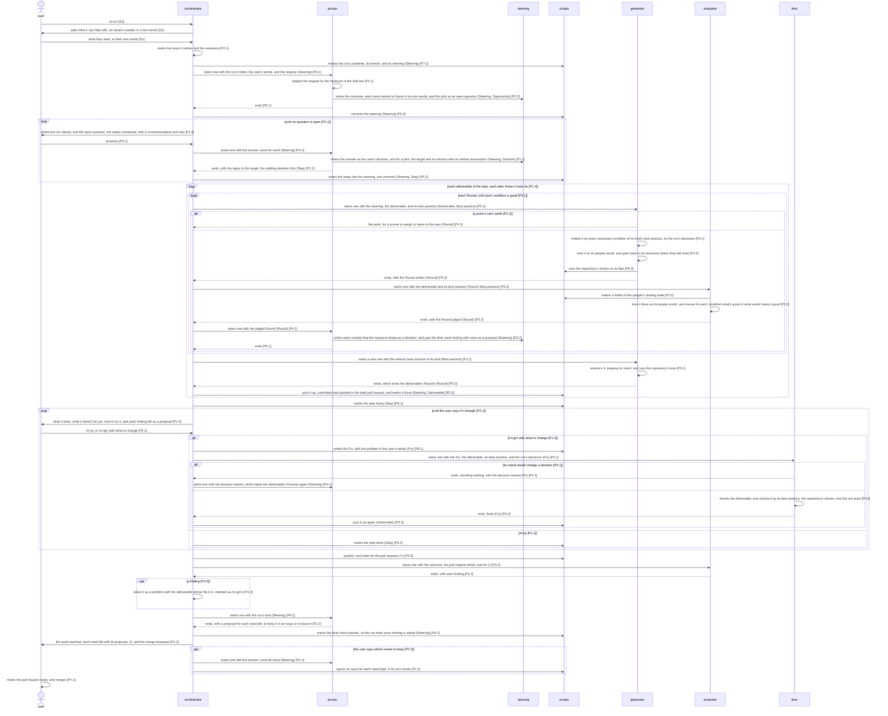
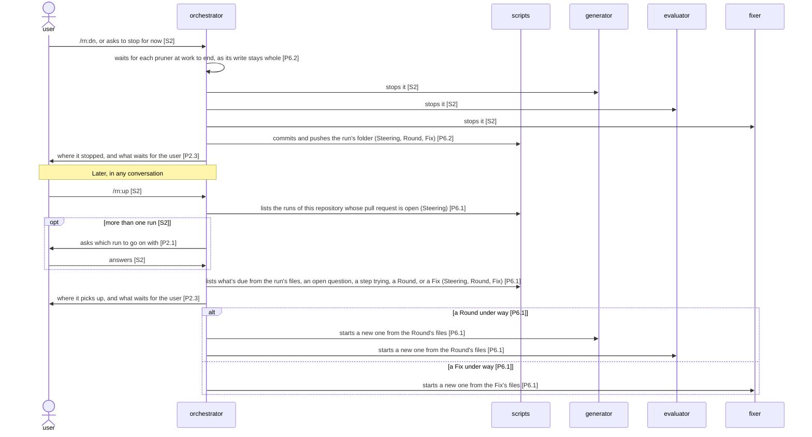

# rn architecture

## User stories

- S1: the user wants what they asked for working for the one need they pick, early, asking in
  their own words, and to decide what happens to each need left.
- S2: the user wants to stop a run and go on with it later, in any conversation, losing nothing.

## Solution strategy

### Principles

rn piles up the [vital few](https://en.wikipedia.org/wiki/Pareto_principle) that bring a
deliverable's people to their aim, and cuts the trivial many thoroughly.

- P1: the goal reached earliest
  - P1.1: each run aims at one need that the user picks.
  - P1.2: the least that runs, through every kind of deliverable that the need takes, goes to the
    user before anything more is made.
  - P1.3: a mend that keeps what the run decided starts at once, with no weighing before it.
- P2: the user as one who uses it
  - P2.1: the user is asked only what only they can decide, one point at a time, in plain words
    with a recommendation and why.
  - P2.2: each need that the user or the issue named stays on the list, and only the user decides
    what happens to it.
  - P2.3: each message to the user opens with where the run stands.
  - P2.4: rn talks in the user's language and writes in the repository's, asking only where they
    disagree.
- P3: best practices in full
  - P3.1: each deliverable, when first made or remade, meets every necessary condition of its
    kind's best practice before the user touches it.
  - P3.2: before the user, each deliverable is tried by one who didn't make it, with only what its
    people have.
  - P3.3: a remake that brings no remedy has a limit, and each finding left goes to the user as a
    proposal.
  - P3.4: a mend is checked by its kind's best practice, the repository's checks, and the unit
    tests.
- P4: one measure of the vital few
  - P4.1: each fact that would change what the run aims at is weighed by one shared measure, by
    one role alone, before it does.
- P5: each role on its own work
  - P5.1: leading, weighing, making, judging, and mending are separate roles, each started with
    only what its work needs.
  - P5.2: each part of the run's record has one writer.
  - P5.3: a step that has one right result is done the same way each time, without a role's
    judgment.
- P6: nothing lost on a stop
  - P6.1: the run's state lives in files on its branch, so that it goes on from any conversation.
  - P6.2: a stop lets each record being written end whole before the run halts.
- P7: the user's repository left as it was
  - P7.1: rn works on its own copy of the repository and its own branch.
  - P7.2: the ready mark and the merge stay the user's.

### Concept model


- Steering\
  Holds what the run aims at and why, and where it stands, for each judgment and each pick-up.
  Its form is [its schema](../../plugins/rn/domain/schemas/steering.schema.json)'s.
- Opportunity\
  A need in the words of those who have it, which the user picks or leaves.
- Solution\
  How the picked need is met, with the riskiest assumption it rests on and that assumption's test
  on the real thing.
- Step\
  One stretch of the way to the picked need, which ends once the user says it's enough.
- Deliverable\
  One file or folder that a step makes for the people, of one kind.
- Best practice\
  The field's established way to make one kind of deliverable, and its conditions, which making
  and judging both stand on.
- Round\
  One making of a deliverable, tried by its maker and then judged by one who didn't make it.
- Fix\
  One mend of a deliverable whose Rounds are over, which keeps each decision of the run. It holds
  the problem in the words that raised it, and what the mend gave.

Strategies:

- The steering split into what the run aims at, written by one role alone, and where it stands,
  written by scripts alone. [P5.2]\
  Intent: no part of the record has two writers, and the run's standing moves the same way at
  each event.
- Each need kept on the tree, the one the user picked marked as the run's target. [P2.2]\
  Intent: no need is dropped without the user's say, and the run knows which one it serves.
- The steps listed in order, the walking skeleton first, each naming the need it meets.
  [P1.2]\
  Intent: the run puts the least that runs in the user's hands before it makes more.
- Each step marked open while rn makes it, trying while it's in the user's hands, and done once
  the user says it's enough. [P6.1]\
  Intent: the run's files alone say what waits for the user.
- Each point for the user kept as an open question, and their answer, word for word, as a
  decision of theirs. [P2.1]\
  Intent: a point and the user's own words outlive the conversation that asked them.
- Each remedy that a Round's judgment brings kept as a decision of the run. [P3.3]\
  Intent: the next Round and each later mend rest on what was weighed.
- A Round past the limit taken only where a remedy was written since the last. [P3.3]\
  Intent: each vital gap is mended before the limit ends the remaking.
- Each Fix kept beside the deliverable's Rounds, with the problem in the words that raised it.
  [P6.1]\
  Intent: a pick-up finds a Fix under way and starts it again on the same problem.

### Components


- orchestrator (prompt)\
  Leads the run to the user's picked need, as the user's one contact.
- vital few (prompt)\
  Holds the one measure by which rn tells the vital few from the trivial many.
- pruner (prompt)\
  Keeps what the run aims at to the vital few, with every need named kept for the user to pick.
- generator (prompt)\
  Makes a deliverable with which its people reach their aim, by its kind's best practice.
- evaluator (prompt)\
  Checks, as the people, whether a deliverable or the pull request whole reaches their aim.
- fixer (prompt)\
  Mends a made deliverable at once, within the run's decisions.
- scripts (script)\
  Does each step that has one right result, and alone writes where the run stands.
- hook (hook)\
  Turns each delete that a role runs in Bash to a script, on every call.

Strategies:

- Each command only an entry point, pointing to the orchestrator's steps for each event. [P5.1]\
  Intent: every event reaches the one role that hands it on.
- The main conversation as the orchestrator, which starts and stops each other role. [P5.1]\
  Intent: the user talks with one role through the run.
- Each fact that would change what the run aims at handed to a new pruner, with the run's folder,
  the user's words, and the fact. [P4.1]\
  Intent: one role holding the measure weighs all that the run aims at takes in, as an outsider
  would.
- One shared prompt of the measure, which both the orchestrator and the pruner read. [P4.1]\
  Intent: the two roles weigh by one measure, which changes in one place.
- The pruner's result handed to a script, which writes the steps into where the run stands.
  [P5.2]\
  Intent: the pruner decides the way, and only scripts write the run's standing.
- Each problem with a deliverable whose Rounds are over handed at once to a new fixer. [P1.3]\
  Intent: a mend within what was weighed starts without a wait, and one that changes it is
  weighed first, as the fixer names it.
- The orchestrator speaking only from the steering and the user's words. [P2.1]\
  Intent: the talk brings back nothing the pruner cut, such as an issue's means.
- Each need shown numbered in the user's words, and one of them recommended with its grounds. [P2.1]\
  Intent: the user judges only which need brings them closest to what they're after.
- The languages proposed once at the start and kept as the user's decisions. [P2.4]\
  Intent: the user reads rn in their own language, and others read the repository in its own.
- One generator and one evaluator for each Round, the evaluator judging every condition from one
  trial. [P3.2]\
  Intent: the people's use is one act, so it's tried once and judged whole.
- The evaluator given the deliverable and its best practice, never what rn meant. [P3.2]\
  Intent: it meets only what the people would meet.
- A new generator for the refactoring once each condition is good, with no evaluator. [P3.1]\
  Intent: a new reader meets what the maker misses, and the checks and tests show the intent
  holds.
- A new fixer for each Fix, with only the deliverable, its best practice, the run's decisions,
  and the problem in its own words. [P3.4]\
  Intent: the fixer mends what went wrong within what was decided.
- A fixer whose mend would change a decision mending nothing, and naming the change. [P4.1]\
  Intent: only a weighing changes what the run aims at.
- The pull request checked whole by an evaluator once each step is done, with its CI. [P3.2]\
  Intent: a newcomer to the work reads the whole diff before the merge is proposed.
- Each step that has one right result done by a script that the role runs. [P5.3]\
  Intent: each role spends its judgment and its context only where a step needs them.
- A stop taken from /rn:dn or the user's words, and a pick-up from /rn:up. [S2]\
  Intent: the user stops and goes on at the moment they choose, and a new run never asks about an
  old one.
- A stop waiting for each pruner at work to end, then stopping the other roles and pushing the
  run's folder. [P6.2]\
  Intent: a pick-up reads a whole steering, and GitHub keeps the work so far as well as the
  user's computer.
- Each role's delete in Bash sent by the hook to a script of exact paths. [P5.3]\
  Intent: a role's clean-up never waits on a permission prompt, and stays in the work and the
  temporary folder.

### Sequences

#### S1: the least that runs for the picked need, in the user's hands



#### S2: a run stopped, and picked up later



### Deployment


The user installs rn as [the README](../../plugins/rn/README.md#installation) says, and types
`/rn:on` at their repository's root.

Strategies:

- rn's own git worktree and branch for each run. [P7.1]\
  Intent: the user goes on with their own work, and their side stays as it was.
- The pull request opened as a draft, which the user marks ready. [P7.2]\
  Intent: nobody reviews or merges the work before the user has seen it checked whole.

### Directory structure

```text
plugins/rn/                        what Claude Code installs for the user
├── skills/                        /rn:on, /rn:up, /rn:dn, /rn:ty, and /rn:gm, each pointing to the orchestrator
├── agents/                        the pruner's, the generator's, the evaluator's, and the fixer's starts
├── hooks/                         the hook that turns a role's delete to a script
└── domain/
    ├── orchestrator.md            each event's own steps, then those that every event shares
    ├── vital-few.md               the measure of the vital few
    ├── pruner.md                  what the pruner does
    ├── generator.md               what the generator does
    ├── evaluator.md               what the evaluator does
    ├── fixer.md                   what the fixer does
    ├── schemas/                   the form of the steering and of each role's result
    ├── best-practices/            rn's best practice of each kind
    └── scripts/                   each step with one right result, as a role runs it

dev/rn/                            what only rn's developers use
└── tests/unit/                    the unit tests of rn's code

.claude/worktrees/                 rn's worktree of each run
└── rn-<yyyymmdd>-<slug>/          one run's worktree, on the work's branch

.rn/                               what rn writes on the work's branch
└── <yyyymmdd>-<slug>/             one run's folder
    ├── steering.json              the steering
    └── rounds/<deliverable>/      each Round and each Fix of the deliverable, in the order made
```

## Test strategy

The user's run of a real request is the end-to-end check. A test at a higher level than the unit tests is added
only for a fault that the user's run found and that a test should have caught before it, or for
an operation that can't be undone.

| Check | Test target | Kind | When | Exit criteria or measure |
|---|---|---|---|---|
| Lint | Parts | Quality | During the work | 0 findings. |
| Static analysis | Parts | Quality | During the work | 0 findings of mismatched types, copied code, or import cycles. |
| Complexity analysis | Parts | Quality | During the work | Per function, McCabe 10, cognitive 15, 6 returns, 12 branches, 5 arguments, 50 statements at most. |
| Unit testing | Parts | Quality | During the work | A case for each class of input that an interface's contract treats apart, and every case passes. |
| Code coverage | Parts | Quality | During the work | 100% statement (C0) and branch (C1) coverage. |
| Scenario testing | Product | Quality | Apart from the work | The user's run of a real request puts the walking skeleton in their hands, with no stop that a fault caused. |
| Installation testing | Product | Quality | Apart from the work | Once ccpm's marketplace lists rn, it installs alone by the README's commands in a fresh home. |
| Configuration testing | Product | Quality | During the work | Every case passes on Python 3.9 and on the newest Python. |
| Conformance and compliance testing | Product | Quality | During the work | Claude Code's strict check of the plugin passes. |
