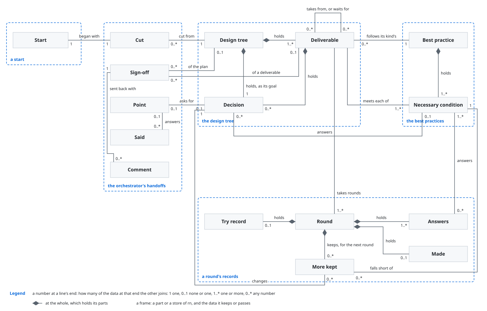
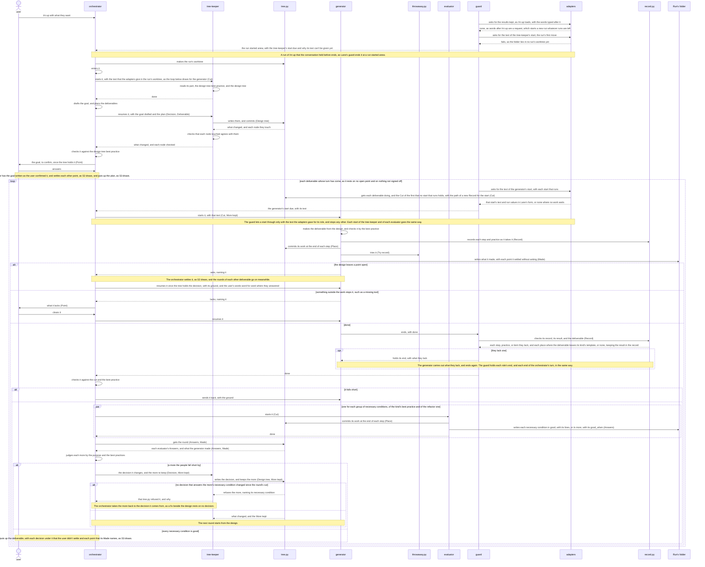
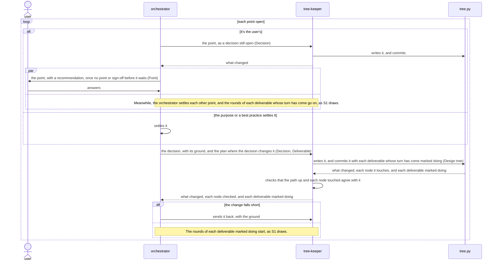
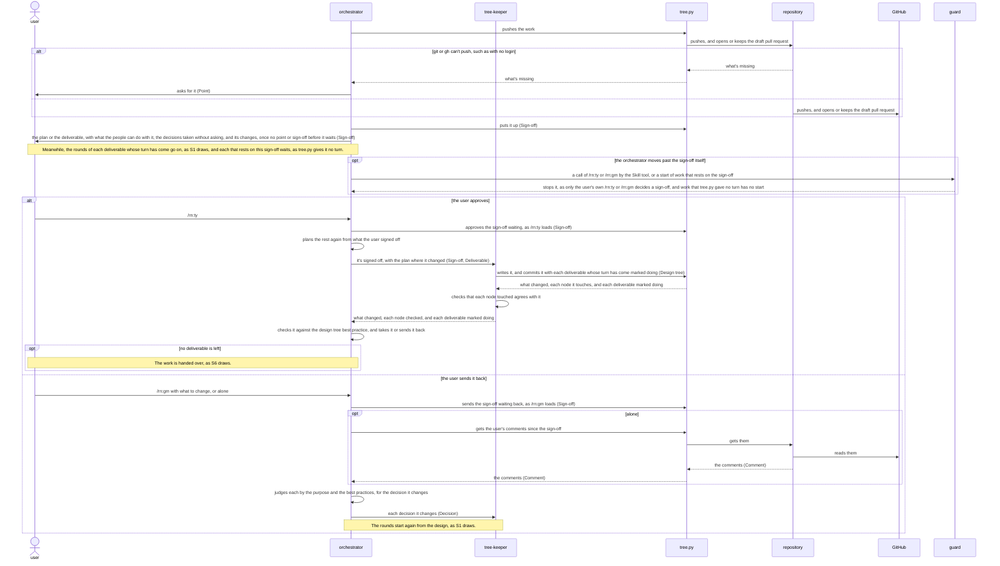
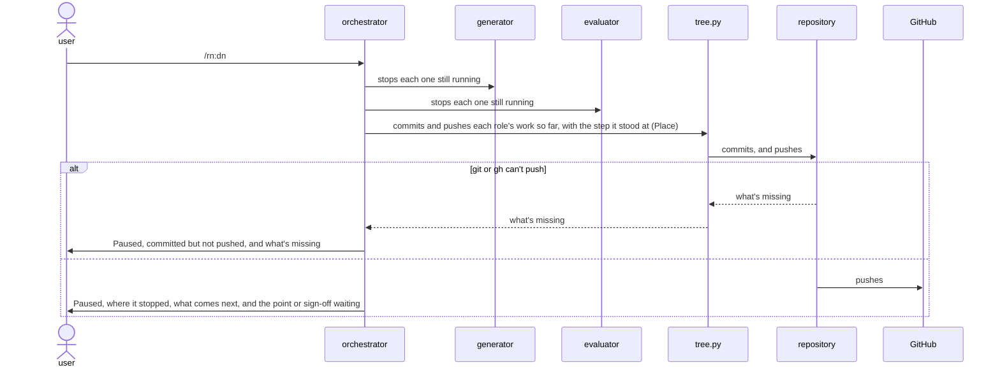
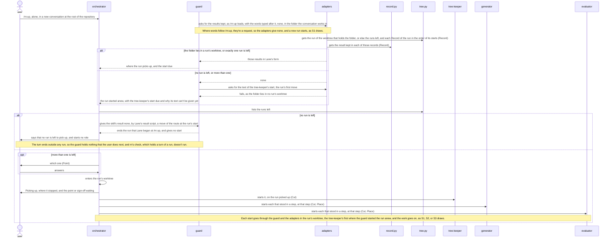
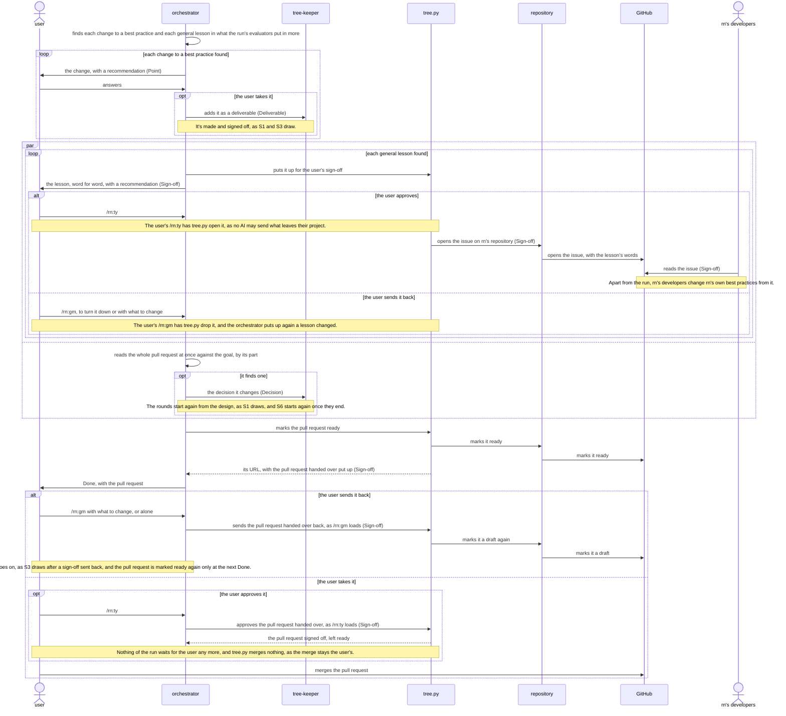

# rn architecture

## User stories

- S1: the user wants to ask in their own words, so that they get what they mean unspecified.
- S2: the user wants to decide only their own points, one at a time, so that their time goes there.
- S3: the user wants to approve or ask a change at each sign-off, so that nothing rests on a
  misreading.
- S4: the user wants to pause a run at any moment, so that they lose neither time nor work.
- S5: the user wants to resume a paused run in any conversation, so that it goes on where it stopped.
- S6: the user wants one pull request with rn's decisions and lessons, so that they merge knowing
  its content.
- S7: each of rn's developers wants each signed-off lesson in rn's issues, so that they improve rn.

## Solution strategy

rn keeps the vital few of each deliverable as decisions in a design tree, asking the user only
theirs. A generator makes each deliverable from its decisions until evaluators with only its people's
view find it good. rn builds on [the plugin guide](../plugin-development-guide.md), and every view
keeps these rules.

### Drawn out along the design tree

Each role starts with only the cut that `tree.py` gave for it, and the guard stops any other start.

*Why*: a role that reads decisions not its own makes what the user didn't mean, which raises KR1.1.

### Every step by best practice

Each role works by its kind's best practice, a generator finishes by the refactor one, and Lane
holds the steps.

*Why*: an AI that skipped a step once skips it again, so the deliverable misses what it makes,
raising KR1.1.

### Every item handled

Each role reads all it starts with, records each step and practice, and names each item its result
carries.

*Why*: an item dropped takes from the deliverable what the item holds, which raises KR1.1.

### Judged by the people it's for

An evaluator gets only what the deliverable's people have.

*Why*: an evaluator that knows what the maker meant judges the making, not what the people get,
raising KR1.1.

### Signed off before it's built on

`tree.py` gives work resting on a sign-off its turn only after `/rn:ty`, and other work its turn at
once.

*Why*: a misreading found late remakes everything resting on it, raising KR1.1, and idle waiting
adds to KR1.2.

### Back to the design tree on a problem

A `more` or a `/rn:gm` changes the decision it comes from, and `tree.py` keeps a `more` only then.

*Why*: a fix beside the design rests on no decision, so the next round loses or breaks it, raising
KR1.1.

### The design tree revised on each run

What a run finds changes the design tree before the next deliverable, and a best practice once
taken.

*Why*: a design tree or best practice kept as first laid out makes the same miss again, raising
KR1.1.

### Tried in a throwaway copy

A deliverable's commands run only through `throwaway.py`, in a throwaway copy and home, as the
guard holds.

*Why*: a command run as its people run it would change the user's files, and mending them adds to
KR1.2.

### The repository holds the work

The run's state lives only in its folder on the work's branch, which `tree.py` commits at each step
and pause.

*Why*: work kept only in a conversation that ends makes the user answer or wait again, adding to
KR1.2.

## Components


- user\
  Gives the goal and each point, sign-off, and lesson that's theirs, pauses the run, and merges.
- rn's developers\
  Change rn's own best practices by each lesson that reaches rn's repository.
- orchestrator\
  Judges whose each point is, settles the rest, plans, and checks each result before taking it.
- tree-keeper\
  Writes each decision into the design tree, and checks that each node it touches agrees.
- generator\
  Makes the deliverable from its cut, and hands back with `asks` each point it can't settle.
- evaluator\
  Judges whether the deliverable meets each condition of its group for its people.
- tree.py\
  Keeps the tree's form, finds each deliverable's turn and cut, and holds the run's files and branch.
- repository\
  Runs each git and gh command for `tree.py`, and reads what they print.
- record.py\
  Checks each record, result, and deliverable against its steps, practices, and template.
- throwaway.py\
  Runs a deliverable's commands in a throwaway copy and home.
- guard\
  Holds each call to its steps and throwaway copy, each end to rn's check, and each sign-off.
- adapters\
  Give Lane each start's text and the results kept, and separate a start from a pick-up.

Strategies:

- One generator for each deliverable\
  Several side by side take about that many times as long for no gain shown, keeping KR1.2 short.
- The orchestrator judging every point\
  The user talks with the one that decides, and no one rewords an answer, keeping KR1.2 short.
- `tree.py` finding the work that waits\
  Code holds it every run, so no work starts early or idles, keeping KR1.1 low and KR1.2 short.
- A tree-keeper writing the design tree\
  The orchestrator checks each change as another's, catching the slips a writer misses, keeping
  KR1.1 low.
- One evaluator for each group of necessary conditions\
  Each judges its group in its own context, side by side, keeping KR1.1 low and KR1.2 short.
- Evaluators by the refactor best practice beside the kind's\
  Judged as one, each round's additions break the structure unseen, so its people misread it, raising
  KR1.1.
- rn's check holding each deliverable to its template\
  Each sentence beyond the vital few buries what the people need, which evaluators pass, raising
  KR1.1.
- Rounds until every necessary condition is good\
  A limit would hand over a deliverable its people can't use, and KR1.1 comes before KR1.2.
- The adapters picking up the one run left from the repository's root\
  At the root, where [Lane's S7](../lane/architecture.md#s7-a-run-picked-up) asks them, no role starts
  over, keeping KR1.2 short.

## Data model



- Cut\
  The part of the design tree that a role starts with.
- Design tree\
  The goal, its decisions, and the plan of deliverables, in
  [the design tree best practice](../../plugins/rn/domain/best-practices/design-tree/best-practice.md)'s
  form.
- Point\
  A question put to the user with its recommendation: an open decision, the goal drafted, or a lack.
- Sign-off\
  The plan, a deliverable, a lesson, or the pull request, put up for `/rn:ty` or `/rn:gm`.
- Made\
  What a generator made: where it carries out each decision and More kept, and each point it settled.
- Place\
  The step each role of a round stands at, with its work, kept at each step's end and a pause.
- Answers\
  An evaluator's answer to each necessary condition of its group, apart from the user's answer to a
  Point.
- More kept\
  An evaluator's `more` that the orchestrator judged the people fall short by, for the next round's
  generator.
- Record\
  What one start of a role, or the orchestrator, carried out, apart from a Try record of commands
  tried.

Strategies:

- The design tree as JSON written through `tree.py`\
  Deliverables rest on one another many to many by path, which no nested list holds, keeping KR1.1
  low.

## Sequences

### S1: a request, and a deliverable made in rounds



### S2: a point settled



### S3: a sign-off



### S4: a pause



### S5: picking up



### S6, S7: the work handed over, and each lesson sent to rn's repository



## Deployment


The user installs rn as [the README](../../plugins/rn/README.md#installation) says, which installs
Lane, and types `/rn:up` at their repository's root.

Strategies:

- rn's own git worktree for each run\
  The user goes on with their work, and a pause leaves nothing of theirs to set right, keeping KR1.2
  short.
- A best practice made on a run in `.rn/best-practices/<kind>/`\
  Every later run finds it and takes it over rn's own of its kind, keeping KR1.1 low.

## Directory structure

rn's folder holds what Claude Code installs for the user. `dev/rn/` holds what only rn's developers
use. `.claude/worktrees/` holds rn's worktree of each run. `.rn/` holds what rn writes on the work's
branch: [the run's folder](../plugin-development-guide.md#where-a-plugin-writes-its-files) and each best practice made on a run.

```text
plugins/rn/
├── .claude-plugin/
│   └── plugin.json                rn's manifest, naming Lane in its dependencies
├── skills/
│   ├── up/
│   │   └── SKILL.md               /rn:up, which makes the main conversation the orchestrator
│   ├── dn/
│   │   └── SKILL.md               /rn:dn, which pauses the run
│   ├── ty/
│   │   └── SKILL.md               /rn:ty, which approves the sign-off waiting
│   └── gm/
│       └── SKILL.md               /rn:gm, which sends the sign-off waiting back
├── agents/
│   ├── tree-keeper.md             starts the tree-keeper
│   ├── generator.md               starts the generator
│   └── evaluator.md               starts the evaluator
├── domain/
│   ├── orchestrator.md            what the orchestrator does
│   ├── tree-keeper.md             what the tree-keeper does
│   ├── generator.md               what the generator does
│   ├── evaluator.md               what the evaluator does
│   ├── tree-keeper-in.schema.json   the form of the tree-keeper's Cut and of each resume
│   ├── tree-keeper-out.schema.json  the form of what the tree-keeper gives
│   ├── generator-in.schema.json   the form of the generator's Cut and of each resume
│   ├── generator-out.schema.json  the form of what the generator gives, its Made among it
│   ├── evaluator-in.schema.json   the form of the evaluator's Cut
│   ├── evaluator-out.schema.json  the form of what the evaluator gives, its Answers among it
│   ├── tree/                      the code of tree.py, a module for each decision it makes
│   ├── sign-off.schema.json       the form of a Sign-off, which tree.py decides
│   ├── repository/                the code of repository, a module for each tool it runs
│   ├── record/                    the code of record.py, a module for each decision it makes
│   ├── record.schema.json         the form of a Record, which record.py decides
│   ├── fault.py                   how tree.py, record.py, throwaway.py, repository, and the
│   │                              adapters say why they stopped, and how each command ends
│   ├── throwaway.py               the code of throwaway.py
│   └── best-practices/            rn's own best practice of each kind
├── scripts/
│   ├── tree.py                    runs the code of tree.py
│   ├── record.py                  runs the code of record.py
│   └── throwaway.py               runs the code of throwaway.py
├── hooks/
│   ├── hooks.json                 starts the guard on each call
│   ├── lanes.json                 the steps the guard holds each role to
│   ├── lane/                      the guard: Lane's code, copied in by Lane
│   └── adapters/                  give the guard each start's text from its Cut, and the results
│                                  kept
└── README.md                      for rn's users

dev/rn/
├── product-vision.md              rn's product vision
├── architecture.md                this document
├── README.md                      for rn's developers
└── tests/                         the test cases, in unit/, properties/, prompts/, integration/,
    │                              and e2e/, with the E2E test files that dev/scripts/e2e.py runs
    └── gh/                        the double of gh, the records of gh it gives from in recorded/,
                                   and compatibility.py, which compares a new gh with them

.claude/worktrees/
└── rn-<yyyymmdd>-<goal>/          rn's worktree of one run, on the work's branch

.rn/
├── <yyyymmdd>-<goal>/             one run
│   ├── design-tree.json           the design tree
│   ├── sign-offs.json             what waits for /rn:ty, and what the user signed off
│   ├── rounds/                    each round's Try record, Made, Answers, More kept, and Place
│   └── records/                   the record of each start of a role, and the orchestrator's
└── best-practices/                each best practice made on a run
```

## Test strategy

Each test case lies in `dev/rn/tests/`, written as Given, When, and Then before anyone builds a part.
`dev/scripts/trace.py` checks that each names an element or a case one level up.

| Check | Test target | Kind | Exit criteria or measure |
|---|---|---|---|
| Lint | Parts | Quality | ruff: 0 findings. |
| Static analysis | Parts | Quality | pyrefly, and pylint's duplicate-code and cyclic-import checks: 0 findings. |
| Complexity analysis | Parts | Quality | complexipy and ruff: per function, McCabe 10, cognitive 15, 6 returns, 12 branches, 5 arguments, 50 statements at most. |
| Unit testing | Parts | Quality | pytest, with the double of Claude Code: every case passes. |
| Unit testing | Parts that hold a prompt | Benchmark | `claude -p` on Opus: each prompt's share of right runs, read by code, against the last version's. Precision and recall for the points put to the user and the `more` judged short. Runs per case: added until one more moves no share. |
| Code coverage | Parts | Quality | coverage: 100% statement (C0) and branch (C1) coverage. |
| Property-based testing | Parts | Quality | hypothesis: 0 counterexamples in reading the design tree, the records, and the adapters' input. |
| Mutation testing | Parts | Quality | cosmic-ray: 0 surviving mutants. |
| Integration testing | Architecture | Quality | pytest, with the double of Claude Code: every case passes, each handoff giving the data the data model names. |
| Contract testing | Architecture | Quality | `dev/rn/tests/gh/compatibility.py` on each new gh: each recorded command gives what its line shows. Claude Code's is Lane's test. |
| Traceability | Architecture | Quality | `dev/scripts/trace.py`: every element tested, every case naming one level up, each rule's case failing broken. |
| Scenario testing | Product | Benchmark | `dev/scripts/e2e.py` on the walkthrough, judged on Opus: the key results KR1.1, then KR1.2, against the last runs. Runs: added until one more moves no mean by a step. |
| Installation testing | Product | Quality | `dev/scripts/e2e.py`: rn installs by the README's commands in a fresh home, and `/rn:up` answers. |
| Configuration testing | Product | Quality | CI's Tests on Python 3.9 and the newest Python: every case passes on each. |
| Conformance and compliance testing | Product | Quality | `claude plugin validate --strict`: passes. |
