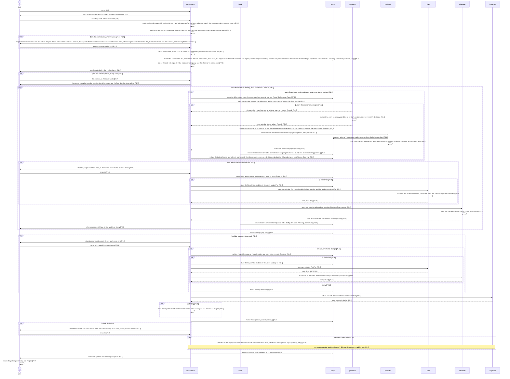
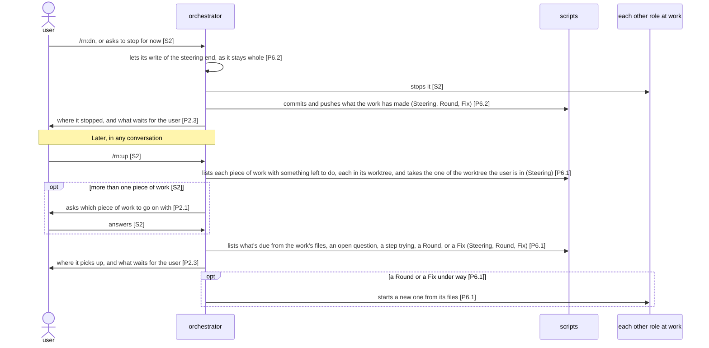
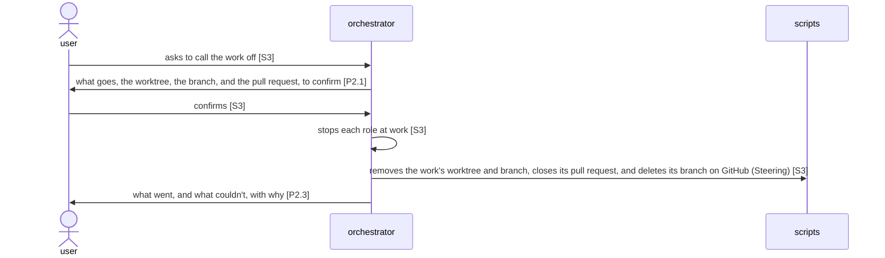

# rn architecture

## User stories

- S1: the user wants what they asked for, as they mean it, working for the one need they agree to
  first, early, asking in their own words, and to decide what happens to each need left.
- S2: the user wants to stop rn's work and go on with it later, in any conversation, losing nothing.
- S3: the user wants to call rn's work off and have nothing of it stay on their computer or on
  GitHub.

## Solution strategy

### Principles

rn piles up the [vital few](https://en.wikipedia.org/wiki/Pareto_principle) that bring a
deliverable's people to their aim, and cuts the trivial many thoroughly.

- P1: the goal reached earliest
  - P1.1: each piece of work aims at one need, the one the user agrees to first.
  - P1.2: the least that runs, through every kind of deliverable that the need takes, goes to the
    user before anything more is made, after only the deliverables they chose to see first.
  - P1.3: a mend of a problem, once weighed, starts at once, with no new Rounds.
  - P1.4: the hearing, the steps, and the questions grow with what the request leaves open: a
    request whose state wanted is settled takes one proposal, and its tree is one need.
- P2: the user as one who uses it
  - P2.1: the user is asked only what the request and their words leave open, in plain words with
    a recommendation and why.
  - P2.2: each need that the user or the issue named stays on the list, and only the user decides
    what happens to it.
  - P2.3: each message to the user has one shape: what was done, with how far the work is to the
    try, then what they do now, one question with numbered options or what to try, and nothing of
    rn's insides, so that they see where the work is and give feedback at once.
  - P2.4: rn talks in the user's language and writes in the repository's, asking only where they
    disagree.
  - P2.5: the user agrees to the work from proposals, and corrects only what's off: the goal they
    are after behind their words, the way to it, and what changes, each file that exists with what
    changes in it, and each deliverable roughly where none exists yet.
  - P2.7: a question of the user's gets an answer with why, and changes nothing until their words
    ask for a change.
  - P2.6: the user sees each deliverable they choose as soon as it's made, before more rests on
    it.
- P3: best practices in full
  - P3.1: each deliverable meets every necessary condition of its kind's best practice, and once
    whole, of its kind's refactor best practice, before the user touches it.
  - P3.2: before the user, each deliverable is tried by one who didn't make it, with only what its
    people have.
  - P3.3: remaking has a limit, and what it leaves goes to the user to confirm.
  - P3.4: a mend confirms, the same way before it and after it, that what was there still holds.
- P4: one measure of the vital few
  - P4.1: each fact that would change what the work aims at is weighed by one shared measure,
    before it does, by the one who holds the talk and reads what was made.
- P5: each role on its own work
  - P5.1: leading, making, judging, mending, refactoring, and inspecting are separate roles,
    each started with only what its work needs, and the one who leads weighs what the work aims
    at.
  - P5.2: each part of the work's record has one writer.
  - P5.3: a step that has one right result is done the same way each time, without a role's
    judgment, and what must hold every time is held by a hook.
- P6: nothing lost on a stop
  - P6.1: the work's state lives in files on its branch, so that it goes on from any conversation.
  - P6.2: a stop lets each record being written end whole before the work halts.
- P7: the user's repository left as it was
  - P7.1: each piece of work lies in a worktree apart from the user's own changes, one they agree
    to.
  - P7.2: the ready mark and the merge stay the user's.

### Concept model


- Steering\
  Holds what the work aims at and why, and where it stands, for each judgment and each pick-up.
  Its form is [its schema](../../plugins/rn/domain/schemas/steering.schema.json)'s.
- Opportunity\
  A need in the words of those who have it, which the user picks or leaves.
- Solution\
  How the picked need is met, with the riskiest assumption it rests on and that assumption's test
  on the real thing.
- Step\
  One stretch of the way to the picked need, which ends once the user says it's enough.
- Deliverable\
  One file or folder that a step makes for the people, of one kind.
- Best practice\
  The field's established way to make one kind of deliverable, and its conditions, which making
  and judging both stand on.
- Round\
  One making of a deliverable, judged by one who didn't make it, or one refactoring of the whole.
- Fix\
  One mend of a deliverable whose Rounds are over, to a problem once weighed. It holds
  the problem in the words that raised it, and what the mend gave.

Strategies:

- The steering split into what the work aims at, as the orchestrator weighed it, and where it
  stands, each written by scripts alone. [P5.2]\
  Intent: no part of the record has two writers, and the work's standing moves the same way at
  each event.
- Each need kept on the tree, the one the user agreed to first marked as the work's target, the
  tree one need where the request settles the state wanted. [P2.2, P1.4]\
  Intent: no need is dropped without the user's say, and the work knows which one it serves.
- The steps listed in order, the walking skeleton first, each naming the need it meets.
  [P1.2]\
  Intent: the work puts the least that runs in the user's hands before it makes more.
- Each deliverable that the user wants to see once it's made ending a step of its own. [P2.6]\
  Intent: the user tries it as they try any step, and what rests on it waits for their word.
- Each step marked open while rn makes it, trying while it's in the user's hands, and done once
  the user says it's enough. [P6.1]\
  Intent: the work's files alone say what waits for the user.
- Each point for the user kept as an open question, and their answer, word for word, as a
  decision of theirs. [P2.1]\
  Intent: a point and the user's own words outlive the conversation that asked them.
- Each remedy that a Round's judgment brings kept as a decision of the work. [P3.3]\
  Intent: the next Round and each later mend rest on what was weighed.
- Each deliverable's next role kept in the steering, said by the orchestrator where its weighing
  decides it, and by the hook where nothing is to weigh, anew from the first Round where its solution
  changed. [P5.2]\
  Intent: the steering alone says what comes next, and nothing outside it keeps a deliverable on a
  dropped solution.
- What the Rounds leave at the limit asked of the user as an open question, the hook refusing a
  Round past it. [P3.3]\
  Intent: the user decides what they'd live with, and a pick-up finds it waiting.
- Each Fix kept beside the deliverable's Rounds, with the problem in the words that raised it.
  [P6.1]\
  Intent: a pick-up finds a Fix under way and starts it again on the same problem.

### Components


- orchestrator (prompt)\
  Leads the work to the need the user agreed to, as the user's one contact, and keeps what the
  work aims at to the vital few, with every need named kept for the user to decide.
- references (document)\
  Hold the one measure by which rn tells the vital few from the trivial many, and how a maker and
  an evaluator use a best practice.
- generator (prompt)\
  Makes a deliverable with which its people reach their aim, by its kind's best practice.
- evaluator (prompt)\
  Checks, as the people, whether a deliverable reaches their aim.
- fixer (prompt)\
  Mends a deliverable whose Rounds are over, to a problem once weighed.
- refactorer (prompt)\
  Refactors a whole deliverable by its kind's refactor best practice, keeping what it does.
- inspector (prompt)\
  Reviews the work's pull request as its author would before asking for review.
- scripts (script)\
  Does each step that has one right result, and alone writes where the work stands.
- hook (hook)\
  Once a role ends, checks its result, moves each deliverable on by its role's result, and
  commits and pushes the work, every time.

Strategies:

- Each command only an entry point, pointing to the orchestrator's steps for each event. [P5.1]\
  Intent: every event reaches the one role that hands it on.
- The main conversation as the orchestrator, which starts and stops each other role. [P5.1]\
  Intent: the user talks with one role through the work.
- Each fact that would change what the work aims at weighed by the orchestrator itself, against
  the user's words and the deliverables as they stand, and given to a script that takes it into
  the steering. [P4.1, P5.2]\
  Intent: the one who heard the user and can answer why decides, so the user's meaning isn't
  passed through another's summary, and the steering keeps one writer.
- One reference of the measure, which the orchestrator reads. [P4.1]\
  Intent: what the work aims at is weighed by one measure, which changes in one place.
- The outcome kept as the user agreed to it, in no fixed form, with each of their words it rests
  on, word for word, and each decision of theirs in their words, which the scripts refuse to
  drop or change. [P2.5]\
  Intent: the work aims at what the user is after, which their first words seldom say in full,
  and no form or rewording turns their meaning around, such as a story that makes the user the
  one who acts where they meant rn to.
- Each problem with a deliverable whose Rounds are over weighed by the orchestrator, then handed to
  a new fixer. [P1.3]\
  Intent: the mend changes only what was weighed, and starts without new Rounds.
- The hearing held as proposals from the outside in, the goal first, each as much as the request
  settles, which the orchestrator fills from the request, the issue with each earlier work and
  pull request of it, and the repository, marking what it had to assume. [P2.5, P1.4]\
  Intent: the user corrects what's off instead of answering what they already said, a settled
  request reaches the agreement in one proposal, and an open one in a few.
- Each question of the user's answered by the orchestrator from the steering, the deliverables,
  and the Rounds, before anything is weighed. [P2.7]\
  Intent: the user talks a point through with the one who can answer why, and nothing is remade
  on a question they only asked.
- What changes named as the files where they exist, and as the rough deliverables where they don't
  yet, each with whether the user wants to see it once it's made. [P2.5, P2.6]\
  Intent: the user knows what the work touches, and sees early each deliverable whose rework
  would cost most if it came all at the end.
- Each search, for the files a request bears on or the ways to make a need, handed by the
  orchestrator to a subagent that checks each way's license, upkeep, open issues, and standing
  before it's offered. [P5.1]\
  Intent: the orchestrator's context holds the talk and the work, and the user picks only among
  ways that hold.
- The orchestrator putting the purpose before rn's steps and scripts, and having the writer of a
  part set right what stands in its way. [P2.1]\
  Intent: no detour that only rn's insides make reaches the user.
- Each deliverable given the kind of its best practice, the user asked before the light kind
  where a best practice of its kind exists, or where none does. [P3.1]\
  Intent: what's made holds the quality its kind needs unless the user says otherwise.
- Each need shown numbered in the user's words, and the first recommended with its grounds, where
  the tree has more than one. [P2.1]\
  Intent: the user judges only which need brings them closest to what they're after.
- The languages proposed once at the start and kept as the user's decisions. [P2.4]\
  Intent: the user reads rn in their own language, and others read the repository in its own.
- One generator and one evaluator for each Round, the evaluator judging every condition from one
  trial. [P3.2]\
  Intent: the people's use is one act, so it's tried once and judged whole.
- The evaluator given the deliverable and its best practice, never what rn meant. [P3.2]\
  Intent: it meets only what the people would meet.
- A new refactorer once the deliverable is whole, its Rounds and fixes over, with no evaluator.
  [P3.1]\
  Intent: making and refactoring stay apart, as their practice has it, and the user tries what
  the deliverable does, which a refactoring keeps.
- A new fixer for each Fix, with only the deliverable, its best practice, the work's decisions,
  and the problem in its own words. It confirms what holds in one way before the mend and after
  it. [P3.4]\
  Intent: the fixer mends what went wrong, and breaks nothing that held.
- The pull request reviewed whole by a new inspector once each step is done. [P3.2]\
  Intent: the pull request is in step with the repository, holds only what its purpose needs,
  and leaves nothing behind, before anyone else reviews it.
- Each step that has one right result done by a script that the role runs. [P5.3]\
  Intent: each role spends its judgment and its context only where a step needs them.
- A stop taken from /rn:dn or the user's words, and a pick-up from /rn:up. [S2]\
  Intent: the user stops and goes on at the moment they choose, and new work never asks about
  old work.
- A cancel taken from the user's words once they confirm what goes, removing the work's worktree,
  branch, and pull request by a script. [S3]\
  Intent: a cancel can't be undone, so only the user starts it, and nothing of the work is left
  for a pick-up to meet.
- A stop that lets the orchestrator's write of the steering end, then stops each role and pushes
  the work's folder. [P6.2]\
  Intent: a pick-up reads a whole steering, and GitHub keeps the work so far as well as the
  user's computer.
- Each role's result checked against its schema by the hook before the role ends, the role kept
  going until it holds. [P5.3]\
  Intent: the role mends its own result, and the orchestrator starts no role again.
- Each role's changes committed and pushed by the hook once its result moves its deliverable on,
  and each commit of a script, of the steering alone, pushed at once, a push that git refuses
  kept for the next. [P6.1]\
  Intent: nothing the work makes lies only on the user's computer, a trial clones what's
  committed, no role's work still being written is committed, and a check of the repository's
  that refuses code before its tests doesn't stop the work.

### Sequences

#### S1: the least that runs for the picked need, in the user's hands



#### S2: the work stopped, and picked up later



#### S3: the work called off



### Deployment


The user installs rn as [the README](../../plugins/rn/README.md#installation) says, and types
`/rn:on` at their repository's root or in a worktree of it.

Strategies:

- A worktree for each piece of work, judged by the orchestrator from where it was started and
  agreed by the user, and made as the repository's rules or the user's tools ask, never the
  repository's own checkout. [P7.1]\
  Intent: the user goes on with their own changes, finds the work's worktree in the tools they use, and
  no case of it lies in a prompt or a script.
- The pull request opened as a draft by the orchestrator, in the repository's language and the
  shape of its recent ones, which the user marks ready. [P7.2]\
  Intent: nobody reviews or merges the work before the user has seen it checked whole, and its
  reviewers read it as they read the repository's other pull requests.

### Directory structure

```text
plugins/rn/                        what Claude Code installs for the user
├── skills/                        /rn:on, /rn:up, /rn:dn, /rn:ty, and /rn:gm, each pointing to the orchestrator
├── agents/                        each role's start
├── hooks/                         the hook that checks and pushes each role's result once it ends
└── domain/
    ├── orchestrator.md            each event's own steps, then those that every event shares
    ├── generator.md               what the generator does
    ├── evaluator.md               what the evaluator does
    ├── fixer.md                   what the fixer does
    ├── refactorer.md              what the refactorer does
    ├── inspector.md               what the inspector does
    ├── references/                the measure of the vital few, and how a maker and an evaluator use a best practice
    ├── schemas/                   the form of the steering and of each role's result
    ├── best-practices/            rn's best practice of each kind
    └── scripts/                   each step with one right result, as a role runs it

dev/rn/                            what only rn's developers use
├── tests/unit/                    the unit tests of rn's code
└── tests/gh/                      the double of gh, with its records

<worktree>/.rn/                    what rn writes on the work's branch, in the work's worktree
└── <yyyymmdd>-<slug>/             the folder of one piece of work
    ├── steering.json              the steering
    └── rounds/<step>/<deliverable>/  each Round and each Fix of the deliverable in the step, in the order made
```

## Test strategy

A real request that the user puts through rn is the end-to-end check. A test at a higher level than the unit tests is added
only for a fault that such a request found and that a test should have caught before it, or for
an operation that can't be undone.

| Check | Test target | Kind | When | Exit criteria or measure |
|---|---|---|---|---|
| Lint | Parts | Quality | During the work | 0 findings. |
| Static analysis | Parts | Quality | During the work | 0 findings of mismatched types, copied code, or import cycles. |
| Complexity analysis | Parts | Quality | During the work | Per function, McCabe 10, cognitive 15, 6 returns, 12 branches, 5 arguments, 50 statements at most. |
| Unit testing | Parts | Quality | During the work | A case for each class of input that an interface's contract treats apart, and every case passes. |
| Code coverage | Parts | Quality | During the work | 100% statement (C0) and branch (C1) coverage. |
| Scenario testing | Product | Quality | Apart from the work | A real request that the user puts through rn brings the walking skeleton to their hands, with no stop that a fault caused. |
| Installation testing | Product | Quality | Apart from the work | Once ccpm's marketplace lists rn, it installs alone by the README's commands in a fresh home. |
| Configuration testing | Product | Quality | During the work | Every case passes on Python 3.9 and on the newest Python. |
| Conformance and compliance testing | Product | Quality | During the work | Claude Code's strict check of the plugin passes. |
