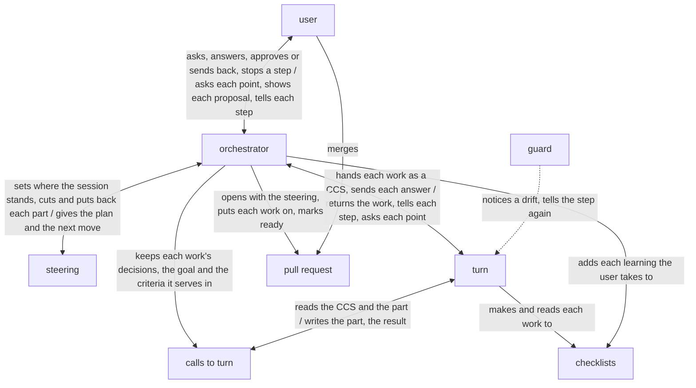

# rn architecture

rn is built on [how a plugin works](../architecture.md) so that a piece of work asked for in rough
words reaches the user's purpose while they only answer, against two drifts: the work drifting from
the purpose, and the AI itself drifting as the work goes on. The orchestrator, the one AI that talks
with the user, decides every move from the steering, the plan and where the session stands, which
rn's scripts rewrite at each move, and has each work made through turn; the user, the goal, the key
results, and what a point to decide, a sign-off, a task and a learning are, are in
[rn's UX](ux.md).

rn holds the [principles every plugin holds](../architecture.md#principles), named below
Principle 1 to 8, and its own, named below rn's Principle 1 and 2:

1. Every task traces back to the purpose, through the goal or the acceptance criteria it serves.
2. At every move the orchestrator sets where the session stands from the checked facts alone, and
   replans from the steering alone.

## User stories

- As the user, I want to ask for a piece of work in rough words with `/rn:up <what I want>`.
- As the user, I want to answer each point to decide and each learning rn puts to me, one per
  message, with an option's letter or in my own words.
- As the user, I want to approve the proposal at each sign-off with `/rn:ty`, or ask for a change
  with `/rn:gm <feedback>`.
- As the user, I want to be told before and after each step what rn does, and to stop a step going
  a way I do not want.
- As the user, I want to go on from where I stopped with `/rn:up` in a fresh conversation.
- As the user, I want to merge the pull request rn marks ready.

## Architecture

### Logical view



- The arrows run in the order of the UX's From asking to the merge; the user meets only the
  orchestrator and the pull request.
- The work is kept from drifting from the purpose in two ways: each task names the goal or the
  acceptance criteria it serves and its result is checked against them (rn's Principle 1), and after
  every move the orchestrator replans from the facts that move brought (rn's Principle 2).

  A task that serves no criterion is work the purpose did not ask for, and a plan kept from what
  was expected drifts from the purpose while every move looks done.
- The AI is kept from drifting itself in two ways: the orchestrator carries only the steering from
  move to move, and each rule a machine can judge is held where the AI acts, as
  [The guard tells each role its steps again](../architecture.md#the-guard-tells-each-role-its-steps-again)
  says: the orchestrator, in the main conversation, by rn's scripts that keep the steering and the
  calls to turn, an approval by `/rn:ty`, and the default branch by GitHub's branch protection; each
  of turn's subagents by the guard, laid with lane.

  A conversation that carries the whole of a long piece of work swells, and a fresh one starts
  from nothing; a rule written only in words is followed by chance.
- The steering is one file that steers the work to its purpose and always shows the latest: the
  stage, the sign-off waiting and the two languages, as `dev/architecture.md`'s Languages has them;
  the goal, the acceptance criteria, the tasks with their steps ticked; the next move and what is
  open. rn's scripts alone write it, and hold it to the form of rn's plan checklist at every keep,
  as they take their data from it.

  The user reads it at each sign-off and on the pull request, and a fresh conversation goes on
  from it alone (rn's Principle 2); one file holding both the plan and where it stands cannot say
  two things, where a state kept beside the plan comes to differ from it.
- At every move the orchestrator gives rn's scripts where the session stands, from the facts that
  move brought, each checked, such as the user's answer, turn's result and the output of what was
  run: the step it takes next and what is open, replacing what the steering said; the stage and the
  sign-off waiting move with the sign-offs alone.

  A fact taken unchecked carries a slip into every move after it, and a record added to rather than
  replaced swells as the conversation would.
- The goal, the criteria and the tasks are made by turn, as every work is, each passing rn's plan
  checklist and its checklist for a fix: rn's scripts cut the part a call makes, the goal and the
  criteria, the tasks or the learnings, into a file of its own, turn makes it there, and rn's
  scripts put it back into the steering once turn returns it.

  turn sees of the steering only the part it makes, so it cannot change the goal while making a
  task, and each part is read by an AI that did not make it before the user approves it
  (Principle 4).
- The tasks are made a few at a time, for the stage at hand: those that reach the plan, then one for
  each document the purpose needs, then those that build the finished work. Each names what it
  serves, the goal while the criteria are made, and each has four steps: the context read, with
  what it needs found out, and what is lacking confirmed with the user; the part and its checks
  designed by turn; that design traced on paper, or tried, by turn's first reader; and the part
  made. After each task the orchestrator has turn make the tasks again from the facts it brought.

  A stage's tasks rest on what the stage before it settled, so tasks made at once for the whole
  rest on guesses; a task begun on a gap fills it with a guess, and checks designed and traced
  before the making show its slips while they are small.
- Each work, a part of the steering, each document, each task's result, each checklist made and the
  finished work, goes to turn as a CCS, the shape [ACC](https://arxiv.org/abs/2601.11653) gives an
  AI's state, holding the work, its receiver, what they use it for and have with it, its
  checklists, its decisions, the goal and the criteria it serves, copied by rn's scripts from the
  steering, the two languages, and rn's checklist for a fix; turn's first user uses it in the
  receiver's place before it comes back (Principle 4).

  turn takes its task as a CCS and makes the work from it and the files it names alone, so the work
  does not stray from what was decided; what turn only reads goes in the CCS and what it makes is a
  file, so it changes nothing it was not asked to make.
- Each point the user decides is kept as a decision of the work it settles, in the CCS of that
  work's next call, before the move after it; a work made again is a new call, its decisions
  carried over and rewritten where an answer changed them.

  A decision kept with the call that is made from it is read by turn as it was answered, and the
  call before it still shows what that work was made from.
- No work turn returns is fixed by the orchestrator: what would be a fix is settled before turn
  runs, as a decision, and a change the user asks at a sign-off goes into the decisions, and turn
  makes the work again.

  The orchestrator only talks and decides (Principle 1); a fix of its own would be work no guard
  keeps and no first user reads.
- While turn runs, the orchestrator passes each line turn tells on to the user and each point turn
  asks to the user as a point to decide, keeps the answer in the decisions, and sends it back; it
  judges none of turn's lines, and stops the run when the user stops a step.

  Only the main conversation talks with the user
  ([Where the orchestrator runs](../architecture.md#where-the-orchestrator-runs)); an orchestrator
  that judged each way turn takes would ask the user more than what is theirs (Principle 2).
- Every decision, answer, feedback and approval is pushed before the move after it, so any stop is
  a place to go on from, and rn has no command to pause (Principle 6).
- An approval is the user's `/rn:ty`, and feedback their `/rn:gm`, both skills the AI cannot call
  ([The caller approves what is theirs](../architecture.md#the-caller-approves-what-is-theirs)).
- At a sign-off, the orchestrator shows the proposal the UX's Sign-offs gives, made from the
  steering and the calls to turn alone.

  So it says nothing turn's first user did not read.
- At each sign-off, once the user answers it, the learnings of
  [Principle 8](../architecture.md#learning-from-each-run) are made through turn as a part of the
  steering: its maker reads the stretch since the sign-off before whole, its history on the branch
  and the files as they are now, and searches the orchestrator's conversations of that stretch for
  what only they show, such as the form of each message to the user; once the user approves the
  finished work, they and those turn returned with each call are the learnings the orchestrator
  puts to the user.

  turn's own learner reads turn's runs alone, so a slip of rn's own steps shows only to a maker
  that reads the orchestrator's; a stretch ends where the user sent the work back or approved it,
  so what led there is near, and is small enough to read whole, where a whole piece of work is not;
  the learnings wait for the end, as each put to the user mid-way is a stop in the work.

### Physical view

```
rn/                                  the plugin, installed by Claude Code with turn
├── skills/
│   ├── up/SKILL.md                  the orchestrator for /rn:up <skill>
│   ├── ty/SKILL.md                  the orchestrator for /rn:ty, which the AI cannot call <skill>
│   └── gm/SKILL.md                  the orchestrator for /rn:gm, which the AI cannot call <skill>
├── scripts/                         the steering, each call to turn, a kind's checklists, the proposal, the user's answer, the records the learnings are made from <Python 3>
└── checklists/                      rn's own, one per kind <Markdown>

<the user's repository>, on the piece of work's own branch
└── .rn/
    ├── checklists/<kind>.md         the user's addition for a kind <Markdown>
    └── <yyyymmdd>-<slug>/           the record of one piece of work
        ├── steering.md              the plan and where the session stands <Markdown>
        └── turn/
            ├── <nnnn>-ccs.json      each call to turn, numbered from 0001 in the order made <JSON>
            ├── <nnnn>-steering.md   the part of the steering the call makes <Markdown>
            └── <nnnn>-result.json   what turn returned for it <JSON>
```

- rn runs on Claude Code, python3 3.9 or later, git and `gh` logged in to an account that can push
  to the repository; turn is installed with rn as its dependency.
- The orchestrator is rn's skills, run in the user's main conversation on the model they run it on.
- The orchestrator starts `turn:up` in the background with the CCS's path, its kinds and where the
  result goes, answers turn's points by SendMessage, and stops a run with TaskStop, as
  [turn](../../turn/README.md) is called.
- Each call is the files of one number, the work named in its CCS; a work made again takes the next
  number, and `<nnnn>-steering.md` is there only for a call that makes a part of the steering.
- The record is kept by a commit and a push to the piece of work's branch, made by the orchestrator
  alone, through rn's scripts; the steering's states before the current one are in its history, and
  the options weighed with their reasons and each feedback with its answer in the commit messages.

  A push is what a fresh conversation, or another machine, reads from.
- The texts the learnings are made from are written in the repository's git folder, where nothing
  is committed, and removed once the learnings are put back.
- The pull request is a draft pull request on GitHub of that branch, opened and marked ready with
  `gh`; a learning's issue is opened with it on `lovaizu/ccpm`, on the user's yes.
- rn's checklists are read-only in the plugin; the user's additions are in their repository and go
  into the piece of work's pull request.

## Verification

### Units

Each skill is checked on Claude Code's default model, the one users run rn on, with
`bypassPermissions` in a Docker Sandbox as rn's README has its users run it, and judged from the
records of every conversation and agent the check started.

- rn's scripts: each gives what this architecture says it gives, for every input it may receive.
  - Flow: unittest in `dev/rn/tests/`, fed the record, turn's results and the checklists each
    reads, by [`dev/check.sh`](../check.sh) with lines and branches 100% covered and by
    [`dev/mutate.sh`](../mutate.sh) with no mutant surviving, with Hypothesis wherever an input
    varies.
- The orchestrator: takes each move in this architecture's order, from `/rn:up` to the pull request
  marked ready.
  - Flow: on the smallest request that reaches each of the skills' moves, one point to decide, one
    acceptance criterion, one document and one task, with turn stood in for by an agent making
    each work from its CCS and the user by answers set by what each reply holds; passes when the
    records show each move in this architecture's order, and the branch holding the steering
    rewritten at each move and a call for each work.
  - Content: the messages, decisions, steerings and proposals it makes on the real requests;
    passes when each message is in the UX's form, each decision is as the user answered, each
    replan rests only on the checked facts of the move before it, and each proposal says only what
    the record holds, read against the records.
- The learnings: each quotes from the records the words it rests on.
  - Flow: made through turn on a piece of work of two stretches set beforehand, the first's
    learnings kept, the second holding a slip of the orchestrator's steps the record shows and one
    only a conversation shows; passes when each is a learning with its words quoted and nothing of
    the first stretch is shown.
- rn's checklists: what is made with them on the real requests.
  - Content: each change sent back at the deliverable sign-off is traced to the checklist or the
    skill it comes from, and fixed there; the fix passes when, on the same real requests run again,
    that change is not sent back and every story is still achieved.
- turn and lane are checked by their own architectures.

### Acceptance

Each trial runs in `lovaizu/playground`, one at a time, on a branch of its own, removed with its
pull requests after, from code kept in `dev/rn/trials/`. The real requests are kept there too, the
same for each version compared: pieces of work asked of rn in a user's rough words, each with the
purpose a stand-in user, an AI, holds behind them and does not write in the request.

- Flow: from `/rn:up` to the pull request marked ready, on the smallest request above, with
  stand-ins for turn and the user; each move shows in the records and in the commits on the branch,
  in this architecture's order.
- Asking in rough words: from a request of a few words, the points to decide reach the stand-in
  user, and the steering holds its purpose; played with real turn.
- Answering each point: every point and every learning came one per message, and each answer shows
  in the decisions and in the work it settles.
  - The stand-in user answers with letters and in its own words, and the record is read against
    the conversation.
- Approving or asking for a change: `/rn:ty` passes the sign-off, and `/rn:gm` brings the same
  sign-off back with what changed.
  - The stand-in user sends back once at each sign-off, then approves.
- Told and stopped: a line reaches the user before and after each step of the tasks, and a step the
  stand-in user stops goes the way it then says.
  - Read from the stand-in's conversation against the orchestrator's moves.
- Going on: from each place the user may stop, while asking, at a sign-off and during the tasks,
  `/rn:up` in a fresh conversation goes on with nothing asked again and nothing lost.
  - The stand-in user's conversation is closed at each, and a fresh one started.
- Merging: the pull request marked ready holds the finished work and every addition taken, and
  merges.
  - The stand-in user merges it.
- KR1.1: the changes the stand-in user sends back at the deliverable sign-off, as the UX's KR1.1
  says.
  - Counted for rn and for the version in use, the latest released rn, on the real requests.
- KR1.2: the user's time from asking to the purpose achieved.
  - Read from the timestamps of the stand-in user's conversation in its parts, answering, checking
    proposals, sending back and doing by hand, and compared with the version in use on the real
    requests; a part that adds nothing to the stories or KR1.1 is cut first.

A change is taken when every story is still achieved and KR1.2 does not come closer at the cost of
KR1.1.
