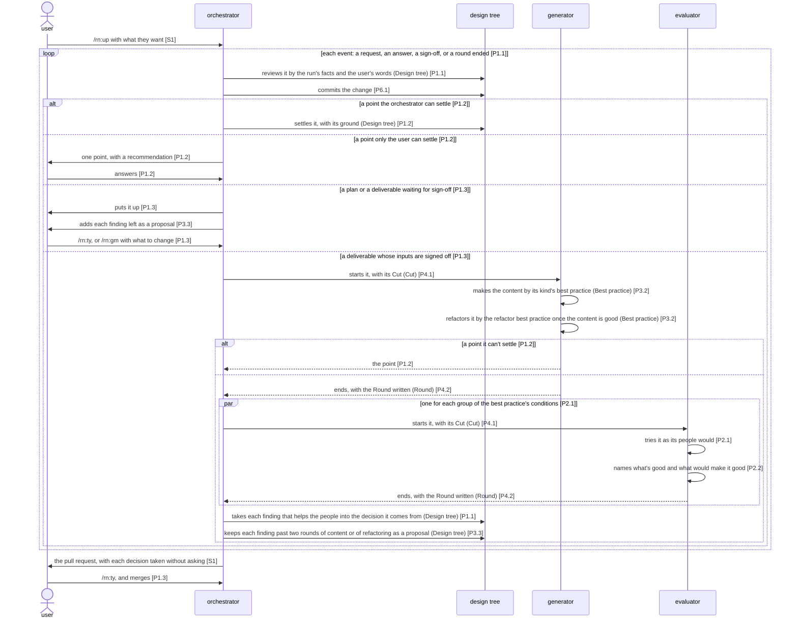
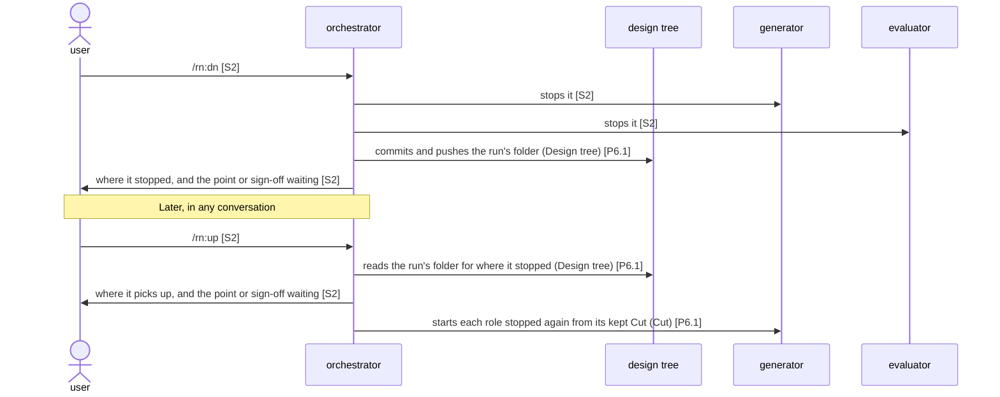
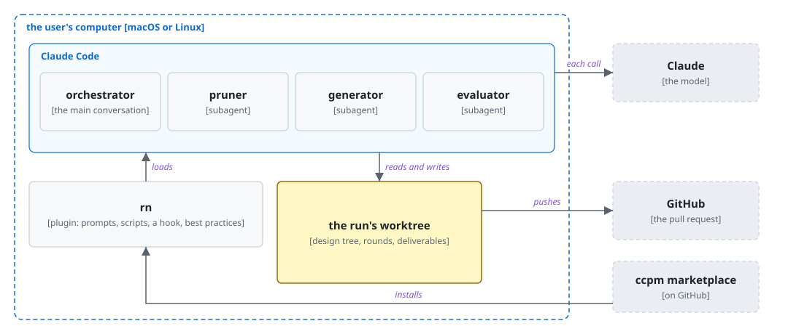

# rn architecture

## User stories

- S1: the user wants the deliverable they're after, asking in their own words with no
  specification.
- S2: the user wants to pause a run and resume it later in any conversation, losing neither time
  nor work.

## Solution strategy

### Principles

rn piles up the vital few that bring a deliverable's people to their aim, and cuts the trivial many.

- P1: toward the people's aim
  - P1.1: the run reviews its course by its facts at each event.
  - P1.2: the user is asked only what only they can decide, one point at a time.
  - P1.3: work that rests on a plan or a deliverable starts once the user signs it off.
- P2: judged by the people's aim
  - P2.1: a deliverable is tried as its people would, with only what they have.
  - P2.2: a trial names only what's good and what would make it good.
- P3: made the field's established way
  - P3.1: running, making, and judging are separate roles.
  - P3.2: a deliverable's content is made the field's established way, then refactored to read
    and change easily.
  - P3.3: remaking has a limit, and each finding left goes to the user as a proposal.
- P4: each role on its own work
  - P4.1: each role starts with only what its work needs.
  - P4.2: what a role makes stays in files, and roles hand each other short results.
- P5: the shortest path
  - P5.1: a role that leaves its steps is told at once and goes back.
- P6: nothing lost on a stop
  - P6.1: the run's state lives in files, so that it goes on from any conversation.

### Data model


- Design tree\
  Holds what to make, why, and how far the run got, for each review and each pick-up. Its form is
  [the design tree best practice](../../plugins/rn/domain/best-practices/design-tree/best-practice.md)'s.
- Cut\
  A role's part of the design tree, so that each role starts with only the decisions its work needs.
- Best practice\
  The field's established way to make one kind of deliverable, and its conditions, which making
  and judging both stand on.
- Round\
  One making of a deliverable and its judging, from which the next mend is decided.

Strategies:

- Each design tree edit checked before its commit, on each condition of its best practice that
  code can check. [P1.1]\
  Intent: the work always rests on a design tree in form.

### Components


- orchestrator (prompt)\
  Leads the run to the people's aim.
- generator (prompt)\
  Makes a deliverable with which its people reach their aim.
- evaluator (prompt)\
  Checks, as the people, whether a deliverable reaches their aim.

Strategies:

- The main conversation as the orchestrator. [P3.1]\
  Intent: start in the simplest form, and mend what it lacks by the E2E test's facts.
- One generator for each deliverable, and one evaluator for each group of conditions that a best
  practice bundles. [P2.1]\
  Intent: judge each condition with care while the wait stays short.
- A later round judging only the conditions whose decisions changed. [P3.3]\
  Intent: spend the judging on conditions whose result can change.
- Lane applied to every activity of every role's steps that it can hold. [P5.1]\
  Intent: a role that leaves its steps notices at once and goes back.

### Sequences

#### S1: a deliverable made in rounds



#### S2: a pause and a pick-up



### Deployment



The user installs rn as [the README](../../plugins/rn/README.md#installation) says, which installs
Lane, and types `/rn:up` at their repository's root.

Strategies:

- rn's own git worktree for each run. [S2]\
  Intent: the user goes on with their work, and a pause leaves their side as it was.

### Directory structure

```text
plugins/rn/                        what Claude Code installs for the user
├── skills/                        /rn:up, /rn:dn, /rn:ty, and /rn:gm
├── agents/                        the generator's and the evaluator's starts
├── domain/
│   ├── orchestrator.md            what the main conversation does as the orchestrator
│   ├── generator.md               what the generator does
│   ├── evaluator.md               what the evaluator does
│   ├── schemas/                   the form of each Cut, result, and sign-off
│   ├── tree/                      the code that checks the design tree
│   ├── check/                     the code that checks each role's result
│   └── best-practices/            rn's own best practice of each kind
├── scripts/                       runs each part's code
└── hooks/                         Lane's rules laid from each role's steps

dev/rn/                            what only rn's developers use
└── tests/                         the test cases, from unit to E2E

.claude/worktrees/                 rn's worktree of each run
└── rn-<yyyymmdd>-<goal>/          one run's worktree, on the work's branch

.rn/                               what rn writes on the work's branch
├── <yyyymmdd>-<goal>/             one run's folder
│   ├── design-tree.json           the design tree
│   └── rounds/                    each Round
└── best-practices/                each best practice made on a run
```

## Test strategy

| Check | Test target | Kind | Exit criteria or measure |
|---|---|---|---|
| Lint | Parts | Quality | 0 findings. |
| Static analysis | Parts | Quality | 0 findings of mismatched types, copied code, or import cycles. |
| Complexity analysis | Parts | Quality | Per function, McCabe 10, cognitive 15, 6 returns, 12 branches, 5 arguments, 50 statements at most. |
| Unit testing | Parts | Quality | Every case passes. |
| Unit testing | Parts that hold a prompt | Benchmark | Each case's results over 3 runs. |
| Code coverage | Parts | Quality | 100% statement (C0) and branch (C1) coverage. |
| Property-based testing | Parts | Quality | 0 counterexamples in reading the design tree and the rounds. |
| Mutation testing | Parts | Quality | 0 surviving mutants. |
| Integration testing | Architecture | Quality | Every case passes, each handoff giving the data the data model names. |
| Contract testing | Architecture | Quality | On each new gh, each recorded command gives what it recorded. |
| Traceability | Architecture | Quality | Every element tested, every case naming one level up, and each strategy's case failing broken. |
| Scenario testing | Product | Benchmark | KR1.1, KR1.2, and the orchestrator's context size, with runs added until one more moves no mean by a step. |
| Installation testing | Product | Quality | rn installs by the README's commands in a fresh home, and `/rn:up` answers. |
| Configuration testing | Product | Quality | Every case passes on Python 3.9 and on the newest Python. |
| Conformance and compliance testing | Product | Quality | Claude Code's strict check of the plugin passes. |
