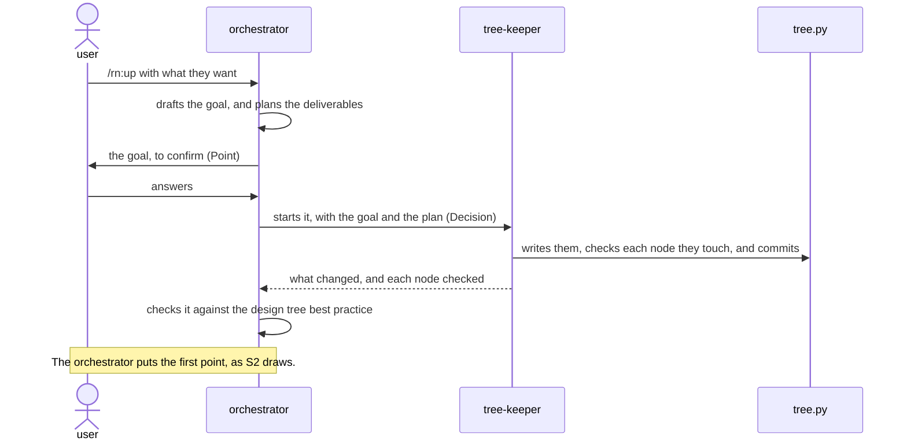
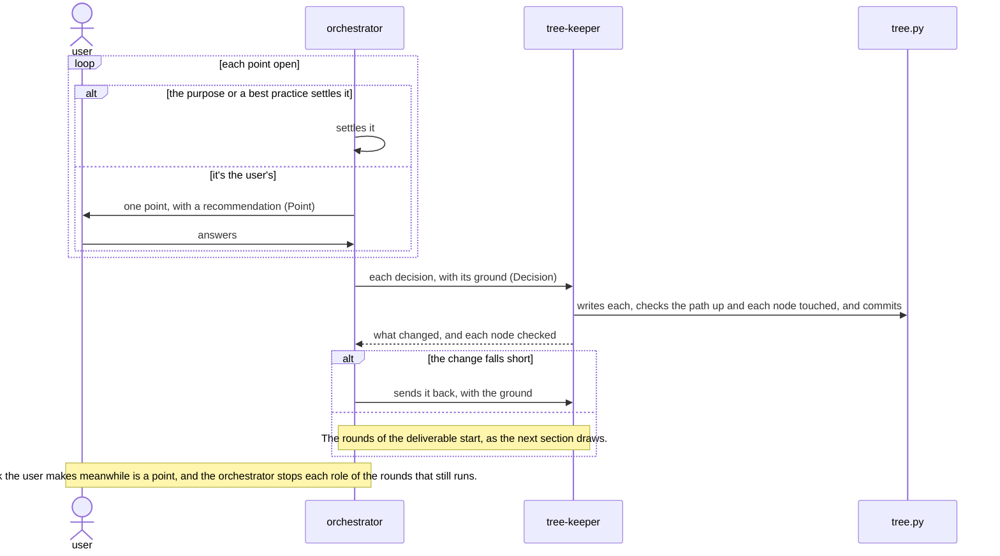
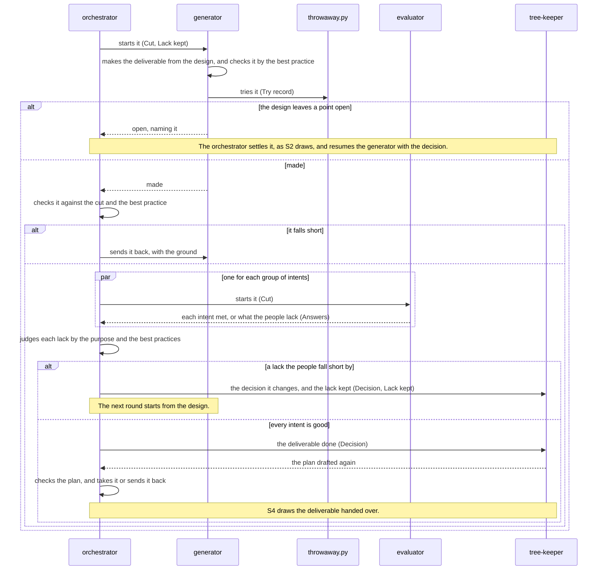
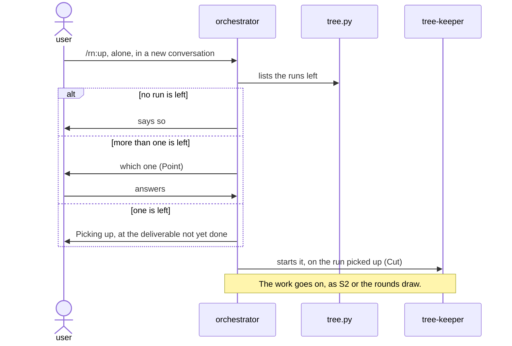
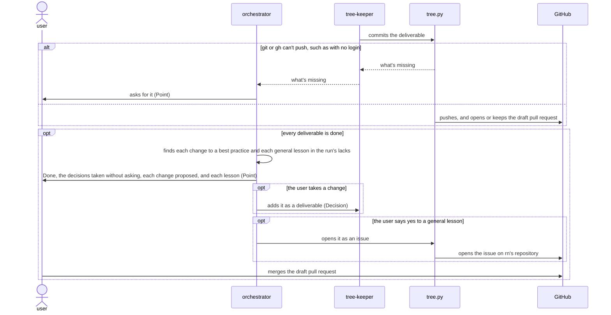

# `rn` architecture

This document says how the parts of rn give [its product vision](product-vision.md). rn builds up
only the vital few of each deliverable: what its people can't do without. The orchestrator, the
main conversation, settles the user's goal and the decisions that serve it, asking the user only the
points that are theirs, and a tree-keeper keeps them in a design tree. A generator makes each
deliverable from its decisions, round after round, until evaluators that have only what its people
have find every intent met. The orchestrator checks every result before it takes it, and a lack
changes the decision it comes from, not the deliverable.

## User stories

- S1: the user wants to type `/rn:up` with what they want, in their own words, so that they get the
  deliverable they mean without writing a specification. It carries the walkthrough's first
  `/rn:up`, the goal put to the user, and each deliverable made with no more questions.
- S2: the user wants to answer each point rn puts to them, one at a time, so that they spend their
  time only on what's theirs to decide. It carries the plan shown with its first point, the answer
  `each file`, and each remark the user makes meanwhile.
- S3: the user wants to type `/rn:up` alone in a new conversation and have rn go on where it
  stopped, so that they never answer a point twice. It carries the walkthrough's second `/rn:up` and
  `Picking up`.
- S4: the user wants each deliverable committed, one draft pull request, and the decisions rn took
  without asking, so that they check the work and merge it themselves. It carries the walkthrough's
  `Done`, each change to a best practice and each lesson that rn proposes there, and the merge.

## Components


What each decides alone:

- user\
  The goal, each point the purpose and the best practices leave open, each change to a best
  practice, each lesson sent to rn's repository, and whether to merge.
- orchestrator\
  Whether a point is the user's, each other point by the purpose and the best practices, the
  deliverables with their order, kind, and size, whether to take each role's result or send it
  back, which lacks the people fall short by and the decision each changes, when a deliverable
  ends, the plan at each turn's end, which changes to a best practice and lessons to propose, and
  which run to pick up.
- tree-keeper\
  How each decision of the orchestrator's goes into the design tree, which nodes a change touches,
  and the plan drafted again at each turn's end.
- generator\
  The deliverable, and each small point that the purpose and the best practice settle one way.
- evaluator\
  Where the deliverable meets each intent of its group for its people, or what would make it good.
- tree.py\
  The tree's form, each role's cut, the runs left, each commit, the draft pull request, and each
  issue that the user says yes to.
- throwaway.py\
  Where a deliverable's commands run.
- guard\
  Whether a role's call keeps its steps, and whether a deliverable's command runs only through
  throwaway.py, as [Lane's architecture](../lane/architecture.md) says.
- adapters\
  How rn's best practices and design tree reach the guard in the form Lane reads.

The choices made, and why:

- One generator for each deliverable over several side by side\
  Three generators would take about three times as long for a gain in KR1.1 that no trial has shown,
  as KR1.2 counts. The cost: a lack in a best practice shows only when its developers run several
  generators to check it.
- The orchestrator judging every point over a role of its own that settles them\
  The user talks with the one that decides, and no answer passes through a role that rewords it, as
  KR1.2 counts. The cost: the main conversation holds every judgment of the run.

## Data model


- Cut\
  The part of the design tree that a role starts with.
- Point\
  A question put to the user, with its recommendation, while its decision is open.
- Lack kept\
  A lack an evaluator named that the orchestrator judged the people fall short by, which the next
  round's generator gets.

## Principles

rn builds on [the plugin best
practice](../../plugins/rn/domain/best-practices/plugin/best-practice.md), and adds these rules,
which every part keeps. It differs from [N17 of the plugin best
practice](../../plugins/rn/domain/best-practices/plugin/best-practice.md#n17) only in when the
orchestrator finds the lessons: in the run's lacks before the merge, since the user merges after rn
ends.

### Drawn out along the design tree

Each role starts with its own cut of the design tree alone.

*Why*: a role that reads decisions not its own makes what the user didn't mean, as KR1.1 counts.

### Every step by best practice

Each role works by the best practice of its kind of work, and Lane holds it to the steps.

*Why*: an AI that skipped a step once skips it again, and the deliverable misses what the step makes
sound, as KR1.1 counts.

### Judged by the people it's for

An evaluator gets only what the deliverable's people have.

*Why*: an evaluator that knows what the maker meant judges the making, not what the people get, as
KR1.1 counts.

### Checked before it's taken

A role's result reaches the design tree, the deliverable, or the user only once the orchestrator
has checked it against the purpose and the best practices.

*Why*: a role that read its work wrong passes the mistake on, and the deliverable misses what the
user means, as KR1.1 counts.

### Back to the design tree on a problem

A lack changes the decision it comes from, and the next round makes the deliverable from the
design, never with a fix beside it.

*Why*: a fix beside the design rests on no decision, so the next round, made from the design, loses
it or breaks another intent with it, as KR1.1 counts.

### The design tree revised on each run

What a run finds changes the design tree before the next deliverable, and the best practice before
the next run, once the user takes the change.

*Why*: a design tree or a best practice kept as first laid out makes the same miss again, as KR1.1
and KR1.2 count.

### Tried in a throwaway copy

A deliverable's commands run only in a throwaway copy of the repository, with a throwaway home,
and a lane of Lane holds each role to it.

*Why*: a command run as the people run it would otherwise change the user's own files.

### The repository holds the work

Every part keeps the run's state only in the run's folder and the deliverables on the work's own
branch, which `tree.py` commits as they change.

*Why*: work kept only in a conversation that ends makes the user answer again, as KR1.2 counts.

## Sequences

Each start of a role goes through the guard, which lets it through only with the cut `tree.py` gave
for that role.

### S1: a request



### S2: a point settled



### S1: a deliverable made in rounds



### S3: picking up



### S4: the work handed over



## Deployment


The user installs rn as [the README](../../plugins/rn/README.md#installation) says, which installs
Lane with it, and types `/rn:up` in Claude Code at the root of their repository.

- A run's files in `.rn/<yyyymmdd>-<goal>/`, committed on the work's branch, over the system's
  temporary folder\
  A run picks up from them in any conversation, as KR1.2 counts. The cost: a folder in the user's
  repository.
- A best practice made on a run in `.rn/best-practices/` over the run's folder\
  Every later run in the repository finds it, and takes it over rn's own of the same kind, as KR1.1
  counts. The cost: a later run misses what rn's own gains after it.

## Directory structure

rn's folder holds what Claude Code installs for the user. `dev/rn/` holds what only rn's developers
use. `.rn/` is what rn writes in the user's repository.

```text
plugins/rn/
├── .claude-plugin/
│   └── plugin.json                rn's manifest, naming Lane in its dependencies
├── skills/
│   └── up/
│       └── SKILL.md               /rn:up, which makes the main conversation the orchestrator
├── agents/
│   ├── tree-keeper.md             starts the tree-keeper
│   ├── generator.md               starts the generator
│   └── evaluator.md               starts the evaluator
├── domain/
│   ├── orchestrator.md            what the orchestrator does
│   ├── tree-keeper.md             what the tree-keeper does
│   ├── generator.md               what the generator does
│   ├── evaluator.md               what the evaluator does
│   ├── tree.py                    the code of tree.py
│   ├── throwaway.py               the code of throwaway.py
│   └── best-practices/            rn's own best practice of each kind
├── scripts/
│   ├── tree.py                    runs the code of tree.py
│   └── throwaway.py               runs the code of throwaway.py
├── hooks/
│   ├── hooks.json                 starts the guard on each call
│   ├── lanes.json                 the steps the guard holds each role to
│   ├── lane/                      the guard: Lane's code, copied in by Lane
│   └── adapters/                  give the guard rn's best practices and design tree
└── README.md                      for rn's users

dev/rn/
├── product-vision.md              rn's product vision
├── architecture.md                this document
├── README.md                      for rn's developers
└── tests/                         the unit, architecture, and product vision tests

.rn/
├── <yyyymmdd>-<goal>/             one run
│   ├── design-tree.json           the design tree
│   └── rounds/                    each round's Try record, Answers, and Lack kept
└── best-practices/                each best practice made on a run
```

## Tests

rn tests by the test rules of [the architecture best
practice](../../plugins/rn/domain/best-practices/architecture/best-practice.md) and [the plugin best
practice](../../plugins/rn/domain/best-practices/plugin/best-practice.md), and differs from them
where this section says. The architecture tests also check that each role of Components has its
agent and its part, that each role's forms carry the data its sequences hand on, and that Lane
holds each lane a principle rests on. Each judgment of the orchestrator's, and whether an intent is good,
only an AI makes, so only the product vision tests show them.


- `tree.py` tried `FULL` at architecture over `HAPPY`\
  A fault there writes the tree wrong or hands a role another's cut, and no higher level checks each
  case, as KR1.1 counts. The cost: the most tests to keep up as the tree's form changes.
