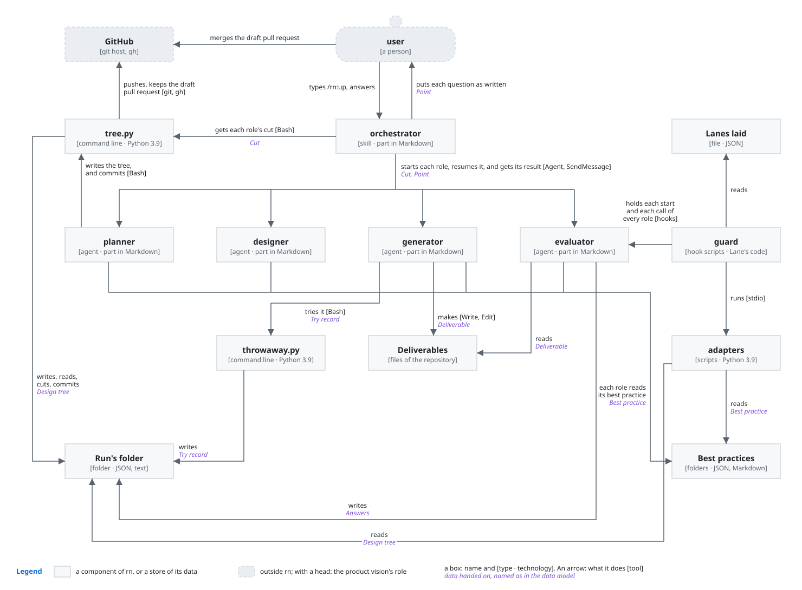
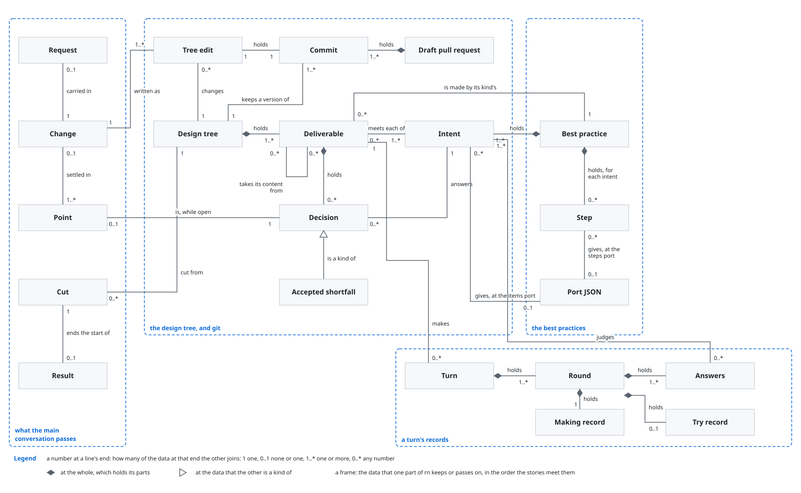
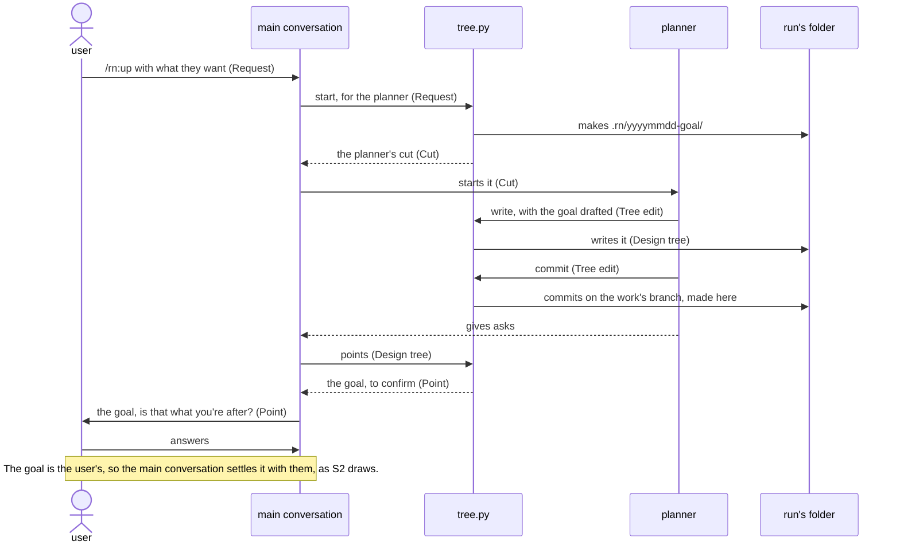
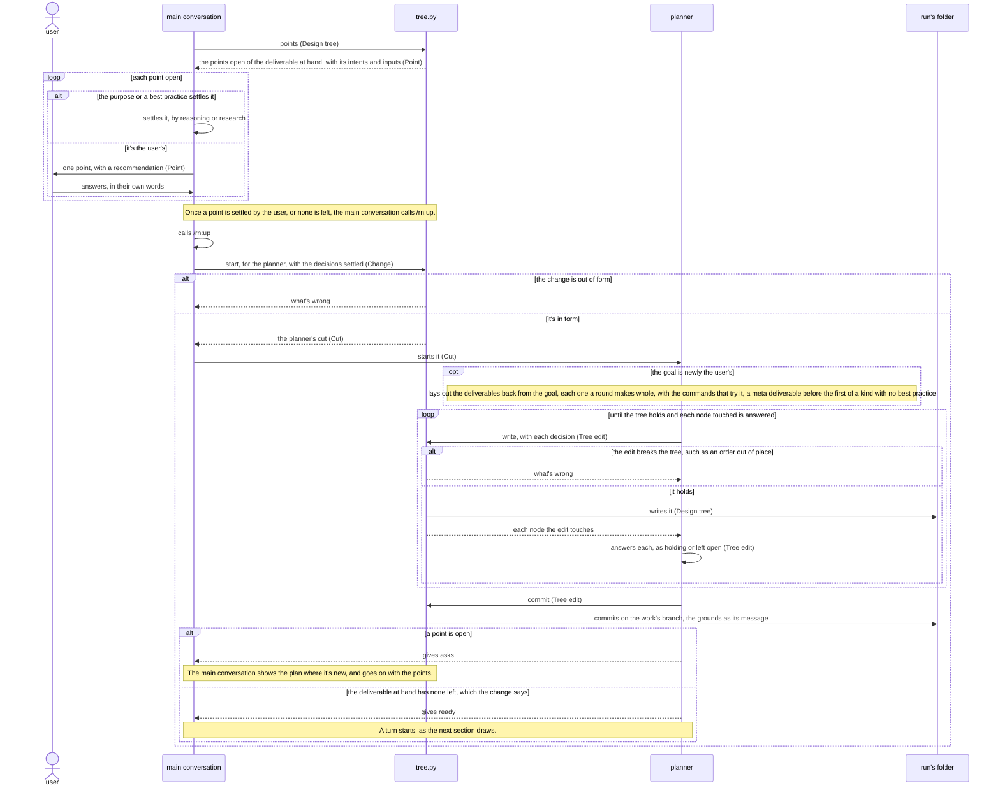
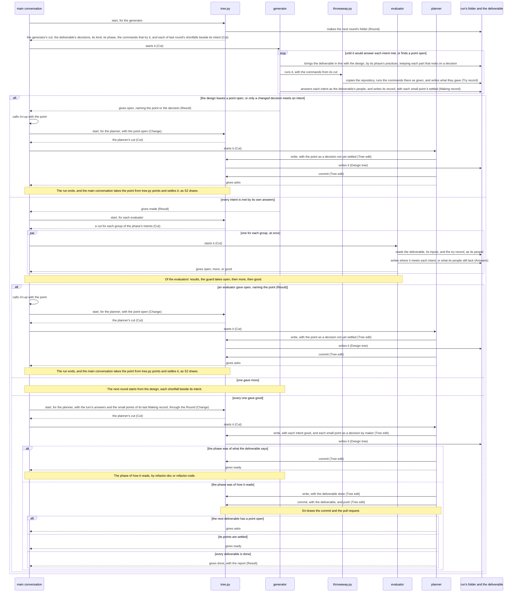
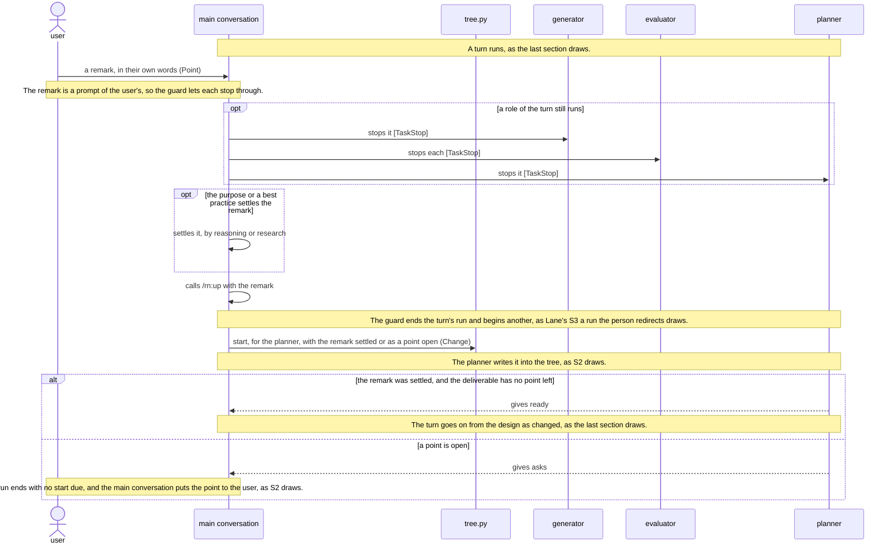
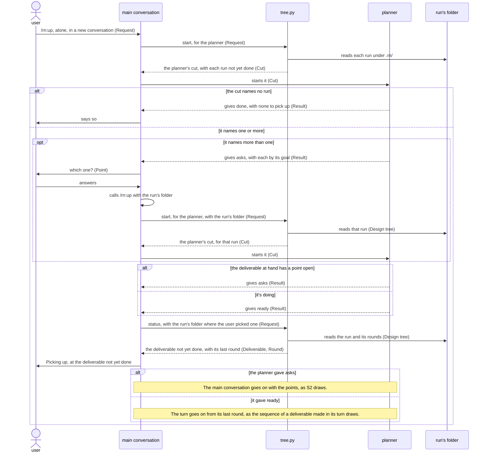
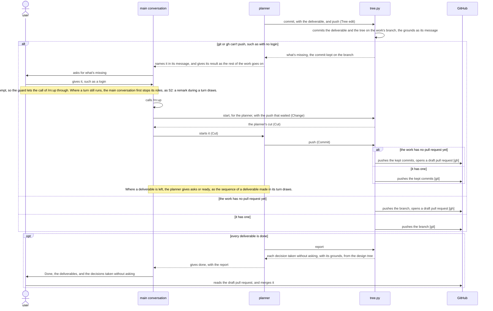
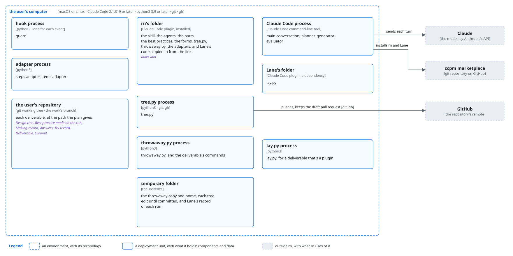
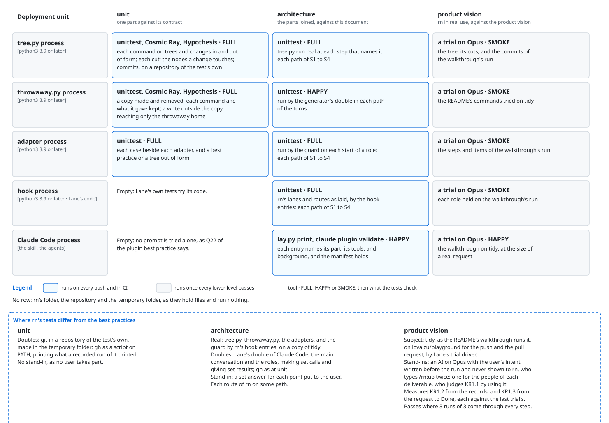

# `rn` architecture

This document says how the parts of rn give [its product vision](product-vision.md). rn holds the
work as decisions in a design tree, apart from the deliverables made from them. The user's
conversation alone settles a point of the design. Every other part makes a deliverable from the
decisions and its kind's best practice, or judges it as its people do, who never see the decisions.
A deliverable that falls short of its people goes back to the decision that serves it, never to a
fix beside the design, and a conversation that ends loses nothing, as the repository holds every
decision.

Each part carries a piece of that idea:

- **The main conversation** settles each point of the design with the user, one at a time, and
  starts the planner with it.
- **The planner** has `tree.py` write each point into the tree, each small point the generator
  settled among them, and lays out the plan back from the goal, with the commands that try each
  deliverable as its people would run them.
- **`tree.py`** alone reads and writes the tree, cuts each role's part of it, and commits each
  change on the work's branch, with one draft pull request for the user to merge.
- **The generator** makes a deliverable whole from its decisions and its kind's best practice, round
  after round in a turn. It settles each small point that has one answer and writes it in the
  round's Making record, and names each other point the decisions leave open.
- **`throwaway.py`** runs the commands that the planner gave for the deliverable, in a throwaway
  copy, and keeps what they gave as the try record.
- **The evaluator**, fresh in each round, reads the deliverable and its try record as its people,
  and says where it meets each intent or what they still lack. A point that it or the generator
  finds open, or a remark of the user's during a turn, goes back to the main conversation through
  the planner and the tree.
- **The guard**, the code of Lane, the plugin that holds a plugin's roles to their steps, holds
  each role to the steps of the practices it carries out, and each start to the text that `tree.py`
  cut for it. It holds the main conversation's starts of roles, its stops, and its calls of `/rn:up`
  to the routes, which name the next start from each role's result.
- **The steps adapter** and **the items adapter** let the guard read rn's best practices and design
  tree.

## Principles

rn builds on [the plugin best practice](../../plugins/rn/domain/best-practices/plugin/best-practice.md).
It differs from these of its practices:

- **[Q5](../../plugins/rn/domain/best-practices/plugin/best-practice.md#q5) and
  [Q17](../../plugins/rn/domain/best-practices/plugin/best-practice.md#q17)**: the main conversation
  settles the points of the design, which
  [Q5](../../plugins/rn/domain/best-practices/plugin/best-practice.md#q5) leaves to a role, and puts
  each point to the user itself, which
  [Q17](../../plugins/rn/domain/best-practices/plugin/best-practice.md#q17) leaves to a role. The
  main conversation still makes and judges nothing of a deliverable, and the planner writes each
  point, so Lane holds every change to the tree. *Why*: the design is the user's intent, so rn
  settles it where the user talks. No role stands between a point and the user, so the main
  conversation weighs each point with all the user said, and asks them none that the purpose
  settles, as KR1.2 counts.
- **[Q21](../../plugins/rn/domain/best-practices/plugin/best-practice.md#q21)**: rn takes in no lesson
  once a run ends. *Why*: no step of the product vision follows the work once the user has the
  draft pull request, and a step there would ask the user more, which KR1.2 counts. A lesson that
  one run meets can come back in a later run, where the evaluators find it again before the
  deliverable goes out. It then costs that run a round, as KR1.3 measures, and not what the people
  get, as KR1.1 counts.

rn adds these.

### Planned back from the goal

The planner lays out every deliverable the goal needs, with what each takes from the others as
its inputs and preconditions, before any turn makes one, by [the plan best practice](../../plugins/rn/domain/best-practices/plan/best-practice.md).
`tree.py` alone orders the deliverables by what each takes from the others. A kind with no best
practice gets a meta deliverable before its first deliverable, made by the meta best practice.

*Why*: a deliverable left out shows only when the work reaches it, and one made before what it
takes needs making again. The people it's for then can't use it as handed over, as KR1.1 counts,
and the user waits longer, which KR1.3 measures.

### One round makes a deliverable whole

The planner makes each deliverable one that a generator makes whole in a round and an evaluator
reads whole. A larger work, such as a plugin's code, splits into a deliverable for each component of
its architecture, each after the components it takes from. The deliverable of the plugin as a whole
comes after them, and checks how they join by the architecture tests.

*Why*: a deliverable larger than a round comes out in pieces that no one design holds together, and
an evaluator that reads only part of it answers an intent on lines it never read. Its people then
meet what no one read whole, as KR1.1 counts.

### The main conversation settles, the planner writes

The main conversation settles each point of the design, in the user's conversation, one at a time.
It settles a point itself where the purpose or a best practice settles it, and puts the rest to
the user with a recommendation. A point the user answers by leaving it to rn counts as theirs.
Only the planner changes the tree, by handing `tree.py` a tree edit. After each edit it answers
each node that `tree.py` lists as touched, and where a node no longer holds, it leaves that point
open for the main conversation. A role never settles a point of the design. The generator settles
only a small point of making, as
[The maker settles a point with one answer](#the-maker-settles-a-point-with-one-answer) says.

*Why*: a point settled outside the user's conversation comes back as rework, or asks the user what
the purpose settles, which KR1.2 counts. Of the main conversation's calls, Lane holds only its
starts of roles, its stops, and its calls of `/rn:up`, as
[Every step on every run](#every-step-on-every-run) says. A change that the main conversation wrote
to the tree itself would go unheld, and the nodes around it would go on saying what held before. A
deliverable built on them then fails its people, as KR1.1 counts.

### Each role gets only its cut

`tree.py` cuts each role's part of the tree, and the main conversation starts the role with that
text alone. No one adds a fix, a hint, or a remark of the user's to a start on the way, or to a
message to a role that runs. No role, and not the main conversation, reads the design tree itself.

*Why*: a role that reads the whole tree takes up decisions that aren't its own, and an evaluator
that reads it judges whether the deliverable follows the design, not what its people get. A
deliverable its people can't use then passes, as KR1.1 counts. A fix or a remark added to a start
reaches the deliverable beside the design, as [Good from the root](#good-from-the-root) rules out.

### The evaluator has only what the deliverable's people have

An evaluator gets the intents of its group, the deliverable, the deliverables it takes its
content from, and the record of the deliverable tried. It never gets the design, the practices,
or the generator's record. Where the user kept a decision knowing what it costs an intent, the
evaluator gets that lack too, in the people's terms, as an accepted shortfall.

*Why*: the people a deliverable is for never see what its maker meant. An evaluator that has the
design or the practices checks how its maker made the deliverable, not what it gives them, as
KR1.1 counts. An evaluator that isn't told of an accepted shortfall sends it back every round,
and the turn never ends, which KR1.3 measures.

### A turn makes a deliverable until every intent is good

A turn is a unit inside `/rn:up`, with no skill of its own, and Lane holds its flow by the routes.

- **It starts from** the decisions the main conversation settled for the deliverable, as `tree.py`
  cuts them, and the best practice of the deliverable's kind. It starts once the planner gives
  `ready`.
- **Its phases** come in order. The first makes what the deliverable says, by its kind's best
  practice. The second makes how it reads, by `refactor-doc` for a document or `refactor-code` for
  code, and changes nothing it says.
- **Each phase goes round after round**: in each round, the generator brings the deliverable in
  line with the design, and the evaluators answer each intent of the phase. An intent is good once
  the evaluators answer it met, and the rounds go on until every intent is good.
- **It ends** once every intent of both phases is good, which the planner writes into the tree as
  it commits the deliverable. Or it stops at a point that only the user can settle, as
  [A point found open goes back to the main conversation](#a-point-found-open-goes-back-to-the-main-conversation)
  says.
- **Its rounds' records** lie in the run's folder, under `turns/`, as
  [Directory structure](#directory-structure) shows.

*Why*: a deliverable handed over with an intent not met fails its people, as KR1.1 counts. A
sentence polished before what it says holds needs polishing again, which KR1.3 measures.

### Good from the root

A shortfall goes back to the decisions that serve its intent, and the next round starts from the
design. `tree.py` cuts the next round's generator start with the deliverable's decisions and each
shortfall beside the intent it falls short of, and with nothing else. The generator brings the
deliverable in line with the decisions, so that each part of it rests on one, and keeps each part
that already does. It lays no fix on the deliverable beside the design. The generator judges
whether the decisions meet a shortfall, as only the generator makes the deliverable from them:

- Where the decisions meet the shortfall, they stand, and the round brings the deliverable in line
  with them.
- Where only a changed decision would meet it, the generator gives `open` and names that decision.
  The decision then goes back to the main conversation, as
  [A point found open goes back to the main conversation](#a-point-found-open-goes-back-to-the-main-conversation)
  says.

*Why*: a fix laid on the deliverable beside the design is a part that no decision holds. The next
round loses it, or keeps it though no one settled it, and a fix for one evaluator's finding breaks
an intent that another found met. A part made anew though a decision already held it can lose what
an evaluator found met. A decision that a role changes is one that no one settled, and an evaluator
can't tell the two cases apart, as it never gets the design. The people then get a deliverable no
design holds, as KR1.1 counts.

### The maker settles a point with one answer

The generator settles a point that no decision holds only where the purpose and its kind's best
practice settle it one way, such as a phrase or the form of a printed line. In each round, it
writes each such point that the deliverable holds, with what settles it, in the round's Making
record. Once the phase's intents are good, the planner's Change reaches the last round's Making
record through the Round, and the planner writes each point it names into the tree, as a decision
by `maker`. The report of the decisions taken without asking reads it there. Any other point, such as
a choice between ways that serve the people differently, or one that touches what the user
approved, is a point of the design. The generator names it open for the main conversation, as
[A point found open goes back to the main conversation](#a-point-found-open-goes-back-to-the-main-conversation)
says.

*Why*: a point that the purpose and the best practice settle one way comes out the same in every
round, so it holds the deliverable as a decision does, and no round loses it. Putting it to the
user gives them nothing to weigh, as KR1.2 counts. In the tree, it stands with every other
decision, so the next phase's cut holds it, and the report that the user reads before they merge
names it with the other decisions taken without asking. The round's folder keeps the Making
record, while a Result reaches only the conversation that got it. A conversation that ends before
the planner writes the points then loses none of them. A lost point would leave the next phase free
to make it another way, as KR1.1 counts. A choice between ways that serve the people
differently is the user's. One that the generator takes alone can come out another way in
the next round, and hands the people a way that no one weighed for them, as KR1.1 counts.

### The maker checks first

Before it gives `made`, the generator answers each intent of the phase the way the evaluators do,
as the deliverable's people, with the lines that meet it or what they still lack. Where it would
answer one not met, it brings the deliverable in line with the design again. Where only a changed
decision would meet an intent, it gives `open` instead of `made`, as
[Good from the root](#good-from-the-root) says. Only the evaluators' answers make an intent good.

*Why*: a lack that the maker could have seen otherwise costs a round of evaluators to find, and the
user waits longer, which KR1.3 measures. The maker reads what it meant, not only what it wrote, so
its own answer making an intent good would let a deliverable its people can't use pass, as KR1.1
counts.

### The evaluator seeks the good

An evaluator reads as the deliverable's people. For each intent, it says where the deliverable
meets it, or what the people still lack to reach good. It hunts no defect that the people would
never meet.

*Why*: a finding that the people never meet sends the deliverable back for a change that gives them
nothing, and the turn runs longer, which KR1.3 measures. A fix for it can break what they do meet,
as KR1.1 counts.

### A point found open goes back to the main conversation

The run stops at a point found open, in either of these cases:

- The generator finds a point that the design leaves open, or names a decision that must change.
- An evaluator finds a point that the people's use leaves open, such as a choice between ways
  that serve them alike.

A role only finds and names such a point, in the Result that ends the run. The main conversation
calls `/rn:up` with it, the planner writes it into the tree as a decision not yet settled, and
`tree.py points` gives it to the main conversation, as it gives any point open. The main
conversation alone decides whether the purpose or a best practice settles it or it's the user's.
It settles the point, the planner writes it, and the turn goes on from the design as changed.
Where only a change to a decision that the user settled would meet a shortfall, rn takes the
decision to the user only with a fact that their answer didn't weigh. Without such a fact, the
shortfall stays as an accepted shortfall.

*Why*: a role that settles such a point itself makes a part that the design doesn't hold, which
[Good from the root](#good-from-the-root) rules out for a fix. A point that reaches the main
conversation only in a Result goes with the conversation if it ends, while one in the tree waits
for the next `/rn:up`, so the user answers no point twice, as KR1.2 counts. Asking the user again
what they settled spends their time and gives them nothing to weigh, as KR1.2 counts.

### A remark during a turn is a point

A remark that the user makes while a turn runs is a point. The main conversation takes it in these
steps, which [S2: a remark during a turn](#s2-a-remark-during-a-turn) draws:

1. The main conversation stops each role of the turn that still runs, with `TaskStop`. The remark
   is a prompt of the user's, so Lane lets the stop through, as
   [its principle on how long the guard holds the main conversation](../lane/architecture.md#the-guard-holds-the-main-conversation-only-while-its-run-lasts)
   says.
2. Right after the stop, the main conversation calls `/rn:up` with the remark, which ends the
   turn's run and begins another. It hands the planner the remark settled, where the purpose or a
   best practice settles it, or else as a point open.
3. The planner writes the remark into the tree. For a remark settled, the turn goes on from the
   design as changed. For a point open, the planner gives `asks`, so the run ends with no start
   due, and the main conversation puts the point to the user as it puts any point.

No one passes the remark to a role that runs, as
[Each role gets only its cut](#each-role-gets-only-its-cut) says.

*Why*: a role that runs on makes or judges a deliverable by a design about to change, and its
result costs the user a round, as KR1.3 measures. A turn that went on in the stopped run would
start its next role from a cut made before the remark. A remark passed to a role reaches the
deliverable beside the design, and the next round loses it, so the user says it again, as KR1.2
counts.

### Tried in a throwaway copy

The commands that try a deliverable, its install steps among them, run only in a throwaway copy of
the repository, with a throwaway home. The planner decides them as the deliverable's people would
run them, and `throwaway.py` runs them as given.

*Why*: a try that doesn't run the commands as the people run them misses what they would meet,
and hands over a deliverable they can't use, as KR1.1 counts. A command run as the people run it,
such as `tidy` on a Downloads folder, would otherwise change the user's own files, which can't be
undone. Commands that the generator chose would try what it meant to make, and could change from
round to round, so the evaluators would judge a run that differs from what the people run, as
KR1.1 counts.

### Every step on every run

Lane holds each role to the steps of the practices it carries out, read from the best practice
itself at the steps port, a best practice made on the run among them. It holds each start to the
text that `tree.py` gave. Of the main conversation's calls, it holds its starts of roles, its stops
with `TaskStop`, and its calls of `/rn:up` to the routes, and none of its other calls, such as a
write to a file, as
[Lane's principle on how long the guard holds the main conversation](../lane/architecture.md#the-guard-holds-the-main-conversation-only-while-its-run-lasts)
says.

*Why*: an AI that skipped a step once skips it again on another run, and the deliverable misses
what the step was there to make sound, as KR1.1 counts. The main conversation reads and researches
freely to settle a point, so a guard on its other calls would leave it to put to the user a point
that the purpose settles, as KR1.2 counts.

### The repository holds the work

`tree.py` commits every change to the tree on the work's own branch as the planner writes it, with
its grounds in the commit message. It commits a deliverable once its turn ends good, and keeps
one draft pull request for the work. The user merges it, and rn never does. A run's files lie in
`.rn/<yyyymmdd>-<goal>/`, and `/rn:up` alone goes on from them.

*Why*: a conversation can end at any point, and work kept only in it goes with it, so the
user answers again, as KR1.2 counts. The merge is the user's, as
[Q16](../../plugins/rn/domain/best-practices/plugin/best-practice.md#q16) says.

## User stories

Each story carries a part of the main use of O1, rn's only objective, as the walkthrough runs it.

- **S1**: the user wants to type `/rn:up` with what they want, in their own words, and confirm the
  goal rn reads in it. It carries the walkthrough's first `/rn:up` and the goal put to the user.
- **S2**: the user wants to answer each point rn puts to them, one at a time, in their own words.
  It carries the plan shown with its first point, the answer `each file` and rn making README.md
  from it, each point that comes up while rn makes a deliverable, and each remark the user makes
  meanwhile.
- **S3**: the user wants to type `/rn:up` alone in a new conversation, and have rn go on where it
  stopped, asked nothing again. It carries the walkthrough's second `/rn:up`, `Picking up`, rn
  making tidy/cli.py from where the work stopped, and the user picking one run where more than one
  isn't yet done.
- **S4**: the user wants each deliverable committed on a branch, one draft pull request to merge,
  and the decisions rn took without asking them. It carries the walkthrough's `Done`, the user's
  merge, and what the user gives where a push lacks it, such as a login.

## Components



Every component lies on the sequences of S1 to S4, which carry O1, except the generator, the
evaluator, and `throwaway.py`, which lie on those of S2 and S3, where a turn makes a deliverable.
What each decides alone:

- **user**: what's theirs: the goal, each point the purpose and the best practices leave open, and
  whether to merge.
- **main conversation**: whether a point, open in the tree, found by a role, or remarked by the
  user, is the user's or settled by the purpose or a best practice, how it's settled, the words
  it's put in, and when a deliverable has no point left.
- **planner**: the goal as drafted from the request, the plan, each deliverable's kind, inputs and
  preconditions, each deliverable's size, so that a round makes it whole, the commands that try
  each deliverable as its people would run them, its install steps among them, and what stands in
  for a file outside the repository, whether each node a change touches still holds, each status
  and intent made good from the evaluators' answers, and which result to give for the runs left
  that its cut lists.
- **generator**: the deliverable, each small point of making it that the purpose and its kind's
  best practice settle one way, such as a phrase, its own answer to each intent before it gives
  `made`, and whether the decisions meet a shortfall. A point the design leaves open, or a decision
  that must change, it only finds and names.
- **evaluator**: where the deliverable meets each intent of its group for its people, or what they
  still lack. A point that their use leaves open, it only finds and names.
- **tree.py**: the form of the design tree and of a change, the order of the deliverables, from
  their inputs and preconditions, each role's cut, the nodes an edit touches, each turn's phase,
  round and groups, the points open for the main conversation, the runs under `.rn/` not yet done,
  each commit, the branch, and the draft pull request, the deliverable of a run not yet done and
  its last round, and the report of each decision taken without asking, read from the design tree
  with its grounds.
- **throwaway.py**: where a deliverable's commands run, and what of them the try record keeps. It
  runs the commands as the planner gave them.
- **steps adapter**, **items adapter**: how rn's best practices and design tree read in the forms
  of Lane's steps and items ports.
- **guard**: whether a role's call keeps its lanes, which start is due, whether a start's text
  is the one `tree.py` gave, and whether a stop of a role or a call of `/rn:up` during a run follows
  a prompt of the user's, as [Lane's architecture](../lane/architecture.md) says. Of the main
  conversation's calls, it holds only its starts of roles, its stops, and its calls of `/rn:up`.

These choices in the components are ones a developer would question:

- **The main conversation calling `/rn:up` again once it settles a point, with a point a role
  found open, with a remark, with the run the user picked, or once the user gives what a push
  lacked,** over resuming the role that stopped: the point comes from the main conversation, not
  from the user's words alone, and Lane lets a resume carry the user's words and nothing else. A
  new call of the skill begins a run, whose first start is the planner with the text `tree.py` cut
  for it. Lane then holds that start as it holds every other, so no role works from a point that
  the tree doesn't hold, as KR1.1 counts. During a run, Lane lets such a call through only once the
  user has written a prompt, and it then ends that run. The cost: the main conversation reads the
  skill's part again on each call.
- **One point a user settles in each change** over the points of a deliverable written at once: each
  answer is in the tree before the next point goes out, so a conversation that ends loses none,
  as KR1.2 counts. The cost: a run of the planner for each such point.
- **The planner started fresh for each change** over one planner kept for the run: each start
  keeps to its own cut, and a fresh planner carries no decision of an earlier change into this
  one, as KR1.1 counts. The cost: the planner reads its cut again on each start.
- **The generator running `throwaway.py` on each pass of its own check** over each evaluator
  running it: the evaluators of a round run at once, as KR1.3 asks. The round keeps the try record
  of the generator's last pass, so every evaluator judges the same run of the commands, on the
  deliverable as the generator gave it with `made`. The cost: an evaluator can't try a command
  that the try record doesn't hold, and names it as a lack instead.
- **`tree.py` committing and keeping the draft pull request** over a script of its own: each commit
  holds a tree edit, and the edit's grounds make its message, which only `tree.py` reads in the
  form the planner writes. A second reader of that form would drift from `tree.py` as the form
  changes, and a commit it missed would leave a decision that the user then answers again, as
  KR1.2 counts. The cost: `tree.py` needs git, and `gh` for the pull request.

## Data model



- **Request**: the user's words after `/rn:up`, as they typed them, or the folder of the run they
  picked, which the main conversation hands with `/rn:up`, and whose Design tree `tree.py` reads.
- **Change**: what one start of the planner writes: the request, the decisions the main
  conversation settled, a point that a role's Result named open, a remark as a point open, a turn's
  answers and the small points of the generator's last Making record, through the Round that
  holds them, or a push that waited on the user.
- **Tree edit**: what the planner hands `tree.py` to write: each node it changes, the grounds, and
  its answer to each node touched: it holds, or the planner leaves it open.
- **Cut**: the text `tree.py` gives a role to start with: its run values and its part of the tree,
  and for the generator, each of last round's shortfalls, through the Round that holds them.
- **Result**: what a role gives the main conversation as it ends a start: one of its fixed words,
  such as `asks` or `made`, with its message, such as the report that comes with `done` or the
  point that comes with `open`.
- **Point**: a decision the main conversation settles, whether the tree holds it open, a turn
  found it, or the user remarked it during a turn. A point found or remarked reaches the tree
  through a Change, as a decision not yet settled, and reaches the main conversation from there.
- **Turn**: the making of one deliverable from its settled decisions, through both phases.
- **Round**: one making of the deliverable in a phase, with its Making record, its Try record, and
  the evaluators' Answers to it.
- **Making record**: the generator's record of a round, `generator.json`: what it made, each
  small point it settled, its own answer to each intent, and each point it found open.
- **Answers**: an evaluator's record of a round, `evaluator-<group>.json`: each intent, by its
  question's id in the best practice of the deliverable's kind, met with the lines that meet it, or
  not met with what the people still lack.
- **Try record**: the commands that try a deliverable and what each gave on the generator's last
  pass of a round, `throwaway.txt`.
- **Accepted shortfall**: a decision of the user's, under the intent it costs, that says what the
  people lack by it.
- **Port JSON**: a best practice's steps or a tree's items in the forms of Lane's ports.
- **Rules laid**: rn's lanes and routes as Lane laid them, which hold each role to its steps and
  name the next start from each result.

The data serve O1 through the stories whose sequences hand them on. Cut, Result, Design tree, Tree
edit, and Commit lie on every story's sequence, and so do Step, Port JSON, and Rules laid, which the
guard reads at each start. Request lies on those of S1 and S3, Point on those of S1 to S3, and
Change on those of S2 to S4. Deliverable, Intent, Decision, Accepted shortfall, Best practice, and
a turn's records lie on those of S2 and S3, and Deliverable and Draft pull request on that of S4.

## Sequences

Each story's steps follow in order. The participants carry their names in
[Components](#components), and the data in brackets those in [Data model](#data-model). Each role's
`gives` hands the main conversation a Result. Each start of a role goes through the guard, which
lets it through only with the cut `tree.py` last gave for that role, as
[Lane's architecture](../lane/architecture.md) draws.

### S1: a request



- **The planner drafting the goal** over the main conversation asking for it outright: the user
  confirms a goal written to the plan best practice faster than they write one, which shortens
  what KR1.3 measures. The cost: a run of the planner before the user's first point.

### S2: a point settled



- **The run ending at `asks`, a route with neither a next start nor a wait,** over a route that
  waits for the user: a route that waits has the main conversation resume the planner with the
  user's words alone, but the main conversation also settles points by reasoning, with no words of
  the user's. A route that waits would have it put to the user each point that the purpose settles,
  as KR1.2 counts. The cost: a role started by mistake between two runs starts unheld, though Lane
  still holds its calls.

### S2 and S3: a deliverable made in its turn



- **A turn inside `/rn:up`, with no skill of its own,** over a skill for a turn: the user types
  only `/rn:up`, as the walkthrough does, and the routes of one skill take the work from the
  planner's `ready` through the rounds and back to the planner with no call between them. The user
  then spends no time on a turn, as KR1.3 measures. The cost: `/rn:up`'s routes carry the results
  of every role.
- **The generator bringing the deliverable in line with the design in each round, keeping each
  part that rests on a decision,** over mending the lines that last round found short, or making
  the whole deliverable anew: each round's deliverable holds only what the design holds, and keeps
  what an evaluator found met, so no change breaks what the people already get, as KR1.1 counts.
  The cost: the generator reads each part against the decisions, however small the shortfall.
- **The generator answering each intent before it gives `made`** over leaving every answer to the
  evaluators: a lack it can see costs no round of evaluators, as KR1.3 measures. The cost: the
  generator reads the deliverable again as its people in each round.
- **The rounds without a limit** over a turn that stops after a set number: a turn that stops
  after a set number hands over a deliverable with an intent not met, as KR1.1 counts, which comes
  before KR1.3. A shortfall that only a changed decision meets goes back as a point open, so a turn
  goes on only while the generator can meet what the evaluators find. The cost: a turn runs long
  while its evaluators keep finding new shortfalls, as KR1.3 measures.
- **One evaluator for each group of intents, all at once,** over one for every intent: each is fresh
  on fewer intents, as KR1.1 asks, and they run side by side, as KR1.3 asks. The cost: each evaluator
  reads the whole deliverable.

### S2: a remark during a turn



- **Each role that still runs stopped with `TaskStop`** over letting it end, or sending it the
  remark, for the reasons that [A remark during a turn is a
  point](#a-remark-during-a-turn-is-a-point) gives: a role that runs on costs the user a round, as
  KR1.3 measures, and a remark sent to it makes the user say it again, as KR1.2 counts. [Claude
  Code's subagents reference](https://code.claude.com/docs/en/sub-agents) documents `TaskStop`. The
  cost: the stopped round gives no result, so its work goes unused.
- **A call of `/rn:up` right after the stop, with the remark settled or as a point open,** over
  putting the remark to the user first: the stopped run still has a start due, which Lane has the
  main conversation take before its turn ends. The user would then get the point only after a role
  ran by the old design, and wait for it, as KR1.3 measures. Why the main conversation calls
  `/rn:up` rather than resuming the stopped role is the first choice in [Components](#components).
  The cost: the planner runs twice for a
  remark that's the user's. It first writes the remark open, and later the user's answer.

### S3: picking up



### S4: the work handed over



## Deployment



The user installs rn as [the README](../../plugins/rn/README.md#installation) says, which installs
Lane with it, and types `/rn:up` in Claude Code at the root of their repository.

A developer starts rn as it stands in this repository, with no install. At the root of a git
repository to work in, such as a copy of the trials' `dev/rn/tests/product-vision/tidy/`, they
start Claude Code with the folders of both plugins:

```console
claude --plugin-dir <this repository>/plugins/lane --plugin-dir <this repository>/plugins/rn
```

The local Lane meets rn's dependency on Lane, and `/reload-plugins` loads an edit made during the
session, as Claude Code's [Develop without a marketplace](https://code.claude.com/docs/en/plugins/create#develop-without-a-marketplace)
and [Test a plugin and its dependency locally](https://code.claude.com/docs/en/plugins/dependencies#test-a-plugin-and-its-dependency-locally)
say. `hooks/lane/` of rn then reaches Lane's code through its link.

The product vision trials start rn as the user does instead. They install rn from this repository's
marketplace into a throwaway home, as the README's installation does from GitHub, so installing
copies Lane's code into rn's folder from the link of `hooks/lane/`.

- **Claude Code 2.1.319 or later** over an earlier version: rn runs under its guard, which needs
  it, as [Lane's README](../../plugins/lane/README.md#requirements) says, and rn's tests stand on
  Lane's double of Claude Code, recorded from 2.1.319. Without the guard, a role that skips a step
  hands the people a deliverable that misses what the step makes sound, as KR1.1 counts. The cost:
  a user on an earlier Claude Code updates before rn runs.
- **macOS and Linux** over Windows as well: `python3` and the symbolic link of `hooks/lane/` work
  there as rn needs them, and the README names Windows as not yet tried. A run on a system rn
  hasn't tried could fail at a step that its tests never met, as KR1.1 counts. The cost: a user on
  Windows has no tried way.
- **Python 3.9 and its standard library only, for `tree.py`, `throwaway.py`, and the adapters,**
  over a later Python or packages, as
  [Q13](../../plugins/rn/domain/best-practices/plugin/best-practice.md#q13) says: the user installs
  nothing for rn, so no setup lies between their request and the deliverable, as KR1.3 measures.
  The cost: the code goes without what later versions give.
- **A run's files in `.rn/<yyyymmdd>-<goal>/` of the repository, committed on the work's branch,**
  over the system's temporary folder, as
  [Q12](../../plugins/rn/domain/best-practices/plugin/best-practice.md#q12) says for what the user
  may keep: a run picks up from them in any conversation, so the user answers no point again, as
  KR1.2 counts, and each round's records stay for the user to read. A user who keeps `.rn/` out by
  `.gitignore` still gets each commit, with its grounds in the message. The cost: a folder in the
  user's repository, which the draft pull request shows.
- **A best practice made on a run in the run's `best-practices/`** over rn's own folder: rn's folder
  changes with each update, and a later run of the repository finds it there, so it isn't made
  again, as KR1.3 measures. `tree.py` looks for a
  kind in the run's folder, then in rn's own, then in the repository's earlier runs. The cost: a
  later run may take a best practice made for an earlier run's work.
- **The throwaway copy and home in the system's temporary folder** over a folder in the repository:
  the copy means nothing once the round ends, and a command run there can't reach the user's own
  files. rn then tries the deliverable as its people would without harm, for KR1.1, as [Tried in a
  throwaway copy](#tried-in-a-throwaway-copy) says. The cost: a command that needs a file outside
  the repository, such as one in the user's Downloads folder, gets a made-up one in the throwaway
  home, which the planner gives with the commands.

## Directory structure

```text
plugins/rn/
├── .claude-plugin/plugin.json       rn's manifest, naming Lane in its dependencies
├── skills/up/SKILL.md               the main conversation's entry, /rn:up
├── agents/<role>.md                 the entries of the planner, the generator, and the evaluator
├── domain/up.md                     the main conversation's part
├── domain/<role>.md                 the parts of the planner, the generator, and the evaluator
├── domain/forms/                    the JSON Schemas of each role's in and out, Change, Tree
│                                    edit, Making record, and Answers
├── domain/best-practices/<kind>/    every kind's best practice: plan, plugin, and those of each
│                                    deliverable, meta among them
├── domain/*.py                      the code of tree.py and throwaway.py
├── scripts/tree.py, throwaway.py    their entries, which hand each command to that code
├── hooks/hooks.json, lanes.json     the guard's hook entries, and rn's lanes and routes as laid
├── hooks/lane/                      the guard, a link to Lane's code
├── hooks/adapters/                  the steps adapter and the items adapter, with their cases
└── README.md, CHANGELOG.md, images/   for rn's users

dev/rn/
├── product-vision.md, architecture.md, images/   rn's product vision and architecture
├── README.md                        for rn's developers
├── cosmic-ray.toml                  the mutation testing
└── tests/
    ├── unit/                        unit tests, at the path of what each tests
    ├── architecture/                a test for each path of each sequence
    └── product-vision/              the trials of O1, and the repository tidy that they work in

.rn/<yyyymmdd>-<goal>/               Design tree, as design-tree.json
.rn/<yyyymmdd>-<goal>/best-practices/<kind>/   a best practice made on the run
.rn/<yyyymmdd>-<goal>/turns/<nn>-<deliverable>/<round>/   Making record, Answers, and Try record
                                     of each Round, the rounds of both phases in order
<the paths the plan gives>           each deliverable
<temporary folder>/rn/<yyyymmdd>-<goal>/   the throwaway copy and home, and each Tree edit until
                                     tree.py commits it
```

- **The parts in `domain/`, with the best practices and the code beside them,** as
  [Q1](../../plugins/rn/domain/best-practices/plugin/best-practice.md#q1) says, over Turn's
  `core/roles/` and `core/domain/`: rn now holds Turn, so it keeps one folder of its own
  knowledge, where Lane finds each part and holds each role to its steps, as KR1.1 counts. The
  cost: moving every file of Turn's.
- **No progress file** over a file that says where the run stands: the design tree's statuses and
  the rounds' records already hold it, and a second record of it drifts from them. A run that
  picks up from a record that drifted asks the user again, as KR1.2 counts, or makes a round again,
  as KR1.3 measures. The cost: `tree.py` reads the rounds' folders to tell which round is due.

## Tests

rn tests by [the architecture best practice](../../plugins/rn/domain/best-practices/architecture/best-practice.md#q12)
and [the plugin best practice](../../plugins/rn/domain/best-practices/plugin/best-practice.md#q22),
and differs from them where this section says.



No test level reaches these deployment units, so the table leaves them out:

- **Lane's folder**, **the user's repository**, and **the temporary folder**: they hold files and
  run nothing.
- **The lay.py process**: it runs Lane's code, which Lane's own tests try.

The product vision trial is the first check of each judgment that these parts make and no guard can
hold:

- **main conversation**: whether a point is the user's or settled by the purpose or a best
  practice, and how it's settled.
- **planner**: the goal it drafts, the deliverables of the plan with their kinds and sizes, the
  commands that try each deliverable as its people would run them, and whether each node that an
  edit touches still holds.
- **generator**: whether the deliverable carries out its decisions by its kind's best practice, its
  own answer to each intent, whether the purpose and the best practice settle a point one way, and
  whether the decisions meet a shortfall.
- **evaluator**: whether the deliverable meets each intent of its group for its people.

Cosmic Ray and Hypothesis in the figure run the mutation testing and the property-based tests that
[the architecture best practice](../../plugins/rn/domain/best-practices/architecture/best-practice.md#q12)
asks for. They're the tools that
[the repository's development setup](../README.md#the-property-based-tests-and-the-mutation-testing)
gives every plugin, not a choice of rn's.

- **The tests written with unittest** over pytest's own form: unittest is part of Python's
  standard library, so the tests run on Python 3.9 with nothing installed, as rn's code does, and
  a fault that the users' Python would meet shows before a deliverable does, as KR1.1 counts.
  pytest still runs them at once in CI, as [the development setup](../README.md#the-checks-on-every-push)
  says. The cost: a failing assertion of unittest's shows less of the values than pytest's.
- **The `tree.py` and adapter processes tried `FULL` at unit and at architecture** over `HAPPY`: a
  fault in `tree.py` writes the tree wrong, hands a role another's cut, or hands the evaluator the
  design. A fault in an adapter holds a role to steps not its own on every start, and no role
  notices. No higher level checks every case, so such a fault would reach the people, as KR1.1
  counts. The cost: the most tests to keep up as the forms of the tree and the best practices
  change.
- **The `throwaway.py` process tried `FULL` at unit and `HAPPY` at architecture:** a fault in the
  copy lets a command change the user's own files, which can't be undone, or tries the deliverable
  on other files than its people's, as KR1.1 counts, so unit tries each case of it. It joins rn
  only where the generator runs it on each pass of its own check, so the paths of a turn try that
  join, and trying each case of the copy again there would add nothing. The cost: a command that
  reaches the copy in a way no unit test sets up shows only in a trial.
- **What the main conversation and the roles must do on every run held by the guard, and no level
  running a part in Markdown alone,** as
  [Q22](../../plugins/rn/domain/best-practices/plugin/best-practice.md#q22) says, over a unit trial
  of each part on the model: the architecture tests run rn's lanes and routes as laid on each path,
  so a passing run shows that the guard stops each call, start, and end that breaks a step or a
  route, whatever a part in Markdown does. A unit trial would meet only the cases its developer set
  up, and the role would still skip a step it never met on the user's run, as KR1.1 counts. The
  cost: each judgment that the list under the figure names is first tried in a trial.
- **Lane's double of Claude Code and its trial driver, taken from `dev/lane/`,** over a double of
  rn's own, as [Q14](../../plugins/rn/domain/best-practices/plugin/best-practice.md#q14) says: one
  double sends the events that a recorded Claude Code sent, for both plugins, so a path passes only
  where the real Claude Code would let it, as KR1.1 counts. The cost: a change to Lane's double
  reaches rn's tests.
- **rn installed from this repository's marketplace, in the trials and in an architecture test,**
  over the start with `--plugin-dir` that a developer uses: an install copies Lane's code into rn's
  folder from the link of `hooks/lane/` and installs Lane beside it. An install that leaves either
  out runs every role unheld, which a start with `--plugin-dir` never meets, so it would show first
  to a user, as KR1.1 counts. The architecture test checks `HAPPY` that the installed folder holds
  Lane's code, as rn has one way to install. The cost: each trial takes the time of an install, CI
  needs Claude Code's command line, which `claude plugin validate` already needs, and Lane's trial
  driver, which starts each plugin from its folder, needs a way to start rn as installed.
- **`claude plugin eval` left out of the trials** over a suite of eval cases: an eval case runs one
  prompt in an empty workspace and never stops for an answer, while the walkthrough types `/rn:up`
  twice, answers two points, and goes on in a new conversation, which the trial measures KR1.2 and
  KR1.3 on. An eval run leaves `gh` real, so it would open a real pull request, and a case run on
  one prompt tries a skill alone, which
  [Q22](../../plugins/rn/domain/best-practices/plugin/best-practice.md#q22) rules out. The cost: the
  trials need their own driver, which Lane's already is.
- **The trials `HAPPY` for the Claude Code process, and `SMOKE` for the rest,** over every row
  alike: only the trials run the prompts, so they try the main paths of the walkthrough, where the
  judgments under the figure meet KR1.1 and KR1.2, while the other rows only confirm what lower
  levels checked. The cost: a fault in a prompt shows only once every lower level passes.
- **The trials on Opus** over another model: rn's users run Opus, as
  [the rules of building the plugins](../../.claude/rules/dev.md#6-build-each-slice) say, and
  another model makes other slips than the users meet, so the trial would measure KR1.1 and KR1.2
  on runs the users never get. The cost: each trial runs at Opus's price.
- **A trial passing where 3 runs of 3 come through every step** over fewer runs, or 2 of 3: a step
  that rn keeps on 2 runs of 3 is one it skips on the user's third run, as KR1.1 counts, which
  [Every step on every run](#every-step-on-every-run) rules out. The cost: three runs of the
  walkthrough for each trial, and a slip rarer than that can still pass.
- **A trial failing where a stand-in can't use its deliverable for the use the walkthrough shows,
  or where KR1.2 or KR1.3 comes out worse than the last trial's, and naming that use or key
  result,** over a trial that passes on the steps alone: a run can come through every step and
  still hand the people a deliverable they can't use, as KR1.1 counts. It can also ask the user more
  of what the purpose settles, or take more of their time than before, as KR1.2 and KR1.3 measure.
  The product vision gives these key results no target, so the last trial's measure is the line.
  The cost: the first trial has no last trial to set KR1.2 and KR1.3 against, so it fails only on
  a use.
- **The trial's `tidy` holding each fact a deliverable needs, such as where it's hosted,** over a
  placeholder: no way of making a README can give a real clone command from a placeholder, so a
  trial would fail on the fixture and not on rn, and KR1.1 would count a fault of the fixture's.
  The cost: keeping the fixture's facts true.
