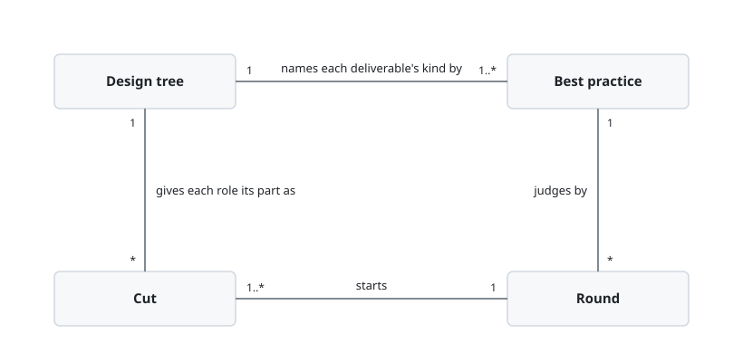
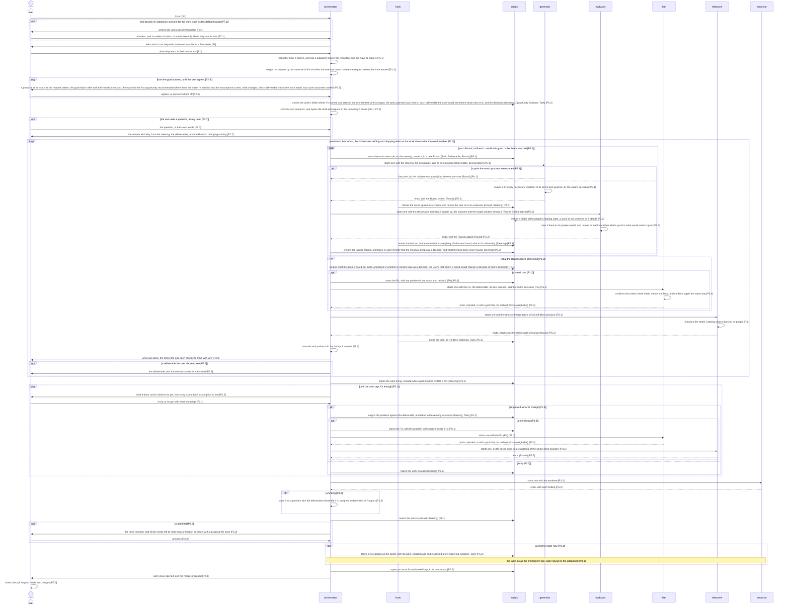
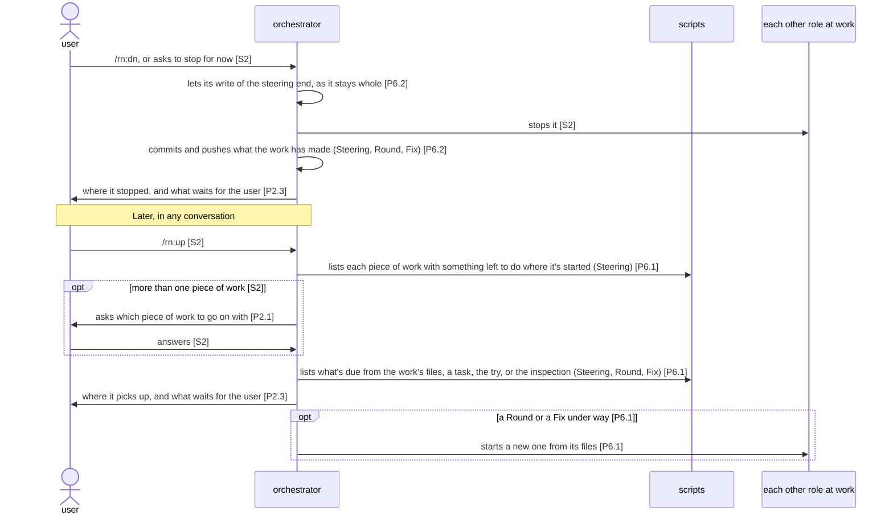
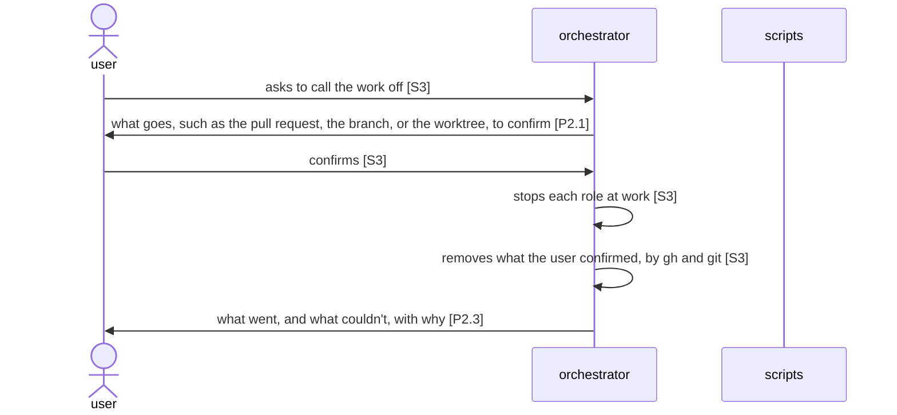

# rn architecture

## User stories

- S1: the user wants what they asked for, as they mean it, working for the one need they agree to
  first, early, asking in their own words, and to decide what happens to each need left.
- S2: the user wants to stop rn's work and go on with it later, in any conversation, losing nothing.
- S3: the user wants to call rn's work off and have nothing of it stay on their computer or on
  GitHub.

## Solution strategy

### Principles

rn piles up the [vital few](https://en.wikipedia.org/wiki/Pareto_principle) that bring a
deliverable's people to their aim, and cuts the trivial many thoroughly.

- P1: the goal reached earliest
  - P1.1: each piece of work aims at one need, the one the user agrees to first.
  - P1.2: the least that runs, through every kind of deliverable that the need takes, goes to the
    user before anything more is made, after only the deliverables they chose to see first.
  - P1.3: a mend of a problem, once weighed, starts at once, with no new Rounds.
  - P1.4: the hearing, the tree, and the questions grow with what the request leaves open: a
    request whose state wanted is settled takes one proposal, and its tree is one branch.
- P2: the user as one who uses it
  - P2.1: the user is asked only what the request and their words leave open, in plain words with
    a recommendation and why.
  - P2.2: each need that the user or the issue named stays on the list, and only the user decides
    what happens to it.
  - P2.3: each message to the user has one shape: what was done, with how far the work is to the
    try, then what they do now, one question with numbered options or what to try, and nothing of
    rn's insides, so that they see where the work is and give feedback at once.
  - P2.4: rn talks in the user's language and writes in the repository's, asking only where they
    disagree.
  - P2.5: the user agrees to the work from proposals, and corrects only what's off: the goal they
    are after behind their words, the way to it, and what changes, each file that exists with what
    changes in it, and each deliverable roughly where none exists yet.
  - P2.7: a question of the user's gets an answer with why, and changes nothing until their words
    ask for a change.
  - P2.6: the user sees each deliverable they choose as soon as it's made, before more rests on
    it.
- P3: best practices in full
  - P3.1: each deliverable meets every necessary condition of its kind's best practice, and once
    whole, of its kind's refactor best practice, before the user touches it.
  - P3.2: before the user, each deliverable is tried by one who didn't make it, with only what its
    people have.
  - P3.3: remaking has a limit, and what it leaves is weighed like any other fact, the user's
    only where a mend would change a decision of theirs.
  - P3.4: a mend confirms, the same way before it and after it, that what was there still holds.
- P4: one measure of the vital few
  - P4.1: each fact that would change what the work aims at is weighed by one shared measure,
    before it does, by the one who holds the talk and reads what was made.
- P5: each role on its own work
  - P5.1: leading, making, judging, mending, refactoring, and inspecting are separate roles,
    each started with only what its work needs, and the one who leads weighs what the work aims
    at.
  - P5.2: each part of the work's record has one writer.
  - P5.3: a step that has one right result is done the same way each time, without a role's
    judgment, and what must hold every time is held by a hook.
- P6: nothing lost on a stop
  - P6.1: the work's state lives in files on its branch, so that it goes on from any conversation.
  - P6.2: a stop lets each record being written end whole before the work halts.
- P7: the user's repository left as it was
  - P7.1: each piece of work lies where the user starts it, on a branch for the work, and rn
    makes a branch or a worktree only on their words.
  - P7.2: the ready mark and the merge stay the user's.

### Concept model



- Steering\
  Holds what the work aims at, the tasks to it, and the decisions of its talk, for each judgment
  and each pick-up. Its form is [its schema](../../plugins/rn/domain/schemas/steering.schema.json)'s.
- Opportunity\
  A need, pain point, or desire, in the words of those who have it, which the user picks or leaves,
  and which breaks into smaller ones until each is small enough to solve.
- Solution\
  What its people do and get once the opportunity is met, with the assumptions they test once it's
  in their hands.
- Task\
  One thing to do for the solution that the work aims at, which changes one deliverable, and goes
  once it's done.
- Deliverable\
  One file or folder that the work makes for the people, of one kind.
- Best practice\
  The field's established way to make one kind of deliverable, and its conditions, which making
  and judging both stand on.
- Round\
  One making of a deliverable, judged by one who didn't make it, or one refactoring of the whole.
- Fix\
  One mend of a deliverable whose Rounds are over, to a problem once weighed. It holds
  the problem in the words that raised it, and what the mend gave.

Strategies:

- The steering written by scripts alone, from the aim that the orchestrator weighed and from each
  role's result. [P5.2]\
  Intent: no part of the record has two writers, and the work's standing moves the same way at
  each event.
- Each need kept on the opportunity solution tree, as its people see it with no means in it, a
  small request one branch, and the solution agreed to first marked as the work's target.
  [P2.2, P1.4]\
  Intent: no need is dropped without the user's say, each part of the work serves the outcome
  through the tree, and the work knows which solution it serves.
- The tasks planned back from the target, first to last, and changed by the orchestrator as the
  work shows what the solution takes, each going once it's done. [P1.2]\
  Intent: the work puts the least that runs in the user's hands before it makes more, and the
  steering holds only what's left.
- Each deliverable that the user wants to see once it's made kept as a decision, and shown to them
  once its task goes, before the next starts. [P2.6]\
  Intent: what rests on it waits for their word, from any conversation.
- The work's stage, once no task is left, kept as trying while it's in the user's hands, enough
  once they say so, and inspected once the inspector passed it, and dropped where the target
  changes. [P6.1]\
  Intent: the work's files alone say what waits for the user, and a new target is handed over
  anew.
- Each decision of the work's talk kept in a line. [P2.1]\
  Intent: no conversation asks it again.
- Each remedy that a Round's judgment brings kept as a decision of the work. [P3.3]\
  Intent: the next Round and each later mend rest on what was weighed.
- Each task's next role kept in the steering, said by the orchestrator where its weighing
  decides it, and by the hook where nothing is to weigh, a new task where its solution changed.
  [P5.2]\
  Intent: the steering alone says what comes next, and nothing outside it keeps a deliverable on a
  dropped solution.
- Each task named by an id that the script gives in order and never gives again, its place in the
  steering's list its order of work, and each task closed, completed or canceled, moved to its own
  record. [P5.2]\
  Intent: a task's words, its Rounds' folder, and its record name one task, as a deliverable that
  spans many files, or one that two tasks make in turn, has no one path to name it by.
- The version of rn that wrote the work kept in the steering, and a work of another version
  brought into this rn's form before any step. [P5.2]\
  Intent: the user updates rn between conversations, and the work goes on from where it stopped.
- What the Rounds leave at the limit weighed by the orchestrator, mended by a fixer or left, the
  script refusing a Round past it. [P3.3]\
  Intent: the user is asked only what's theirs to decide.
- Each Fix kept beside the deliverable's Rounds, with the problem in the words that raised it.
  [P6.1]\
  Intent: a pick-up finds a Fix under way and starts it again on the same problem.

### Components


- orchestrator (prompt)\
  Leads the work to the need the user agreed to, as the user's one contact, and keeps what the
  work aims at to the vital few, with every need named kept for the user to decide.
- references (document)\
  Hold how a maker and an evaluator use a best practice.
- generator (prompt)\
  Makes a deliverable with which its people reach their aim, by its kind's best practice.
- evaluator (prompt)\
  Checks, as the people, whether a deliverable reaches their aim.
- fixer (prompt)\
  Mends a deliverable whose Rounds are over, to a problem once weighed.
- refactorer (prompt)\
  Refactors a whole deliverable by its kind's refactor best practice, keeping what it does.
- inspector (prompt)\
  Reviews the work's pull request as its author would before asking for review.
- scripts (script)\
  Does each step that has one right result, and alone writes where the work stands.
- hook (hook)\
  Once a role ends, checks its result, and moves each task on by its role's result, every time.

Strategies:

- Each command only an entry point, pointing to the orchestrator's steps for each event. [P5.1]\
  Intent: every event reaches the one role that hands it on.
- The main conversation as the orchestrator, which starts and stops each other role. [P5.1]\
  Intent: the user talks with one role through the work.
- Each fact that would change what the work aims at weighed by the orchestrator itself, against
  the user's words and the deliverables as they stand, and given to a script that takes it into
  the steering. [P4.1, P5.2]\
  Intent: the one who heard the user and can answer why decides, so the user's meaning isn't
  passed through another's summary, and the steering keeps one writer.
- The measure of the vital few, the opportunity solution tree, and the tasks planned back from the
  target written in the orchestrator's prompt, as what it holds to, in place of a best practice of
  its own. [P4.1]\
  Intent: the one role that weighs what the work aims at holds the practices it weighs by, and
  judges each case that its steps don't name by them.
- The outcome kept as the user agreed to it: what they're after behind their words, as the
  orchestrator read it from them. [P2.5]\
  Intent: the work aims at what the user is after, which their first words seldom say in full.
- Each problem with a deliverable whose Rounds are over weighed by the orchestrator, then handed to
  a new fixer. [P1.3]\
  Intent: the mend changes only what was weighed, and starts without new Rounds.
- The hearing held as proposals from the outside in, the goal first, each as much as the request
  settles, which the orchestrator fills from the request, the issue, and the repository, marking
  what it had to assume. [P2.5, P1.4]\
  Intent: the user corrects what's off instead of answering what they already said, a settled
  request reaches the agreement in one proposal, and an open one in a few.
- Each best practice naming no other kind as what it rests on. [P3.1]\
  Intent: each best practice serves alone.
- Each question of the user's answered by the orchestrator from the steering, the deliverables,
  and the Rounds, before anything is weighed. [P2.7]\
  Intent: the user talks a point through with the one who can answer why, and nothing is remade
  on a question they only asked.
- What changes named as the files where they exist, and as the rough deliverables where they don't
  yet, each with whether the user wants to see it once it's made. [P2.5, P2.6]\
  Intent: the user knows what the work touches, and sees early each deliverable whose rework
  would cost most if it came all at the end.
- Each search, for the files a request bears on or the ways to make a need, handed by the
  orchestrator to a subagent that checks each way's license, upkeep, open issues, and standing
  before it's offered. [P5.1]\
  Intent: the orchestrator's context holds the talk and the work, and the user picks only among
  ways that hold.
- The orchestrator putting the purpose before rn's steps and scripts, and having the writer of a
  part set right what stands in its way. [P2.1]\
  Intent: no detour that only rn's insides make reaches the user.
- Each deliverable given the kind of its best practice, and the general kind where no best
  practice of its kind exists, marked as an assumption in the proposal. [P3.1]\
  Intent: what's made holds the quality its kind needs, and a deliverable of no known kind still
  holds what every deliverable needs.
- Each opportunity shown numbered in the user's words, and the first recommended with its
  grounds, where the tree has more than one. [P2.1]\
  Intent: the user judges only which need brings them closest to what they're after.
- The languages proposed once at the start and kept as the user's decisions. [P2.4]\
  Intent: the user reads rn in their own language, and others read the repository in its own.
- One generator and one evaluator for each Round, the evaluator judging each condition that one
  trial reaches. [P3.2]\
  Intent: the people's use is one act, so it's tried once and judged whole.
- The evaluator given the deliverable and its best practice, never what rn meant. [P3.2]\
  Intent: it meets only what the people would meet.
- A new refactorer once the deliverable is whole, its Rounds and fixes over, with no evaluator.
  [P3.1]\
  Intent: making and refactoring stay apart, as their practice has it, and the user tries what
  the deliverable does, which a refactoring keeps.
- A new fixer for each Fix, with only the deliverable, its best practice, the work's decisions,
  and the problem in its own words. It confirms what holds in one way before the mend and after
  it. [P3.4]\
  Intent: the fixer mends what went wrong, and breaks nothing that held.
- The pull request reviewed whole by a new inspector once the user says the target is enough.
  [P3.2]\
  Intent: the pull request is in step with the repository, holds only what its purpose needs,
  and leaves nothing behind, before anyone else reviews it.
- Each step that has one right result done by a script that the role runs. [P5.3]\
  Intent: each role spends its judgment and its context only where a step needs them.
- A stop taken from /rn:dn or the user's words, and a pick-up from /rn:up. [S2]\
  Intent: the user stops and goes on at the moment they choose, and new work never asks about
  old work.
- A cancel taken from the user's words once they confirm what goes, such as the pull request, the
  branch, or the worktree, removed by the orchestrator. [S3]\
  Intent: a cancel can't be undone, so only the user starts it, and only what they confirm goes.
- A stop that lets the orchestrator's write of the steering end, then stops each role, and
  commits and pushes the work, what a role left half made as work in progress. [P6.2]\
  Intent: a pick-up reads a whole steering and goes on from what was half made, and GitHub keeps
  the work so far as well as the user's computer.
- Each deliverable of the target put in its place and its end shape by the first task, each part
  that a later task makes marked `TODO:`, and filled by the tasks after it. [P1.2]\
  Intent: the work heads for the target from the start, what the user meets first leads what's
  built under it, each task's end passes the repository's checks, and the marks left show what's
  missing.
- The hand-over and the end refused by `steering mark` while a line that the work adds holds a
  `TODO:` mark. [P6.1]\
  Intent: no part still to make reaches the user's try or the merge unseen.
- Each role's result checked against its schema by the hook before the role ends, the role kept
  going until it holds. [P5.3]\
  Intent: the role mends its own result, and the orchestrator starts no role again.
- The work committed and pushed by the orchestrator at the end of each purpose, such as the aim
  agreed, a task done, the hand-over, or a stop, in the repository's shape of commits.
  [P6.1]\
  Intent: each commit says one thing done, and nothing the work makes lies only on the user's
  computer.
- A trial of the worktree as it stands, its changes not yet committed with it. [P3.2]\
  Intent: the evaluator tries what was made, though the orchestrator commits only at the end of a
  purpose.

### Sequences

#### S1: the least that runs for the picked need, in the user's hands



#### S2: the work stopped, and picked up later



#### S3: the work called off



### Deployment


The user installs rn as [the README](../../plugins/rn/README.md#installation) says, and types
`/rn:on` on the branch they want the work on.

Strategies:

- The work where rn is started, the orchestrator asking the user what to do where the branch
  isn't one for the work. [P7.1]\
  Intent: the user chooses where the work lies with the tools they use, and no case of it lies in
  a prompt or a script.
- The pull request opened as a draft, which the user marks ready. [P7.2]\
  Intent: nobody reviews or merges the work before the user has seen it checked whole.

### Directory structure

```text
plugins/rn/                        what Claude Code installs for the user
├── skills/                        /rn:on, /rn:up, /rn:dn, /rn:ty, and /rn:gm, each pointing to the orchestrator
├── agents/                        each role's start
├── hooks/                         the hook that checks each role's result once it ends
└── domain/
    ├── orchestrator.md            each event's own steps, then those that every event shares
    ├── generator.md               what the generator does
    ├── evaluator.md               what the evaluator does
    ├── fixer.md                   what the fixer does
    ├── refactorer.md              what the refactorer does
    ├── inspector.md               what the inspector does
    ├── references/                how a maker and an evaluator use a best practice
    ├── schemas/                   the form of the steering and of each role's result
    ├── best-practices/            rn's best practice of each kind
    └── scripts/                   each step with one right result, as a role runs it

dev/rn/                            what only rn's developers use
└── tests/unit/                    the unit tests of rn's code

<worktree>/.rn/                    what rn writes on the work's branch, in the work's worktree
└── <yyyymmdd>-<slug>/             the folder of one piece of work
    ├── steering.json              the steering
    ├── closed.json                each task closed, completed or canceled, in the order it closed
    └── tasks/<id>/                each Round and each Fix of the task, in the order made
```

## Test strategy

A real request that the user puts through rn is the end-to-end check. A test at a higher level than the unit tests is added
only for a fault that such a request found and that a test should have caught before it, or for
an operation that can't be undone.

| Check | Test target | Kind | When | Exit criteria or measure |
|---|---|---|---|---|
| Lint | Parts | Quality | During the work | 0 findings. |
| Static analysis | Parts | Quality | During the work | 0 findings of mismatched types, copied code, or import cycles. |
| Complexity analysis | Parts | Quality | During the work | Per function, McCabe 10, cognitive 15, 6 returns, 12 branches, 5 arguments, 50 statements at most. |
| Unit testing | Parts | Quality | During the work | A case for each class of input that an interface's contract treats apart, and every case passes. |
| Code coverage | Parts | Quality | During the work | 100% statement (C0) and branch (C1) coverage. |
| Scenario testing | Product | Quality | Apart from the work | A real request that the user puts through rn brings the walking skeleton to their hands, with no stop that a fault caused. |
| Installation testing | Product | Quality | Apart from the work | Once ccpm's marketplace lists rn, it installs alone by the README's commands in a fresh home. |
| Configuration testing | Product | Quality | During the work | Every case passes on Python 3.9 and on the newest Python. |
| Conformance and compliance testing | Product | Quality | During the work | Claude Code's strict check of the plugin passes. |
