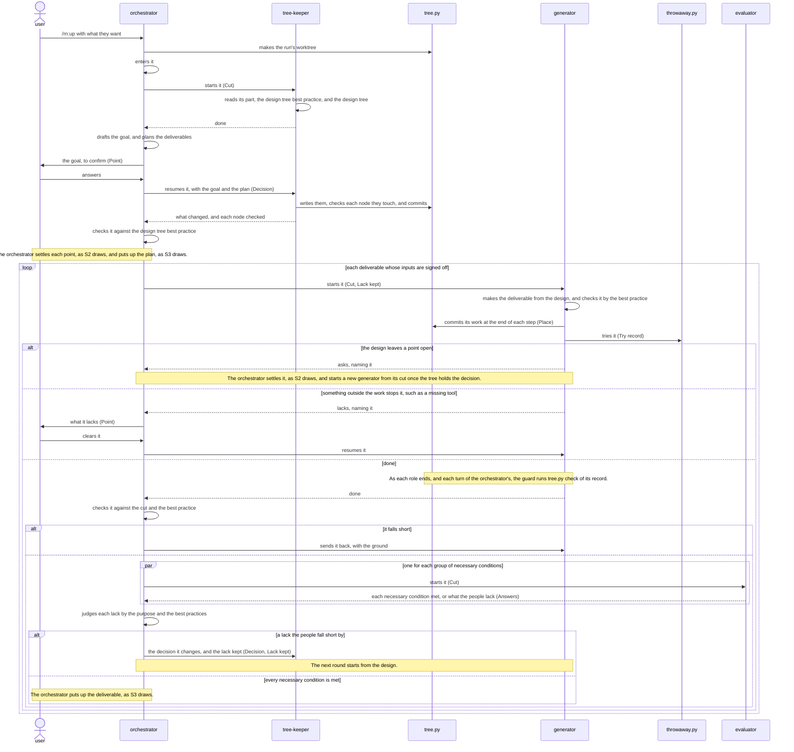
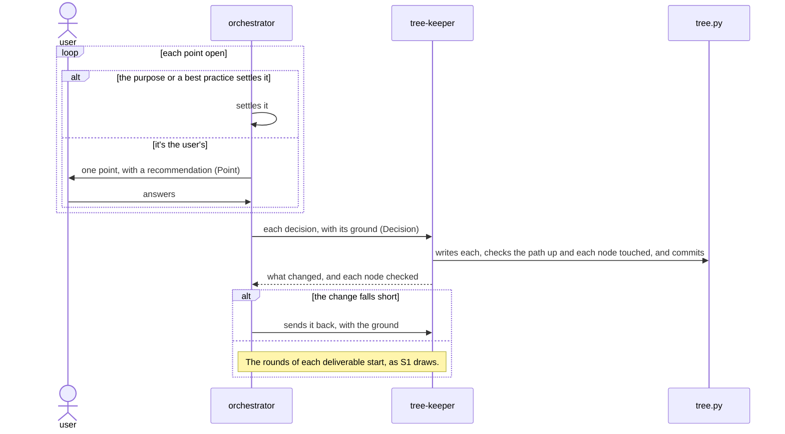
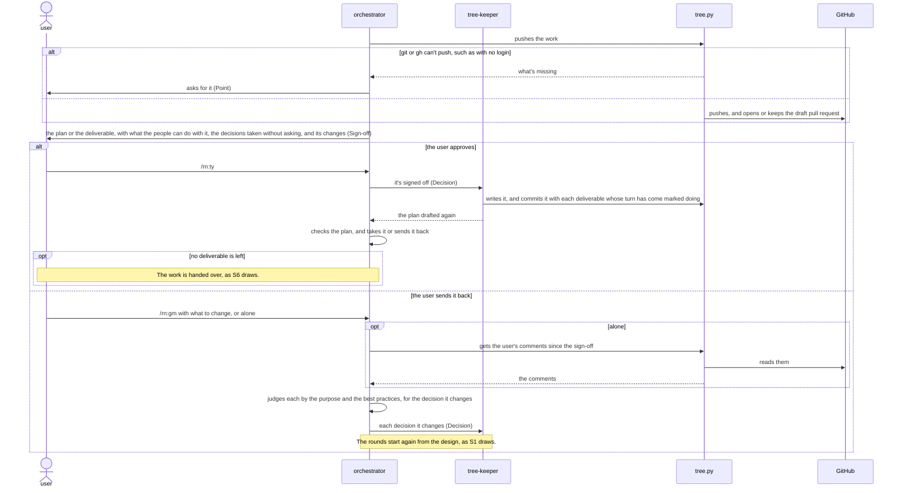
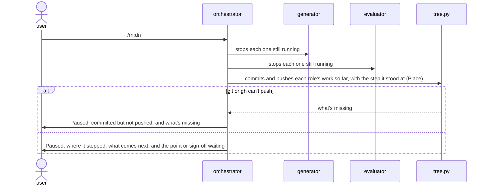
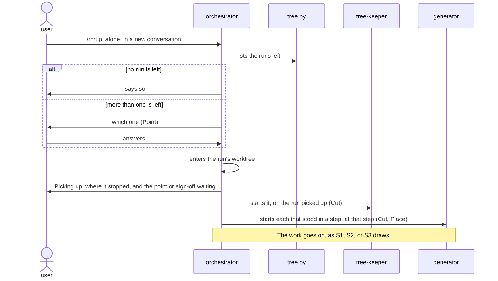
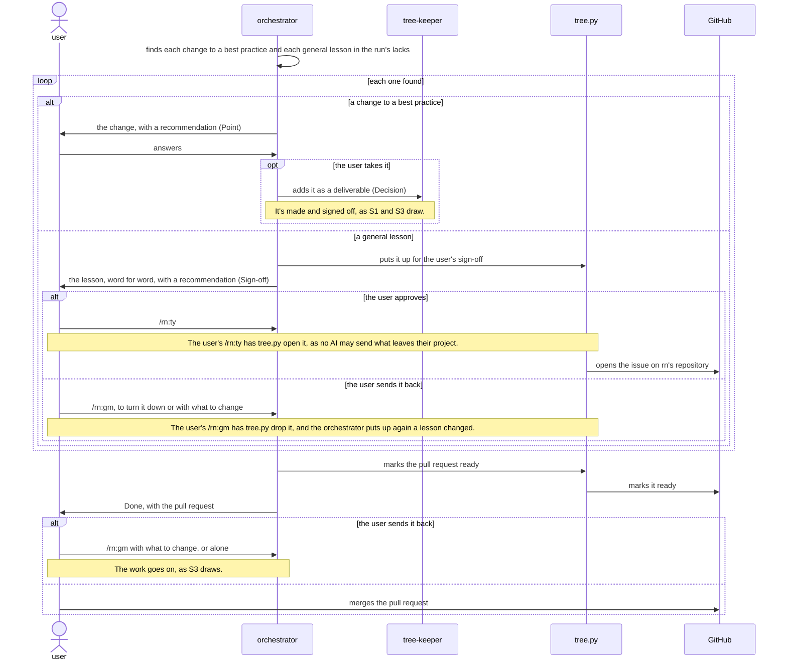

# `rn` architecture

This document says how the parts of rn give what [its README](../../plugins/rn/README.md)
promises. rn builds up only the vital few of each deliverable, what its people can't do without, as
decisions in a design tree: the orchestrator, the main conversation, settles them, asking the user
only the points that are theirs, and a tree-keeper keeps them. A generator makes each deliverable
from its decisions, round after round, until evaluators that have only what its people have find
every necessary condition met, and the user signs it off before anything rests on it. The orchestrator checks
every result before it takes it, and a lack changes the decision it comes from, not the deliverable.

## User stories

- S1: the user wants to type `/rn:up` with what they want, in their own words, so that they get the
  deliverable they mean without writing a specification. It carries the walkthrough's first
  `/rn:up`, the goal put to the user, and each deliverable made in rounds.
- S2: the user wants to answer each point rn puts to them, one at a time, so that they spend their
  time only on what's theirs to decide. It carries the answer `each file`.
- S3: the user wants to sign off the plan and each deliverable with `/rn:ty`, or send it back with
  `/rn:gm`, so that nothing rests on what they didn't mean. It carries the plan and each deliverable
  put up for sign-off, each `/rn:ty`, and `/rn:gm` with what to change or with their comments on the
  pull request.
- S4: the user wants to type `/rn:dn` and stop the run at any moment, so that they lose neither
  their time nor the work so far. It carries the walkthrough's `/rn:dn` and `Paused`.
- S5: the user wants to type `/rn:up` alone in a new conversation and have rn go on where it
  stopped, so that they never answer a point twice or wait for work made again. It carries the
  walkthrough's second `/rn:up` and `Picking up`.
- S6: the user wants one pull request, the decisions rn took without asking, and the lessons of the
  run, so that they check the work and merge it themselves. It carries the walkthrough's `Done`,
  each change to a best practice that rn proposes there, each lesson that it puts up for their
  sign-off, and the merge.

## Components


What each decides alone:

- user\
  The goal, each point the purpose and the best practices leave open, each sign-off, each change to
  a best practice, each lesson sent to rn's repository, when to pause, and whether to merge.
- orchestrator\
  Whether a point is the user's, and each other point from the purpose and the best practices: the
  deliverables and their plan, whether to take each role's result or send it back, which lacks the
  people fall short by, and what to propose at Done.
- tree-keeper\
  How each decision of the orchestrator's goes into the design tree, which nodes a change touches,
  and the plan drafted again at each turn's end.
- generator\
  The deliverable, and each small point that the purpose and the best practice settle one way.
- evaluator\
  Where the deliverable meets each necessary condition of its group for its people, or what would make it good.
- tree.py\
  The tree's form and each deliverable whose turn has come to be doing, each role's cut and the
  deliverables that start side by side, the run's worktree, the runs left and where each stopped, each
  commit, the pull request and the user's comments on it, the issue of each lesson that the user
  signs off, and each role's record and whether it holds each step and practice, which is rn's
  check.
- throwaway.py\
  Where a deliverable's commands run.
- guard\
  Whether a role's call keeps its steps, whether rn's check accepts a role's record and result at its end, whether a deliverable's command runs only through
  throwaway.py, and whether the run passes a sign-off only after the user's `/rn:ty`, by the lanes
  that rn lays in [Lane](../lane/architecture.md).
- adapters\
  How rn's best practices and design tree reach the guard in the form Lane reads.

The choices made, and why:

- One generator for each deliverable over several side by side\
  Three generators would take about three times as long for a gain in KR1.1 that no end-to-end test has shown,
  which adds to KR1.2. The cost: a lack in a best practice shows only when its developers run several
  generators to check it.
- The orchestrator judging every point over a role of its own that settles them\
  The user talks with the one that decides, and no answer passes through a role that rewords it, which keeps KR1.2 short. The cost: the main conversation holds every judgment of the run.

## Data model


- Cut\
  The part of the design tree that a role starts with.
- Point\
  A question put to the user, with its recommendation, while its decision is open.
- Sign-off\
  The plan, a deliverable, or a lesson for rn's repository put to the user for `/rn:ty` or
  `/rn:gm`, with what the people can do with it, the decisions taken without asking, and its
  changes, or with the lesson's words.
- Place\
  The step that each role of a round stands at, with the work it has made, kept at the end of each
  step and at a pause.
- Lack kept\
  A lack an evaluator named that the orchestrator judged the people fall short by, which the next
  round's generator gets.

## Principles

rn builds on [the plugin guide](../plugin-development-guide.md), and adds these rules,
which every part keeps.

### Drawn out along the design tree

Each role starts with its own cut of the design tree alone, and the guard lets it start only with
the cut that `tree.py` gave for that role.

*Why*: a role that reads decisions not its own makes what the user didn't mean, which raises KR1.1.

### Every step by best practice

Each role works by the best practice of its kind of work, and Lane holds it to the steps.

*Why*: an AI that skipped a step once skips it again, and the deliverable misses what the step makes
sound, which raises KR1.1.

### Every item handled

Each role reads in full what it starts with and each best practice its part names. It records each
step and each practice item it takes at the time each names, as
[the plugin guide](../plugin-development-guide.md#a-record-of-each-step-and-practice) says. Its result
names each item of each other list it carries: each decision of its cut it checked, each necessary
condition it judged, and each lack and comment it judged. Lane holds each read by its trace, and
the guard runs rn's check of the record and the result against the whole list at the role's end,
and at the end of each turn of the orchestrator's in a run.

*Why*: an item dropped takes from the deliverable what the item holds, which raises KR1.1.

### Judged by the people it's for

An evaluator gets only what the deliverable's people have.

*Why*: an evaluator that knows what the maker meant judges the making, not what the people get, which
raises KR1.1.

### Signed off before it's built on

The plan and each deliverable reach the work that rests on them, and the pull request becomes ready,
only after the user's `/rn:ty`, and the guard holds the run to it.

*Why*: a wrong reading of what the user means, found only at the end, makes everything that rests
on it made again, which raises KR1.1 and adds to KR1.2.

### Back to the design tree on a problem

A lack, or what the user sends back with `/rn:gm`, changes the decision it comes from, and the next
round makes the deliverable from the design, never with a fix beside it.

*Why*: a fix beside the design rests on no decision, so the next round, made from the design, loses
it or breaks another necessary condition with it, which raises KR1.1.

### The design tree revised on each run

What a run finds changes the design tree before the next deliverable, and the best practice before
the next run, once the user takes the change, which the orchestrator proposes before the merge.

*Why*: a design tree or a best practice kept as first laid out makes the same miss again, which raises
KR1.1 and adds to KR1.2.

### Tried in a throwaway copy

A deliverable's commands run only in a throwaway copy of the repository, with a throwaway home,
and a lane of Lane holds each role to it.

*Why*: a command run as the people run it would otherwise change the user's own files, and the
user would spend their time setting them right, which adds to KR1.2.

### The repository holds the work

Every part keeps the run's state only in the run's folder and the deliverables on the work's own
branch, in rn's own worktree, and `tree.py` commits them at the end of each step and at a pause.

*Why*: work kept only in a conversation that ends, or left uncommitted at a pause, makes the user
answer or wait for it again, which adds to KR1.2.

## Sequences

### S1: a request, and a deliverable made in rounds



### S2: a point settled



### S3: a sign-off



### S4: a pause



### S5: picking up



### S6: the work handed over



## Deployment


The user installs rn as [the README](../../plugins/rn/README.md#installation) says, which installs
Lane with it, and types `/rn:up` in Claude Code at the root of their repository.

- rn's own git worktree for each run, over the user's checkout\
  The user goes on with their own work while rn runs, and a pause leaves nothing of theirs to set right, which keeps KR1.2 short. The cost: a worktree on disk for each run until its merge.
- A best practice made on a run in `.rn/best-practices/` over the run's folder\
  Every later run in the repository finds it, and takes it over rn's own of the same kind, which keeps
  KR1.1 low. The cost: a later run misses what rn's own gains after it.

## Directory structure

rn's folder holds what Claude Code installs for the user. `dev/rn/` holds what only rn's developers
use. `.claude/worktrees/` holds rn's worktree of each run, and `.rn/` is what rn writes on the work's
branch.

```text
plugins/rn/
├── .claude-plugin/
│   └── plugin.json                rn's manifest, naming Lane in its dependencies
├── skills/
│   ├── up/
│   │   └── SKILL.md               /rn:up, which makes the main conversation the orchestrator
│   ├── dn/
│   │   └── SKILL.md               /rn:dn, which pauses the run
│   ├── ty/
│   │   └── SKILL.md               /rn:ty, which approves the sign-off waiting
│   └── gm/
│       └── SKILL.md               /rn:gm, which sends the sign-off waiting back
├── agents/
│   ├── tree-keeper.md             starts the tree-keeper
│   ├── generator.md               starts the generator
│   └── evaluator.md               starts the evaluator
├── domain/
│   ├── orchestrator.md            what the orchestrator does
│   ├── tree-keeper.md             what the tree-keeper does
│   ├── generator.md               what the generator does
│   ├── evaluator.md               what the evaluator does
│   ├── tree.py                    the code of tree.py
│   ├── throwaway.py               the code of throwaway.py
│   └── best-practices/            rn's own best practice of each kind
├── scripts/
│   ├── tree.py                    runs the code of tree.py
│   └── throwaway.py               runs the code of throwaway.py
├── hooks/
│   ├── hooks.json                 starts the guard on each call
│   ├── lanes.json                 the steps the guard holds each role to
│   ├── lane/                      the guard: Lane's code, copied in by Lane
│   └── adapters/                  give the guard rn's best practices and design tree
└── README.md                      for rn's users

dev/rn/
├── product-vision.md              rn's product vision
├── architecture.md                this document
├── README.md                      for rn's developers
└── tests/                         the test cases, in unit/, properties/, prompts/, integration/,
                                   and e2e/, with the E2E test files that dev/scripts/e2e.py runs

.claude/worktrees/
└── rn-<yyyymmdd>-<goal>/          rn's worktree of one run, on the work's branch

.rn/
├── <yyyymmdd>-<goal>/             one run
│   ├── design-tree.json           the design tree
│   ├── sign-offs.json             what waits for /rn:ty, and what the user signed off
│   ├── rounds/                    each round's Try record, Answers, Lack kept, and Place
│   └── records/                   the record of each role's start, and the orchestrator's
└── best-practices/                each best practice made on a run
```

## Test strategy

rn tests by [the plugin guide](../plugin-development-guide.md#test), in unit tests, integration
tests, and end-to-end (E2E) tests. Its test cases lie in `dev/rn/tests/`, and `dev/scripts/trace.py`
checks that each names an element or a case one level up.

### Unit tests

- Tries: `tree.py`, `throwaway.py`, and the adapters, each against its contract, and the prompts of
  the orchestrator, the tree-keeper, the generator, and the evaluator, each against what its line in
  Components and its steps in the sequences ask of it.
- Runs real: the part, with git in a temporary folder. A bare repository stands in for the remote,
  and a double of `gh` gives what [the manual of `gh`](https://cli.github.com/manual/) shows. A
  prompt's role runs alone on Opus in a throwaway copy of a repository that the test sets up, with
  `tree.py` and `throwaway.py` real.
- Tools: those of [the plugin guide's checks](../plugin-development-guide.md#the-quality-checks-of-every-plugin),
  and `claude -p` on Opus for the prompts.
- Passes when: the plugin guide's checks of the code, with property-based tests of `tree.py`'s
  reading and writing of the design tree, its list of the nodes that a change touches, its check
  of a record against a prompt's steps and a best practice's practices, and each adapter's reading
  of a best practice or a design tree into Lane's form; and each case of a prompt passing on all of
  its k = 3 runs.
- Runs: the code's tests as the plugin guide times them, and a prompt's tests before a change of
  the prompt is taken.

### Integration tests

- Tries: each path through the sequences of S1 to S6, each principle, where the parts keep it and
  where one breaks it, each decision of each component in Components, each handoff between parts
  with the data it passes, and each kind of data in the data model.
- Runs real: `tree.py`, `throwaway.py`, the adapters, the guard as Lane lays it, and rn's lanes. The
  double of Claude Code in `dev/tests/` stands in for Claude Code, and sends each event as the
  recorded runs in `dev/tests/recorded/` show. A test plays the user, the orchestrator, and each
  role by the calls it makes on the double, and each role gives only results in the form of its
  part's output, which the role's unit tests show the real prompt giving. GitHub is the bare
  repository and the double of `gh` of the unit tests.
- Tools: pytest, the double of Claude Code, `claude plugin validate --strict`, and
  `dev/scripts/trace.py`.
- Passes when: `trace.py` passes the plugin guide's checks of the trace.
- Runs: with the unit tests of the code, as the plugin guide times them.

### E2E tests

- Tries: the key results KR1.1 and KR1.2, by the README's walkthrough at its real size: type hints
  for a library the size of invoicer, with the plan of its two deliverables, two points answered,
  each sign-off, and a pause and a pick-up in a new conversation.
- Runs real: rn and Lane, installed as the README says, on the real Claude Code on Opus, in a fresh
  clone of [lovaizu/playground](https://github.com/lovaizu/playground) that holds the library. An AI on Opus in the user's place holds an intent that rn never
  receives, and reads only what the screen shows, as `dev/scripts/e2e.py` runs it.
- Tools: pytest, `dev/scripts/e2e.py`, and a judge on Opus for KR1.1.
- Passes when: the key results, KR1.1, the share of the deliverables handed over that the judge
  finds their people can't use, and KR1.2, the time from the request to the deliverable, the
  stand-in's own time answering included, each taken from the records of every run; a change kept
  only where it improves a key result and leaves none before it worse than in the last runs, as the
  product vision orders them; the judge used only once it's right on each kept record whose answer
  is known; and 3 runs of the walkthrough after each change.
- Runs: once every unit and integration test passes, started by the developer.

- k = 3 runs of each case of a prompt over 1 or 5\
  A prompt that slips on 3 runs in 10 fails 3 runs of 3 about two times in three, so most slips
  that would make a deliverable unusable show before the E2E tests, which keeps KR1.1 low. The cost:
  each change of a prompt waits on 3 runs of each of its cases, and a slip rarer than 1 run in 5
  passes them more often than not.
- 3 runs of the walkthrough over 1\
  KR1.1 is a share, and one run hands over too few deliverables to show it move, which keeps a
  change that raised KR1.1 unseen. The cost: each change waits on 3 whole runs on Opus.
- Property-based tests of `tree.py`'s reading of the design tree and its check of a record over
  cases drawn by hand alone\
  An AI writes the tree and each record, so they take forms that no developer foresees, and a fault
  there hands a role another's cut or passes a record that skipped a practice, which raises KR1.1.
  The cost: each night's run of every input.
