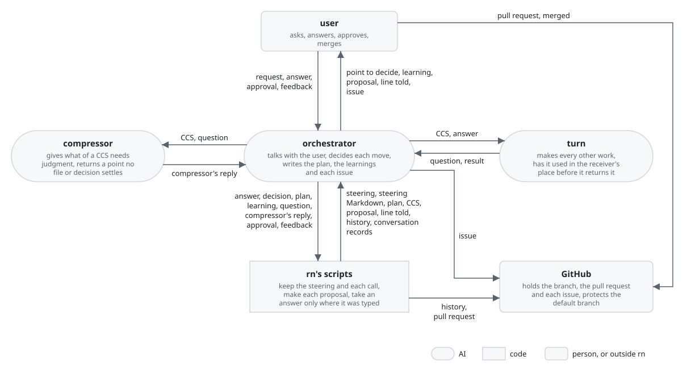
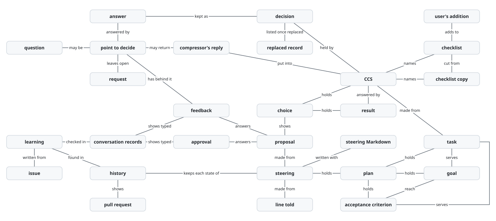
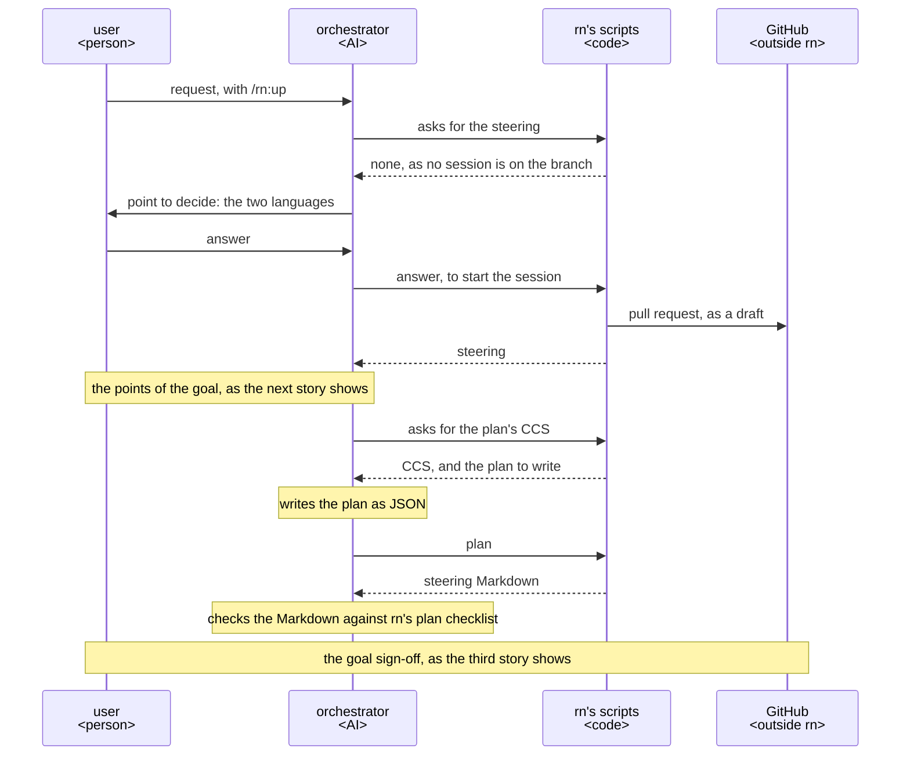
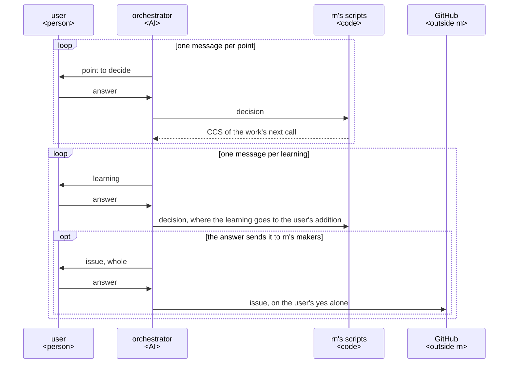
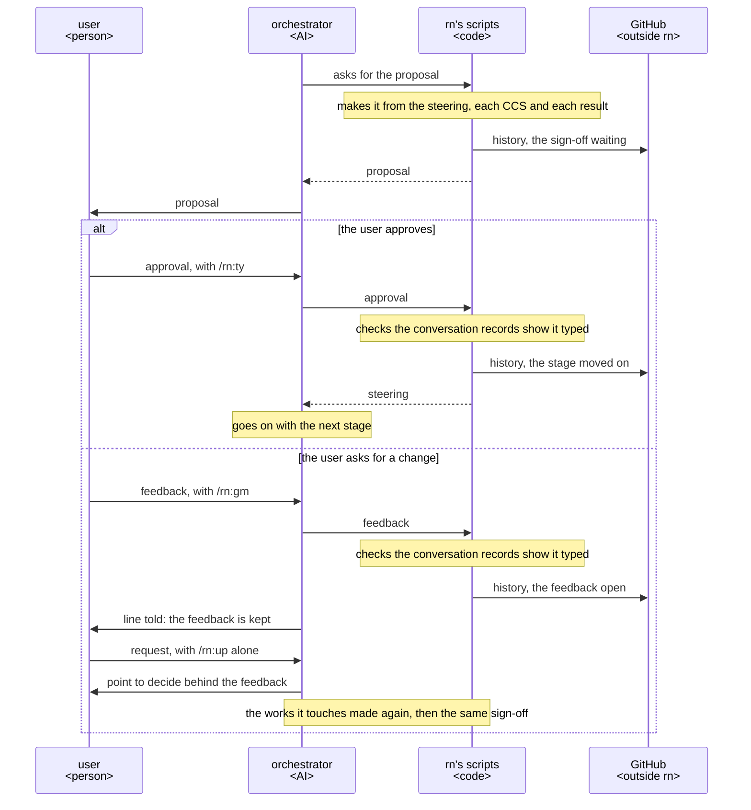
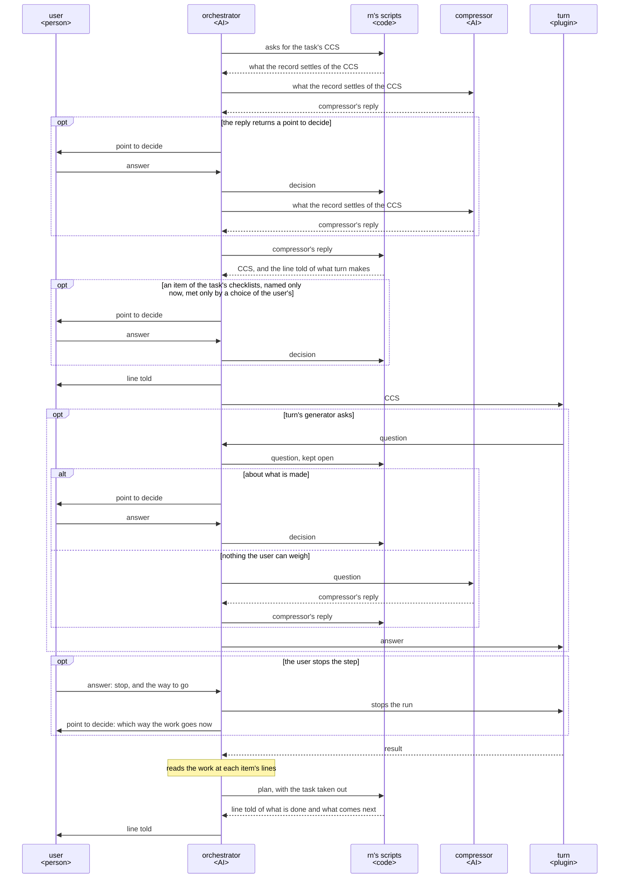
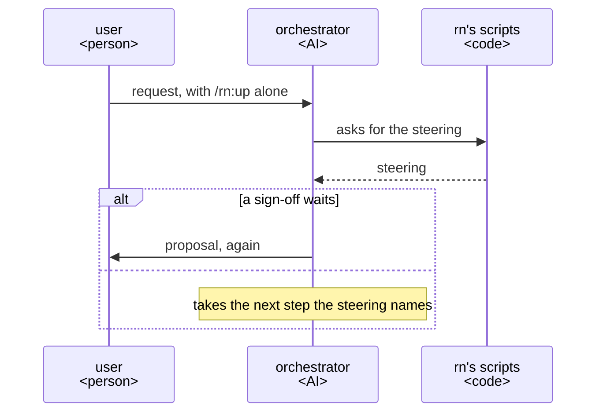
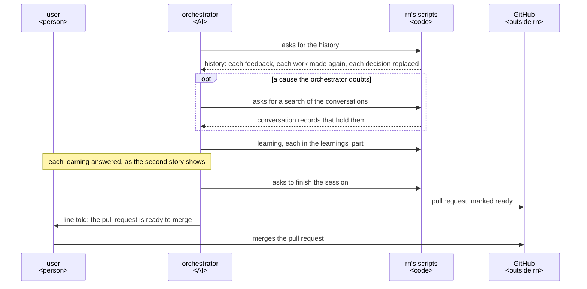
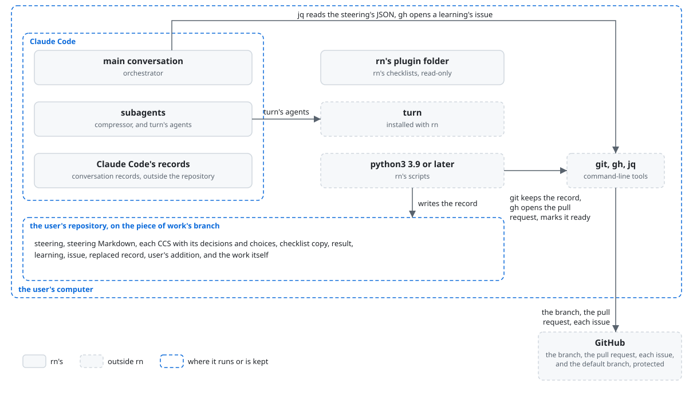

# rn architecture

rn is built on [how a plugin works](../architecture.md). It takes a piece of work asked for in rough
words to the user's purpose while the user only answers, and it is put together against two drifts:
the work drifting from the purpose, and the AI drifting as the work goes on. The orchestrator is the
one AI that talks with the user. It decides every move from the steering, the record of the plan and
of where the session stands, which rn's scripts rewrite at each move. The orchestrator writes the
plan and the learnings itself and has turn make every other work. [rn's UX](ux.md) says who the user
is, what the goal and the key results are, and what a point to decide, a sign-off, a task and a
learning are.

rn holds the [principles every plugin holds](../architecture.md#principles), named below Principle 1
to 9. It adds two of its own, named below rn's Principle 1 and 2:

1. Every task traces back to the purpose, through the goal or the acceptance criteria it serves.
2. At every move the orchestrator sets where the session stands from the checked facts alone, and
   replans from the steering and from what each done task served, decided and made.

## User stories

- As the user, I want to ask for a piece of work in rough words with `/rn:up <what I want>`.
- As the user, I want to answer each point to decide and each learning rn puts to me, one per
  message, with an option's letter or in my own words.
- As the user, I want to approve the proposal at each sign-off with `/rn:ty`, or ask for a change
  with `/rn:gm <feedback>`.
- As the user, I want to be told before and after each step what rn does, and to stop a step going
  a way I do not want.
- As the user, I want to go on from where I stopped with `/rn:up` in a fresh conversation.
- As the user, I want to merge the pull request rn marks ready.

## Architecture

### Logical view

#### Components



- The arrows run in the order of the UX's [From asking to the merge](ux.md#from-asking-to-the-merge).
- rn keeps the work from drifting from the purpose in two ways.

  Each task names the goal or the acceptance criteria it serves, and its result is checked against
  them (rn's Principle 1). After each task the orchestrator weighs the facts the task brought, and
  writes the plan again where they change it (rn's Principle 2). A task that serves no criterion is
  work the purpose did not ask for. A plan kept from what was expected drifts from the purpose while
  every move looks done.
- rn keeps the AI from drifting in three ways.

  First, the orchestrator carries only the steering from move to move. Second, rn's scripts and the
  compressor take what each work is made from out of the record alone; the orchestrator's
  conversation does not choose it. Third, each rule a machine can judge is held where the AI acts,
  as [The guard tells each role its steps again](../architecture.md#the-guard-tells-each-role-its-steps-again)
  says. rn's scripts hold the orchestrator in the main conversation, as they keep the steering and
  the calls. `/rn:ty` holds an approval, and GitHub's branch protection holds the default branch.
  The guard, laid with lane, holds each of turn's subagents. The tools its agent file allows hold the
  compressor, which only reads.

  A conversation that carries the whole of a long piece of work swells, and a fresh one starts from
  nothing. What a work is given, when that conversation chooses it, drifts as the conversation
  swells. A rule written only in words is followed by chance.
- The orchestrator writes the goal, the criteria and the tasks itself, with rn's plan checklist
  open, and checks them against the same checklist.

  rn's scripts cut the part that holds the goal, the criteria and the tasks into a file of its own,
  with the CCS the part is written from. The orchestrator writes the part there as JSON in the
  steering's form. rn's scripts put it into the steering once it passes the checks they hold it to,
  and write its Markdown with it. The orchestrator then checks that Markdown against the checklist,
  as the user reads it.

  The user reads the plan whole at the goal sign-off as soon as it is made. A reader in their place
  would add a reading the user makes next, and its time at every remake (Principle 5). The
  orchestrator writes only the part cut out, so it cannot change the goal while it writes a task.
- The compressor gives the part of a CCS that needs judgment, for a work turn makes, from the
  steering, the works made and the work's latest call alone.

  The compressor is an agent of rn's with no conversation. It gives the receiver and their use at
  the build stage, any other file the receiver has, and the one command that checks the result,
  from the project's architecture. Where each result goes, and every rule it is made by, comes from
  the repository, such as the folder its architecture's directory structure gives a component. Where
  the repository settles none, it comes from a decision the orchestrator asks the user while
  planning, as the orchestrator asks a document's path. The compressor reads these and decides none
  of them. Where it finds such a point that no file or decision settles, it gives nothing for the
  CCS and returns the point to the orchestrator. The orchestrator asks the user, keeps the answer as
  a decision and starts the compressor again.

  Made from the record alone, a CCS rests on what was kept, as ACC makes a state from the state
  before, the move's signal and what was admitted, not from the transcript. A place or a rule the
  compressor chose would be a choice of the user's made where the user does not see it. turn,
  started from a CCS with nothing missing, makes nothing on a guess. The compressor returns the point
  rather than asking it, as only the main conversation talks with the user.
- The orchestrator fixes no work turn returns.

  The orchestrator reads the work at the lines turn returns for each item. An item its lines fall
  short of, or one turn leaves without Good, is a point the orchestrator settles before turn makes
  the work again, as a decision, in the same way as a change the user asks at a sign-off. A fix of
  the orchestrator's own would be work no guard keeps and no first user reads, and the user would
  read it only in what the sign-off shows of it.
- An approval is the user's `/rn:ty` and feedback is their `/rn:gm`, both skills the AI cannot call
  ([The caller approves what is theirs](../architecture.md#the-caller-approves-what-is-theirs)).

  rn's scripts keep either answer only where Claude Code's record of the conversation shows that the
  user typed it after the proposal. The orchestrator runs rn's scripts itself, so a script that took
  an answer on the orchestrator's word would take an approval the user never gave.

#### Data model



- The steering is the map to the purpose, kept current: from it, and from what each move found, the
  orchestrator decides the next move.

  The steering holds only what is left and where the session stands. That is what the piece of work
  is, set at its start with the two languages as [Languages](../architecture.md#languages) has them;
  the plan; and the status, which is the stage, whether a sign-off waits, the next step and what is
  open. rn's scripts alone write it, as JSON held to its JSON Schema at every keep. They also check
  what a schema cannot: that each ID named is there, that each task serves an acceptance criterion
  and each criterion a goal, that each goal has a criterion serving it, and that no task builds on
  itself through others. In the same write they write the
  Markdown the user reads from it, the plan in the form of
  [rn's plan checklist](../../plugins/rn/checklists/session/plan.md).

  The user reads the Markdown at each sign-off and on the pull request. A fresh conversation goes on
  from the JSON alone (rn's Principle 2), which the orchestrator reads with `jq` as
  [JSON between agents](../architecture.md#json-between-agents) says. A slip from the JSON's form
  stops at the write, and a model is less likely to change or overwrite JSON than Markdown
  (Anthropic, "Effective harnesses for long-running agents", 2025-11-26). One write that makes both
  files keeps them from differing, just as one record that holds both the plan and where the session
  stands keeps a state beside the plan from differing from it. What is no longer left, such as a
  done task, is kept where it was made: in the calls, the repository and the history. So each
  reading of the map holds only what the next move uses.
- The orchestrator lays the tasks backward from the acceptance criteria, as the criteria are laid
  from the goal.

  Every criterion passed reaches the goal, and every task's completion criterion passed passes the
  criteria. The orchestrator makes the tasks a few at a time, for the stage at hand, as rn's plan
  checklist asks. Each task is one result, made by one call to turn. Its completion criteria say
  only what that result must do, never the means or the inputs.

  A stage's tasks rest on what the stage before it settled, so tasks made at once for the whole work
  rest on guesses. A task begun on a gap fills it with a guess. Each stage meets unknowns that
  research or a small trial finds out while they are small, and its result adds or drops tasks. The
  means are turn's maker's to choose and the inputs are the compressor's, so a means or an input
  written in the plan would settle, before the making, what its maker decides.
- A task holds no state of its own: a task in the plan is left, and a run of turn stopped on it goes
  on from its call.

  The orchestrator takes a task out of the plan once every item of the result turn returned for it
  holds at its lines. rn's scripts refuse this where turn has returned no result for the task's
  latest call, and they put a sign-off only where no task is left. A task marked done before its
  result is made passes its stage with that result missing. A state kept on each task beside its
  calls would come to differ from them.
- A CCS holds what a work is made from, one CCS for each call, in the shape
  [ACC](https://arxiv.org/abs/2601.11653) gives an AI's state.

  rn's scripts copy into the CCS what the record settles: what the work serves, from its task's
  completion criteria; the results of the tasks it builds on, each named and passed as it is; its
  decisions; the kind's checklists; the stage; and the languages. A plan's CCS holds, in place of
  what the work serves, the latest call of each done task, with what that task served, decided and
  made. The orchestrator writes the plan and the learnings from their CCS. turn makes every other
  work, and turn's first user uses it in the receiver's place before it comes back (Principle 5).

  turn takes its task as a CCS and makes the work from the CCS and the files it names alone, so the
  work does not stray from what was decided. What turn only reads goes in the CCS, and what it makes
  lies within the files and folders the CCS names for it, so it changes nothing it was not asked to
  make. A result passed as it is, not summarised, reaches the next maker as it was accepted. One call
  for each task has each result read by its first user before anything is made on it.
- A task's CCS names the receiver, their use and what they have, as the situation the work is used
  in at its stage.

  Before anything is built, a document's receiver is the user approving it and whoever builds to it,
  who have the plan and the documents made before it; rn's scripts name them. Once the product is
  built, the receivers are the product's users, who have the built product; the compressor names
  them for the work.

  turn's first user does what the receiver does with what they have. What it lacks reaches it only
  through these, as the decisions go to turn's maker alone
  ([turn's architecture](../turn/architecture.md#physical-view)). Suppose a document's reader were
  named as a checklist's opening names the finished product's reader, such as a newcomer installing
  it. The first user would then run a product not yet built and send the document back for what is
  not there.
- A call made before the build gives turn each of the work's checklists without the questions that
  are judged on the built product, in a checklist copy written for the call beside its CCS; rn, as
  the checklists' caller, tells which questions those are.

  Once the product is built, the build stage makes again each document made before it whose
  checklists hold such questions. The product's users, with the built work, are its receivers, and
  every question is asked of it, as rn's plan checklist's Q-12 asks.

  A question asking what the built product does is answered only by running it. Judged before the
  build, it sends the document back for what is not there, whoever the receiver is. A document
  judged without it promises what no one has checked against the product until it is made again. A
  checklist holds its questions alone ([rn's checklist for checklists](../../plugins/rn/checklists/meta.md)),
  so which of them wait for the built product is the caller's to tell, and rn tells it of its own
  checklists.
- Each call gives turn, beside the kind's checklists, rn's checklist of every document where the
  kind is a document, and names the questions of rn's own checklists that are asked of each part of
  the work, such as whether each term is known where it is met.

  A document's own checklist holds only what its kind needs, and what every document needs is held
  once. A question asked of each part passes where one part gives it and another does not, unless
  turn holds it to every part, which turn does only for the questions its caller names.
- The call that makes a task's result gives turn the one command that checks it: the project's own,
  as the project's architecture gives it, or none where the project has none.

  For a part rn's scripts put back, the plan or the learnings, the orchestrator runs the command of
  rn's scripts that runs on the part the checks they hold it to when they keep it. turn's maker runs
  the command each time it changes the work, so the result is made to the check. A check is the
  project's, decided once in its architecture, so a task that named its own would say it again and
  drift from it. A part checked as it is written is kept in its form at the first put.
- Each point the user decides is kept as a decision of the work it settles, in the CCS of that
  work's next call, before the move after it.

  A work made again is a new call: its decisions are carried over, and rewritten where an answer
  changed them. A decision kept with the call that is made from it is read by turn as it was
  answered, and the call before it still shows what that work was made from.
- Each thing the compressor gives a CCS is kept there as a choice with why, carried over as the
  decisions are, and each choice turn's maker made where the CCS left it open comes back in turn's
  result, with why.

  Each is a choice made in the user's place, which the work holds and the user did not see. Kept
  where the work is made from and where it is returned, it reaches the sign-off from the record
  alone.

#### Sequences

Asking for a piece of work with `/rn:up <what I want>`:



Answering each point to decide and each learning:



Approving with `/rn:ty`, or asking for a change with `/rn:gm <feedback>`:



Being told before and after each step, and stopping a step:



Going on with `/rn:up` in a fresh conversation:



Merging the pull request rn marks ready:



- At every move the orchestrator gives rn's scripts where the session stands, from the facts that
  move brought, each checked, such as the user's answer, turn's result and the output of what was
  run.

  The orchestrator gives the step it takes next and what is open, which replace what the steering
  said. The stage and the sign-off waiting move with the sign-offs, and at a stage's end only as rn's
  scripts allow. rn's scripts give back the line the orchestrator tells the user: what is done and
  what comes next, and before turn is called, what turn makes.

  A fact taken unchecked carries a slip into every move after it. A record added to rather than
  replaced swells as the conversation would. A line made from what was kept tells the user what the
  steering holds, not what the orchestrator recalls.
- The session goes through stages, each settling one thing before the next is built on it.

  The stages are the goal, why the user wants the work and what shows it done; the ux, what the user
  gets and how they use it; the architecture, how it is built and checked, with the research it
  rests on; then the build, the finished work used, and the learnings. The user always signs off the
  goal. The user signs off the ux and the architecture each on its own, and rn passes either with no
  sign-off where the work needs no document of it. The orchestrator hears each such document as a
  point at the stage's start: kept in the repository, the one already there changed, kept in the
  session's folder alone, or not made.

  A README changed at a sign-off it shared with the architecture would remake the architecture
  drawn on it, so what the user gets is settled before how it is built. Which documents a work needs
  depends on the repository and the work, such as a change to a product that has them, or a work
  with nothing the user uses. The plan is no stage of its own, as the orchestrator makes it again at
  every move.
- After each task the orchestrator weighs whether the facts the task brought change the remaining
  tasks or the criteria, and only then writes the plan again.

  A choice the goal or a criterion would take that no answer of the user's made is first a point to
  decide, and the orchestrator writes what an answer settled into them in the plan's words. A plan
  made again with nothing changed costs a call and risks moving what was approved. A plan kept past
  a fact that changes it drifts from the purpose.
- When the orchestrator hears the points of a work, it reads the checklists the work will be made
  with and pictures how the work meets each item from what is decided.

  The checklists are rn's for the work's kind, rn's checklist of every document for a document, and
  the user's addition. An item the work meets only by a choice that no answer of the user's made is a
  point to decide, settled before turn is called. A choice an item needs that no one settled is met
  by turn while it makes the work, either asked back mid-run or guessed. A choice settled before the
  work does not come back as rework after it
  ([Asking until nothing is left to decide](../architecture.md#asking-until-nothing-is-left-to-decide)).
- The architecture of the finished work says how heavily each of its parts is checked, such as by
  property tests or mutation testing, from what a failure of each part would cost the user, as rn's
  architecture checklist asks; the user approves it at the architecture sign-off.

  rn's code checklist asks of every work the tests designed from its requirements and the checks its
  architecture gives. A weight rn set for every work alike would give a small tool the checks of a
  large one, on a ground the user cannot weigh against their purpose.
- While turn runs, the orchestrator passes on nothing of it, and stops the run when the user stops a
  step.

  When turn's generator asks a question, the orchestrator keeps the question in the steering before
  it asks the user. Where the question is about what is made, the orchestrator puts it to the user
  as a point to decide, keeps the answer in the decisions, and sends the answer back to the
  generator. Claude Code shows turn's agents as they run, so a line repeating it is read by no one.
  Only the main conversation talks with the user
  ([Where the orchestrator runs](../architecture.md#where-the-orchestrator-runs)), so the generator
  asks it directly. An orchestrator that judged each way turn takes would ask the user more than
  what is theirs (Principle 2). The orchestrator writes the question down before it asks the user,
  as it writes every move, so a stop while the question waits is a place to go on from.
- The orchestrator puts only a point to decide to the user.

  A question turn asks that changes nothing the user can weigh goes to the compressor. The
  orchestrator starts the compressor again with the question, and the compressor's answer is added
  to the CCS, its choice kept for the sign-off; turn goes on where it stood. A stop of rn's scripts
  or of turn's run is gone on from by the step that meets it, such as by calling turn again with the
  same call.

  A point to decide is a choice that changes what is made. How rn or turn goes on, or what turn's
  reader is handed, is no choice the user can weigh, and asking it spends their time on rn's own
  working (KR1.2). An issue sent from the middle of the session would be decided before the rest of
  the work shows what the whole fell short in.
- rn's scripts write every decision, answer, feedback and approval to the session's files before the
  move after it, and commit and push them as the step they belong to ends, such as when a call of
  turn returns or at a sign-off.

  So any stop is a place to go on from, and rn has no command to pause (Principle 7). Going on from a
  stop needs the files, not the push. A commit and a push at each answer would spend a move of the
  orchestrator each and hold the run the answer goes to.
- At a sign-off, the orchestrator shows the proposal the UX's Sign-offs gives, which rn's scripts
  make from the steering and the calls alone; they take the choices of each work from its latest
  call and from turn's result for it.

  So the proposal says only what the steering holds and what each work was made from and came back
  with, and nothing is written for the proposal alone.
- The orchestrator finds the learnings of [Principle 9](../architecture.md#learning-from-each-run) in
  the branch's history, where rn's scripts give each feedback with its answer, each work made again
  and each decision an answer replaced, each with its commit.

  The orchestrator checks each cause it doubts by rn's scripts' search of the session's
  conversations. It writes the learnings with rn's learnings checklist open, and rn's scripts keep
  them in a file of their own. It writes each issue to rn's makers itself, with rn's issue checklist
  open, shows it to the user whole, and opens it only on their yes, as
  [Learning from each run](../architecture.md#learning-from-each-run) says.

  Each send-back, remake and point asked again is kept in the commit of its step, so the history
  holds every place the work fell short, however long the session ran; the orchestrator of a fresh
  conversation remembers none of it. A cause the history does not show, such as the form of a
  message to the user, is only in the conversations. Claude Code keeps them outside the repository,
  where an agent's own reading stops to ask. The user reads each issue whole before it is sent, so a
  reader in their place would add a reading the user makes anyway (Principle 5).

### Physical view

#### Deployment



- rn runs on Claude Code, python3 3.9 or later, git, `jq`, and `gh` logged in to an account that can
  push to the repository; Claude Code installs turn with rn, as rn's dependency.
- The user starts the orchestrator by typing `/rn:up`, `/rn:ty` or `/rn:gm`; each skill hands to
  `prompts/orchestrator.md`, which runs in the user's main conversation on the model they run it on.
- The orchestrator starts the compressor in the foreground with what rn's scripts print for the
  work, and has rn's scripts put the compressor's reply into the CCS.

  The compressor's work is short, and started in the foreground its end is known without reading
  any record.
- The orchestrator starts `turn:up` in the background with the CCS's path, its kinds and where the
  result goes, answers turn's points by SendMessage, and stops a run with TaskStop, as
  [turn](../../plugins/turn/README.md) is called.
- The orchestrator keeps the record by a commit and a push to the piece of work's branch, through
  rn's scripts alone. The steering's states before the current one are in the branch's history, and
  the options weighed with their reasons and each feedback with its answer are in the commit
  messages.

  A fresh conversation goes on from the files rn's scripts wrote, and a push is what another machine
  reads from.
- The pull request is a draft pull request of that branch on GitHub, which rn's scripts open and
  mark ready with `gh`. The orchestrator opens a learning's issue with `gh` on `lovaizu/ccpm`, on the
  user's yes.
- rn's checklists are read-only in the plugin; the user's additions are in their repository and go
  into the piece of work's pull request.

#### Directory structure

```text
plugins/rn/                          the plugin, installed by Claude Code with turn
├── skills/                          the entries, each saying where what the orchestrator names lies <skill>
│   ├── up/SKILL.md                  /rn:up, handing to the orchestrator
│   ├── ty/SKILL.md                  /rn:ty, which the AI cannot call, handing to the orchestrator's approval
│   └── gm/SKILL.md                  /rn:gm, which the AI cannot call, handing to the orchestrator on feedback
├── agents/compressor.md             the compressor's entry, rn:compressor, allowed only the tools that read <agent>
├── prompts/                         the orchestrator and the compressor <Markdown>
│   ├── orchestrator.md              its Role and the steps every stage takes, which each entry has read first
│   ├── <stage>.md                   the steps of the goal, ux, architecture, build and learnings stages
│   ├── approval.md, feedback.md     the steps on an approval and on feedback
│   ├── messages.md                  the forms of the messages asking a point or a learning
│   └── compressor.md                the compressor's steps
├── scripts/                         rn's scripts, what the orchestrator runs for each move a machine can judge <Python 3>
│   ├── rn.py                        the command line, a subcommand for each move, calling the part's module
│   ├── steering.py                  the steering, held at every keep to its form and its IDs, changed, and written with its Markdown
│   ├── session.py                   the session's record: started, each move kept, each call, each part cut and put back
│   ├── ccs.py                       what the record settles of each work's CCS, the compressor's choices put in, written and handed on
│   ├── proposal.py                  the proposal at each sign-off, and the answers to it
│   ├── learnings.py                 the learnings, kept in a file of their own
│   ├── conversations.py             the conversation records, as Claude Code keeps them, searched
│   ├── history.py                   each send-back, remake and replaced decision in the branch's history
│   ├── repo.py                      git and gh run, and the files written
│   ├── stop.py                      each stop, and each value given checked
│   ├── record.py, template.py,      lane's readers of Claude Code's records, of Markdown and of a
│   │   schema.py                    JSON Schema, by links
│   ├── call.py, items.py            turn's readers of a CCS and a checklist's items, by links
│   └── forms.py, parts.py           turn's checks of a reply and the parts of the work, by links
├── forms/
│   ├── steering.json                the steering's form <JSON Schema>
│   ├── compressor.json              the compressor's reply: its choices, or the point it returns <JSON Schema>
│   └── claim.json, reading.json     turn's forms, which forms.py reads beside it, by links <JSON>
├── hooks/adapters/items-checklist.py  turn's adapter of lane's items port, which hands to items.py, by a link
└── checklists/                      rn's own, one for each kind, meta.md for checklists, doc.md given beside each kind of document's, and fix.md beside any kind's for a fix <Markdown>

<the user's repository>, on the piece of work's own branch
└── .rn/
    ├── checklists/<kind>.md         the user's addition for a kind <Markdown>
    └── <yyyymmdd>-<slug>/           the record of one piece of work
        ├── steering.json            the steering: what is left to reach the goal and where the session stands <JSON>
        ├── steering.md              the steering's Markdown, written with it for the user <Markdown>
        ├── learnings.md             the learnings, for the user once the finished work is approved <Markdown>
        ├── replaced.jsonl           the replaced record: each decision an answer replaced, a line each, as one step's commit keeps every move of it <JSON Lines>
        ├── issue-<n>.md             each issue to rn's makers, written before the user is asked to send it <Markdown>
        ├── <path>                   each document kept here alone, at the path a decision names, and each research or trial result, as `t<n>.md` <Markdown>
        └── calls/
            ├── <nnnn>-ccs.json      each call's CCS, numbered from 0001 in the order made <JSON>
            ├── <nnnn>-plan.json     the plan the orchestrator writes on a call on the plan <JSON>
            ├── <nnnn>-learnings.md  the learnings it writes on a call on the learnings <Markdown>
            ├── <nnnn>-checklist-<k>.md  the k-th checklist copy of a call before the build, without the questions judged on the built product <Markdown>
            └── <nnnn>-result.json   the result turn returned for a call to it <JSON>
```

## Test

rn is tested as [Test](../architecture.md#test) says, and by those rules alone.

- rn's scripts get the project's unit tests, property tests and mutation testing in full, as they
  keep the record a session goes on from and take an approval only from the user's own command.

  A failure there loses the user the record of days of work, or takes an approval they never gave.
- rn's roles are tried with `bypassPermissions` in a Docker Sandbox, as rn's README has its users
  run it.
- Each move of the orchestrator is tried alone, from a session state made beforehand, with turn, gh
  and the user stood in for; the trial also checks how the moves follow one another, as each move's
  state is the one the move before it leaves.
- rn's acceptance test runs rn whole with the real turn on `lovaizu/playground`, on a request of
  about an hour with documents and code. An AI stands in for the user, holding what they truly want,
  written beforehand and never shown to rn.

  A request someone would bring rn passes every stage, the ux's, the architecture's and the build's
  included, so its send-backs and the stand-in's time are rn's key results. A run on stand-in parts
  or a tiny request shows neither.
