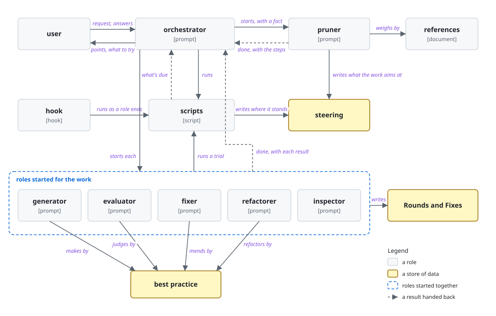
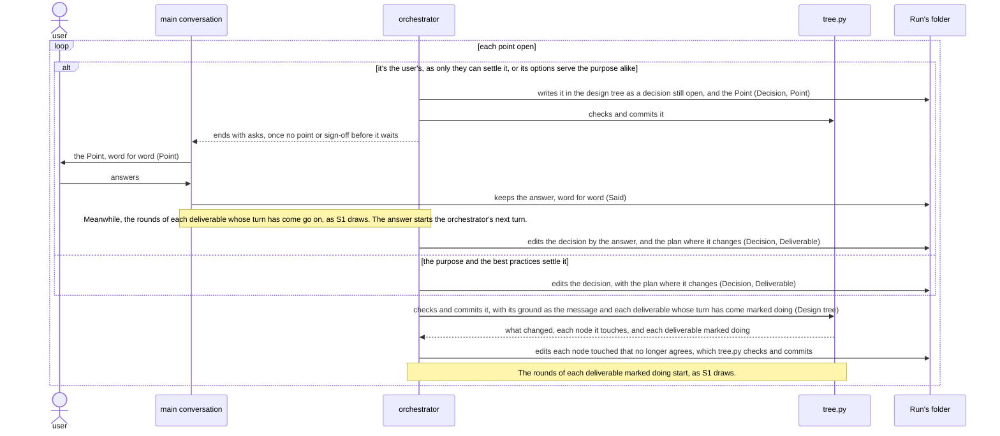
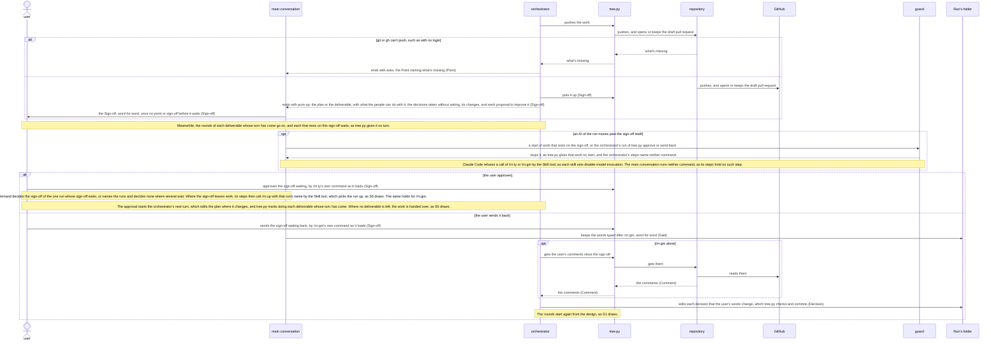
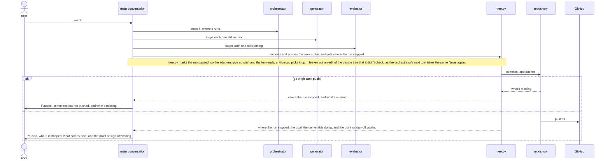
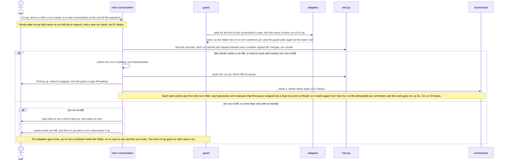
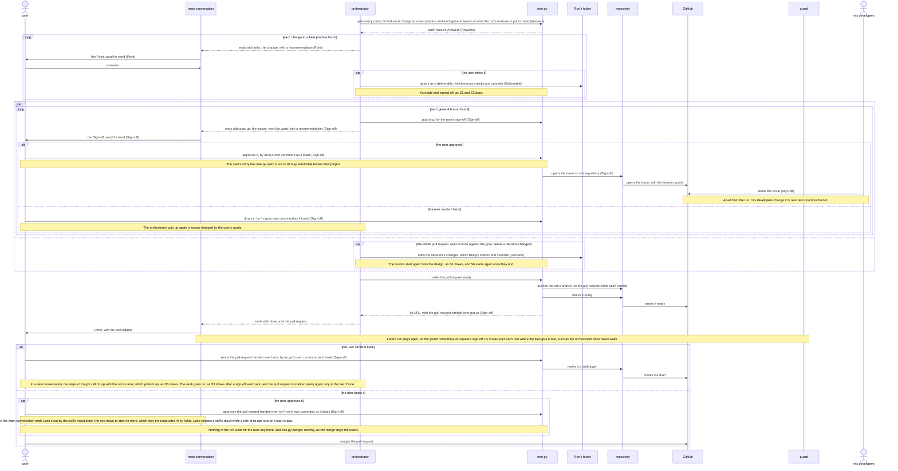

# rn architecture

## User stories

- S1: the user wants to ask in their own words, so that they get what they mean with no specification.
- S2: the user wants to decide only their own points, one at a time, so that their time goes there.
- S3: the user wants to approve or ask a change at each sign-off, so that nothing rests on a
  misreading.
- S4: the user wants to pause a run at any moment, so that they lose neither time nor work.
- S5: the user wants to resume a paused run in any conversation, so that it goes on where it stopped.
- S6: the user wants one pull request with rn's decisions and lessons, so that they merge knowing
  its content.
- S7: each of rn's developers wants each signed-off lesson in rn's issues, so that they improve rn.

## Solution strategy

rn keeps the vital few of each deliverable as decisions in a design tree, asking the user only
theirs. At each event, an orchestrator rebuilds the run from the tree; generators make each
deliverable until evaluators find it good. Every role starts from a cut
and files, and every view keeps these rules.

### Drawn out along the design tree

Each role starts with only the cut that `tree.py` kept for it, and the guard stops any other start.

*Why*: a role that reads decisions not its own makes what the user didn't mean, which raises KR1.1.

### No context carries the run

Each AI reads what it needs from files, and the main conversation holds only the talk and the starts.

*Why*: a context that grows each turn slows each call, adding to KR1.2, and its compaction drops
decisions, raising KR1.1.

### Every step by best practice

Each role's steps say each practice and file it takes, and the guard holds it to what they say.

*Why*: an AI that skipped a step once skips it again, so the deliverable misses what it makes,
raising KR1.1.

### Every item handled

Each role names each item its result carries, and `check.py` holds its end until each is there.

*Why*: an item dropped takes from the deliverable what the item holds, which raises KR1.1.

### Judged by the people it's for

An evaluator gets only what the deliverable's people have, and answers each condition by their aim,
the goal's state.

*Why*: an evaluator with the maker's intent, or without the people's aim, judges for someone else,
raising KR1.1 and KR1.2.

### Signed off before it's built on

`tree.py` gives work resting on a sign-off its turn only after `/rn:ty`, and other work its turn at
once.

*Why*: a misreading found late remakes everything resting on it, raising KR1.1, and idle waiting
adds to KR1.2.

### Back to the design tree on a problem

A `more` or a `/rn:gm` changes the decision it comes from, and `tree.py` keeps a `more` only then.

*Why*: a fix beside the design rests on no decision, so the next round loses or breaks it, raising
KR1.1.

### The design tree reviewed each turn

Each turn, what the run has shown changes the tree's content and course, and a best practice
once taken.

*Why*: a tree kept as first laid out piles up rounds that the people never use, raising KR1.1
and KR1.2.

### Tried in a throwaway copy

A deliverable's commands run only through `throwaway.py`, in a throwaway copy and home, as the
guard holds.

*Why*: a command run as its people run it would change the user's files, and mending them adds to
KR1.2.

### The repository holds the work

The run's state lives only in its folder on the work's branch, committed at each change, end,
and pause.

*Why*: work kept only in a conversation that ends makes the user answer or wait again, adding to
KR1.2.

## Components



- user\
  Gives the goal and each point, sign-off, and lesson that's theirs, pauses the run, and merges.
- rn's developers\
  Change rn's own best practices by each lesson that reaches rn's repository.
- main conversation\
  Shows the user each message word for word, keeps their words, and starts each role due.
- orchestrator\
  Rebuilds the run from the tree and its news, keeps the tree true, and settles all but the user's points.
- generator\
  Makes the deliverable from its cut with only what brings its people closer, handing back each point it can't settle.
- evaluator\
  Finds, as the deliverable's people toward their aim, what's good and what would make it good, condition by condition.
- tree.py\
  Checks and commits each edit of the tree, finds each turn, and keeps each start's cut and news.
- repository\
  Runs each git and gh command for `tree.py`, and reads what they print.
- check.py\
  Checks each role's result against its cut and template, then keeps the result and commits the role's work.
- throwaway.py\
  Runs a deliverable's commands in a throwaway copy and home.
- guard\
  Holds each role to what its steps say, each end to `check.py`, and each sign-off to the user.
- adapters\
  Give Lane each start's text from its cut, and each step's practices.

Strategies:

- An orchestrator started anew at each event, one at a time\
  Its context holds only the tree and the news, so a long run neither slows nor forgets, keeping
  KR1.1 low.
- A main conversation that decides nothing\
  Each word passes as it was given, and its compaction loses nothing kept in files, keeping KR1.1 low.
- One generator for each deliverable\
  Several side by side take about that many times as long for no gain shown, keeping KR1.2 short.
- `tree.py` finding the work that waits, in the order the orchestrator sets\
  Code holds it every run, so no work starts early or idles, keeping KR1.1 low and KR1.2 short.
- A node with no file settled by the orchestrator\
  The deliverables built on it read only its decisions, so rounds on it would add to KR1.2.
- The orchestrator editing the design tree, and `tree.py` checking each edit\
  Code checks each change every time, and no role passes on another's change, keeping KR1.1 low and
  KR1.2 short.
- Each rule of the guard laid by Lane from the words of a role's steps\
  Each holds what its step says every time, so rn builds no check of its own, keeping KR1.1 low.
- One evaluator for each group of necessary conditions\
  Each judges its group in its own context, side by side, keeping KR1.1 low and KR1.2 short.
- A round's Answers given to the orchestrator once each of its evaluators ends\
  A turn on part of a round decides again once the rest arrive, adding to KR1.2.
- A later round judging only the conditions whose decisions changed\
  A condition judged again with nothing changed ends as before, adding to KR1.2.
- The structure reworked by the refactor best practice once the content is good\
  It changes structure only on content that holds, so earlier it's done twice, adding to KR1.2.
- `check.py` holding each deliverable to its template\
  Each sentence beyond the vital few buries what the people need, which evaluators pass, raising
  KR1.1.
- Two rounds of content and two of structure at most\
  A third round on the same decisions ends alike, so each `more` left goes to the user, keeping KR1.2
  short.
- Routes that start any role after any result, and end the run only once nothing is left\
  `tree.py` gives each start due, and Lane holds an idle turn while one is due, keeping KR1.1 low.
- A start due once for each Cut\
  A start ended with a Result is due again only once the tree changes its inputs, keeping KR1.2 short.
- Each run of Lane's at `/rn:up`, its starts due from the run's files\
  A pick-up starts what the files show undone, so Lane replays nothing, keeping KR1.2 short.

## Data model


- Cut\
  What a start begins with: its part of the design tree, and for the orchestrator, the news.
- News\
  What the run showed since the orchestrator's latest ended turn's Cut: each Said, Comment, round,
  sign-off, and other Result.
- Design tree\
  The goal, the deliverables with their decisions, and the work order, in
  [the design tree best practice](../../plugins/rn/domain/best-practices/design-tree/best-practice.md)'s
  form.
- Said\
  The user's words in a run, kept word for word: the request, an answer, or a `/rn:gm`.
- Point\
  A question put to the user with its recommendation: an open decision, the goal drafted, or a lack.
- Sign-off\
  The plan, a deliverable, a lesson, or the pull request, put up for `/rn:ty` or `/rn:gm`.
- Start\
  One start of a role: the Cut it began with, and the Result it ended with.
- Made\
  What a generator made: where it carries out each decision and More kept, and each point it settled.
- Answers\
  An evaluator's answer to each necessary condition of its group, apart from the user's answer to a
  Point.
- More kept\
  An evaluator's `more` the orchestrator kept for the next round, naming its best practice, condition,
  and the decision it changes.

Strategies:

- The design tree as JSON that the orchestrator edits and `tree.py` checks\
  Deliverables rest on one another many to many by path, which no nested list holds, keeping KR1.1
  low.
- A Cut kept as its start opens\
  Each later read of the round takes it, so nothing rebuilds a round from git's history, keeping
  KR1.2 short.
- A Cut naming the commit at which its deliverable was last done\
  A generator reworking it reads only each input's change since then, keeping KR1.2 short.

## Sequences

### S1: a request, and a deliverable made in rounds

```mermaid
sequenceDiagram
  actor U as user
  participant M as main conversation
  participant GD as guard
  participant A as adapters
  participant O as orchestrator
  participant T as tree.py
  participant G as generator
  participant W as throwaway.py
  participant E as evaluator
  participant C as check.py
  participant F as Run's folder
  U->>M: /rn:up with what they want, words that name no run left
  GD->>A: asks for the text of the orchestrator's start, the first move of each run of /rn:up
  A-->>GD: none, as the folder lies in no run's worktree yet, and the guard asks again at the start's call
  M->>T: makes the run's worktree
  M->>M: enters it, by EnterWorktree
  M->>F: keeps the request, word for word (Said)
  loop each event of the run: a Said, a sign-off decided, or a role's end that brings News
    GD->>A: asks for the text of the orchestrator's start, again at the start's call
    A->>T: gets the orchestrator's Cut with the News after the Cut of its latest turn that ended with a Result, written at the path its start keeps (Cut, News)
    alt an orchestrator runs, or the News is empty or holds only part of a round
      A-->>GD: none, so no orchestrator start is due
    else
      A-->>GD: that start's text, which names the Cut's path, and its run values
      M->>T: gets each start due, with its text, as the adapters give it
      M->>O: starts it, with that text, the Cut as it stands at the call
      Note over M,GD: The guard holds the main conversation's turn while a start is due and no role runs, as each route lists only starts. Its steps start each start due before it ends a turn, as a role that runs lets the turn end.
    end
    O->>F: edits the design tree by the News: the goal and plan, a decision, a more to keep, or the work order (Design tree, More kept)
    O->>T: checks the tree as edited, and commits it with each decision's ground as the message
    alt a path names no node, an item of work comes before an input not done, a deliverable's inputs leave out a kind, or a more's decision didn't change
      T-->>O: refuses the change, naming each, and commits nothing
    else
      T-->>O: what changed, each node it touches, and each deliverable marked doing
    end
    O->>GD: ends, with asks and a Point, puts-up and a Sign-off, goes-on, or done
    GD->>C: checks the result, and keeps it in the Start once the Point or Sign-off is in form (Start)
    C->>T: commits the role's work, with its result as the message
    opt asks or puts-up
      M->>U: the Point or Sign-off, word for word (Point, Sign-off)
      U->>M: answers
      M->>F: keeps the answer, word for word, as the next event (Said)
    end
    Note over M,O: Meanwhile, the rounds of each deliverable whose turn has come go on.
  end
  loop each round of a deliverable whose turn has come, as it rests on no open point and on nothing not signed off
    GD->>A: asks for the text of the generator's start, with each start that runs
    A->>T: gets the Cut of the first in the work's order that no start holds, running or ended with a Result since its decisions last changed, written at the path its start keeps (Cut, More kept)
    A-->>GD: that start's text and run values, or none where no work waits
    M->>G: starts it, with that text
    G->>W: tries it (Try record)
    G->>F: writes the deliverable, and what it made, with each point it settled without asking (Made)
    G->>GD: ends, with done, asks naming a point, or lacks naming what stops it
    GD->>C: checks that the Made carries each decision and More kept of its Cut, and the deliverable keeps its template (Start)
    C-->>GD: the result kept in the Start, with the role's work committed, or what's missing, which holds its end
    Note over G,O: Its end is an event: on asks or lacks, the orchestrator settles the point or asks the user, and the generator starts again from its new Cut.
    GD->>A: asks for the text of each evaluator's start
    A->>T: gets the Cut of each group due: of the best practice that the round judges by, each holding a condition whose decisions changed since the round before, or any in the first round, once the round's generator ended with done, and with no start of the group's in the round yet (Cut)
    A-->>GD: a text for each, naming its group, so that one starts beside another
    par one for each group due, started one after another as the guard gives each text, running side by side
      M->>E: starts it, with its text (Cut)
      E->>W: tries it toward the people's aim (Try record)
      E->>F: writes each necessary condition in good, with its lines, or in more, with its good_when (Answers)
      E->>GD: ends, with done, which check.py checks against its Cut, keeps in the Start, and commits (Start)
    end
    Note over E,O: Once each evaluator of the round ends, the round is an event: tree.py gives its Answers in the orchestrator's News, and none of a round in part. The orchestrator reads them and keeps only a more the people fall short by, before the second round of content or of structure ends. After the rounds of content, the generator reworks the structure by the refactor best practice. Then the orchestrator puts up the deliverable, with each more left as a proposal, as S3 draws.
  end
```



### S2: a point settled



### S3: a sign-off



### S4: a pause



### S5: picking up



### S6, S7: the work handed over, and each lesson sent to rn's repository



## Deployment


The user installs rn as [the README](../../plugins/rn/README.md#installation) says, which installs
Lane, and types `/rn:up` at their repository's root.

Strategies:

- rn's own git worktree for each run\
  The user goes on with their work, and a pause leaves nothing of theirs to set right, keeping KR1.2
  short.
- A best practice made on a run in `.rn/best-practices/<kind>/`\
  Every later run finds it and takes it over rn's own of its kind, keeping KR1.1 low.

## Directory structure

rn's folder holds what Claude Code installs for the user. `dev/rn/` holds what only rn's developers
use. `.claude/worktrees/` holds rn's worktree of each run. `.rn/` holds what rn writes on the work's
branch: [the run's folder](../plugin-development-guide.md#where-a-plugin-writes-its-files) and each best practice made on a run.

```text
plugins/rn/
├── .claude-plugin/
│   └── plugin.json                rn's manifest, naming Lane in its dependencies
├── skills/
│   ├── up/
│   │   └── SKILL.md               /rn:up, which starts or picks up a run
│   ├── dn/
│   │   └── SKILL.md               /rn:dn, which pauses the run
│   ├── ty/
│   │   └── SKILL.md               /rn:ty, which approves the sign-off waiting
│   └── gm/
│       └── SKILL.md               /rn:gm, which sends the sign-off waiting back
├── agents/
│   ├── orchestrator.md            starts the orchestrator
│   ├── generator.md               starts the generator
│   └── evaluator.md               starts the evaluator
├── domain/
│   ├── conversation.md            what the main conversation does at every moment
│   ├── orchestrator.md            what the orchestrator does
│   ├── generator.md               what the generator does
│   ├── evaluator.md               what the evaluator does
│   ├── orchestrator-in.schema.json  the form of the orchestrator's Cut and News
│   ├── orchestrator-out.schema.json the form of what the orchestrator gives, its Point or Sign-off
│   ├── generator-in.schema.json   the form of the generator's Cut
│   ├── generator-out.schema.json  the form of what the generator gives, its Made among it
│   ├── evaluator-in.schema.json   the form of the evaluator's Cut
│   ├── evaluator-out.schema.json  the form of what the evaluator gives, its Answers among it
│   ├── tree/                      the code of tree.py, a module for each decision it makes
│   ├── sign-off.schema.json       the form of a Sign-off, which tree.py decides
│   ├── start.schema.json          the form of a Start, which tree.py and check.py decide
│   ├── repository/                the code of repository, a module for each tool it runs
│   ├── check/                     the code of check.py, a module for each decision it makes
│   ├── template/                  the code of template.py, which holds a document to its kind's
│   │                              template, alone or within check.py's check of a deliverable
│   ├── fault.py                   how tree.py, check.py, throwaway.py, repository, and the
│   │                              adapters say why they stopped, and how each command ends
│   ├── throwaway.py               the code of throwaway.py
│   └── best-practices/            rn's own best practice of each kind
├── scripts/
│   ├── tree.py                    runs the code of tree.py
│   ├── check.py                   runs the code of check.py
│   ├── template.py                runs the code of template.py
│   └── throwaway.py               runs the code of throwaway.py
├── hooks/
│   ├── hooks.json                 starts the guard on each call
│   ├── lanes.json                 the rules and routes that Lane laid from each role's steps
│   ├── lane/                      the guard: Lane's code, copied in by Lane
│   └── adapters/                  give the guard each start's text from its Cut, and each
│                                  step's practices
└── README.md                      for rn's users

dev/rn/
├── product-vision.md              rn's product vision
├── architecture.md                this document
├── README.md                      for rn's developers
└── tests/                         the test cases, in unit/, properties/, prompts/, integration/,
    │                              and e2e/, with the E2E test files that dev/scripts/e2e.py runs
    └── gh/                        the double of gh, the records of gh it gives from in recorded/,
                                   and compatibility.py, which compares a new gh with them

.claude/worktrees/
└── rn-<yyyymmdd>-<goal>/          rn's worktree of one run, on the work's branch

.rn/
├── <yyyymmdd>-<goal>/             one run
│   ├── design-tree.json           the design tree
│   ├── said/                      each Said, word for word
│   ├── sign-offs.json             what waits for /rn:ty, and what the user signed off
│   ├── starts/                    each Start: the Cut it began with, and its Result
│   └── rounds/                    each round's Try record, Made, Answers, and More kept
└── best-practices/                each best practice made on a run
```

## Test strategy

Each test case lies in `dev/rn/tests/`, written as Given, When, and Then before anyone builds a part.
`dev/scripts/trace.py` checks that each names an element or a case one level up.

| Check | Test target | Kind | Exit criteria or measure |
|---|---|---|---|
| Lint | Parts | Quality | ruff: 0 findings. |
| Static analysis | Parts | Quality | pyrefly, and pylint's duplicate-code and cyclic-import checks: 0 findings. |
| Complexity analysis | Parts | Quality | complexipy and ruff: per function, McCabe 10, cognitive 15, 6 returns, 12 branches, 5 arguments, 50 statements at most. |
| Unit testing | Parts | Quality | pytest, with the double of Claude Code: every case passes. |
| Unit testing | Parts that hold a prompt | Benchmark | `claude -p` on Opus: each case's results over several runs, read by code from each run's record. Runs per case: 3, as no case's runs differed. |
| Code coverage | Parts | Quality | coverage: 100% statement (C0) and branch (C1) coverage. |
| Property-based testing | Parts | Quality | hypothesis: 0 counterexamples in reading the design tree, the records, and the adapters' input. |
| Mutation testing | Parts | Quality | cosmic-ray: 0 surviving mutants. |
| Integration testing | Architecture | Quality | pytest, with the double of Claude Code: every case passes, each handoff giving the data the data model names. |
| Contract testing | Architecture | Quality | `dev/rn/tests/gh/compatibility.py` on each new gh: each recorded command gives what its line shows. Claude Code's is Lane's test. |
| Traceability | Architecture | Quality | `dev/scripts/trace.py`: every element tested, every case naming one level up, each rule's case failing broken. A review: 0 cases that miss what their element says. |
| Scenario testing | Product | Benchmark | `dev/scripts/e2e.py` on the walkthrough, the key results KR1.1, then KR1.2, over several runs. A stand-in of each deliverable's people tries it, and code checks. Runs: added until one more moves no mean by a step. |
| Installation testing | Product | Quality | `dev/scripts/e2e.py`: rn installs by the README's commands in a fresh home, and `/rn:up` answers. |
| Configuration testing | Product | Quality | CI's Tests on Python 3.9 and the newest Python: every case passes on each. |
| Conformance and compliance testing | Product | Quality | `claude plugin validate --strict`: passes. |
