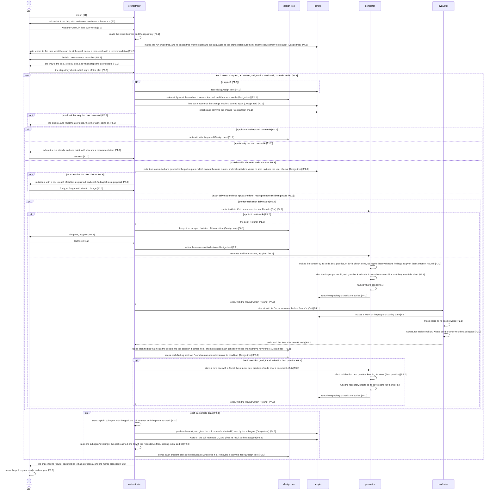
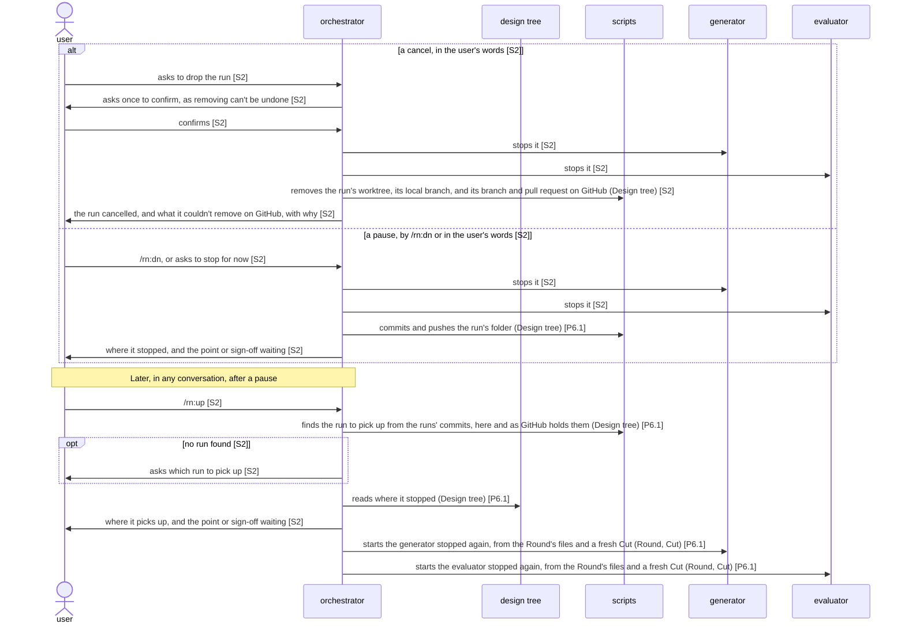

# rn architecture

## User stories

- S1: the user wants the deliverable they're after, asking in their own words, checking only the
  steps they choose.
- S2: the user wants to pause a run and resume it in any conversation losing nothing, or to
  cancel it.

## Solution strategy

### Principles

rn piles up the [vital few](https://en.wikipedia.org/wiki/Pareto_principle) that bring a
deliverable's people to their aim, and cuts the trivial many.

- P1: toward the people's aim
  - P1.1: the run reviews its course at each event by what it has done and learned.
  - P1.2: the user is asked only what only they can decide, one point at a time, in their own
    terms.
  - P1.3: work that rests on the plan or on a deliverable that the user checks starts at their
    sign-off.
- P2: judged by the people's aim
  - P2.1: a deliverable is tried as its people would, with only what they have.
  - P2.2: a trial names only what's good and what would make it good.
  - P2.3: the work is checked whole before its merge is proposed.
- P3: made the field's established way
  - P3.1: running, making, and judging are separate roles.
  - P3.2: content is made by its kind's best practice and refactored, or, as the user picks, by
    its check alone.
  - P3.3: remaking has a limit, and each finding left goes to the user as a proposal.
- P4: each role on its own work
  - P4.1: each role starts with only what its work needs.
  - P4.2: what a role makes stays in files, and roles hand each other short results.
  - P4.3: a step that has one right result is done the same way each time, without a role's
    judgment.
- P5: the shortest path
  - P5.2: deliverables that rest on none still being made are made at the same time.
  - P5.3: work that a stop leaves alone goes on.
- P6: nothing lost on a stop
  - P6.1: the run's state lives in files, so that it goes on from any conversation.

### Concept model


- Design tree\
  Holds what to make, why, and how far the run got, for each review and each pick-up. It also
  holds rn's version, the languages, the steps, the issues, and the pull request. Its form is
  [the design tree best practice](../../plugins/rn/domain/best-practices/design-tree/best-practice.md)'s.
- Cut\
  A role's part of the design tree, so that each role starts with only the decisions its work needs.
- Best practice\
  The field's established way to make one kind of deliverable, and its conditions, which making
  and judging both stand on.
- Round\
  One making or refactoring of a deliverable, which its maker tries as its people would. Its judge
  tries content too. What each found good or short decides the next mend.

Strategies:

- Each design tree edit checked before its commit, on each condition of its best practice that
  code can check. [P1.1]\
  Intent: the work always rests on a design tree in form.
- The plan kept as the design tree's own deliverable, and each sign-off as its deliverable done.
  [P1.3]\
  Intent: the run's files alone say what waits for the user and what may start.
- Each point that the user settles kept as an open decision of its condition, and their answer
  as its decision. [P6.1]\
  Intent: a point and its answer outlive the conversation that asked it.
- The way to the goal kept as the design tree's steps, each saying whether the user checks it.
  [P1.3]\
  Intent: the run's files alone say which deliverables wait for the user, and where the run stands.
- Each deliverable's last Round marked as the end of its Rounds once it's put up. [P1.3]\
  Intent: a send-back gets Rounds of its own, so that the user's change is remade.
- The issues to close and to refer to written from the request, never asked. [P1.2]\
  Intent: the user isn't asked what their request already says.
- The pull request opened as a draft, which the user marks ready. [P2.3]\
  Intent: nobody reviews or merges the work before the user has seen it checked whole.
- A finding that the people would never meet dropped by holding its condition good. [P1.1]\
  Intent: the next generator gets as given each finding of a condition still short.

### Components


- orchestrator (prompt)\
  Leads the run to the people's aim.
- generator (prompt)\
  Makes a deliverable with which its people reach their aim.
- evaluator (prompt)\
  Checks, as the people, whether a deliverable reaches their aim.
- scripts (script)\
  Does each step that has one right result.

Strategies:

- Each command only an entry point, pointing to the orchestrator's steps for each event. [P1.1]\
  Intent: every event reaches the one place that reviews the run, as no command checks its input.
- The main conversation as the orchestrator, which starts and stops each other role. [P3.1]\
  Intent: the talk with the user and the review of the design tree share one context.
- Each message to the user opening with where the run stands on the way to the goal. [P1.2]\
  Intent: a user who knows nothing of rn's insides knows at each message what's done and what's
  next.
- The final check made by a plain subagent over the pull request's whole diff and its CI. [P2.3]\
  Intent: the diff stays out of the orchestrator's context, and a newcomer to the work reads it.
- One generator and one evaluator for each Round, the evaluator judging every condition from one
  trial. [P2.1]\
  Intent: the people's use is one act, so it's tried once and judged whole.
- A new generator for the refactoring once each condition is good, with no evaluator. [P3.2]\
  Intent: a new reader meets what the content's maker misses, and the checks and tests show the
  intent holds.
- The generator trying the deliverable as its people would, and going back to its decisions on a
  shortfall they meet. [P2.1]\
  Intent: the generator finds its own shortfall, and hands on only what it saw serve the people.
- Each role trying the deliverable outside the work's branch, and checking only its own files.
  [P4.3]\
  Intent: the pull request holds only the deliverables and the run's records.
- The generator taking as given what the last evaluator found good or short. [P2.2]\
  Intent: the generator mends by the evaluator's own measure.
- The last Round's roles resumed within the same conversation, and started from its files in a new
  conversation. [P6.1]\
  Intent: each mend starts from what the last Round learned, wherever the run goes on.
- A point that a role can't settle taken to the user as given, and the answer taken back as
  given. [P1.2]\
  Intent: the user answers the role's own question, and the role gets the user's own words.
- Each step that has one right result done by a script that the role runs. [P4.3]\
  Intent: each role spends its judgment and its context only where a step needs them.
- Each deliverable's Rounds kept apart from the others', so that each deliverable due starts
  at once. [P5.2]\
  Intent: the user waits for the slowest deliverable, not for all of them in turn.
- Each maker's removal done by a script of exact paths, which a hook names to its deletes in Bash.
  [P4.3]\
  Intent: a maker's clean-up never waits on a permission prompt, and stays in the work and the
  temporary folder.
- Each step written as what it does, never tied to one OS's tools, such as Glob or Bash's
  `find`. [P4.3]\
  Intent: rn runs alike on each OS that Claude Code runs on.
- A script's refusal that only the user can mend stopping only the work it concerns. [P5.3]\
  Intent: the user mends one blocker while every other deliverable goes on.
- A pause or a cancel taken from the user's words. [S2]\
  Intent: the user stops a run without learning a command.
- A cancel confirmed once, removing the run here and its branch and pull request on GitHub. [S2]\
  Intent: nothing that can't be undone happens on one misread sentence, and no run is left to
  collide with.

### Sequences

#### S1: a deliverable made in rounds



#### S2: a pause, a cancel, and a pick-up



### Deployment


The user installs rn as [the README](../../plugins/rn/README.md#installation) says, and types
`/rn:on` at their repository's root.

Strategies:

- rn's own git worktree for each run. [S2]\
  Intent: the user goes on with their work, and a pause leaves their side as it was.

### Directory structure

```text
plugins/rn/                        what Claude Code installs for the user
├── skills/                        /rn:on, /rn:up, /rn:dn, /rn:ty, and /rn:gm, each pointing to the orchestrator
├── agents/                        the generator's and the evaluator's starts
├── hooks/                         the hook that turns a maker's delete in Bash to remove.py
├── domain/
│   ├── orchestrator.md            the event's own step, then those that every event shares
│   ├── generator.md               what the generator does
│   ├── evaluator.md               what the evaluator does
│   ├── schemas/                   the form of each Cut and result
│   ├── tree/                      the code that checks the design tree
│   ├── check/                     the code that checks each role's result against its form
│   ├── rounds/                    the code that reads and writes the Rounds
│   ├── template/                  the code that holds a document to its kind's template
│   ├── repository/                the code that makes a run's worktree and puts a deliverable up
│   ├── remove/                    the code that removes what a maker made for itself
│   ├── hook/                      the code of the hook before each Bash command
│   └── best-practices/            rn's own best practice of each kind
└── scripts/                       each step with one right result, as a role runs it

dev/rn/                            what only rn's developers use
└── tests/                         the test cases, from unit to integration

.claude/worktrees/                 rn's worktree of each run
└── rn-<yyyymmdd>-<slug>/          one run's worktree, on the work's branch

.rn/                               what rn writes on the work's branch
├── <yyyymmdd>-<slug>/             one run's folder
│   ├── design-tree.json           the design tree
│   └── rounds/                    each Round
└── best-practices/                each best practice made on a run
```

## Test strategy

| Check | Test target | Kind | When | Exit criteria or measure |
|---|---|---|---|---|
| Lint | Parts | Quality | During the work | 0 findings. |
| Static analysis | Parts | Quality | During the work | 0 findings of mismatched types, copied code, or import cycles. |
| Complexity analysis | Parts | Quality | During the work | Per function, McCabe 10, cognitive 15, 6 returns, 12 branches, 5 arguments, 50 statements at most. |
| Unit testing | Parts | Quality | During the work | Every case passes. |
| Code coverage | Parts | Quality | During the work | 100% statement (C0) and branch (C1) coverage. |
| Property-based testing | Parts | Quality | During the work | 0 counterexamples of each invariant that rn's product vision, README, and this document state. |
| Integration testing | Architecture | Quality | During the work | Every case passes, with a double of each prompt, and each handoff gives the data the concept model names. |
| Contract testing | Architecture | Quality | Apart from the work | On each new version of gh, each recorded command gives what it recorded. |
| Traceability | Architecture | Quality | During the work | Every element tested, every case naming one level up, and each principle's case failing with its part broken. |
| Scenario testing | Product | Quality | Apart from the work | A walkthrough run of the README's request reaches its pull request with no stop that a fault caused. |
| Installation testing | Product | Quality | Apart from the work | Once ccpm's marketplace lists rn, it installs alone by the README's commands in a fresh home. |
| Configuration testing | Product | Quality | During the work | Every case passes on Python 3.9 and on the newest Python. |
| Conformance and compliance testing | Product | Quality | During the work | Claude Code's strict check of the plugin passes. |
