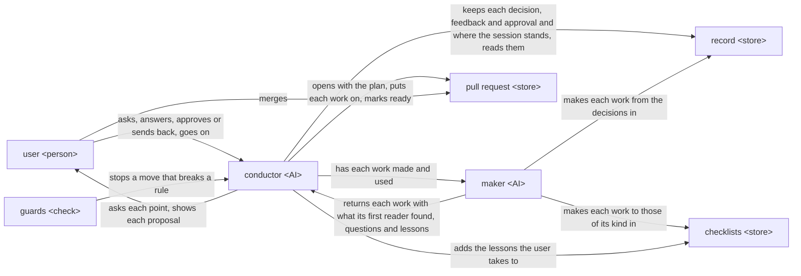

# rn design

rn is one AI, the conductor, that talks with the user and decides every move, and a maker that makes
each work the user sees, such as the plan, a document or the finished work, and has it used first by
an AI that did not make it; a record kept before each next move lets any conversation go on from
where the last one stopped in a session, one piece of work from `/rn:up` to the merge. It brings
about [rn's UX](ux.md), whose goal and key results it is checked against.

## User stories

- As the user, I want to ask for a piece of work in rough words with `/rn:up <what I want>`.

  The UX's scenes Asking and The plan begin here.
- As the user, I want to answer each point rn confirms with me, with an option's letter or in my own
  words.

  A point to decide is a choice that changes what is made. The points come while rn asks before it
  writes the plan, the goal of the piece of work and its acceptance criteria, each one thing the
  finished work must do for the goal; during the tasks, the parts the piece of work is divided
  into; and as the lessons, what the session learned, at the end. The UX's scenes Asking, The tasks
  and Lessons rest on this story, as the points they bring.
- As the user, I want to approve a proposal with `/rn:ty` or ask for a change with
  `/rn:gm <feedback>`.

  A proposal is what rn shows the user at a sign-off, a stop where it waits for their answer; there
  are three, in this order: the plan sign-off, the design sign-off on the documents the purpose
  needs, and the deliverable sign-off on the finished work. The UX's scenes Feedback and
  Checklists rest on this story: feedback is sent with `/rn:gm`, and each proposal shows what the
  work gives for each item of its checklists.
- As the user, I want to go on from where I stopped with `/rn:up` in a fresh conversation.

  The UX's figure ends on this story, wherever the user stops, and so does Feedback's clearing of
  the conversation.
- As the user, I want to merge the pull request rn marked ready.

  The plan, the documents and the finished work reach the user on a pull request of the session's
  own branch, as the UX has it. The UX's scene Records rests on this story, as rn's commit messages
  on that branch, and Lessons' additions go into the same pull request.

## Architecture

### Logical view

Six components take on the stories; the user meets only the conductor and the pull request. A move
is one thing rn does next, such as confirming a point, having a work made or stopping at a
sign-off; the steps of each command are made of moves.



- On `/rn:up <what they want>`, the conductor finds the points to decide from the user's words, the
  repository and its documentation, and confirms each with the user, the looked-up ones included,
  one per message.

  Each message lists the points, the settled ones with their outcome and the current one marked;
  for the current one it gives the conclusion, its grounds and the options, the recommended one
  first, each with its trade-off and whether it can be undone, then one question on that point
  alone. The conductor alone decides each move: what to confirm with the user, what work to
  have made, whether a work that comes back serves the purpose, and when to stop at a sign-off. A
  decision taken without the goal and the conversation leaves a record the user cannot stand
  behind; one decider keeps the course one.
- Each answer goes into the record, in the decisions of the work it settles, before the work that
  follows it.

  The record is everything rn keeps of the session: the plan, the decisions for each work, what each
  work was made from, and the state: where the session stands and what comes next, written whole
  after each move, the states before it kept in the history of the record. The decisions say what
  the work must say or do and hold what is true now; the history of the record holds how it was
  reached, the options weighed with their reasons and each feedback with its answer. The next
  conversation goes on only from what was kept, so nothing is made on a decision not yet kept.
- At every move a machine can judge, a guard checks it before the conductor makes it, and stops it,
  naming the step and why, where it would let a sign-off pass without the user's `/rn:ty`, keep a
  plan outside the form rn's checklist for plans gives, start a work before the decision it follows
  is kept, or keep a change anywhere but the session's own branch.

  A rule written in words is followed by chance; a stop at the moment holds every time.
- The conductor has each work made by the maker from its decisions and the checklists of its kind,
  and the maker has an AI that did not make it, the first reader, use it in the place of its
  receiver, whoever the work is for, before it comes back.

  Besides the plan, a document and the finished work, a work may be a task's result or a checklist.
  The checklists for a kind are rn's own, which say what a work of that kind must give its receiver,
  and the user's addition for that kind, which holds only what it adds; for a kind rn has none for,
  the user's addition, made to rn's checklist for checklists, is the whole checklist for that kind.
  The maker returns, for each item of the checklists, its Good, what the receiver gets for what the
  item asks, with the lines of the work that give it; the questions only the user can decide; and
  lessons. The conductor reads each Good at its lines, puts each question to the user as a point,
  and fixes by hand only what falls short of the purpose in a few lines; where the decisions change
  much, it has the work made again. The maker of a work finds the Good it meant; an AI that did not
  make it finds the Good its lines give, which is what the user gets.
- After each move, the conductor replans from the facts the move brought alone, such as the user's
  answer, the work with what its first reader found and the output of what it ran, and replaces the
  state before the next move; a checklist or an environment a task lacks, such as a tool to
  install, becomes a task of its own before the task that needs it.

  A plan kept from what was expected drifts from the purpose while every move looks done, and a
  work made without the checklist or environment it needs is made to a guess and made again. A
  change to the goal or an acceptance criterion is a point confirmed with the user.
- The plan is the first work, and the conductor opens the pull request with it.

  The goal and each acceptance criterion get an ID that later messages refer to. The pull request
  is where the user sees every work and, at the end, merges.
- At a sign-off, the conductor stops with the proposal: where the session stands, the sign-offs
  done and ahead; what changed since the last proposal; the work's link on the pull request; and
  each item of the work's checklists with its Good and lines from the maker.

  The proposal is put together from what the maker returned and the record alone, so it says
  nothing the first reader did not read.
- On `/rn:ty`, the conductor keeps the approval in the record and goes on to the next move.
- On `/rn:gm <feedback>`, the conductor keeps the feedback in the record and stops; the next
  `/rn:up` finds the point behind it, one rn decided wrong or did not ask, confirms it, puts the
  answer into the decisions, has the work made again, and stops at the same sign-off with what
  changed.
- After the plan sign-off, the conductor confirms with the user, as a point, which documents the
  purpose needs, has each made in the order its checklist says it is drawn, the UX, then the README,
  then the design, and stops at the design sign-off.
- After the design sign-off, the conductor writes the tasks into the plan, each naming the
  acceptance criteria it serves, and has each task's result made by the maker, used for those
  criteria.

  A point only the user can decide that comes up here is confirmed with them as before the plan.
- When the tasks are done, the conductor has the finished work used by the maker as the user would
  use it, for every acceptance criterion, and stops at the deliverable sign-off.
- On `/rn:ty` at the deliverable sign-off, the conductor confirms each lesson the maker returned
  during the session with the user as a point, with what happened, the addition to the user's
  checklists the conductor recommends for it, and whether a fault of rn's own goes as an issue to
  the people who build rn; it puts each addition taken on the pull request, then marks the pull
  request ready.

  The conductor keeps each lesson in the record as the maker returns it, so a session that went on
  in several conversations still has them all.
- The user merges the pull request; rn never merges.
- On `/rn:up` in a fresh conversation, the conductor reads the record on the session's branch and
  goes on from where the session stands.

  Any stop is a place to go on from, since every decision was kept before the work after it; so
  there is no command to pause, and the user stops wherever they stop.

### Physical view

```text
rn/                                   the plugin, on the user's machine
├── skills/
│   ├── up/                           the conductor's steps for /rn:up
│   ├── ty/                           the conductor's steps for /rn:ty
│   └── gm/                           the conductor's steps for /rn:gm
├── scripts/
├── hooks/
│   ├── hooks.json                    one entry per hook event
│   └── *.py                          one check each
└── checklists/                       rn's own, one markdown file per kind

<the user's repository>, on the session's branch
└── .rn/
    ├── checklists/<kind>.md          the user's addition for a kind
    └── <yyyymmdd>-<slug>/            the record of one session
        ├── steering.md               the plan
        ├── decisions/<work>.decisions.md
        ├── ccs/<work>.json           what each work was made from
        └── state.json                the state
```

- A fresh `/rn:up` goes on with the session whose folder the checked-out branch changed from the
  default branch and whose plan is not finished; the folders of merged sessions stay in the
  repository, finished, so they are never taken up again, and sessions rn 0.9.0 left are found the
  same way.

- The conductor is rn's three skills, one per command, each run in the user's Claude Code
  conversation on the model the user runs it on.
- The maker is turn, a plugin installed with rn as its dependency; the conductor calls its `turn:up`
  agent with a work's CCS, a JSON file holding all turn's call takes, the work, its receiver, what
  they use it for and have with it, its checklists and the files it is made from, kept in the
  record as `ccs/<work>.json`, and reads the result turn writes.

  turn's own design leaves the judging of its result to the caller, which is why the conductor
  reads each Good at its lines.
- While turn runs, the conductor passes each message turn's agents send it on to the user in the
  conversation's language, judging nothing and asking nothing; when the user says to stop, it
  stops the run.

  Only the agent doing the work knows whether its way is right; a conductor that judged it would
  ask the user each time, and the user would answer more than what is theirs.
- rn's scripts serve the conductor: they find a kind's checklists, rn's and the user's addition;
  write a work's CCS; put the proposal together from turn's result and the record; and read and
  write `state.json`.
- The guards are rn's hooks, one check for each rule above; the session's own branch is held by
  stopping any commit or push on the default branch.
- rn's scripts and hooks run on Python 3.9 or later with the standard library alone, and change
  JSON with jq.
- The record is the session's folder, kept by a commit and a push to the session's branch with git;
  its history is the commit messages. The conductor alone commits and pushes.

  A push is what a fresh conversation, or another machine, reads from.
- rn's checklists are read-only in the plugin; the user's additions are in their repository and go
  into the session's pull request.
- The pull request is a draft pull request on GitHub of the session's branch, opened and marked
  ready with the GitHub CLI `gh`, logged in to an account that can push to the repository; a
  lesson's issue is opened with it on `lovaizu/ccpm`.

## Verification

Every trial runs in `lovaizu/playground` on a branch of its own, removed with its pull requests
after, from code kept in `dev/rn/trials/`, where the real requests the trials use are kept too, the
same for each version compared: pieces of work asked of rn in a user's rough words, each with the
purpose the stand-in user holds behind them. Every AI part runs on Opus 5.5, the model Claude Code
runs by default on every plan, and runs with `bypassPermissions` in a Docker Sandbox, as rn's README
has its users run it, and is judged from the JSONL of every conversation and agent it started, not from its
outcome alone.

### Units

- rn's scripts: each gives what this design says it gives, for every input it may receive.
  - Flow: unittest in `dev/rn/tests/`, fed the record, turn's results and checklists each reads, run
    in CI on every push; passes with every line and branch run, every mutant caught, and property
    tests wherever an input varies.
- rn's hooks: each check stops what it must and lets through what it must.
  - Flow: as for the scripts, fed the tool calls and the record each check receives.
- Each skill: takes each step of its command in this design's order.
  - Flow: on the smallest request that reaches each of the skill's steps, one of one point to
    decide, one acceptance criterion, one document and one task whose stood-in result lacks a
    checklist, with turn stood in for by an agent giving a result set beforehand and the user by
    answers set beforehand; passes when the JSONL of the conversation shows each step in this
    design's order and each hook stopping where its check should, the plan gains a task for the
    lacking checklist before the task that needs it, and the branch
    holds each commit the steps make, a new `state.json` among them after each move.
  - Content: the messages, decisions, plans and proposals it makes on the real requests; passes
    when each message is in the form above, each decision is as the user answered, each replan and
    each `state.json` rests only on the facts the move before it brought, and each proposal says
    only what turn's result and the record hold, read against the JSONL.
- rn's checklists: what is made with them on the real requests.
  - Content: each change sent back at the deliverable sign-off is traced to the checklist or the
    skill it comes from, and fixed there; the fix passes when, on the same real requests run
    again, that change is not sent back and every story is still achieved.
- turn is checked by its own design.

### Acceptance

- Flow: from `/rn:up` to the pull request marked ready, on the smallest request above, with
  stand-ins for turn and the user; each step shows in the JSONL and in the commits on the branch,
  in this design's order.
- Asking in rough words: from a request of a few words, the points to decide reach the user and the
  plan holds their purpose.
  - A stand-in user holding a purpose it does not write in the request plays it with real turn.
- Answering each point: each answer shows in the decisions and in the work it settles, and every
  point came one per message.
  - The stand-in user answers with letters and in its own words, and the record is read against
    the conversation.
- Approving or asking for a change: `/rn:ty` passes the sign-off, and `/rn:gm` brings the same
  sign-off back with what changed.
  - The stand-in user sends back once at each sign-off, then approves.
- Going on: from each place the user may stop, while asking, at a sign-off and during the tasks,
  `/rn:up` in a fresh conversation goes on with nothing asked again and nothing lost.
  - The stand-in user's conversation is closed at each, and a fresh one started.
- Merging: the pull request marked ready holds the finished work and every addition taken, and
  merges.
  - The stand-in user merges it.
- KR1.1: the changes a stand-in user holding the purpose sends back at the deliverable sign-off.
  - Each thing its feedback there asks to be different counts as one, compared with the version in
    use, the latest released rn, on the real requests.
- KR1.2: the user's time from asking to the purpose achieved.
  - Read from the timestamps of the stand-in user's conversation in its parts, answering, checking
    proposals, sending back and doing by hand, and compared with the version in use on the real
    requests; a part that adds nothing to KR1.1 is cut first.

A change is taken when every story is still achieved and it brings KR1.1 closer, or KR1.2 closer
without raising KR1.1.
