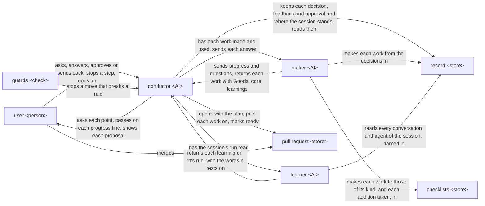

# rn design

rn is one AI, the conductor, that talks with the user and decides every move, and a maker that makes
each work the user sees, such as the plan, a document or the finished work, and has it used first by
AIs that did not make it, each on its own; a record kept before each next move lets any
conversation go on from where the last one stopped in a session, one piece of work from `/rn:up` to
the merge. It brings about [rn's UX](ux.md), whose goal and key results it is checked against.

rn holds the [principles every plugin holds](../architecture.md#principles), and its own:

1. Every task traces back to the purpose, through the acceptance criteria it serves.
2. The plan is remade from the facts each move brings alone, and only a short state is carried from
   move to move.

## User stories

- As the user, I want to ask for a piece of work in rough words with `/rn:up <what I want>`.

  The UX's scene From asking to the merge begins here, with its item The plan.
- As the user, I want to answer each point rn confirms with me, with an option's letter or in my own
  words.

  A point to decide is a choice that changes what is made. The points come while rn asks before it
  writes the plan, the goal of the piece of work and its acceptance criteria, each one thing the
  finished work must do for the goal; while the tasks, the parts the piece of work is divided into,
  are carried out; and as the learnings, what the session taught that would make later work better,
  at the end. The UX's scenes Asked each point, and a change sent back, While the tasks are carried
  out, and Learnings rest on this story, as the points they bring.
- As the user, I want to stop a step going a way I do not want, and say the way.

  The UX's scene While the tasks are carried out ends on this story.
- As the user, I want to approve a proposal with `/rn:ty` or ask for a change with
  `/rn:gm <feedback>`.

  A proposal is what rn shows the user at a sign-off, a stop where it waits for their answer; there
  are three, in this order: the plan sign-off, the design sign-off on the documents the purpose
  needs, and the deliverable sign-off on the finished work. The UX's scene Asked each point, and a
  change sent back rests on this story for `/rn:gm`, and the items Sign-offs and Checklists of From
  asking to the merge rest on it for what a proposal shows and what its work is made with.
- As the user, I want to go on from where I stopped with `/rn:up` in a fresh conversation.

  The UX's scene Stopped, and gone on rests on this story, and so does the clearing of the
  conversation after `/rn:gm`.
- As the user, I want to merge the pull request rn marked ready.

  The plan, the documents and the finished work reach the user on a pull request of the session's
  own branch, as the UX has it. The UX's scene From asking to the merge ends on this story, and its
  item Records rests on it, as rn's commit messages on that branch; the additions the user takes
  from the learnings go into the same pull request.

## Architecture

### Logical view

Seven components take on the stories; the user meets only the conductor and the pull request. A move
is one thing rn does next, such as confirming a point, having a work made or stopping at a
sign-off; the steps of each command are made of moves.



- On `/rn:up <what they want>`, the conductor finds the points to decide from the user's words, the
  repository and its documentation, and confirms each with the user, the looked-up ones included,
  one per message.

  Each message lists the points, the settled ones with their outcome and the current one marked;
  for the current one it gives the conclusion, its grounds and the options, the recommended one
  first, each with its trade-off and whether it can be undone, then one question on that point
  alone. This is rn's form for a point, wherever a point comes from. The conductor alone decides
  each move: what to confirm with the user, what work to have made, whether a work that comes back
  serves the purpose, and when to stop at a sign-off, as
  [Principle 1](../architecture.md#the-orchestrator-holds-the-whole-and-decides) has it.
- Each answer goes into the record, in the decisions of the work it settles, before the work that
  follows it.

  The record is everything rn keeps of the session: the plan, the decisions for each work, what each
  work was made from, and the state: where the session stands and what comes next, written whole
  after each move, the states before it kept in the history of the record. The decisions say what
  the work must say or do and hold what is true now; the history of the record holds how it was
  reached, the options weighed with their reasons and each feedback with its answer. The next
  conversation goes on only from what was kept
  ([Principle 6](../architecture.md#where-the-course-is-kept)).
- At every move a machine can judge, a guard checks it before the conductor makes it, and stops it,
  naming the step and why, where it would let a sign-off pass without the user's own `/rn:ty`, keep
  a plan outside the form rn's checklist for plans gives, start a move or end the conductor's turn
  while a change in the session's folder, a decision or the state among them, is not committed and
  pushed, start a task's making before its steps before it are ticked, change by hand a file of a
  work, keep a change anywhere but the session's own branch, or merge the pull request.

  A rule written in words is followed by chance; a stop at the moment holds every time
  ([Principle 5](../architecture.md#the-guard-tells-each-role-its-steps-again)).
- The conductor has each work made by the maker from its decisions and the checklists of its kind,
  and the maker has two AIs that did not make it, the first readers, each use it on its own in the
  place of its receiver, whoever the work is for, before it comes back.

  Besides the plan, a document and the finished work, a work may be a task's result, a checklist or
  a rule of the project. The checklists for a kind are rn's own, which say what a work of that kind
  must give its receiver, and the user's addition for that kind, which holds only what it adds; for
  a kind rn has none for, the user's addition, made to rn's checklist for checklists, is the whole
  checklist for that kind. An item gets its Good, what the receiver gets for what it asks, only
  where both first readers give it; an item that does not settle becomes a question. The maker
  returns each item's Good with the lines of the work that give it; the work's core, its few core
  decisions each with its intent, which the first readers read with the work; and its learnings on
  its own run. Each first reading is made on its own, so each adds a check
  ([Principle 4](../architecture.md#read-by-those-who-did-not-make-it)).
- While the maker runs, the conductor passes on to the user, in the conversation's language and
  adding and judging nothing, each progress line it sends:
  before a step, what it will do, how far and how; after it, what is done and what comes next. Each
  question it sends, the conductor puts to the user as a point in rn's form, keeps the answer
  in the work's decisions, and sends it to the maker, which waits for it and goes on. When the user
  stops a step and says the way, the conductor stops the run, keeps the way in the work's
  decisions, and has the run go on from where it stopped.

  Only the agent doing the work knows whether its way is right; a conductor that judged each line
  would ask the user each time, and the user would answer more than what is theirs
  ([Principle 2](../architecture.md#the-caller-approves-what-is-theirs)). A question and a way are
  the user's decisions like any answer, so they take the same form and are kept before the work
  goes on.
- When a work comes back, the conductor reads each Good at its lines and the core against the goal,
  the acceptance criteria and the decisions, and leaves every change to the work to the maker. A
  shortfall that rests on a point the user has not decided goes to them as a point; any other is
  kept in the work's decisions and the work is made again. Where the core does not fit in a few
  short lines, the conductor takes the work as not yet simple, keeps that in its decisions and has
  it made again before it stops.

  The first readers read in the receiver's place, each on its own; the conductor reads after them
  as the one that holds the purpose, the decisions and the conversation, so its reading checks that
  each Good rests on its lines and serves what the user agreed, and the first readings stay each
  its own. A work made again is read by its first readers as it was the first time, where a change
  by hand would reach the user unread (Principle 4).
- A checklist serves the purpose of whoever uses a work of its kind: it says who they are and what
  they achieve with the work, the idea its items rest on, and the items, each with why. How a work
  is made is the plan's tasks.

  A checklist is answered on the work, which holds no steps; the idea and each why let a maker
  meet the items their own way, and steps there would be followed without the purpose.
- After each move, the conductor replans from the facts the move brought alone, such as the user's
  answer, the work with its Goods and the output of what it ran, and replaces the state before the
  next move. Where the facts change the plan, it keeps the change in the plan's decisions and has
  the maker make the plan again; a checklist or an environment a task lacks, such as a tool to
  install, becomes a task of its own before the task that needs it, serving the acceptance criteria
  that task serves. Each change, a learning's place among them, is decided from this design.

  A plan kept from what was expected drifts from the purpose while every move looks done, and a
  work made without the checklist or environment it needs is made to a guess and made again. A
  change decided case by case drifts from the others. A change to the goal or an acceptance
  criterion is a point confirmed with the user.
- The plan is the first work, and the conductor opens the pull request with it.

  The goal and each acceptance criterion get an ID that later messages refer to. The pull request
  is where the user sees every work and, at the end, merges.
- At a sign-off, the conductor stops with the proposal, as the UX's Sign-offs has it: the link to
  each work on the pull request and its core, those of its decisions changed since the last
  proposal marked, and the two commands to answer with; nothing else.

  The user judges the decisions and their intent; the text was read for them by the first readers
  and the conductor. The proposal is put together from what the maker returned and the record
  alone, so it says nothing the first readers did not read.
- On `/rn:ty`, the conductor keeps the approval in the record and goes on to the next move.
- On `/rn:gm <feedback>`, the conductor keeps the feedback in the record and stops; the next
  `/rn:up` finds the point behind it, one rn decided wrong or did not ask, confirms it, puts the
  answer into the decisions, has the work made again, and stops at the same sign-off with what
  changed.
- After the plan sign-off, the conductor confirms with the user, as a point, which documents the
  purpose needs, has each made from the one before it, the UX, then the README, then the design,
  and stops at the design sign-off. What of the README only the built work can give, such as how to
  install it and its links, is the last task, serving the acceptance criteria the README serves.

  The design is built to what the README promises, and how the work is installed is known only once
  it is built.
- After the design sign-off, the conductor keeps in the plan's decisions the tasks it divides the
  work into, and has the maker make them into the plan, each a part a user of the finished work can
  try, with its completion criterion, what it must do for the acceptance criteria it names, and its
  steps, each a box ticked when done, each traced to that criterion:

  ```text
  G1 → AC → T: completion criterion
            ├ 1. read the context it needs; confirm what is lacking     conductor, with the user
            ├ 2. design the part it makes, and how that part is checked  the maker, first run
            ├ 3. trace the design on paper against its checks            that run's first readers
            └ 4. make it, checked as it grows, code test first           the maker, second run
  ```

  The steps are written in every task, their content its own; what is done inside a step stays in
  the commits and the records. A box is ticked by rn's script from the record, as a fact of what is
  done. The design goes into the part of the project's design document it changes, or into the
  task's decisions where the purpose needs no design document, and the checks into the project's
  tests, written before the making and failing, so nothing is made that no one uses once the work
  is done.

  A task begun on a gap fills it with a guess, and one whose checks are designed and traced before
  its making shows its slips while they are small, before any making is spent on them; a step
  written only where it differs leaves the others unseen and skipped. A point only the user can
  decide that comes up here is confirmed with them as before the plan.
- Where the project keeps its design document, its tests and how they are written is read from the
  repository first, and only what it does not say is confirmed with the user, with the documents
  after the plan sign-off; the maker makes the answer into where the project keeps such rules, or,
  where it keeps none, a fact every session needs into `CLAUDE.md` and a rule for one part of it
  into a rule file scoped to that part by `paths`, so no later session asks it again.

  Claude Code loads `CLAUDE.md` in every session and a rule with `paths` only once a file it names
  is read or written, as its documentation advises for what one part of a repository needs.
- When the tasks are done, the conductor has the finished work used by the maker's first readers as
  the user would use it, for every acceptance criterion, and stops at the deliverable sign-off.
- On `/rn:ty` at the deliverable sign-off, the conductor has the learner, an AI that did no part of
  the work, read the records of every conversation and agent of the session and give each learning
  on rn's own run with the words it rests on quoted. It puts each learning to the user as a point,
  the learner's and the maker's alike, one per message, with what happened and where it recommends
  it go: one of the project's own into the user's checklists or rules, made there by the maker and
  put on the pull request; a general one to rn's makers, who make turn too, as an issue on
  `lovaizu/ccpm` naming the plugin whose run it is about, opened only once the user says yes. It
  then marks the pull request ready.

  This is [learning from each run](../architecture.md#learning-from-each-run) (Principle 8). The
  conductor keeps each of the maker's learnings in the record as it comes back, so a session that
  went on in several conversations still has them all.
- The user merges the pull request; rn never merges.
- On `/rn:up` in a fresh conversation, the conductor reads the record on the session's branch and
  goes on from where the session stands.

  Any stop is a place to go on from, since every decision was kept before the work after it; so
  there is no command to pause, and the user stops wherever they stop.

### Physical view

```text
rn/                                   the plugin, on the user's machine
├── skills/
│   ├── up/                           the conductor's steps for /rn:up
│   ├── ty/                           the conductor's steps for /rn:ty
│   └── gm/                           the conductor's steps for /rn:gm
├── agents/
│   └── learner.md                    the learner
├── scripts/
├── hooks/
│   ├── hooks.json                    one entry per hook event
│   └── *.py                          one check each
└── checklists/                       rn's own, one markdown file per kind

<the user's repository>, on the session's branch
└── .rn/
    ├── checklists/<kind>.md          the user's addition for a kind
    └── <yyyymmdd>-<slug>/            the record of one session
        ├── steering.md               the plan
        ├── decisions/<work>.decisions.md
        ├── ccs/<work>.json           what each work was made from
        ├── conversations.json        the JSONL of each conversation the session ran in
        └── state.json                the state
```

- A fresh `/rn:up` goes on with the session whose folder the checked-out branch changed from the
  default branch and whose plan is not finished; the folders of merged sessions stay in the
  repository, finished, so they are never taken up again, and sessions rn 0.9.0 left are found the
  same way.
- The conductor is rn's three skills, one per command, each run in the user's Claude Code
  conversation on the model the user runs it on, and each with `disable-model-invocation: true`, so
  only the user's typing starts it and an approval or a feedback is their own action
  ([Principle 2](../architecture.md#the-caller-approves-what-is-theirs)).
- The maker is turn, a plugin installed with rn as its dependency; the conductor calls its `turn:up`
  agent with a work's CCS, a JSON file holding all turn's call takes, the work, its receiver, what
  they use it for and have with it, its checklists and the files it is made from, kept in the
  record as `ccs/<work>.json`, and reads the result turn writes, whose `lessons` are the maker's
  learnings.

  turn's progress lines and questions reach the conductor as messages from its agent while it runs,
  and each answer goes back by message
  ([SendMessage](https://code.claude.com/docs/en/sub-agents#resume-subagents)); a stopped run goes
  on when the conductor calls turn again with the same result.
- The learner is rn's agent `learner`, started by the conductor with the session's folder alone; it
  reads the JSONL files `conversations.json` names, those of the agents each started, and the
  record's history.
- rn's scripts serve the conductor: they find a kind's checklists, rn's and the user's addition;
  write a work's CCS; put the proposal together from turn's result and the record, and stop where
  an item of the work's checklists has no Good; tick each step's box from the record; and read and
  write `state.json`.
- The guards are rn's hooks in `hooks/hooks.json`, one check for each rule above. Claude Code runs
  a plugin's hooks whenever the plugin is enabled, in the main conversation and in subagents alike,
  and tells a hook which subagent it runs in through `agent_id`, but not which skill runs
  ([hooks](https://code.claude.com/docs/en/hooks#hooks-in-skills-and-agents)); so each check acts
  only in the main conversation, where the conductor runs, while the checked-out branch holds a
  session not finished, and lets every other call go on.

  - The user's own `/rn:ty` is known from the `UserPromptExpansion` event, which fires when a
    command the user types expands, with its `command_name`
    ([hooks](https://code.claude.com/docs/en/hooks#userpromptexpansion)); a sign-off is cleared
    only after it. The same event keeps each conversation's `transcript_path` in
    `conversations.json`.
  - A change not committed and pushed is checked as the conductor starts the maker or the learner,
    sends the maker an answer, sets the state, and ends its turn, by what git shows of the
    session's folder and its branch.
  - A change by hand is an `Edit` or a `Write` by the conductor to a file other than the session's
    decisions.
  - The session's own branch is held by stopping any commit or push on the default branch, and the
    merge by stopping `gh pr merge`.
- rn's scripts and hooks run on Python 3.9 or later with the standard library alone, and change
  JSON with jq.
- The record is the session's folder, kept by a commit and a push to the session's branch with git;
  its history is the commit messages. The conductor alone commits and pushes.

  A push is what a fresh conversation, or another machine, reads from.
- rn's checklists are read-only in the plugin; the user's additions are in their repository and go
  into the session's pull request.
- The pull request is a draft pull request on GitHub of the session's branch, opened and marked
  ready with the GitHub CLI `gh`, logged in to an account that can push to the repository; a
  learning's issue is opened with it on `lovaizu/ccpm`.

## Verification

Every trial runs in `lovaizu/playground` on a branch of its own, removed with its pull requests
after, from code kept in `dev/rn/trials/`, where the real requests the trials use are kept too, the
same for each version compared: pieces of work asked of rn in a user's rough words, each with the
purpose the stand-in user holds behind them. Every AI part runs on Opus 5.5, the model Claude Code
runs by default on every plan, and runs with `bypassPermissions` in a Docker Sandbox, as rn's README
has its users run it, and is judged from the JSONL of every conversation and agent it started, not
from its outcome alone.

### Units

- rn's scripts: each gives what this design says it gives, for every input it may receive.
  - Flow: unittest in `dev/rn/tests/`, fed the record, turn's results and checklists each reads, run
    in CI on every push; passes with every line and branch run, every mutant caught, and property
    tests wherever an input varies.
- rn's hooks: each check stops what it must and lets through what it must, in the main conversation
  on a session's branch, and lets every call through in a subagent or on a branch with no session.
  - Flow: as for the scripts, fed the tool calls, the typed commands and the record each check
    receives.
- Each skill: takes each step of its command in this design's order.
  - Flow: on the smallest request that reaches each of the skill's steps, one of one point to
    decide, one acceptance criterion, one document and one task whose stood-in result lacks a
    checklist, with turn stood in for by an agent that sends set progress lines and a question
    while it runs and gives a result set beforehand, one of them with an item without Good and one
    with a core longer than a few lines, and the user by answers set beforehand, one of them
    stopping a step and saying the way; passes when the JSONL of the conversation shows each step
    in this design's order and each hook stopping where its check should, each progress line
    reached the user as sent, the question reached them as a point in rn's form and its answer was
    in the decisions before it went back to turn, the way was in the decisions before the run went
    on, no proposal was shown over the item without Good or the long core, the conductor changed no
    work's file itself, the plan gains a task for the lacking checklist before the task that needs
    it, naming that task's acceptance criteria, and the branch holds each commit the steps make,
    pushed, a new `state.json` among them after each move.
  - Content: the messages, decisions, plans and proposals it makes on the real requests; passes
    when each message is in rn's form, each decision is as the user answered, each replan and
    each `state.json` rests only on the facts the move before it brought, and each proposal holds
    only each work's link and its core in a few short lines with the changes marked, each from
    turn's result and the record, read against the JSONL.
- The learner: what it gives on the real requests.
  - Content: each learning quotes the words of the records it rests on, read against the JSONL,
    and is about rn's own run.
- rn's checklists: what is made with them on the real requests.
  - Content: each change sent back at the deliverable sign-off is traced to the checklist or the
    skill it comes from, and fixed there; the fix passes when, on the same real requests run
    again, that change is not sent back and every story is still achieved.
- turn is checked by its own design.

### Acceptance

- Flow: from `/rn:up` to the pull request marked ready, on the smallest request above, with
  stand-ins for turn and the user; each step shows in the JSONL and in the commits on the branch,
  in this design's order, the learner's run among them.
- Asking in rough words: from a request of a few words, the points to decide reach the user and the
  plan holds their purpose.
  - A stand-in user holding a purpose it does not write in the request plays it with real turn.
- Answering each point: each answer shows in the decisions and in the work it settles, and every
  point came one per message, those turn asked while it ran among them.
  - The stand-in user answers with letters and in its own words, and the record is read against
    the conversation.
- Stopping a step: the work made after the stop follows the way the user said.
  - The stand-in user stops one step of real turn and says a way, and the decisions and the work
    are read against it.
- Approving or asking for a change: `/rn:ty` passes the sign-off, and `/rn:gm` brings the same
  sign-off back with what changed.
  - The stand-in user sends back once at each sign-off, then approves.
- Going on: from each place the user may stop, while asking, at a sign-off and during the tasks,
  `/rn:up` in a fresh conversation goes on with nothing asked again and nothing lost.
  - The stand-in user's conversation is closed at each, and a fresh one started.
- Merging: the pull request marked ready holds the finished work and every addition taken, an
  issue is open for each learning the user sent and for no other, and the pull request merges.
  - The stand-in user merges it.
- KR1.1: the changes a stand-in user holding the purpose sends back at the deliverable sign-off.
  - Each thing its feedback there asks to be different counts as one, compared with the version in
    use, the latest released rn, on the real requests.
- KR1.2: the user's time from asking to the purpose achieved.
  - Read from the timestamps of the stand-in user's conversation in its parts, answering, checking
    proposals, sending back and doing by hand, and compared with the version in use on the real
    requests; a part that adds nothing to KR1.1 is cut first.

A change is taken when every story is still achieved and it brings KR1.1 closer, or KR1.2 closer
without raising KR1.1.
