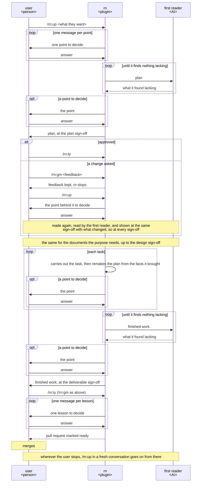

# rn UX

The experience rn must give its user, and the two measures every version of rn is judged by against
the version in use. Build or change any part of rn to it.

## Users and goals

- G1: Whoever wants to hand a whole piece of work to an agent: they ask for it without preparing
  anything and only answer what they are asked, and their purpose is achieved.

  The purpose is what the user wants the piece of work to achieve. Preparing is anything the user
  would do before asking, such as writing a specification or gathering what the agent needs to know.

## Key results

The key results count what happens at the sign-offs. A sign-off is a stop where rn shows the user a
proposal and waits for their answer. There are three, in this order: the plan sign-off, on the
plan, which holds the user's purpose as rn wrote it down and the acceptance criteria, each one
thing the finished work must do for that purpose; the design sign-off, on all the documents the
purpose needs, such as a UX, a README and a design for what the user is building; and the
deliverable sign-off, on the finished work.

The key results stand from the highest priority: the changes sent back at the end come before the
user's time. Time saved on a finished work that misses the purpose is lost, since what is sent back
then is made again after all of it is built; so a version saves the user time only without raising
the changes sent back. Neither has a target value: a version is better when it comes closer than
the version in use, on the same requests.

- KR1.1: The changes the user sends back at the deliverable sign-off; fewer is better, and none once
  G1 is reached.

  Each thing the user's feedback there asks to be different counts as one change. Every one counts,
  since the user agreed the purpose at the plan and design sign-offs, so a change asked at the end is
  where the finished work misses it; changes asked at those two earlier sign-offs do not count, as
  there the user is still deciding what the finished work should be. Each change is effort the user
  spent beyond answering, so fewer shows them closer to G1.

- KR1.2: The time the user spends from asking to their purpose achieved; shorter is better, and once
  G1 is reached only the time spent answering the points to decide is left.

  A point to decide is a choice that changes what is made; it is the user's to decide. The time
  counted is every minute the user spends answering, checking proposals at the sign-offs, sending
  changes back, and doing anything by hand. G1 is asking without preparing and only answering, so
  every minute beyond answering the points to decide is effort rn left to them.

## Scenes

The figure shows who acts in turn from asking to the merge. `/rn:ty` approves a proposal and
`/rn:gm <feedback>` asks for a change. The first reader is an AI that did not make a proposal;
before every sign-off it reads and uses the proposal in the user's place, the finished work for
each acceptance criterion. A task is one part of building the finished work; after the design
sign-off, rn divides the piece of work into tasks. A lesson is what the session learned that would
make later pieces of work better.

- Asking: rn confirms each point to decide with the user, even the points it could look up, with
  what it looked up and the answer it recommends, since a point decided unasked is made again when
  it is wrong.

  Each message shows the points to decide, the settled ones with their outcome and the current one
  marked. For the current one it gives the conclusion, its grounds, and the options, the recommended
  one first, each with its trade-off and whether it can be undone, then one question on that point
  alone, answered by the option's letter or in the user's own words. Answers to the user's own
  questions, and slips rn corrected that leave nothing to decide, come first, apart from the points.

- The plan: rn gives the goal and each acceptance criterion an ID and puts the plan on a draft pull
  request of its own branch.

- Sign-offs: at each sign-off rn shows the link to each work and its core decisions, each with its
  intent, in a few short lines, and nothing else: no summary of the text, no diff. The user glances
  at the work for its size and diagrams and judges the decisions and intents; the text is the first
  reader's and rn's to check.

  Where the core decisions do not fit in a few short lines, rn takes it as a sign the work is not
  yet simple, and makes it again before it stops.

- Feedback: on `/rn:gm`, rn keeps the feedback and stops, so the conversation can be cleared.

  The point behind the feedback is one rn decided wrong or did not ask.

- Records: rn writes in its commit messages what the documents do not keep: the options weighed
  with their reasons, and each feedback with its answer.

- Checklists: each document and the finished work is made with rn's checklist for its kind, which
  says what that kind, such as a README, must give its reader, and with the user's addition to it.

  The addition sits at `.rn/checklists/<kind>.md` in the user's repository and holds only what it
  adds; a kind rn has no checklist for gets one made there. rn's own checklists are not changed in
  place, since they sit outside git on the user's machine and an update of rn replaces them.

- The tasks: each names the acceptance criteria it serves and is checked against them; the user
  does not watch.

  After each move rn remakes the plan from the facts the move brought, and a change to the goal or
  an acceptance criterion comes to the user as a point to decide.

- Resuming: from move to move rn carries only a short record of where the work stands, and
  `/rn:up` in a fresh conversation goes on from it.

- Lessons: each comes with what happened and the addition to the user's checklists it recommends,
  and with whether a fault of rn's own goes to rn as an issue.

  The additions the user takes go into the same pull request.

## Benefits

What the user gains with rn, each with why it holds; these are why the user chooses rn.

- The user asks without preparing: rough words are enough, and rn finds the points to decide and
  comes to confirm them.
- The user's purpose is achieved by answering alone: each point is confirmed, each task traced to
  the acceptance criteria, and the plan remade from the facts each move brings, so the work does
  not drift from the purpose and making a finished work again becomes rare.
- At each sign-off the user decides from the proposal alone: what they are shown has been read and
  used in their place by the first reader, so they need not read it all again; they judge only
  the core decisions and their intent.
- A piece of work that takes days neither swells nor drifts, and goes on from wherever the user
  stopped: only a short record of where it stands is carried from move to move.
- What was decided, and why, stays, in the README and the design in the user's repository and in
  rn's commit messages, so the next piece of work, or a teammate, starts from it.
- What a session learned is confirmed with the user one lesson at a time, and what they add to their
  checklists makes every later piece of work better.
