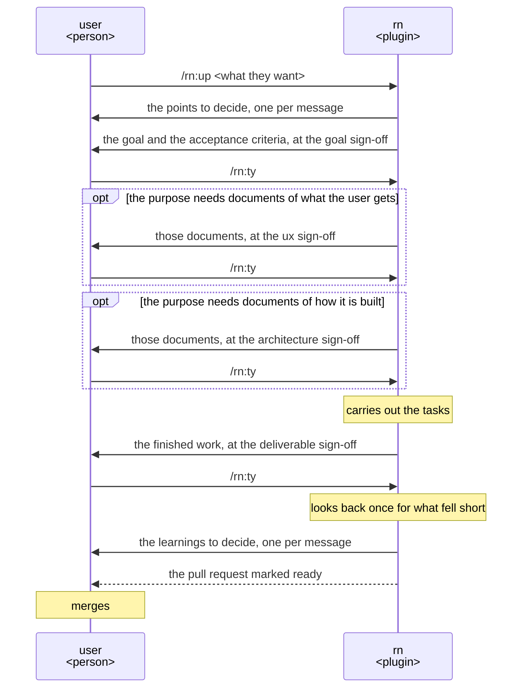
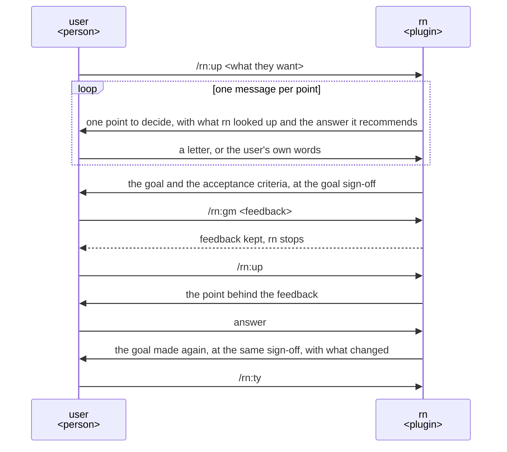
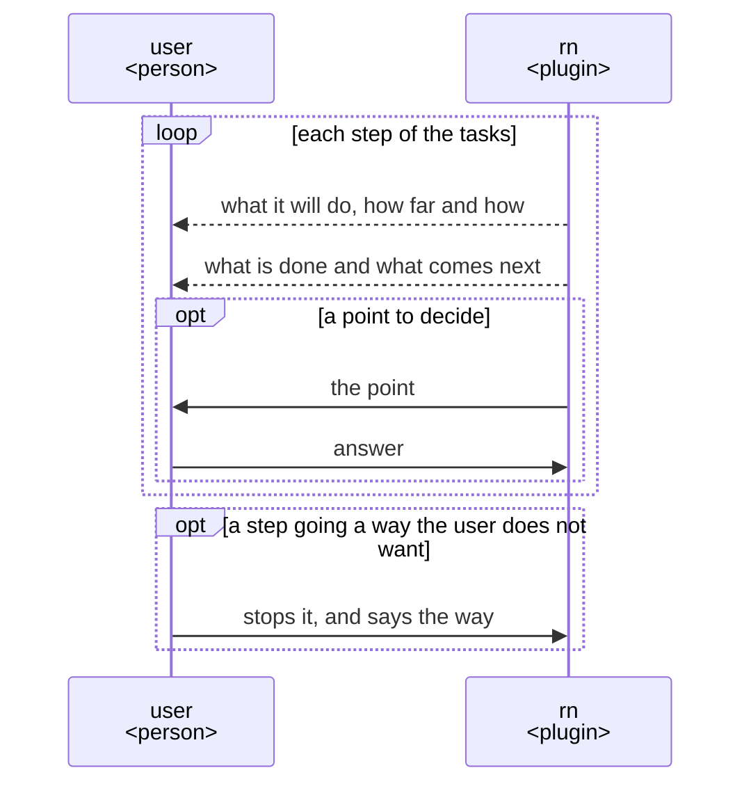
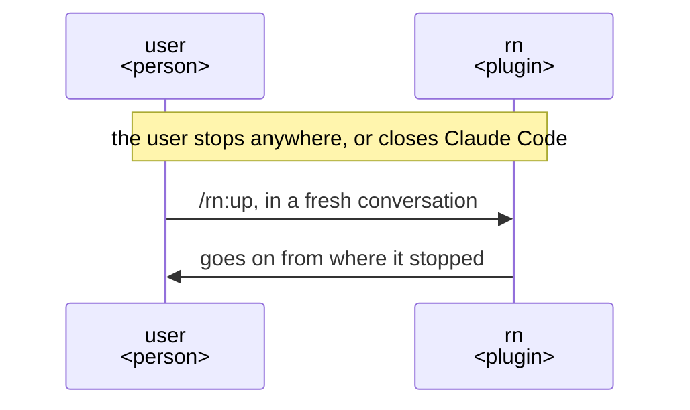
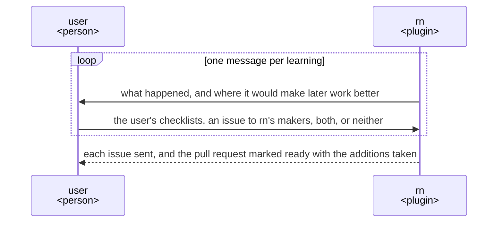

# rn UX

rn takes a whole piece of work its user asks for in their own words to their purpose, asking them
only what is theirs to decide. Build and change every part of rn so that its user gets that.

## Users and goals

- G1: Whoever wants to hand a whole piece of work to an agent: they ask for it without preparing
  anything and only answer what they are asked, and their purpose is achieved.

  The purpose is what the user wants the piece of work to achieve. Preparing is anything the user
  would do before asking, such as writing a specification or gathering what the agent needs to know.

## Key results

The key results count what happens at the sign-offs. A sign-off is a stop where rn shows the user a
proposal and waits for their answer. There are up to four, in this order:

- the goal sign-off, on the user's purpose as rn wrote it down and the acceptance criteria, each one
  thing the finished work must do for that purpose;
- the ux sign-off, on the documents that say what the user gets and how they use it, such as a UX
  and a README;
- the architecture sign-off, on the documents that say how the work is built and checked, such as an
  architecture and the research it rests on;
- the deliverable sign-off, on the finished work.

rn leaves out the ux and the architecture sign-off where the purpose needs no such document.

- KR1.1: The changes the user sends back at the deliverable sign-off; fewer is better, and none once
  G1 is reached.

  Each thing the user's feedback there asks to be different counts as one change. Every one counts,
  since the user agreed the purpose at the sign-offs before it, so a change asked at the end shows
  where the finished work misses it. Changes asked at those earlier sign-offs do not count, as there
  the user is still deciding what the finished work should be. Each change is effort the user spent
  beyond answering, so fewer shows them closer to G1.

- KR1.2: The time the user spends from asking to their purpose achieved; shorter is better, and once
  G1 is reached only the time spent answering the points to decide is left.

  A point to decide is a choice that changes what is made; it is the user's to decide. The time
  counted is every minute the user spends answering, checking proposals at the sign-offs, sending
  changes back, and doing anything by hand. G1 is asking without preparing and only answering, so
  every minute beyond answering the points to decide is effort rn left to them.

The key results stand from the highest priority: the changes sent back at the end come before the
user's time. Time saved on a finished work that misses the purpose is lost, since what is sent back
then is made again after all of it is built. So a version saves the user time only without raising
the changes sent back. Neither has a target value: each version is judged by how close it brings
the user to G1.

## Scenes

Two take part: the user, a person, and rn, a plugin. The user types `/rn:ty` to approve a proposal
and `/rn:gm <feedback>` to ask for a change. A task is one part of the piece of work, such as
research, a document or a part of the finished work. rn divides each stage into tasks as it reaches
the stage, and changes them as each task brings its facts. A learning is what the piece of work
taught that would make later work better.

### From asking to the merge

- Languages: rn's first point is the language it talks in and the one it writes into the repository.

  rn proposes both from what the repository and the user's instructions set. All rn shows the user,
  the proposals included, is in the first language, adding nothing and leaving nothing out.
- The plan: rn gives the goal and each acceptance criterion an ID and puts the plan on a draft pull
  request of its own branch.
- Documents: each document the ux or the architecture stage needs is a point to decide.

  The user chooses whether it is kept in the repository, the one already there changed, kept in the
  session's folder alone, outside what the work leaves, or not made. Which documents a piece of work
  needs depends on the repository and the work, so rn proposes them from both.
- Sign-offs: before the ux, the architecture and the deliverable sign-off, an AI that did not make
  the work reads and uses it in the user's place, and rn makes it again until that AI finds nothing
  lacking.

  That AI uses the finished work for each acceptance criterion. rn checks the goal and the criteria
  against its checklist itself, as the user reads them at their sign-off as they stand. At the ux and
  the architecture sign-off rn shows the link to each document, and at the deliverable sign-off the
  links to the finished work. With them rn shows each choice made in the work that the user was not
  asked, by rn or by the AI that made it, each with why, and nothing else: nothing of the user's own
  answers, which the work holds and that AI has checked, no summary of the text, and no diff. The
  user glances at the work for its size and diagrams and judges those choices; the text is for that
  AI and rn to check.
- Records: rn writes in its commit messages what the documents do not keep: the options weighed with
  their reasons, and each feedback with its answer.
- Checklists: rn makes each document and the finished work with its checklist for that kind, which
  says what that kind, such as a README, must give its reader, and with the user's addition to it.

  The addition sits at `.rn/checklists/<kind>.md` in the user's repository and holds only what it
  adds; for a kind rn has no checklist for, rn makes one there. rn does not change its own checklists
  in place, since they sit outside git on the user's machine and an update of rn replaces them.

### Asked each point, and a change sent back

- rn confirms each point to decide with the user, even the points it could look up, since a point
  decided unasked is made again when it is wrong.

  Each message shows the points to decide, the settled ones with their outcome and the current one
  marked. For the current one it gives the conclusion, its grounds, and the options, the recommended
  one first, each with its trade-off and whether it can be undone. Then it asks one question on that
  point alone, which the user answers with the option's letter or in their own words. Answers to the
  user's own questions, and slips rn corrected that leave nothing to decide, come first, apart from
  the points.
- On `/rn:gm`, rn keeps the feedback and stops, so the user can clear the conversation.

  The point behind the feedback is one rn decided wrong or did not ask. The same goes at every
  sign-off.

### While the tasks are carried out

- Each task names the goal or the acceptance criteria it serves, and rn checks the task against
  them, so the user need not watch.

  A change to the goal or an acceptance criterion comes to the user as a point to decide.

### Stopped, and gone on

### Learnings

- Once the user approves the finished work, rn looks back over the whole piece of work once, for
  each change the user sent back, each work made again and each point asked again.

  What each of these taught is a learning. A learning put to the user midway would be a stop in the
  work.
- rn recommends where each learning goes, and the user decides.

  A learning for the user's repository alone goes into the user's checklists. One that would help
  everyone's work, such as a question rn's own checklist does not ask or a slip of rn's own steps,
  goes to rn's makers as an issue, since rn is open source and gets better for all its users from
  it.

## Benefits

What the user gains with rn, each with why it holds; these are why the user chooses rn.

- The user asks without preparing: rough words are enough, and rn finds the points to decide and
  comes to confirm them.
- The user's purpose is achieved by answering alone: each point is confirmed, each task traced to
  the acceptance criteria, and the plan remade from the facts each move brings, so the work does
  not drift from the purpose and making a finished work again becomes rare.
- At each sign-off the user decides from the proposal alone: the goal and the criteria are the
  proposal itself, and an AI that did not make each document and the finished work has read and
  used it in the user's place, so they need not read it all again; they judge only what was chosen
  without asking them, each with why.
- A piece of work that takes days neither swells nor drifts, and goes on from wherever the user
  stopped: rn carries only a short record of where the work stands from move to move.
- What was decided, and why, stays, in the documents rn writes into the user's repository and in
  rn's commit messages, so the next piece of work, or a teammate, starts from it.
- What a piece of work taught is confirmed with the user one learning at a time: what they add to
  their checklists makes their later work better, and what they send rn's makers makes rn better
  for them and everyone.
