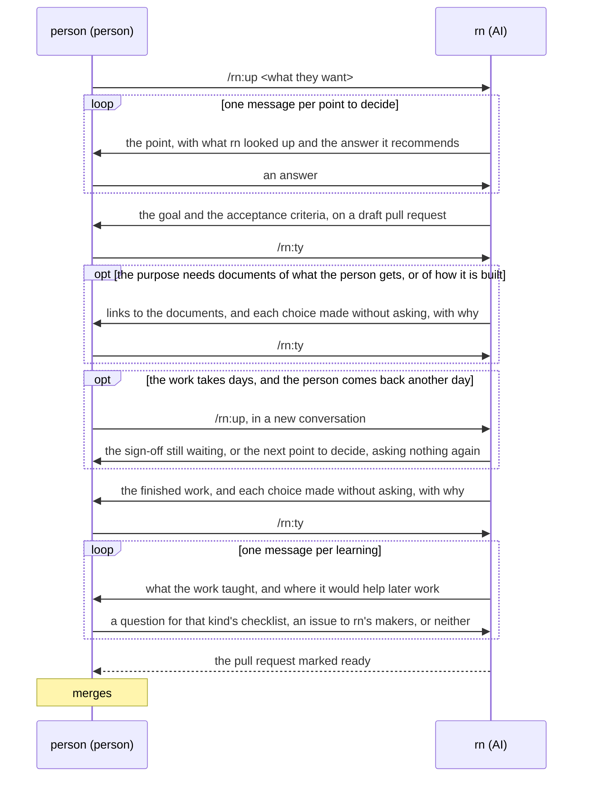

# rn UX

## OKRs

- O1: A person who wants to hand a whole piece of work to an agent, even work of days, asks for it
  in rough words without preparing anything, only answers what they are asked, and their purpose is
  achieved.
  - KR1.1: The changes the person sends back at the sign-off on the finished work. Fewer is better,
    and none once O1 is reached.
  - KR1.2: The time the person spends from asking to their purpose achieved. Shorter is better, and
    once O1 is reached only the time spent answering is left.

KR1.1 comes before KR1.2: time saved on a finished work that misses the purpose is lost when it is
made again.

Key results have no target values. When a measure becomes a target, it stops being a good measure
(Goodhart's law). Use the key results to judge how close the objective is.

## Scenarios

The person is a person. rn is an AI: a Claude Code plugin that works in the person's conversation.
A sign-off is a stop where rn shows a proposal and waits: the person types `/rn:ty` to approve it,
or `/rn:gm <feedback>` to ask for a change.

### O1: From a request in rough words to a merged pull request

