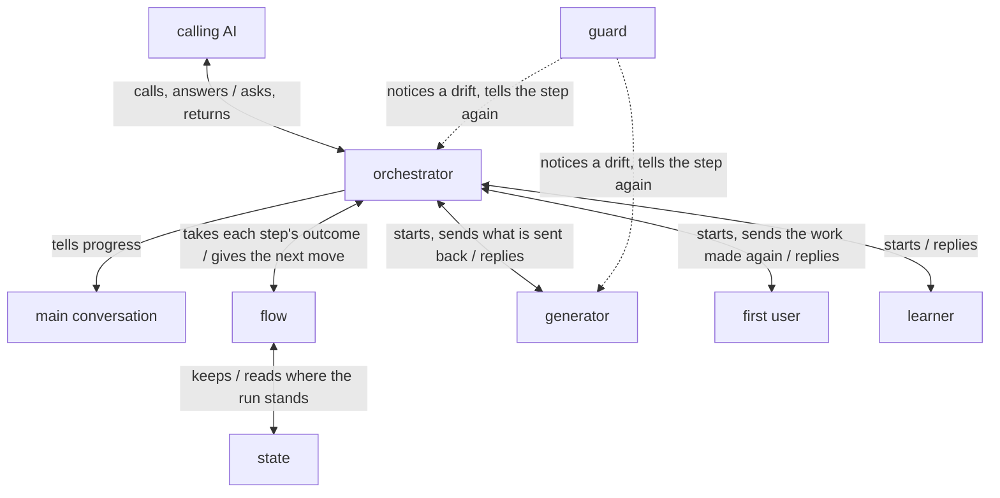

# turn architecture

turn is built on [how a plugin works](../architecture.md): `turn:up`, the orchestrator the calling
AI starts, runs a fixed loop kept in a script, in rounds: in each, one role makes the work and
makes it again until another, using it in its receiver's place, finds every item's Good, and the
orchestrator checks that each Good holds. Each role's steps are held by lanes laid with
[lane](../../lane/README.md). The goal, the key results, and what a checklist, a CCS and its kinds,
the receiver and a Good are, are in [turn's UX](ux.md).

turn holds the [principles every plugin holds](../architecture.md#principles), named below
Principle 1 to 8, and its own:

1. Every role that makes or reads the work looks only for each item's Good, what the receiver gets,
   and works only to give it.
2. Each item is judged by what the receiver gets with what they have, never by whether the work
   matches its sources.

## User stories

- As the calling AI, I want to start turn with the path of a CCS, its kinds and where the result
  goes, and get the work back where it goes, with each item's Good and its lines, and the lessons
  from the run to put to the user.
- As the calling AI, I want the user told, as the run goes, what it will do and what is done, in
  the main conversation, which alone talks with them.
- As the calling AI, I want to be sent each point only the user can decide as soon as the run meets
  it, and to send back the answer for the run to go on.
- As the calling AI, I want to call turn again with the same result after a run stopped anywhere,
  and have it go on from where it stopped.

## Architecture

### Logical view



The guard acts in every role as it does in the generator; the figure draws it once. The calling AI
is the main conversation, or an agent the main conversation started. The generator and the first
user are the roles of the run; the learner comes once the run is done, as the learner
of [Principle 8](../architecture.md#learning-from-each-run), and reads the run's records, not the
work.

- The calling AI starts the orchestrator with the call: the CCS's path, where the result goes, and
  the kinds it uses in the CCS for where the work goes, the checklists, the receiver, what the
  receiver uses the work for and what they have with it, such as the whole repository for a
  maintainer of code.

  The CCS is the calling AI's, and turn defines nothing of it but these: what turn needs is found by
  these kinds, and the values stay in the CCS alone, so the call and the CCS cannot differ. Each is
  needed, since without what the receiver uses the work for and has with it no reader can stand in
  their place. Where the result goes is this call's answer, not the task's state, so it is not in
  the CCS.
- The orchestrator first has the flow check the call, and the flow, where the call names a missing
  file or leaves a kind without an entry, says so and the orchestrator returns it, with no run
  started.
- The flow keeps where the run stands in the state, beside the result, and gives the orchestrator
  each next move, the role to start or to send more work, with what it is given, a line for the
  user, a check, a question, or the run returned, and the orchestrator makes the move and hands the
  flow its outcome.

  The run is a fixed loop, so its course and its bounds are kept in code, which holds them the same
  way each time where an AI counting may slip unseen (Principle 6).
- A call naming a result whose state is there goes on from the move the state was last at, each
  role the run goes on with, one kept started included, started anew, given what it was given and
  what was sent to it since, and reading its inputs again.

  A run gone on costs that reading and reaches the same place. A conversation ends, is cleared or
  is compacted, and what lives only in it is lost; a role's context is lost with its conversation,
  so what it is given and sent is kept in the state to give again.
- Before any work is made, the orchestrator checks that the CCS holds everything the run needs: it
  reads the CCS, the files it names but the work, and the checklists, and finds for every item what
  in them gives its Good, and that what the receiver has lets the first user do with the work what
  the receiver does, such as running its tests; each item that lacks it waits on a question, saying
  what is lacking with the items it settles.

  A Good the CCS cannot give, the generator cannot give either, and a reader that has less than the
  receiver cannot find the Good they get; the making and the readings after it would be spent for
  nothing, and an answer may also change how the whole work is laid out.
- A question goes to the calling AI as soon as it is found, as the orchestrator's reply, and the
  run waits.

  The point is the user's to decide (Principle 2), and settled when it is met, it is not met again
  as rework, nor left in the result for the calling AI to fix (Principle 7). A subagent cannot ask
  the person (dev/architecture.md, Where the orchestrator runs); the calling AI fills what it can
  from its sources and asks the user the rest.
- The orchestrator words a question found as it checks the CCS from its own reading, and one for
  an item two rounds leave without Good from the findings the flow shows it, each with the answer
  it recommends, and hands on one the generator gives, with the answer the generator recommends, as
  the generator wrote it.

  Each question is worded by the one that holds what it rests on: the orchestrator holds the CCS it
  checked and the findings the flow shows it, and a generator's question retold would ask what the
  generator did not.
- The calling AI sends the answer back and keeps it in its CCS, and the orchestrator hands it to
  the flow, which gives it to the generator, by message where the generator asked and in what it is
  given where it is started next, and the run goes on from there.

  The answer in the CCS is read there by a call again.
- Before each move and after each outcome, the flow makes a line for the user, what the move will
  do, how far and how, or what is done and what comes next, and the orchestrator sends it to the
  main conversation as a move of its own; no one answers it, and no role tells it.

  The lines are for the user, and only the main conversation talks with the user
  (dev/architecture.md, Where the orchestrator runs). The user gets nothing else until the run
  returns, so a run going a slow or wrong way would show only once its time is spent; the flow
  makes the line from the move, so it says what the run does, not what an agent means to do.
- Every role that makes or reads the work looks only for the Good each item gets and the lines that
  give it, the orchestrator's check included, which asks whether each Good holds; what a machine
  can judge of a reply, the flow checks from it.

  An AI that looks for what more the work needs finds more without end, and each find is patched
  in, so the work drifts from what it should be. Each role has one aim, so it works to the aim
  rather than to a list of steps; what a machine can judge is left to a script (Principle 5).
- Each item is answered by what the receiver gets using the work with what they have, never by
  whether the work matches the sources it was made from.

  What the receiver gets is the work's purpose; matching the sources is a means to it, and checked
  on its own it draws the work toward the sources' words and the product's edge cases rather than
  toward the receiver. A reader judges by what the receiver gets even where the sources are among
  what the receiver has, such as a maintainer's repository, since matching them is not what the
  receiver uses the work for.
- Each item is answered where its checklist's `Scope` line says: `its part`, at the lines that give
  it; `each part`, in every part of the work on its own, a Good for each; `whole`, of the work at
  once; the flow splits the work into its parts, a document's sections under its top headings with
  the title and opening as one, and each other file whole, stops a reply that gives an each-part
  item without every part, and takes such an item's Good from a reader only where every part has
  one.

  A Good found where one part gives it passes a part that does not, so a remake that breaks one
  part for another item goes unseen; what lies between the parts, such as one name for each thing,
  is found only in the whole. The checklist says it once, so every role and every run answers an
  item at the same place.
- The flow stops a reply that gives a Good at lines the work does not hold: a file not of the
  work, lines past its end, or, for an each-part item, lines outside the part.

  The calling AI checks each Good by reading its lines, and a Good at lines that are not there
  cannot be checked; a script finds it at once (Principle 5).
- The generator first sets, from the whole CCS, the Good the receiver is to get from the work for
  each item and where the work gives it.

  A work made to Goods set first gives each where it was meant; one written first and matched to
  the items after is patched item by item.
- Where only the user's answer can give an item its Good, the generator replies with the
  questions, each with the answer it recommends, before making anything, and goes on once the
  answers reach it.

  What the CCS does not say becomes a question, not its own guess, and asked before the making, its
  answer shapes the work rather than a remake (Principle 7).
- The generator then makes the work to give each Good, runs what it wrote as the receiver would,
  and replies with each item's Good with its lines, and with any question found while making,
  handed on the same way.

  What is not run is not known to work, and a receiver who meets it failing gets nothing from the
  rest. Its Goods are its claim, not a judgment.
- Where a path of the work already holds a file, the generator makes the work from it rather than
  from nothing, so what already gives its Good stays as it is.
- The first user uses the work in the receiver's place, with everything the receiver has and doing
  all they do with it, and gives for each item the Good it found in the work, with its lines, and
  for each it finds none, the places of the work where it looked for it, what it did there and what
  it did not get.

  A reader that did not make the work finds only the Good its lines give; the maker finds the Good
  it meant (Principle 4). What the receiver gets lies also in what they have and do beside the
  work: a reader with less misses a Good the receiver gets, and one that only reads passes what a
  run shows to fail. A place alone does not show the maker what was missing; what the reader did
  there and did not get does.
- The generator is sent each item the first user found no Good for, as the first user gave it, and
  the first user is sent the work made again, with no reading between, until it finds every item's
  Good, each item left waits on a question, or it has been sent back three times in a round, the
  generator and the first user staying started until then.

  The generator holds the sources it read and the Good it meant at each line, so it changes only
  what is sent back, without reading the sources again; how the work gives the Good is the
  generator's to decide, since an edit told per item broke other items. A first user that stays
  started reads again whether the places it stopped at now give the Good, so what is left only
  shrinks. A bound keeps a reading that does not settle from going on without end, and what it
  leaves goes on without Good to the orchestrator's check.
- From the generator's first making to the end of the first user's reading, the orchestrator reads
  no work and makes only the moves the flow gives.

  The orchestrator holds the sources and the call, so a reading of its own there finds the Good the
  work meant, not the one the receiver gets (Principle 4); put between the remake and the first
  user, it costs a reading each time and pulls the remake toward its own view.
- What passes between the roles goes through the flow: the first user is not given the generator's
  reply, and the generator gets only what the first user, or the orchestrator's check, found
  lacking.

  A reader shown the maker's claim finds the Good it was told to find (Principle 4).
- Once the first user's reading ends, the orchestrator checks each Good it gave: it reads the work
  whole, reads each Good at its lines as the receiver the CCS names, runs what the Good says the
  receiver gets, as the receiver would, and says yes where the receiver gets what the item asks,
  or, where not, what the receiver does not get and where.

  The first user finds the Goods the work gives; whether each is true, what it says against what
  the receiver gets, is a second question, and a reader asked both narrows the item to the Good it
  found. The orchestrator holds the whole run and decides (Principle 1), and with the sources it
  knows what the work does, which a claim may overstate.
- The flow gives an item its Good only where the first user gave one and the orchestrator said yes,
  and the result gives the first user's Good and its lines.

  A Good only the orchestrator found would be judged by one that knew what the work meant.
- Where an item is without Good, the generator, started anew, is given each such item with what the
  first user or the orchestrator's check found lacking, and the work is made again, used by the
  first user, started anew, and checked by the orchestrator, until every item has its Good or waits
  on a question.
- An item two rounds leave without Good waits on a question: what the user is to decide for the
  receiver to get it.

  The rounds are bound as the sending back in a round is; an item they leave lacks what neither the
  CCS nor the readings give, so it comes back as a point for the user to decide, not as work for
  the calling AI to fix (Principle 7).
- Once the run is done, the learner reads the record of every agent of the run, the orchestrator's
  included, and gives from them what fell short and why, each lesson with the words it rests on
  quoted and said to be the project's own or general, or that it found none and what it checked.

  This is the learner of Principle 8, where its why is said; it reads the run's records, not the
  work, so it holds that principle, and turn's own two hold the roles that make or read the work.
- The flow puts the lessons into the result, and the calling AI puts each to the user: a project's
  own into the user's checklists or rules, a general one to turn's makers as an issue, which the
  calling AI shows to the user whole and opens only on their yes, taken as
  [The caller approves what is theirs](../architecture.md#the-caller-approves-what-is-theirs) says.

  The calling AI, not turn, reaches the user, as with a question.
- The flow writes the result where the call says, and the orchestrator ends only once it is there.

  A reply would be copied into a file by the calling AI, where a slip goes unseen.
- Each step of a role, the orchestrator's included, that alone is not sure to hold has a lane, and
  the guard notices a drift from it and tells the role the step again: a role reads what it is given
  alone, and whole; writes only its work and its reply, its reply in its form; commits and pushes
  nothing; and ends only once its reply is there.

  A role that reads only what it is given is not bent by what it was not meant to see, and an item
  judged on a part read is judged on a guess for the rest. The calling AI keeps the work in git on
  its own judgment, after checking it.
- On the orchestrator, the lanes hold that it begins with the flow, makes only the move the flow
  gave, a line for the user among them, and hands on a question of the generator's as the flow
  printed it.
- That every item is answered, that each Good's lines are in the work, and that the result is
  there, the flow checks itself.

### Physical view

```
turn/                      the plugin, installed by Claude Code
├── agents/
│   ├── up.md              the orchestrator <agent>
│   ├── generator.md       <agent>
│   ├── first-user.md      <agent>
│   └── learner.md         <agent>
├── scripts/
│   ├── turn.py            the flow <Python 3>
│   └── *.py               the call's check, the forms, the parts, the records <Python 3>
└── hooks/
    ├── hooks.json         the lanes on every agent, laid by lane:up
    └── lane/              lane's code, the guard, a link to lane's <Python 3>
```

- turn runs on Claude Code, python3 3.9 or later, and git.
- The calling AI starts `turn:up` in the background with the call as JSON, from the main
  conversation or from an agent it started; turn's agents take the two layers below it, and Claude
  Code starts agents down to three layers below the main conversation.

  The calling AI can still take the user's pause while it waits, and stops a run with TaskStop. The
  user sees the run's agents in the panel below the prompt input.
- The state is a JSON file beside the result, the result's path with `.run.json` added, read and
  written by the flow alone.

  It is kept in the calling AI's work folder, each run its own, so several runs go at once without
  meeting, and a call again finds it by the result it names.
- `turn.py` prints each next move as one JSON line `{"tool": ..., "input": {...}}`, last in its
  output: an Agent call starting a role, a SendMessage to a role kept started, or a SendMessage to
  `main` with a line for the user. A role's prompt is a JSON object of what it is given: the files
  it reads, the work, the reply file and the checklists, each a path, and the flow's message what is
  sent back.

  The move printed as the tool call itself is a form lane holds the orchestrator to, and a role
  given its inputs as JSON is held by lanes on the values it starts from.
- Each role writes its reply to the reply file its prompt names, in a JSON form of its own, held to
  its JSON Schema in `scripts/`; the flow reads it there once the orchestrator runs `turn.py next`.
  A role sent more work writes its reply again, and `turn.py next` waits until it has been written
  since the send, as the reply of a subagent sent a message comes back later, not with the send.

  Tried: an orchestrator that ended its turn after the send never got the reply; one that waited on
  a script reading what was kept got it word for word. The file is read by the flow alone, so no AI
  copies a reply, and the first user's lane on what it reads keeps it from the generator's.
- The orchestrator gives the flow the agent ID each Agent call returns, by which the flow names the
  role to send more work to and the learner is given each role's record.

  The Agent tool gives a subagent no name to be messaged by, so a role is reached by its ID.

  The learner needs, beside the IDs, the folder Claude Code keeps the records in, and the
  orchestrator's own record, and the orchestrator is told neither: a hook's event carries the
  session's `transcript_path` and the `agent_id` it runs in, by which lane's guard finds a
  subagent's record; the start_with lane on `turn.py start` hands both to the flow, so no AI copies
  them.
- The orchestrator replies with a question and ends its turn; the calling AI sends the answer to its
  agent ID with SendMessage, which resumes it, as `lane:up` is reached.
- The lines go by SendMessage to `main`, loaded with ToolSearch: called from the main conversation,
  the calling AI is told them; called from an agent, they reach the main conversation above it, as
  that agent cannot be messaged by a name.

  Tried with an agent started by an agent started in the background: its message to `main` reached
  the conversation while the agent that started it was still running.
- The lanes, laid with `lane:up` from each agent's steps, run values taken from what the agent
  starts from: on each role, read_only and read_whole on `{given}`, write_only on `{work}` and
  `{reply}`, in_form on `{reply}` and its form, and end_when on `{reply}`, and hands_off on
  `git commit` and `git push` on each role that runs commands; on the orchestrator, start_with on
  `turn.py start`, read_only and read_whole on the `{given}` that `turn.py start` prints, the CCS,
  the files it names but the work, and the checklists, and on the work once the flow gives the
  check of each Good, follow_next on `turn.py next`, which holds
  the lines it prints as moves, as_printed on a question of the generator's it hands on, and
  hands_off as on the roles.

  The generator's running what it wrote, and the first user's and the orchestrator's running what
  the receiver runs, are held
  by their steps alone: what is run is found in the work and in what the receiver does with it, and
  the CCS names no kind for a command, so turn has none to give test_after.

  The flow reads the result and every reply itself, so a lane on every item answered or on the
  result made would check what the flow holds already, and lane sees a write only in the call that
  makes it, where the flow writes the result inside its own run.

  Each lane acts in its own agent alone, by `agent_type`, and reads that agent's own record and
  what it started from, so runs at once are told apart without turn tracing them; turn keeps no
  hooks of its own.

## Verification

### Units

Each agent is checked on Claude Code's default model, the one users run turn on, and judged from
the records of every conversation and agent the check started.

- The flow: each move follows from the state and the outcome handed to it in this design's order,
  the call's check stops what it must, an item gets its Good only where the first user gave one and
  the orchestrator said yes, a
  reply giving a Good at lines the work does not hold is stopped, a question is sent at the move it
  is found, an item two rounds leave without Good becomes a question, a stopped run goes on from its
  last move, and the result and each reply are held to their forms.
  - Flow: unittest in `dev/turn/tests/`, fed the calls, states and replies each receives, by
    [`dev/check.sh`](../check.sh) with lines and branches 100% covered and by
    [`dev/mutate.sh`](../mutate.sh) with no mutant surviving.
- The lanes: `hooks/hooks.json` holds the lanes the steps call for, and each agent's steps their
  sentences.
  - Flow: unittest reading the agents and `hooks/hooks.json`; each lane's check is lane's, tested in
    lane.
- The orchestrator: takes each move in this design's order, from the call to the result.
  - Flow: on a task of two items, one answered at its part and one in each part, with the three
    roles stood in for by agents that read what their step reads and write a reply set beforehand,
    one set for each way a run goes: every item given its Good at the first reading and held by the
    orchestrator's check, an item the first user finds no Good for given at its next reading, an
    item sent back three times going on without Good, a Good the orchestrator's check finds untrue
    made again with its finding, a question the generator replies with before making anything sent
    at once and its answer sent to the generator, which then makes the work, a question found while
    making sent the same, and an item two rounds leave without Good sent as a question and the run
    going on with the answer, each with the learner once after the run; on the same task with its
    decision taken out, the question found as the CCS is checked sent and the run going on with the
    answer; and the run stopped after the first user's reading and called again. Passes when its
    records show each move in this design's order, the orchestrator reading no work before the
    first user's reading ends and running what each Good says at its check, no lane stopping a call
    that keeps its step, a line sent to `main` before each move and after each outcome, and the
    result as the set replies make it.
- Each of the three roles: works to its aim with what it is given, writing its form.
  - Flow: started on its own with a prompt set beforehand, as the flow would give it, on a task of
    two items, one answered at its part and one in each part; passes when its record shows it read
    only and whole what it is given, and its reply fills its form; the generator, on a CCS leaving
    one item's Good to the user, replies with that question before making anything and makes the
    work once sent the answer by message; the generator runs what it wrote, and the first user what
    the receiver runs; the generator, sent back by message, remakes the work
    without reading its sources again, and the first user, sent the work made again, gives the
    places it stopped at their Good; the learner gives each lesson with the words it rests on
    quoted from the records, said to be the project's own or general.
  - Content: what it makes in the acceptance trials below, by KR1.1's bar there, each item it falls
    short on read in its record for why.

### Acceptance

Each trial runs in a clone of `lovaizu/playground` of its own, on a branch of its own, pushing
nothing, removed after: a stand-in for the calling AI, run as the main conversation on Claude
Code's default model, is handed a
small task's CCS and checklist and calls turn, and is judged from the records of every agent it
started and from the work. Each acceptance trial is run three times at once.

What an AI does varies from run to run, and one run shows one of its ways; runs that push nothing
and keep their own folders do not touch each other.

- Flow: a stand-in for the calling AI calls turn on a task of one item, with every role real;
  passes when its records show each move in this design's order and the work comes back with the
  result in its form.
- The work back: it comes back where it goes, every item has a Good with its lines, and each lesson
  has the words it rests on.
  - Each Good is checked by reading its lines in the work, and each lesson against the records it
    quotes.
- Told as it goes: the main conversation is told a line before each move and after each outcome.
  - Read from the stand-in's record against the orchestrator's moves.
- A point asked: on a CCS that leaves the license open, the question reaches the stand-in before any
  work is made, and the run goes on with its answer.
  - Read from the records.
- Gone on: a run stopped during the first user's reading and called again with the same result goes
  on from that move and returns.
  - Read from the records: no move before it is made again.
- KR1.1: the items the work meets, as the UX's KR1.1 says.
  - Judged by one judge, an AI that took no part in either run, for turn and for the version in use
    on the same task by one bar: an item counts where the judge, reading the work each returns at
    the lines each gives, finds the receiver gets what the item asks; kept with the trial in
    `dev/turn/trials/`.
- KR1.2: the time from the call to the work coming back.
  - Taken from the records' timestamps for a README-sized work, and compared with the version in use
    on the same task.
  - Read move by move from the same timestamps; time that adds nothing to the stories or KR1.1 is
    cut first.

A change is taken when every story is still achieved and KR1.2 does not come closer at the cost of
KR1.1.
