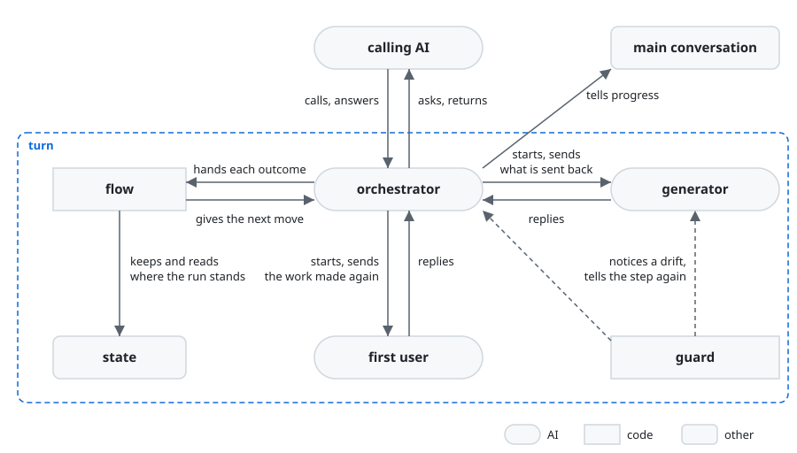

# turn architecture

turn is built on [how a plugin works](../architecture.md) so that the work the calling AI asks for
comes back meeting every item of the checklists it gave, with nothing left for it to fix; the
calling AI, the goal, the key results, and what a checklist, a CCS and its kinds, the receiver and a
Good are, are in [turn's UX](ux.md). The calling AI deals only with the orchestrator, through which
the generator and the first user go back and forth until the first user finds each item's Good;
only the items that reading ends without Good are made again in the next round, so a run can end in
one round.

turn holds the [principles every plugin holds](../architecture.md#principles), named below
Principle 1 to 9, and two of its own, named turn's Principle 1 and 2:

1. Every role that makes or reads the work looks only for each item's Good and works only to give
   it.

   An AI that looks for what more the work needs finds more without end, and each find is patched
   in, so the work drifts from what it should be.
2. Each item is judged by what the receiver gets with what they have, never by whether the work
   matches its sources.

   What the receiver gets is the work's purpose; matching the sources is a means to it, and checked
   on its own it draws the work toward the sources' words rather than toward the receiver.

## User stories

- As the calling AI, I want to start turn with the path of a CCS, its kinds, where the result
  goes and the command that checks the work, and get the work back where it goes, with the lines of
  each item's Good.
- As the calling AI, I want the user told when each of turn's agents starts and ends, when a point
  is asked and when the result is back, in the main conversation, which alone talks with them.
- As the calling AI, I want to be sent each point only the user can decide as soon as the run meets
  it, and to send back the answer for the run to go on.
- As the calling AI, I want to call turn again with the same call after a run stopped anywhere,
  and have it go on from where it stopped.

## Architecture

### Logical view



- The calling AI is the main conversation, or an agent the main conversation started; the guard acts
  in every role as it does in the generator, and the figure draws it for the orchestrator and the
  generator alone.
- The call names, beside the CCS's path, where the result goes and `test`, the one command that
  checks the work or `null` where it has none, the kinds the CCS uses for where the work goes, the
  checklists, the receiver, what the receiver uses the work for and what they have with it; turn
  defines nothing else of the CCS.

  The values stay in the CCS alone, so the call and the CCS cannot differ; without what the
  receiver uses the work for and has with it, no reader can stand in their place. Where the result
  goes and the test are settled when the caller calls, this call's answer, not the task's state, so
  they are not in the CCS; the test is required and given as `null` for none, as a field required
  and nullable says "explicitly none" in structured outputs and OpenAPI 3.1, so a test left out
  by a slip is not taken for none.
- The flow, a script, keeps where the run stands in the state and gives the orchestrator each next
  move that needs it, starting a role, sending one a message, asking or returning the result, and
  waits for a role's end itself; the orchestrator makes only that move and hands the flow its
  outcome.

  The run is a fixed loop, so its course and its bounds are kept in code, which holds them the same
  way each time where an AI counting may slip unseen, and a move the flow can make itself is not
  spent as a turn of the orchestrator (Principle 6). A call naming a result whose state is there
  goes on from its last move, since what lives only in a conversation is lost when it ends.
- The generator, before it makes anything, asks what the CCS leaves open that only the user can
  decide, and settles each other point the work rests on itself, naming it as chosen with why.

  A Good resting on a point only the user can decide cannot be made before it is answered, and
  asked first it costs no making; a point the purpose and the project's practice settle is the
  generator's, as how the work gives each Good is (Principle 2).
- A question goes to the calling AI as its reply as soon as it is met, from the generator or for an
  item the rounds leave without Good, and the run waits for the answer.

  The point is the user's to decide (Principle 2), and settled when it is met it is not met again
  as rework, nor left in the result for the calling AI to fix (Principle 7); a subagent cannot ask
  the person ([Where the orchestrator runs](../architecture.md#where-the-orchestrator-runs)).
- The flow makes a line for the user when a role starts or ends, when a point is asked and when the
  result is back, carried in that move, and the orchestrator sends it to the main conversation.

  Only the main conversation talks with the user, and these are where the run is seen going a slow
  or wrong way or the user must act (Principle 1); made from the move, the line says what the run
  does, not what an agent means to do.
- In a round, the generator makes the work, runs it and checks every item, and the first user uses
  it in the receiver's place; the generator is sent each item the first user found no Good for,
  with what the receiver would need to get it, and makes the work again for it; the first user is
  sent the work made again and answers every item, until it finds every item's Good or the flow's
  bound ends its reading.

  The generator holds the sources and the Good it meant at each line, so it changes only what is
  sent, and how the work gives the Good is its to decide, as an edit told per item breaks other
  items; told what the receiver would need, not how, it mends the work for the receiver's use, not
  toward the reader (Principle 4).
- The orchestrator reads no work, held to what `turn.py start` gives it by a lane, a hook laid by
  [lane](../../plugins/lane/README.md), and the first user is not given the generator's reply; an
  item gets its Good where the first user gives its lines, and the result gives those lines.

  The orchestrator holds the sources and the call, so its own reading finds the Good the work
  meant, not the one the receiver gets, and pulls the remake toward its view; a reader shown the
  maker's claim before its own first reading finds the Good it was told to find (Principle 4).
- An answer is taken in where the run stands: the flow sends each role the files the CCS names now,
  and lane takes them from that message.

  A run started again for an answer makes and reads again what it had already made and read.
- Only the items without Good are made again in the next round, each with what the receiver would
  need, and an item the rounds leave without Good becomes a question, worded from that need.

  An item the rounds leave lacks what neither the CCS nor the readings give, so it comes back as a
  point for the user to decide, not as work for the calling AI to fix (Principle 7).
- Each item is answered where its checklist's `Scope` line says, by every role and every run.

  A Good found where one part gives it passes a part that does not, and what lies between the parts
  is found only in the whole.
- The generator's claim gives each item by the lines of the work that give its Good, and on a remake
  the items sent alone.

  Finding the lines has the generator look at the place, and the flow checks them against the
  work's files and parts; an item not sent stands as it was, and a claim in words of every item each
  round is read by no one and costs its writing every round.
- The generator names in its claim each choice the work rests on that the CCS and its files leave
  open, with why, and the result carries those the finished work rests on.

  How the work gives each Good is the generator's to decide, so it settles points no one gave it;
  named with why, they reach the calling AI, which shows its user what was chosen without asking
  them, where a choice said only in the generator's words reaches no one.
- The result holds each item by the lines of its Good, and finding what fell short in the run is the
  calling AI's, as [Principle 8](../architecture.md#learning-from-each-run) leaves it to the caller.

  A turn run is one move of the calling AI's run, so what fell short in it shows beside the rest in
  what that run kept, and a lesson found by each call apart is weighed again by the user at each.
- The flow writes the result where the call says, and the orchestrator ends only once it is there.

  A reply would be copied into a file by the calling AI, where a slip goes unseen.

### Physical view

```
plugins/turn/              the plugin, installed by Claude Code
├── agents/
│   ├── up.md              the orchestrator's entry, turn:up <agent>
│   ├── generator.md       the generator's entry <agent>
│   └── first-user.md      the first user's entry <agent>
├── prompts/
│   ├── orchestrator.md    the orchestrator, its steps <Markdown>
│   ├── generator.md       the generator, its steps <Markdown>
│   └── first-user.md      the first user, its steps <Markdown>
├── docs/
│   └── calling.md         what a step gives turn and gets back <Markdown>
├── forms/
│   └── *.json             each role's reply form <JSON Schema>
├── scripts/
│   ├── turn.py            what the orchestrator and the roles run <Python 3>
│   ├── flow.py            the flow: the move at each stage of the run <Python 3>
│   ├── state.py           where the run stands <Python 3>
│   ├── call.py            the call checked, and the run laid out of the CCS <Python 3>
│   ├── prompts.py         what each role is given <Python 3>
│   ├── forms.py           each reply checked <Python 3>
│   ├── parts.py           the parts of the work <Python 3>
│   ├── items.py           a checklist's items, as turn's are headings <Python 3>
│   ├── template.py        a link to lane's, Markdown read <Python 3>
│   └── record.py          a link to lane's, Claude Code's records read <Python 3>
└── hooks/
    ├── hooks.json         the hook of each agent and event, written by lane's lay.py <JSON>
    ├── lanes.json         the lanes on every agent, laid by lane's lay.py <JSON>
    ├── adapters/          items-checklist.py, lane's items port handed to items.py, with its
    │                      cases, laid by lane's lay.py <Python 3>
    └── lane/              lane's code, the guard, a link to lane's <Python 3>

<where the call puts the result>
└── <result>               the result <JSON>

<the root of the repository holding the result>/
└── .turn/
    └── <yyyymmdd>-<name>/ one run, gone once it returns
        ├── run.json       the state <JSON>, read and written by the flow alone
        ├── next.lock      held by the `turn.py next` running, so no second one takes its move
        └── <role>.json    each role's reply <JSON>, read by the flow alone
```

- turn runs on Claude Code and python3 3.9 or later.
- The calling AI starts `turn:up` in the background with the call as JSON, from the main
  conversation or from an agent it started, and stops a run with TaskStop; turn's agents take the
  two layers below it, within the three
  [a plugin that uses another](../architecture.md#a-plugin-that-uses-another) has.

  The calling AI can still take the user's pause while it waits; the user sees the run's agents in
  the panel below the prompt input.
- A run's files are placed as
  [Where a plugin writes its files](../architecture.md#where-a-plugin-writes-its-files) says:
  `<name>` is the result's path from the root, each `%` written `%25` and each `/` `%2F`, the
  root the nearest folder above the result holding `.git`, or the result's folder where none does,
  and `<yyyymmdd>` the day the run began, its folder found by the name on any later day.

  A call again with the same result finds the run however long after and from whichever folder of
  the repository it is made, and two runs with other results do not meet.
- The orchestrator reaches each role and the main conversation with Claude Code's Agent and
  SendMessage, and its question is its reply, which the calling AI answers by SendMessage to it.
- Each role writes its reply to a file its prompt names, in a JSON form of its own, read by the flow
  alone.

  No AI copies a reply, and the first user's lane on what it reads keeps it from the generator's.
- The flow takes a role's reply only once the role has ended: a role started returns from the Agent
  call at its end, and a role sent a message goes on in the background, whose end the flow reads in
  the record Claude Code writes of the role's agent, a reply ending its turn after the message, read
  with lane's `record.py`.

  A reply is written before its role ends, which may still check it or write it again; taken as
  soon as it is there, the run moves on, and returns, removing the run's folder, while the role
  still runs, which then writes into the user's repository a file of a run that is gone. Claude
  Code tells a role's end by a task notification, which reaches the main conversation alone where
  `turn:up` is a subagent, as rn starts it, while it writes the role's record whoever started it.
- The flow gives no role the run's own files, nor the first user the CCS, a folder holding them
  given as its other entries, as a lane lets a role read anything under a folder it is given.

## Test

turn is tested as [Test](../architecture.md#test) says.
