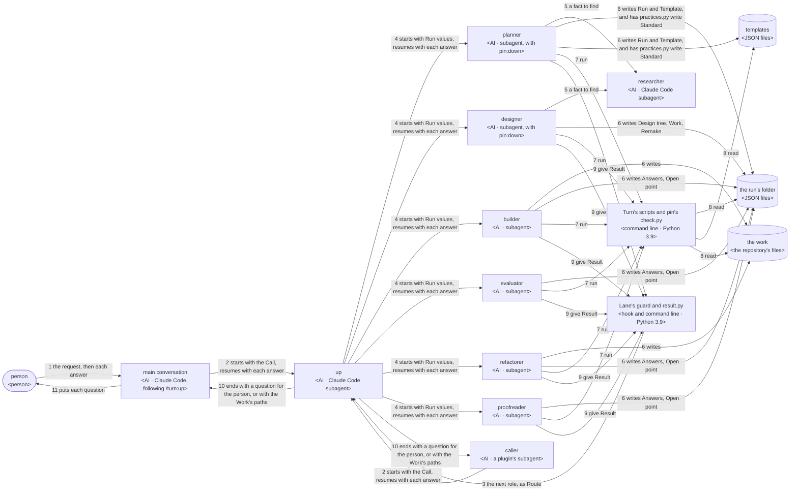
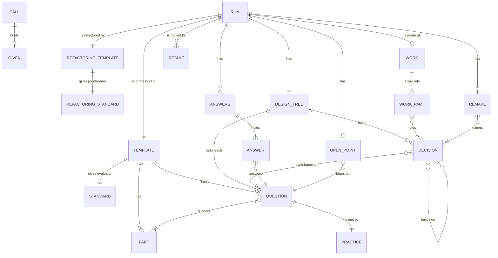
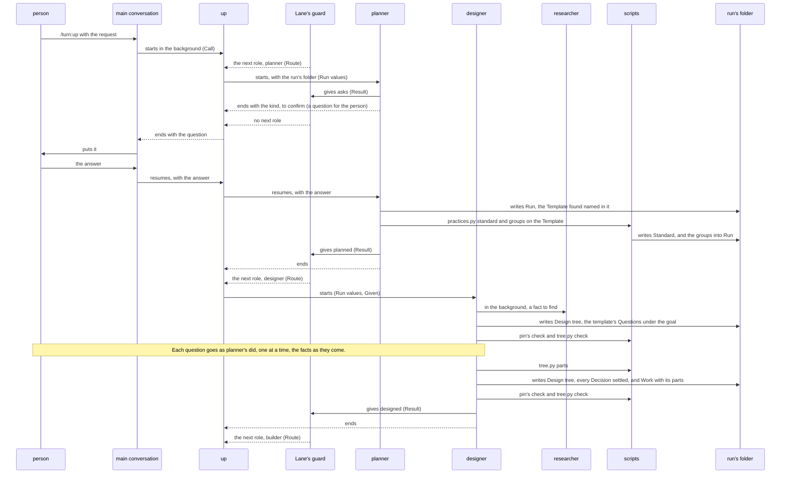
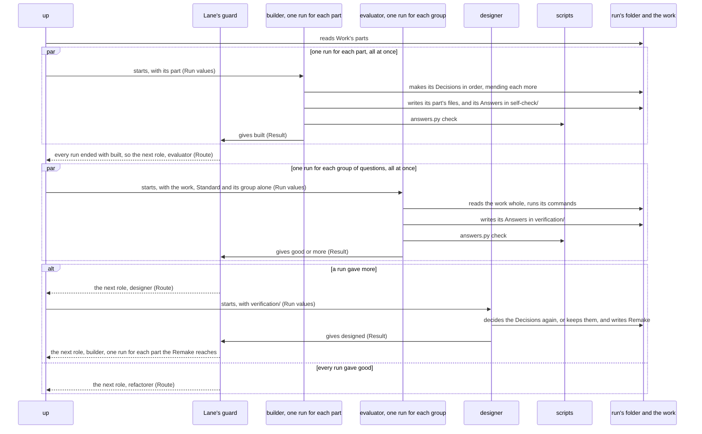
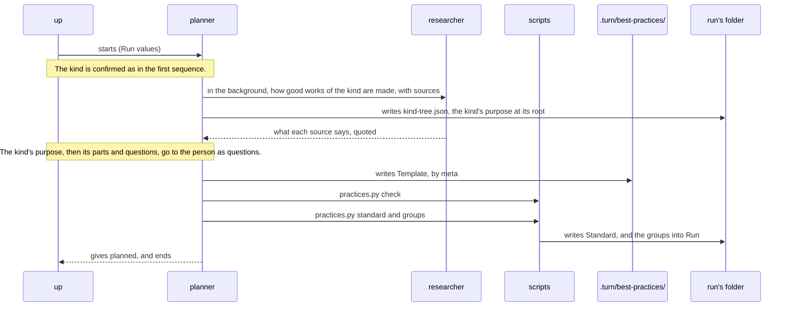
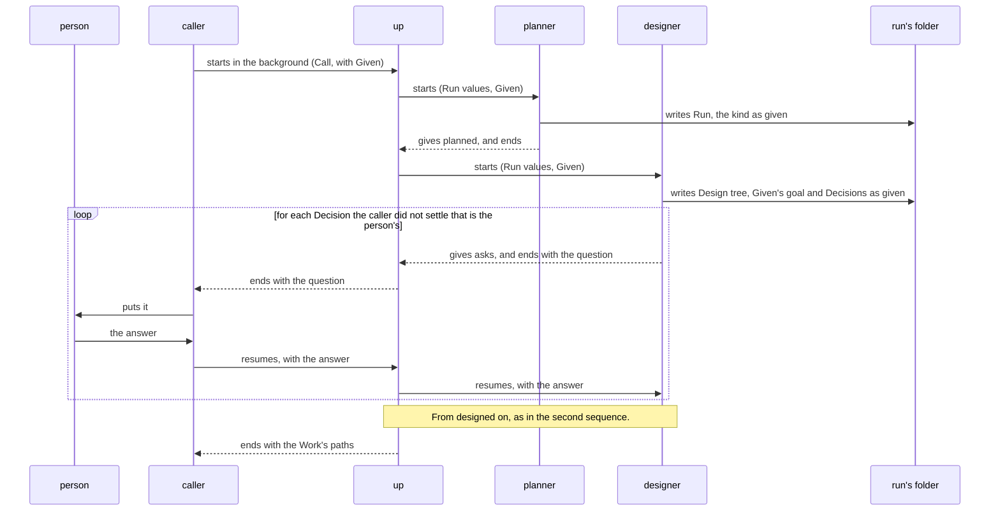
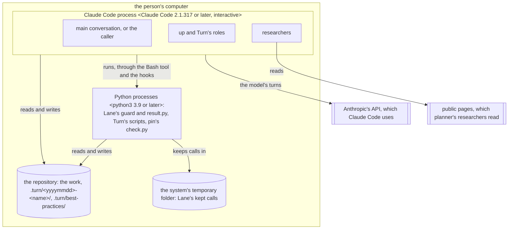

# Turn architecture

Turn makes a work in two phases, each a loop of roles that Lane's routes carry from one role to the
next. In the content phase, designer settles a design tree: pin's file of the decisions the work
needs, each joined to the question of the kind's template it serves, under the work's purpose.
builder makes the work decision by decision. evaluator answers each question as the work's user,
and each shortfall goes back to its decision. In the refactoring phase, refactorer improves how
the work says what it says, and proofreader checks it. Every role runs in the background and
carries on from the run's files, and parts that stand apart run at once. What this gives the
person and the caller is in [Turn's UX](ux.md).

## Principles

Turn follows Principles 2, 3, 5, 6, 7 and 8 of [how a plugin works](../architecture.md#principles).
It differs on three:

- Principle 1: the orchestrator, `up`, decides no move. Lane's routes give each next role from the
  result the last one gave, as Principle 7 has the course of a fixed loop kept outside the AI.
- Principle 4: a role's question for the person reaches them through `up` and the main
  conversation. A subagent reaches no one but the one that started it, and only by its end
  ([subagents](https://code.claude.com/docs/en/sub-agents)). Each passes the question on word for
  word.
- Principle 9: Turn leaves the lessons of a run to its caller. When the person types `/turn:up`,
  they are the caller, and the run's folder keeps each send-back for them.

The principles below are what Turn adds.

### One way for every kind

How Turn moves a work, its roles and its routes, is the same for every kind of work. What differs
between kinds lies only in the kind's template: its goal, its parts, its questions and its ways of
meeting them.

A new kind then needs only a template, which planner makes and the person approves (O2), and a
change to how Turn moves a work reaches every kind at once.

### Every decision comes from the purpose down

designer settles the work by [pin](../../plugins/pin/README.md)'s design tree: the work's purpose
at the root, the template's questions under it, and under each question the decisions that make it
yes. planner makes a new kind's template the same way, the kind's purpose at the root.

A decision that serves no question costs the person a question for nothing, and a question that no
decision serves is a point the work will guess (KR1.1, KR2.1).

### The person is asked only what is theirs, one point at a time

The roles find facts themselves, and ask the person only what they decide, as pin's `pin:down`
does. A point the caller settled is taken as given and never asked again.

A question about a fact spends the person's time on what an AI could look up, and a point asked
again tells the caller its settling was lost (KR1.1, KR3.1).

### The evaluator has only what the work's user has

evaluator is given the work and the template's goal, parts and questions, not the design and not
the template's ways of meeting the questions. proofreader is given the same of the refactoring
template.

The work's user never sees the design. An evaluator that has it judges whether the work follows
the design, not what its user gets (KR1.1).

### A shortfall is mended at its decision

A question that evaluator finds not yet met goes back to designer, which traces it to the decisions
that serve the question. Where a decision cannot make its question good, designer decides it
again, with the decisions that build on it; where the decisions hold and the work strays from
them, it keeps them. Either way builder makes the work again from those decisions. A point the
person raises enters the same way.

A fix put onto the work beside its design is a part no decision holds, so the next remake loses it
or keeps it unasked (KR1.1).

### What the work says before how it says it

The content phase makes what the work says and does, by the kind's own questions. The refactoring
phase then improves how it says it, by `refactor-doc` for a document or `refactor-code` for code,
and changes nothing it says. A point that would change what it says goes back to designer.

builder and evaluator then look only at the content while it is made, and no sentence is improved
before its content is settled, only to be improved again once the content changes (KR1.2).

### Each role starts fresh, from the run's files

designer, builder, evaluator, refactorer and proofreader start fresh at each move, and carry on
from the run's files. A role resumed with the person's answer goes on in its own context.

evaluator then reads each round with fresh eyes, and a run stopped anywhere goes on from its
folder in a new session (KR1.1, KR1.2).

### Parts that stand apart run at once

Decisions that build on one another are made in order, in one run. Branches of the design tree
that do not are made side by side: `up` starts one run of builder for each, all at once, each
writing only files no other run writes. The questions a work is checked by are answered the same
way, one run of evaluator or proofreader for each group of questions. The next route is taken
once every run of the step has ended. A part is not split where splitting would make it worse,
such as one document written in two voices, and refactorer is always one run, as how a work says
things holds over the whole of it.

The lead time is shortened without a step left out (KR1.2, KR2.2, KR3.2). Only `up` starts runs:
a role that started runs of its own would stand a layer deeper, and under a caller the depth
limit would leave it no Agent tool, so the work would go in order again.

### Turn knows its caller only by the call

No line of Turn's code or prompts names a caller. A caller gives what it settled in the form
[the call](#data-model) has, and puts each question to the person as the call says.

rn and any other caller then take Turn as it is, and a change for one reaches the others in the
open.

## User stories

- As the person, I want to type `/turn:up` with my request, answer each question that is mine, and
  get the work. Carries O1 from the request to the work handed back, and O2 with the next story.
- As the person, I want to approve the purpose and the questions of a kind new to Turn, and have
  later runs use them. Carries O2 from the kind settled to the template kept.
- As a caller, I want to start `turn:up` with what I settled, put each question it ends with to the
  person, resume it with the answer, and get the work. Carries O3 from the start to the work handed
  back.
- As the person, I want to go on with a stopped run from its folder. Off the main path, serves
  KR1.2.
- As the person, I want to name a run's folder and a change, and have the work made again from the
  design with the change in it. Off the main path, serves KR1.1.

## Logical view

### Components



Legend: a rounded box is a person; a box is an AI or a script, with its kind and what it is made
with in angle brackets; a cylinder is a store of files. Each arrow says what one does to another,
with the data it hands on named as in the data model, and its number gives the order. Arrows 2 and
10 go to the main conversation when the person types `/turn:up`, and to the caller when a plugin
calls Turn.

- `up` alone starts and resumes Turn's roles, and only as Lane tells it. It reads the run's
  `run.json` and `work.json` to give each role its run values, and writes nothing. It serves every
  objective, as the one each role's start and each answer pass through.
- planner alone settles the kind, whether the work is a document or code, and the kind's template.
  It looks for a template in `.turn/best-practices/` first, then in Turn's own, and makes one by
  [meta](../../plugins/turn/core/domain/best-practices/meta.json) where neither has the kind. It is
  there for O2; in O1 and O3 it only finds the template.
- designer alone changes the design and alone asks the person about the work, so the work is
  always made from one design (KR1.1, KR3.1). It also settles the work's paths and the commands its
  user runs.
- builder alone makes the work in the content phase, and refactorer in the refactoring phase.
  builder decides the small points of making, such as a phrase or a function's name, from the
  design and the template's ways of meeting the questions. A point the design leaves open that
  bears on the work's quality it returns to designer unanswered.
- evaluator alone judges the content, and proofreader how the work says it. Neither changes the
  work (KR1.1, KR2.1, KR3.1).
- builder, evaluator, refactorer and proofreader each use and answer, in the same way: read the
  work whole, run what runs as its user would, and write for each question either the lines that
  meet it, or what the user gets once it is good, never how to make it. This way lies once, in
  `core/domain/use-and-answer.md`, and each of the four parts names it.
- A researcher finds one fact. It is a subagent that Claude Code ships, such as Explore, so Turn
  holds no agent of its own for it.
- Lane's guard, the check script Lane lays into Turn, alone decides the next role, from Turn's
  routes and the result each role gave, and holds each role to its lanes. Lane's `result.py` alone
  checks that a result is one a route is on.
- Turn's scripts alone check what Lane does not: `practices.py` a template's form, `tree.py` that
  the design tree asks the template's questions, and `answers.py` each answers file. pin's
  `check.py` alone checks that the design tree holds together. `tree.py parts` and
  `practices.py groups` alone split a step's work into the runs `up` starts.
- The main conversation follows `/turn:up`'s skill only to start `up` and to pass on its questions,
  answers and end. Lane does not check the main conversation, so it holds none of Turn's work.

The roles' lanes, the rules Lane holds a role's steps to, each laid by Lane's `lay.py` from Turn's
proposal, `{name}` standing for a run value `up` gives. Each JSON file a role writes is also held to
its form by an `in_form` lane, the form a JSON Schema in `core/domain/forms/`.

| Role | Writes only | Runs only, beside its result command | Is held, as it ends, to |
|---|---|---|---|
| `up` | nothing | nothing | having started each role Lane named |
| planner | `{run}/run.json`, `{run}/kind-tree.json`, `.turn/best-practices/` | pin's check, `practices.py` | `practices.py check` passed after the template's last change |
| designer | `{run}/design-tree.json`, `{run}/work.json`, `{run}/remake.json` | pin's check, `tree.py check`, `tree.py parts` | both passed after the tree's last change |
| builder | `{work}`, `{answers}`, `{open}` | `{commands}`, `answers.py` | the work read whole; `answers.py check` passed after the last change |
| evaluator | `{answers}` | `{commands}`, `answers.py` | the work read whole; `answers.py check` passed |
| refactorer | `{work}`, `{run}/refactor-check.json` | `{commands}`, `answers.py` | as builder |
| proofreader | `{answers}` | `{commands}`, `answers.py` | as evaluator |

evaluator and proofreader also read only the work and the template's goal, parts and questions,
which Standard in the data model holds.

#### Choices

- **`/turn:up` runs in the main conversation, not as a forked skill.** Only the main conversation
  can ask the person, and a subagent has no `AskUserQuestion`
  ([subagents](https://code.claude.com/docs/en/sub-agents)). The skill's body tells the main
  conversation how to pass each question on and resume `up` with the answer. A fork's body would
  reach only the fork, and the main conversation would be left to guess what to do with its end.
- **A role that asks gives `asks`, which ends the routes.** A role that ends with no result is kept
  going once by Lane, and `up` with a start due is let end as a fault. So planner and designer give
  `asks` before they end with a question, and Turn's routes take `asks` to no next role: `up` is
  free to end with the question. Resumed with the answer, the role gives a later result, which Lane
  takes over `asks`, and the routes go on from it.
- **`up` fans out a step, and Lane joins it.** Where `work.json` holds several parts, `up` starts
  one run of builder for each part at once, with the part's run values, and one run of evaluator or
  proofreader for each group of questions in `run.json`. Lane holds each run to its own values by
  the `agentId` its start gives back, and takes the next route once all of them have ended. A role
  that started runs of its own would need a layer more than Claude Code gives under a caller
  ([subagents](https://code.claude.com/docs/en/sub-agents)).
- **Templates kept in `.turn/best-practices/`.** A template made for the person's kind is used by
  every later run in the repository, so it lies outside any one run's folder. One of the
  repository's own is taken over Turn's of the same kind, as the person approved it for their work.

What Turn needs of Lane and pin beyond what they give as built:

- Lane starts a route's `to` once. Turn's `up` starts it many times at once, so Lane counts the
  step done once all of those runs have ended, and joins their results by an order of precedence
  that the routes declare. Turn's routes declare `content`, `open`, `more` and `good`, in that
  order: the joined result is the first of these that any run gave, and otherwise the result the
  runs share. A point of what the work says goes to designer before one of how it says it, and a
  work sent back goes back before it goes on.
- Lane reads a role's steps from the part its entry names under `prompts/`. Turn's parts lie in
  `core/roles/`, as [The core apart from Claude Code](../architecture.md#the-core-apart-from-claude-code)
  says, so Lane reads a part there too.
- Lane takes a run value only as a whole take. Turn's commands name files of the run, as
  `python3 ${dependency:pin}/scripts/check.py {run}/design-tree.json`, so Lane puts a run value into
  a command before it matches it whole.

### Data model



A question for the person and their answer are messages, not data kept: the role that asked writes
the answer into its tree. Each data below is a JSON file, read and changed with `jq`, as
[JSON between agents](../architecture.md#json-between-agents) says. Keys say their intent, a
one-to-many join is nested, and a many-to-many join lists IDs.

- **Call**: the prompt a caller starts `up` with: the `request` in its own words and, under
  `given`, what it settled, each optional: `kind`, `goal`, `decisions` in the design tree's form,
  `work` and `run`, the run's folder. `/turn:up` gives the request alone.
- **Template**: `<kind>.json` in Turn's `core/domain/best-practices/` or in `.turn/best-practices/`,
  the kind its name: `goal`; `parts`, each `id`, `what` and its own `parts`; `benefits`, the
  questions, each `id`, `about`, the parts it asks of or `the whole`, and `what`; and `practices`,
  for each question its `benefit`, `thinking`, `steps` and `grounds`. `practices.py check` verifies
  that every part is asked of by a question and every question has a practice. A refactoring
  template, `refactor-doc` or `refactor-code`, has no `parts`, as the work keeps its kind's shape.
- **Standard**: a template's `goal`, `parts` and `benefits`, written by `practices.py standard` into
  `standard.json`, and `refactoring-standard.json` for the refactoring template.
- **Run**: `run.json`: `kind`; `template`, its path; `refactoring`, `refactor-doc` or
  `refactor-code`; and `groups` and `refactoring_groups`, the template's questions in groups, each
  `id` and `questions`, as `practices.py groups` writes them: the questions that ask of the same
  parts together, and those of `the whole` in one group.
- **Design tree**: `design-tree.json`, in pin's form: `goal`, `questions` and `decisions`. Its
  questions are the template's benefits, each `id` named with the template's file as `readme/Q3`,
  which `tree.py check` verifies. planner's `kind-tree.json` has the same form, its root the kind's
  purpose.
- **Work**: `work.json`: `paths`, the files the work is; `commands`, what its user runs, so
  builder and evaluator run the same; and `parts`, each `id`, `decisions` and `paths`. designer
  writes the parts from `tree.py parts`, which groups the decisions that build on none in another
  group, and joins two groups whose files meet. A work that does not split has one part.
- **Remake**: `remake.json`: `decisions`, each the ID of a decision builder makes again, with the
  `question` and `good_when` that sent it back. Without it, builder makes every decision.
- **Answers**: from builder, evaluator, refactorer and proofreader, in one form:
  `good`, each a `question` with the `lines` that meet it, as `<path>:<from>-<to>`; `more`, each a
  `question` with `good_when`, what the user gets once it is good; and, from proofreader only,
  `content`, in the form of `more`, a point that would change what the work says. `answers.py
  check` verifies that every question a run was given stands in one list only and each line lies
  in the work. Each run of a step writes a file of its own, as `self-check/<part>.json`,
  `verification/<group>.json` and `proofreading/<group>.json`; refactorer, one run, writes
  `refactor-check.json`. The role that reads them after reads the whole folder.
- **Open point**: `open/<part>.json` from a run of builder: `open`, each a `question` with `what`
  the design leaves open.
- **Run values**: the JSON object `up` starts or resumes a role with: `run`, the run's folder;
  `work` and `commands`, from `work.json`, once designer has written it; for a run of builder,
  `decisions` and `work` narrowed to its part, and `answers` and `open`, its own files; for a run
  of evaluator or proofreader, `questions`, its group, and `answers`, its own file; for designer,
  `given`, the Call's, and `returns`, the folders whose points it takes back, as
  [Routes](#routes) gives them. Lane reads them from the start's prompt.
- **Result**: the word a role gives by Lane's result command, kept by Lane, as the routes below
  name it.

### Routes

| From | On | To |
|---|---|---|
| `up`, the orchestrator | | planner |
| planner | `planned` | designer |
| planner | `asks`, a question for the person | no next role |
| designer | `designed` | builder |
| designer | `asks`, a question for the person | no next role |
| builder | `built` | evaluator |
| builder | `open`, a point the design leaves open | designer |
| evaluator | `more` | designer |
| evaluator | `good` | refactorer |
| refactorer | `refactored` | proofreader |
| proofreader | `more` | refactorer |
| proofreader | `content`, a point that would change what the work says | designer |
| proofreader | `good` | no next role, the work done |

`up` gives designer, as `returns`, the folder whose points it takes back: `open/` after `open`,
`verification/` after `more`, and `proofreading/` after `content`. After a Remake, `up` starts a
run of builder only for each part that holds a decision the Remake names.

### Sequences

The person types `/turn:up`, and planner asks a question, O1 of the UX up to the design:



builder and evaluator, each fanned out, with a send-back, O1 of the UX from the design to `good`:



The refactoring phase goes the same way, with no design tree: refactorer, one run, in builder's
place, and proofreader, one run for each group of the refactoring questions, in evaluator's. On
proofreader's `good`, `up` ends with the work's paths.

planner makes a template, O2 of the UX:



A caller calls Turn, O3 of the UX:



- A stopped run goes on when `up` is started with the run's folder. Lane's routes start at planner
  again; planner finds `run.json` and gives `planned`, designer finds the tree and goes on from it,
  as pin's `pin:down` does, and the roles after carry on from the files.
- A change the person names with a run's folder reaches designer as a point to take back, as a
  `more` does.
- A role resumed by SendMessage keeps its `agent_id`, and gives a result again for the resumed run,
  the later over `asks`, as [Lane's routes](../../plugins/lane/docs/routes.md#how-a-subagent-gives-its-result)
  say. The routes then go on from the start that asked.

## Physical view

### Deployment



- The person installs Turn as [the README](../../plugins/turn/README.md#installation) says. Turn's
  manifest lists `pin` in its `dependencies`, so installing Turn installs pin. Lane is laid into
  Turn's `hooks/lane/`, and needs no install.
- The person starts Turn with `/turn:up`; a caller starts the agent `turn:up`. Claude Code runs
  each of Turn's agents in the background, as each sets `background: true`.
- Turn's scripts use Python 3.9 and its standard library only, as
  [Python 3.9 and the standard library](../architecture.md#python-39-and-the-standard-library) says.
- A run's folder is `.turn/<yyyymmdd>-<name>/` at the root of the repository, as
  [Where a plugin writes its files](../architecture.md#where-a-plugin-writes-its-files) says, or the
  folder the caller names.

### Directory structure

```text
plugins/turn/
├── .claude-plugin/plugin.json          Turn's manifest, its version and dependencies <JSON>
├── skills/up/SKILL.md                  /turn:up, for the main conversation <Markdown>
├── agents/<role>.md                    the entry of up and of each role, naming its part <Markdown>
├── core/roles/<role>.md                each role's flow, up's among them <Markdown>
├── core/domain/use-and-answer.md       how builder, evaluator, refactorer and proofreader use and answer <Markdown>
├── core/domain/forms/<file>.json       the form of each file of a run <JSON Schema>
├── core/domain/best-practices/<kind>.json, <kind>.md   Template, and the Markdown made from it <JSON, Markdown>
├── core/domain/practices.py, tree.py, answers.py       the checks of Template, Design tree and Answers <modules · Python 3.9>
├── scripts/practices.py, tree.py, answers.py           their entries <command line · Python 3.9>
├── hooks/hooks.json, hooks/lanes.json, hooks/lane/     Lane's guard and result.py, and Turn's lanes and Routes, laid by Lane <JSON, Python 3.9>
├── docs/calling.md                     the Call, for callers <Markdown>
└── README.md, CHANGELOG.md             for users <Markdown>

dev/turn/
├── ux.md, architecture.md, README.md   for builders <Markdown>
├── cosmic-ray.toml                     the mutation testing <TOML>
└── tests/
    ├── unit/core/domain/               unit and property tests of the checks <Python 3>
    ├── unit/core/roles/                the prompt tests of each role, trial_*.py <Python 3>
    ├── integration/                    the scripts on real files, and Turn's lanes laid <Python 3>
    └── e2e/                            the E2E tests, trial_*.py, and the stand-in person's intents <Python 3>

.turn/best-practices/<kind>.json        Template made for the repository
.turn/<yyyymmdd>-<name>/                Run, Standard, Design tree, Work, Remake; Answers and Open point in self-check/, verification/, refactor-check.json, proofreading/, open/
```

The best practices lie in `core/domain/`, as they are the knowledge of Turn's work that every role
reads alike.

## Test

Turn is tested as [Test](../architecture.md#test) says. What follows is what Turn adds.

| Deployment unit | Unit | Integration | End-to-end |
|---|---|---|---|
| Turn's scripts [python3 3.9 or later] | unittest, Cosmic Ray, Hypothesis · ●●● · each check of a Template, a Design tree and Answers, the parts and the groups | unittest, real files · ●●○ · the exit and its message; `lay.py print` on Turn's proposal | E2E tests · ●●○ · run by the roles on each move |
| Claude Code process: `/turn:up`, `up` and the roles [Claude Code 2.1.317 or later] | prompt tests · ●●○ · each role alone, the person, its neighbors and the researchers stood in for | prompt tests with Turn's lanes laid · ●●○ · each role keeps its lanes and gives its results | E2E tests · ●●● · O1, O2 and O3 of the UX |

Lane's guard and result.py have no row: Lane tests them, and Turn tests only its lanes laid. pin's
`check.py` has none: pin tests it.

- A prompt test runs one role alone, as [Unit: prompts](../architecture.md#unit-prompts) says, with
  Opus. Scripts stand in for the person, answering from a set of answers, and for the roles before
  and after it, giving set files. It passes in three runs of three: the role writes its files in
  form and gives the result the files call for, each question to the person is one point and is
  theirs, and evaluator and proofreader read nothing but the work and their standard.
- An E2E test runs Claude Code with Opus on copies of Turn and pin, as
  [End-to-end: user stories](../architecture.md#end-to-end-user-stories) says, in an interactive
  session, as `claude -p` does not hand a background role's end back to `up`. An AI stands in for
  the person, answering from an intent written beforehand in `tests/e2e/` and never shown to Turn.
  O1 runs on a README and on a module of code with two parts apart, O2 on a kind Turn ships no
  template for, and O3 with a stand-in caller that settles part of the design.
- An E2E test passes in three runs of three where: the stand-in person, given the work and their
  intent, would change nothing in it; every question put to the person is one their intent marks
  as theirs, and none is a point the caller gave; the roles start as the routes say; and, on the
  module of code, the two runs of builder that `up` starts for its two parts overlap in time. Each
  run's time and tokens are kept with its records, so runs can be compared.
- Turn's scripts weigh ●●● in unit tests, as a check that passes wrongly sends a gap into the work
  unseen. The roles weigh ●●● in E2E tests, as a work the person must mend, or a question that is
  not theirs, is what Turn is there to stop.
- The integration tests and the prompt tests weigh ●●○: the unit tests hold every behavior of the
  scripts, and the E2E tests run the roles whole.
