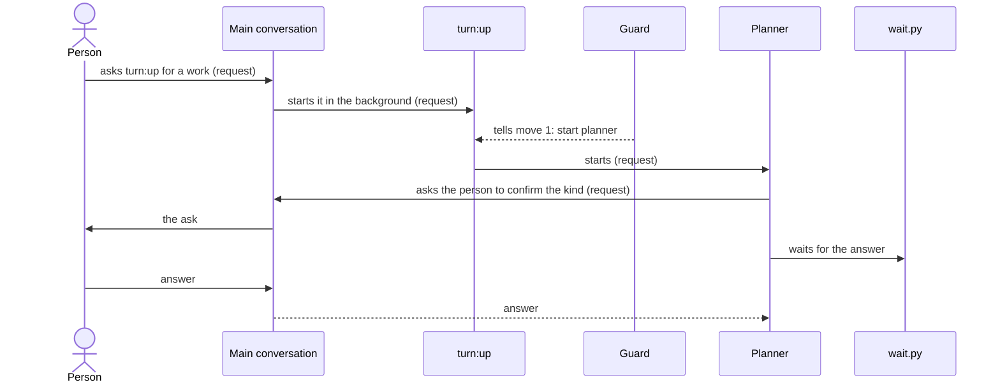
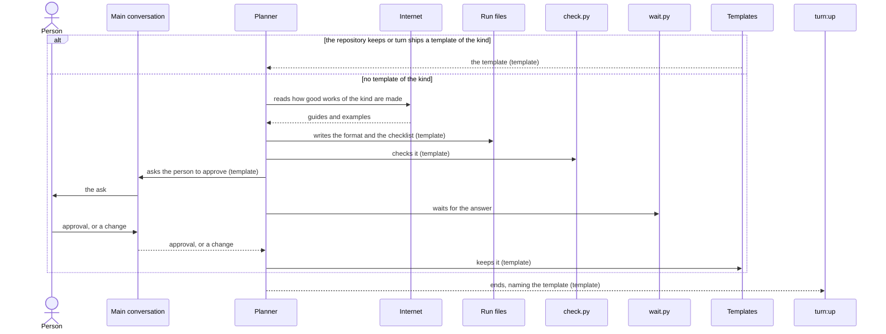
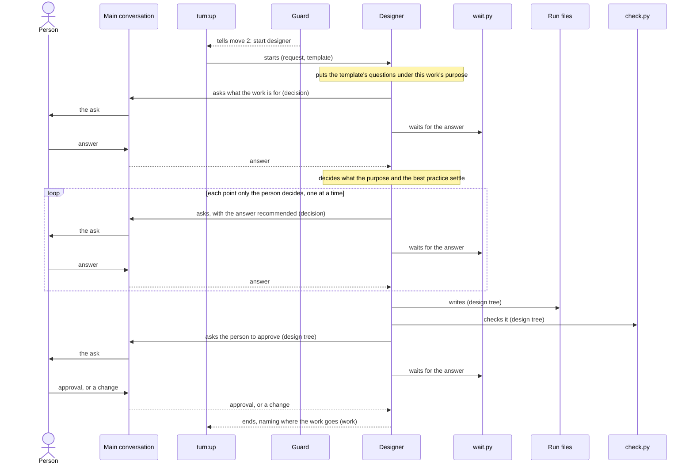
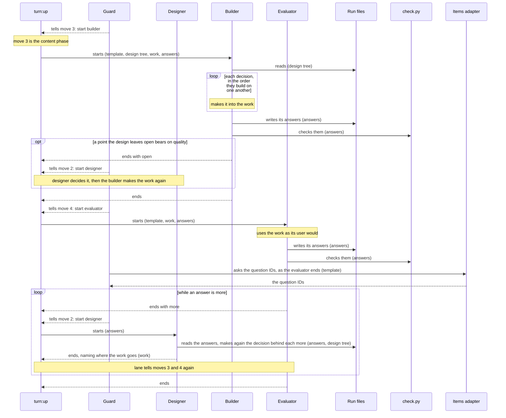
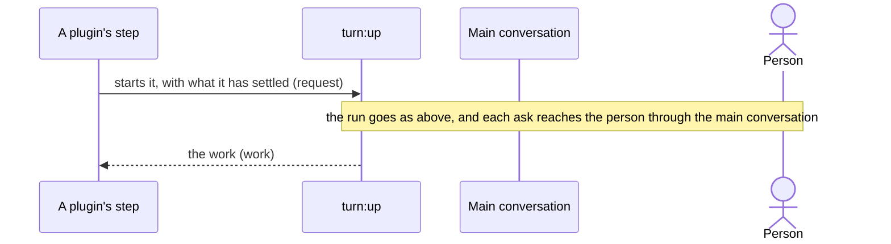

# turn architecture

turn draws a work's design from its kind's template and the person's answers, and has an AI that
never sees the design use the work as its user would, until every question of the template is
good. A kind is a sort of work, such as a press release, and its template holds the kind's format,
the shape of the work, and its questions, each one a work answers yes to when it serves its user.
Four roles do this: planner, designer, builder and evaluator. The builder and the evaluator first
make what the work says, then better how it says it. The ccpm plugin
[lane](../../plugins/lane/README.md) holds the order the roles go in and the limits of each. The
experience this delivers is in [ux.md](ux.md).

## Principles

turn holds every principle of [how a plugin works](../architecture.md#principles), with the
reasons under its [Why it is so](../architecture.md#why-it-is-so). In that document's words, turn's
builder is the maker, its evaluator the reader, and a question of a template an item. An answer is
**good** when the work meets the question's aim, and it names the lines that meet it. An answer is
**more** when the work falls short, and it says what the work's user gets once it is good, never
how to make it. Good and more are what that document calls an item's Good and need. The principles
below are what turn adds.

### One way for every kind

turn's roles hold no rule of any one kind; all that a kind needs is in its template.

A new kind then needs only a template, and every kind gets the same care. A rule written into a
role for one kind, such as "a press release carries a date", bends the work of every other kind.

### Nothing is needed beforehand

turn asks for what it needs: planner asks the kind, and designer asks this work's purpose. A caller
may give what it has already settled with the person, and turn takes that as decided.

Anyone who wants a work can then ask for it in a sentence. A caller such as rn has often settled
the kind or the purpose already, and asking the person again would spend their time on a point
they have decided.

### The evaluator uses the work as its user would

The evaluator uses the work as its user would, and answers each question by what that user gets.
When the work is a template, the evaluator judges a real work of that kind with it.

A judge who reads only the work's words passes a work that meets them and misses its aim. A press
release whose headline names the product passes a reading of the words, while a reporter still
cannot tell from it what is new. The builder answers the questions on its own work the same way, so
it finds first what the evaluator would find.

### The evaluator never sees the design

The evaluator takes the work and the templates of its phase, and never the design tree.

The work's user never sees the design. An evaluator that has it judges whether the work follows the
design, and passes a work that follows a wrong one.

### One asker for each thing the person decides

Planner alone asks the person about the kind and its template. Designer alone asks about this
work's purpose and its design, and alone changes the design.

The work is then always made from one design, and the person is asked each point once. Two roles
that asked would ask the person twice, or keep two answers that drift apart.

### Decided from the purpose down

Designer decides in the order the decisions build on one another, this work's purpose first, and
every decision serves a question of the template. Designer decides what the purpose and the best
practice settle, and asks the person what only they can decide.

Designer keeps the decisions in a design tree: this work's purpose at the root, the template's
questions under it, and under each question the decisions that make it good. A decision made before
the one it builds on is made again once that one is made. A decision that serves no question is
made, kept and checked for nothing.

### A more is mended at its decision

Each more of the kind's own questions goes to designer, who traces it to the decisions that serve
its question. Where a decision cannot make its questions good, designer decides it again, with the
decisions that build on it, as it decided it first: asking the person where the fact is theirs. No
role adds onto the work to answer a more.

A fault fixed where it shows is a patch, and patches pile up until the work no longer reads as one
design. Making the decision again changes every part that rests on it. Where the decisions hold and
the work strays from them, designer keeps the decisions, and the builder makes the work to them
again.

### What the work says before how it says it

The builder and the evaluator make the work in two phases. In the content phase, they answer the
questions of the kind's own template alone, and the builder makes the work from the design tree. In
the refactoring phase, they answer the questions of each template the kind's template includes,
such as `refactor-doc` for every document, alone and with no design tree; only how the work says a
thing changes. A point that would change what the work says goes back to designer, and through the
content phase again.

The builder and the evaluator then keep to what the work says while it is made. Wording polished
before the content is settled is polished again at each new making. A polish that changed what the
work says would pass unchecked by the kind's own questions.

### Each role works from the run's files

Each role starts fresh at each move, and takes what earlier roles made from the run's files: the
design tree and the answers, kept in a folder of their own for each run.

The template and the run's files hold all a role takes from another, so no role needs another's
conversation. A fresh evaluator reads each round with fresh eyes, as no work is passed by the one
who made it, and a run stopped anywhere goes on from its files.

### The phase is the flow's position

The phase is a fact of the move's position in the flow, not of the run's files. `turn:up` tells it
from the position lane names, and gives the builder and the evaluator that phase's paths; neither
role tells its phase itself.

The files cannot tell the phase: after a point the builder returns in the refactoring phase,
designer may keep its decisions, and the files then read as they did in the refactoring phase,
while the work must go through the content phase again. An evaluator that told the phase would
also need files beyond the work, and read what its user never sees.

### lane holds the order and each role's limits

turn declares the order of its roles and the limits of each role in a proposal to lane, and keeps
no script of its own for either. turn's scripts check only what no lane holds.

lane writes and tests each check once, and tells a role that drifts the sentence of its own step,
so the role goes back to the step. A script of turn's own for the order would read the roles' calls
apart from lane, and drift from it.

### turn knows others only by what they document

turn uses lane only as lane's README and its documents say, and a caller only as
[Calling turn](../../plugins/turn/docs/calling.md) says. It names no file of any caller.

lane and each caller change their own code freely behind what they document. A turn built on what
they do not document breaks when they change, and a turn shaped for one caller stops being one way
for every caller.

## User stories

- As the person who wants a work, I want to ask `turn:up` for it in the main conversation, and
  confirm its kind. Carries O1's request, "Write a press release for our new meeting-room booking
  app", and its confirmation, "Is this a release for the press?" (the README's Walkthrough, steps 1
  and 2).
- As that person, I want to approve the format and the checklist turn draws for a kind it has not
  made before, and have them kept for my next work of that kind. Carries O1's research and "Format
  … Approve?" (step 3), and the README's line that the next press release skips step 3.
- As that person, I want to answer what this work is for and each point only I can decide, each
  with the answer turn recommends, and to approve the design. Carries O1 from "What is the release
  for?" to the approved key points (steps 4 and 5).
- As that person, I want the work only once a second AI, using it as its user would, finds every
  question good, both of what the work says and of how it says it. Carries O1's last step, "The
  press release" (step 6), and the README's How it works.
- As a plugin's step, such as rn's, I want to start `turn:up` for a work my step needs, giving what
  my step has already settled with the person, and get the work back. Carries O1 when the person
  reaches turn through such a plugin, and the README's Documentation, "Calling turn".

## Logical view

### Components


- `turn:up` alone holds a run. It takes each move lane tells it (follow_flow), and starts each role
  in the foreground, as lane counts a start only once the role has ended. It alone tells the phase,
  from the position each move names, as [lane's flow](../../plugins/lane/docs/flow.md) words it,
  such as "The next move of the flow is move 5: start `turn:builder` in the foreground." It gives
  each role the paths that role works on, as one JSON line its lanes read. The builder and the
  evaluator get their phase's: its templates and its self-check or verification, and the design
  tree in the content phase alone, given as `null` in the refactoring phase. It takes the
  templates' paths from the end of planner, and the work's paths from the end of designer. It ends
  once lane tells it the flow is done, naming each file of the work.
- turn's proposal to lane declares the flow on `turn:up`, as
  [lane's flow](../../plugins/lane/docs/flow.md#the-flow) gives it. Its order is planner, designer,
  builder, evaluator, builder, evaluator, positions 1 to 6. Positions 3 and 4 are the content
  phase, and 5 and 6 the refactoring phase. The work goes back to designer (2) while the builder
  at 3 or at 5 answers `open`, and while the evaluator at 4 answers `more`. It goes back to the
  builder at 5 while the evaluator at 6 answers `more`.
- Planner alone decides the kind, and takes a kind a caller gave without asking. It gives the
  kind's template: one the repository keeps, else one turn ships, else a new one drawn from how
  good works of the kind are made. It writes a new template in the run's folder, and keeps it in
  the repository's templates folder once the person approves it, so no run takes a template the
  person has not approved. lane holds it to write only those two folders (write_only), and to pass
  `check.py`'s template check after changing a template (test_after).
- Designer alone decides each point of the design, such as where the work goes and the language it
  is written in, from the purpose and the best practice or by asking the person. It takes each
  point a caller gave as decided. It alone finds where the cause of each more lies, and alone
  decides a point the builder returns, in either phase, as a point of what the work says. It ends
  naming where the work goes. lane holds it to read the answers it was sent back with to their end
  (read_whole), to write only the design tree (write_only), in its form (in_form), and to pass
  `check.py`'s tree check after changing it (test_after).
- Builder alone decides the small points of making, such as a phrase or a function's name, and in
  the refactoring phase how the work says each thing. It returns a point the design leaves open
  that bears on the work's quality, and in the refactoring phase a point that would change what
  the work says: it writes the question the point bears on as a more of its self-check, and ends
  with `open`. In the refactoring phase it mends each more of the evaluator. lane holds it to read
  the design tree it is given to its end (read_whole), to write only the work and its self-check
  (write_only), to run no `git commit` or `git push` (hands_off), to write the self-check in its
  form (in_form), to answer every question of the templates it is given (every_item), and to pass
  `check.py`'s answers check (test_after).
- Evaluator alone decides each answer, good or more, from its own first reading of the work. It
  ends with `more` while an answer is more. lane holds it to read only the work and the templates
  it is given (read_only), to read the work to its end (read_whole), to write only its
  verification (write_only), in its form (in_form), to answer every question of the templates it
  is given (every_item), to pass `check.py`'s answers check (test_after), and to end only once the
  verification is made (end_when).
- `check.py` alone checks what no lane holds. A template is in its form, and a question looks at
  every part of its format. In a design tree, a decision serves every question, every decision
  reaches the root, and the decisions were made in the order they build on one another. In a
  self-check or a verification, no question stands both good and more, and every line an answer
  names is in the work.
- The items adapter alone gives every_item the question IDs of a template, each named with its
  template, such as `readme/Q3`. every_item counts a question answered where its ID stands as a
  word of its own, as [lane's lanes](../../plugins/lane/docs/lanes.md) say. A question
  named with its template is then answered only by its own ID, as `readme/Q3` does not stand in
  `refactor-doc/Q3`.
- An ask is a question or an approval that a role puts to the person. Each ask that reaches the main
  conversation says what it waits on and the answer turn recommends. A main conversation that knows
  nothing of turn then puts it to the person and sends back their words.
- `wait.py` alone holds a role that has asked until the answer comes. The role runs it in the
  foreground, and again each time it returns without the answer, as a message reaches a subagent
  only at its next tool call.
- `turn:up` is a subagent, even when a person calls turn, though
  [Where the orchestrator runs](../architecture.md#where-the-orchestrator-runs) starts such a
  plugin by a skill. lane lays a flow only on a subagent, and one entry then serves the person and a
  plugin's step alike.
- The main conversation starts `turn:up` in the background. It then stays free to put each ask to
  the person while the roles work.
- lane's flow keeps turn's order, not a script of turn's own. turn's run goes in a fixed order with
  set ways back, which lane's flow declares and lane's guard holds, written and tested once in lane.
- `check.py` holds a template to its form, not an in_form lane. in_form holds a file at a path its
  step names, and a kept template's path holds the kind, which planner decides in the run.
- The person approves a template and a design by their answer in the main conversation, not by the
  skill of their own that
  [The caller approves what is theirs](../architecture.md#the-caller-approves-what-is-theirs) asks
  for. Neither is hard to undo: a change sends planner or designer back to the decision it touches.
- The builder returns an open point as a more of the self-check, not in a file of another form.
  Designer then reads one form, whichever position sent the work back.
- The builder and the evaluator each serve both phases, not a role started for each phase. A role
  splits by what it alone decides, and the builder decides how the work is made in both phases, as
  the evaluator decides what its user gets in both.
- The evaluator's more in the refactoring phase goes back to the builder, not to designer. A more
  of how the work says a thing changes no decision, and designer would only pass it on.
- Every file the roles pass on is JSON, so `check.py` checks one against another, such as a
  template's questions against its parts.

### Data model


### Sequences

Asking `turn:up` for a work and confirming its kind:



Approving the template of a new kind:



Answering what only the person decides, and approving the design:



Making what the work says, until every question of the kind's own is good:



Bettering how the work says it, once every question of the kind's own is good:

```mermaid
sequenceDiagram
  participant M as Main conversation
  participant U as turn:up
  participant G as Guard
  participant D as Designer
  participant B as Builder
  participant E as Evaluator
  participant R as Run files
  participant C as check.py
  G-->>U: tells move 5: start builder
  Note over U: move 5 is the refactoring phase
  U->>B: starts (included templates, no design tree, work, answers)
  Note over B: betters how the work says each thing, by the included templates' questions
  B->>R: writes its answers (answers)
  B->>C: checks them (answers)
  opt a point would change what the work says
    B-->>U: ends with open
    G-->>U: tells move 2: start designer
    U->>D: starts (answers)
    Note over U,D: designer decides it, or keeps its decisions; either way lane tells moves 3 and 4, the content phase, again
  end
  B-->>U: ends
  G-->>U: tells move 6: start evaluator
  U->>E: starts (included templates, work, answers)
  Note over E: uses the work as its user would
  E->>R: writes its answers (answers)
  E->>C: checks them (answers)
  loop while an answer is more
    E-->>U: ends with more
    G-->>U: tells move 5: start builder
    U->>B: starts (included templates, no design tree, work, answers)
    B->>R: reads the evaluator's answers, writes its own (answers)
    B-->>U: ends
    Note over U,E: lane tells move 6 again
  end
  E-->>U: ends
  G-->>U: tells that the flow is done
  U-->>M: the work (work)
```

Starting `turn:up` from a plugin's step:



- Every ask goes to the main conversation, even when a plugin's step started `turn:up`. Only the
  main conversation can ask the person, as
  [Where the orchestrator runs](../architecture.md#where-the-orchestrator-runs) says.
- A point the builder returns in the refactoring phase goes through the whole content phase again,
  builder and evaluator included. The evaluator then checks that what the work says still holds
  before the refactoring phase goes on.

## Physical view

### Deployment


- The person installs turn as the README's Installation says. They start it by asking the main
  conversation to have `turn:up` make a work, as the README's Walkthrough shows. A plugin's step
  starts the `turn:up` agent itself, as [Calling turn](../../plugins/turn/docs/calling.md) tells
  the step's maker.
- A person who asks `turn:up` again for a work whose run stopped goes on with that run. `turn:up`
  finds the run's folder by the work, and each role takes up what the run files already hold.
- A run's files lie in `.turn/<yyyymmdd>-<name>/` in the repository, and the templates planner
  makes lie in `.turn/templates/`, as
  [Where a plugin writes its files](../architecture.md#where-a-plugin-writes-its-files) places what
  may be kept. The templates' folder carries no date, as each template serves every later run.
- Planner keeps the templates it makes in the repository, not in turn's installed folder, which an
  update replaces, nor in the person's home folder, which agents cannot read without asking. A kept
  template is taken before a shipped one of the same kind, as the person approved it.
- lane's guard lies in turn's own folder, where `lay.py write` lays it. The person then needs no
  lane installed.

### Directory structure

```text
plugins/turn/                       turn, installed by Claude Code
├── .claude-plugin/plugin.json      the manifest <JSON>
├── agents/up.md                    turn:up's entry <subagent · Markdown>
├── agents/<role>.md                Planner's, Designer's, Builder's and Evaluator's entries <subagent · Markdown>
├── prompts/<role>.md               the steps of turn:up, planner, designer, builder and evaluator <Markdown>
├── scripts/check.py, <check>.py    check.py and each check it runs <script · Python 3.9 stdlib>
├── scripts/wait.py                 wait.py <script · Python 3.9 stdlib>
├── forms/<file>.json               Forms of the design tree and the answers <JSON Schema>
├── templates/<kind>.json           Templates that turn ships <JSON>
├── hooks/hooks.json, lanes.json    the hooks, the flow and the lanes, laid by lane <JSON>
├── hooks/lane/                     Guard, laid by lane <Python 3.9>
├── hooks/adapters/items-template.*   Items adapter and its cases, laid by lane <script · Python 3.9 stdlib>
├── docs/calling.md                 for the maker of a plugin's step <Markdown>
├── README.md, CHANGELOG.md         for the person <Markdown>
└── how-it-works.svg, idea.svg      the README's figures <SVG>

dev/turn/                           what only turn's builders need
├── README.md                       how to run turn's tests and trials
├── ux.md, architecture.md, *.svg   turn's UX and this document
├── cosmic-ray.toml                 the mutation testing of turn's scripts <TOML>
├── tests/                          unit and property tests of turn's scripts <Python 3>
└── trials/                         trials of each role, of the roles together, and of the whole <Python 3>

<the repository the work is in>/.turn/
├── templates/<kind>.json           Templates that planner made in this repository <JSON>
└── <yyyymmdd>-<name>/              one run's Run files: a new template before approval, design-tree.json, and a self-check.json and a verification.json for each phase <JSON>
```

## Test

turn is tested by the project's shared test rules in [Test](../architecture.md#test). What follows
says only what turn adds to them. A trial is a run of a role, or of the whole of turn, made by the
assistant and judged from its records. A weight, from ●○○ to ●●●, says how heavily a unit is tested.

| Deployment unit | Unit | Integration | End-to-end |
|---|---|---|---|
| turn's agents [Claude Code subagents · Markdown] | a trial of one role, the rest mocked · ●●● · it keeps to its steps, in each phase it serves | a trial of the four roles under lane's flow, the person mocked · ●●○ · the hand-offs through the run files, and the rounds of both phases to every question good | ▨[^1] |
| turn's scripts [process · Python 3.9 stdlib] | unittest, Cosmic Ray, Hypothesis · ●●● · each check of `check.py`, `wait.py`, and the items adapter | unittest with lane's real guard laid from turn's proposal, in a real repository · ●○○ · the lanes run the checks and the adapter, and the flow tells each move | ▨[^1] |
| turn's installed folder [plugin folder] | `check.py` · ●●○ · each shipped template is in its form, and a question looks at every part | ▨[^2] | ▨[^1] |
| turn on the person's computer [Claude Code] | ▨[^3] | ▨[^3] | a trial of each user story, the assistant as the person · ●●○ · the work, and what the person was asked |

[^1]: End-to-end tests run on the whole alone, in the last row.
[^2]: A template has no neighbour to join it to, as nothing runs it; the evaluator judges a real
    work of its kind with it when the template itself is the work.
[^3]: The units it is made of are tested in their own rows.

- lane's guard is lane's code, tested in lane, so it has no row here.
- Unit tests: a trial of one role makes the role real and runs it on Opus, with its lanes laid; it
  mocks every other role and the person, and gives the role the run files it would find. Pass: in
  each of three runs, the role keeps to its steps and its file passes `check.py`. The unit tests of
  `check.py`, `wait.py` and the adapter make them real and fake nothing but the files they read.
  Pass: as the shared rules set for code.
- Integration tests: a trial of the four roles makes them, `turn:up` and lane's guard real, on Opus,
  and mocks the person with set answers. Pass: in each of three runs, the run ends with every
  question good, of the kind's own template and of those it includes, and each more of the kind's
  own was mended at its decision, made again or kept, never by an addition to the work alone.
  The test of the guard with turn's lanes makes lane's guard and a repository real. Pass: all pass.
- End-to-end tests: a trial of each user story makes the whole of turn real in Claude Code, on Opus,
  with the assistant standing in for the person. Pass: in each of three runs, the person is asked
  only what the README's Walkthrough asks of them, and gets a work the evaluator finds good on every
  question; the maintainer then judges it as the shared rules say.
- turn's agents weigh ●●●: a role that strays gives the person a work that misses its purpose, or
  asks them what they need not decide.
- turn's scripts weigh ●●●: a check that passes a missing answer, or a decision that serves
  nothing, hands the person a work before every question is good.
- turn's installed folder weighs ●●○: a part no question looks at goes into every work of the kind
  unchecked, while the evaluator still reads the parts the questions do look at.
- turn on the person's computer weighs ●●○: a story's trial takes many minutes and many tokens, and
  the rows above catch most faults first.
- A trial passes on three runs of three, not on one: what an AI does varies from run to run, and a
  role that keeps its steps once may stray in the next.
