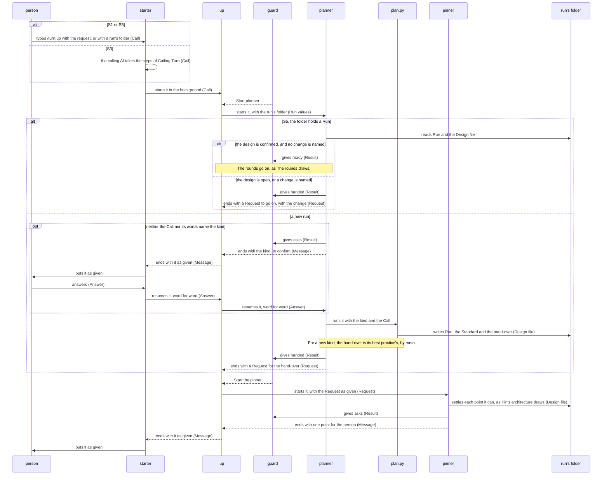
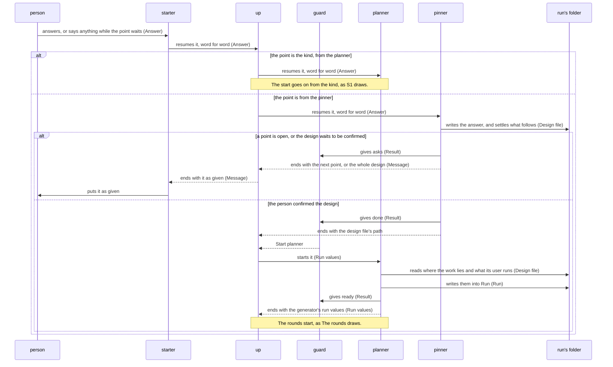
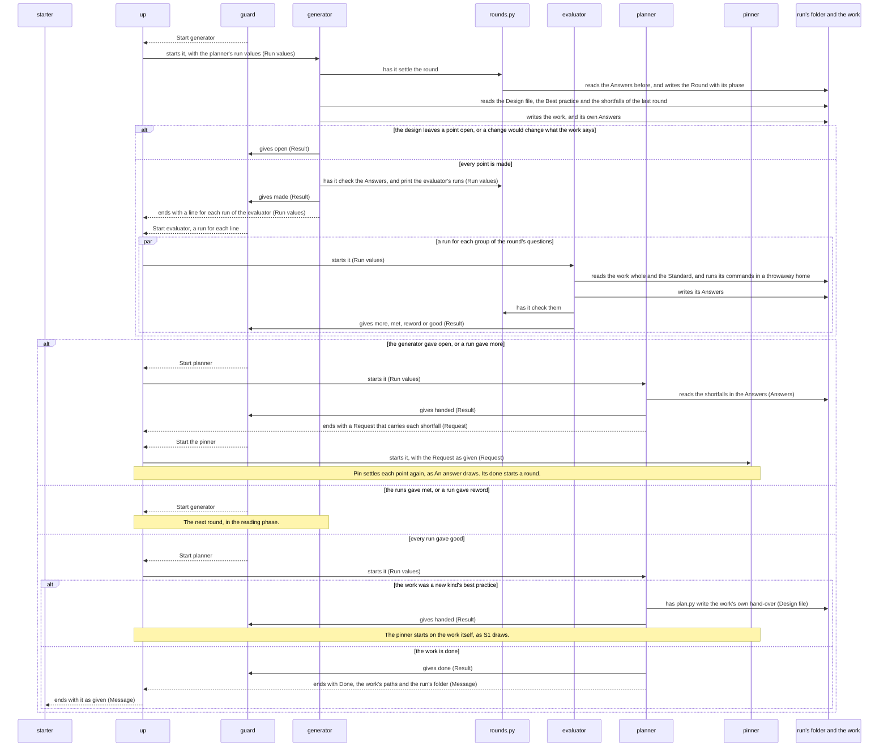

# Turn architecture

This document says how Turn is built to give [Turn's UX](ux.md). It is for a developer, a person or
an AI, who builds or changes Turn.

Turn makes every kind of work by one course of subagents. Lane, the plugin that holds a subagent to
the rules of its steps, moves the course: its routes name the subagent to start next from the
result that the last one gave. The planner settles the kind of work. It hands Pin the work's goal,
the questions of the kind's best practice and the points that a calling AI settled. Pin's
subagent, the pinner, settles the design from there with the person, one point at a time. The
generator makes the work from the design, against the kind's best practice. The evaluator then
answers each question as the work's user would, and is never given the design. A round is one such
making and check, and the evaluator starts fresh in each. A question not met goes back through Pin
to the decision behind it. Once every question is met, the rounds go on with the questions of how
the work reads. up, the subagent that starts each of them, carries each point to whoever started
Turn, and each answer back, as given.

## Principles

Turn builds on [the principles of the plugin best practice](../plugin-best-practice.md#principles)
and on its Development section, with these differences:

- Turn departs from
  [Where the orchestrator runs](../plugin-best-practice.md#where-the-orchestrator-runs): its
  orchestrator, up, is always a subagent, as
  [Choices in the components](#choices-in-the-components-and-their-costs) says.
- Turn departs from
  [The orchestrator holds the whole and decides](../plugin-best-practice.md#the-orchestrator-holds-the-whole-and-decides):
  up decides no move. Lane's routes give each next start, as
  [Where the router keeps the course](../plugin-best-practice.md#where-the-router-keeps-the-course)
  says. The planner decides what Turn hands Pin.
- Turn does not take
  [Learning from each run](../plugin-best-practice.md#learning-from-each-run). No step of the UX
  follows the work handed back, and a step there would ask the person more (KR1.2). The run's
  folder keeps each check of the work for whoever looks.

The principles below are what Turn adds. Each gives its rule, then why.

### One course for every kind

Every kind of work goes through the same roles, routes and rounds. A kind differs only in its best
practice. A kind new to Turn gets its best practice as a work of its own, made by the same course
with `meta` as its best practice. No role names a kind of work, but the planner, which names
`meta`, `refactor-doc` and `refactor-code`.

*Why*: a new kind then needs only a best practice, and the person approves it as they approve any
design (KR1.1). A fix to the course reaches every kind at once.

### Pin alone settles the design

After the planner's hand-over, only the pinner writes the design file and puts a point of the
design to the person. Each point that the work raises goes back to Pin in a Request, the text that
up starts the pinner with. Such a point is a question not met, or a point that the design leaves
open. No role of Turn changes a decision itself. The planner asks the person one point only, the
kind, and only before there is a design.

*Why*: the design file is then the one record of each point and who settled it, which the README
promises. Pin asks the person only what is theirs, and keeps what a calling AI settled. A point
that a role of Turn settles beside Pin could come out otherwise than the person means it, or be
asked again (KR1.1, KR2.1). A decision changed outside Pin also leaves each decision built on it
as it was.

### The evaluator has only what the work's user has

The evaluator reads the work and the Standard: the best practice's goal, parts and questions,
without the ways of meeting them. It never reads the design, the best practice's ways or the
generator's answers to the questions.

*Why*: the work's user never sees any of these. An evaluator that has the design judges whether
the work follows it, not what its user gets (KR1.1). One that has the ways checks how the work was
made, not what it gives.

### What the work says before how it says it

A phase is the set of questions that a round asks. The rounds of the content phase make what the
work says and does, by the kind's questions. The rounds of the reading phase then improve how the
work says it, by `refactor-doc` for a document or `refactor-code` for code. They change nothing
that the work says. A change to what the work says goes back to Pin, and the content phase follows
again.

*Why*: the README promises that the last rounds change only how the work says a thing. No role
improves a sentence before its content is settled, only to improve it again once the content
changes (KR1.2).

### A shortfall goes back to its decision

The generator makes the work only from the design. A question not met in the content phase goes
back to the decisions that serve it, through Pin. The generator then makes the work again from
the design. No role puts a fix onto the work beside the design.

*Why*: a fix beside the design is a part that no decision holds. The next round makes the work
again from the design, and loses the fix or keeps it with no one having settled it (KR1.1).

### Each role starts fresh from the run's folder

The planner, the generator and the evaluator start fresh each time up starts them, and carry on
from the files in the run's folder. A role resumed with the person's answer keeps its context. up
keeps no file.

*Why*: the evaluator then reads each round with fresh eyes, as the README promises. A run that
stopped goes on from its folder in a new session, and asks nothing again (KR1.2).

### Passed on as given

up passes on each point, each Request and each answer as it got them, and answers nothing of the
work itself. The planner hands Pin each point that the calling AI settled as it was given.

*Why*: a point reworded on the way is a question that no role asked. An answer summed up loses
what the person meant (KR1.1). The UX counts as gone wrong a settled point asked again or held
otherwise, and a question that the calling AI cannot pass on as given (KR2.1).

### Turn knows no calling AI

No line of Turn names a plugin that calls it. A calling AI reaches Turn only through `turn:up`, in
the forms that [Calling Turn](../../plugins/turn/docs/calling.md) gives.

*Why*: every calling AI takes the same Turn. A change made for one would reach the others unseen,
and could settle their points otherwise than they settled them (KR2.1).

### Turn changes only the work

The generator writes only the work and the run's folder. The generator and the evaluator run the
work's commands only in a throwaway copy of the repository, with a throwaway home. No role
commits, pushes or publishes.

*Why*: the README promises that Turn writes the files, and that the person chooses what happens to
them. A command run as the work's user runs it, such as `tidy` on a Downloads folder, would
otherwise change the person's own files, which cannot be undone. The person would then stop the
run (KR1.1).

## User stories

Each story names its user, the way that user meets Turn, and the steps of
[the UX's scenarios](ux.md#scenarios) that it carries.

- **S1**: As the person, I want to type `/turn:up` with my request, and get the first point that is
  mine. Carries the first steps of O1: the request, the purpose and questions of a kind new to
  Turn, and the work's purpose put to the person.
- **S2**: As the person, I want to answer the point that Turn puts to me, and get the next point,
  the design to approve, or the work. Carries the rest of O1: each answer, each round of the loop,
  the design approved, a point that comes up while the work is made, and the work handed over.
- **S3**: As the calling AI, I want to start `turn:up` with the request and the points I settled,
  and get the first point for the person. Carries the first steps of O2: the hand-over, and the
  points kept as given.
- **S4**: As the calling AI, I want to resume `turn:up` with the person's answer word for word, and
  get the next point, the design, or the work where I said. Carries the rest of O2: each point
  passed on and answered, the design approved, and the work handed back.
- **S5**: As the person, I want to type `/turn:up` with a run's folder, alone or with a change, and
  have the run go on from its folder, or the work made again with the change in its design. Off
  the main path, serves KR1.2 for a run that stopped, and KR1.1 for a change: the person would
  otherwise mend the work themselves.

## Components

The figure shows each role of Turn and each store of data that the stories need. The starter is
whoever starts up: the main conversation, which follows the steps of the skill `/turn:up`, or the
calling AI, which follows [Calling Turn](../../plugins/turn/docs/calling.md). The guard is Lane's
check script, which Lane's command `lay.py` lays into Turn, as the plugin best practice names a
plugin's hooks. The pinner lies outside Turn, and Pin's own guard holds it.


### What each role alone decides

- The starter decides nothing of the work. It puts each point to the person, and passes the
  answer back word for word.
- up decides the run's folder: the one the calling AI gave, else the one the request names, else a
  new one in `.turn/`. It also decides which role to resume with an answer: the one whose point it
  passed on.
- The planner decides the kind, the best practice that the work is made by, and whether the run
  first makes a new kind's best practice. It decides what each Request to Pin carries. Once Pin
  hands the design back, it reads out where the work lies and what its user runs. It decides when
  the run is done.
- The pinner decides everything in the design, as
  [Pin's architecture](../pin/architecture.md#what-each-role-alone-decides) says.
- The generator decides the work, and each small point of making it, such as a phrase or a
  function's name.
- The evaluator decides whether each question of its group is met.
- `plan.py` decides whether a best practice holds its form. It writes the hand-over, the Standard
  and the Run.
- `rounds.py` decides each round's phase and questions, how the questions are grouped among the
  evaluator's runs, and whether a role's Answers hold.
- `throwaway.py` decides where a work's command runs.
- The guard decides whether a call or an end of a role keeps the role's rules, and which start is
  due next.

### What the guard holds each role to

Lane lays these rules from Turn's proposal, as [Lane's lanes](../../plugins/lane/docs/lanes.md)
say. Pin's guard holds the pinner to Pin's rules.

| Role | Writes only | Runs only, beside its result | Before it gives its result |
|---|---|---|---|
| up | nothing | nothing | has made each start that the routes name |
| planner | the run's folder | `plan.py` | has passed `plan.py` after its last change |
| generator | the work, and its own Answers | `rounds.py`, and the work's commands in `throwaway.py` | has answered every question of the round, and passed `rounds.py` after its last change |
| evaluator | its own Answers | `rounds.py`, and the work's commands in `throwaway.py` | has read the work to its end, and nothing but the work, the Standard and its own Answers; has answered every question of its group |

### Choices in the components, and their costs

- **up always runs as Turn's subagent, for the person too.** Run in the main conversation, it
  would need no carrier between it and the person. But Lane checks only subagents, so only a
  subagent's course is held to the routes. The cost: each point passes up and the starter, and
  costs a resume of up (KR1.2). The main conversation passes each point by its steps alone, which
  no hook sees. Turn runs only in an interactive session, where Claude Code starts the
  orchestrator again as a subagent it started ends
  ([the routes](../../plugins/lane/docs/routes.md#what-the-orchestrator-is-told)).
- **Turn uses Pin as Pin is built: Turn is Pin's maker AI.** The planner hands over in the design
  file. up is Pin's go-between: it starts the pinner as one of Turn's roles, puts each of its
  points to the starter, and resumes it with the answer. A role of Turn that followed the
  pinner's steps itself would need nothing new from Lane or Pin. But Turn would then copy Pin's
  rules, and they would drift apart. Pin, used as built, runs as it was tested. The cost: Lane
  must let a route name a subagent of a dependency and keep its results, and the pinner must give
  one result while a point waits and another once the design is confirmed.
- **The planner stands on both sides of Pin.** up could hand Pin each point, and the generator
  could read the design itself. But one role then decides what Turn hands Pin and what it takes
  from the design, and up stays a carrier. The cost: a run of the planner each time the design is
  handed over or comes back (KR1.2).
- **A kind new to Turn gets its best practice as a work of its own.** A step of its own could make
  a best practice faster. But the person then approves the kind's purpose and questions as they
  approve any design, and the course stays one for every kind. The cost: the first work of a new
  kind takes a whole course more, as the README says.
- **One run of the generator makes the whole work in each round.** Runs side by side, one for each
  part that stands apart, would shorten the lead time. But parts made apart drift in voice and in
  what joins them, and the first key result comes first, as the UX says. The cost: a work whose
  parts stand apart is made one part after another (KR1.2).
- **The evaluator runs once for each group of the round's questions, all at once.** One run could
  answer every question. But each run is fresh on fewer questions, and the runs go side by side
  (KR1.1, KR1.2). The cost: each run reads the whole work.
- **The role before a step hands up the next role's run values.** up could read them from the
  run's folder. But Lane lets up make no call but the start due. So the planner ends with the
  generator's run values, and the generator ends with a line for each run of the evaluator. The
  cost: those two replies carry what up starts with.
- **No role of Turn starts a subagent.** A researcher in the background would let a role go on
  meanwhile. But Claude Code lets subagents start subagents only three layers below the main
  conversation, and a calling AI may stand one layer down. A child's end would also start its
  role again while a point waits. So the pinner and the generator find facts themselves. The
  cost: they find facts one after another, in their own context (KR1.2).

## Data model

The figure shows each data that Turn's roles pass or keep, and how each joins another.


- **Call**: what the starter starts up with: the request in its own words, and what the calling AI
  settled.
- **Run**: the run's own file: the kind, the works to make in order, and where each lies and what
  its user runs.
- **Work**: what the person wants made. A run makes one work, or first the best practice of a new
  kind.
- **Best practice**: a kind's goal, parts, questions, and a way to make each question yes.
- **Question**: one question of a best practice, such as `readme/Q3`.
- **Standard**: a best practice without its ways, which is all the evaluator gets.
- **Design file**: Pin's `design-tree.json`: the work's goal, the questions, and the Decisions that
  make each question yes.
- **Decision**: one point of the design, with who settled it.
- **Request**: what up starts the pinner with: the design file's path, and each point that the
  work raised.
- **Run values**: one line that a role is started with, naming its own files.
- **Round**: one round's phase and questions, as `rounds.py` settles them.
- **Answers**: what the generator or one run of the evaluator gives for each question of its round:
  met, with the lines that meet it, or not met, with what the user still lacks. The generator's
  also hold each point that the design leaves open.
- **Result**: the word that a role gives as it ends, kept by the guard.
- **Rules laid**: Turn's rules and routes, as Lane laid them.
- **Message**: what up ends with, under a heading that tells the starter what to do.
- **Answer**: the person's words, passed back word for word.

The fields of each data lie where it is built, as [Directory structure](#directory-structure) gives
them. [Calling Turn](../../plugins/turn/docs/calling.md) gives the Call and the headings of a
Message. [The design tree](../../plugins/pin/core/roles/pinner.md#the-design-tree) gives the
Design file.

## Sequences

Each story's steps follow in order. The participants are named as in [Components](#components).
The data in brackets are named as in [Data model](#data-model). The stories pair by who carries
the point, so three sequences draw the five stories.

### The routes

Each role gives one of these results as it ends, and the guard names the next start by them.

| From | On | Start next |
|---|---|---|
| up | | planner |
| planner | `asks`, the kind for the person | none, while the point waits |
| planner | `handed`, a Request for Pin | the pinner |
| planner | `ready`, the design read out | generator |
| planner | `done`, the work handed back | none, the run ends |
| pinner | `asks`, a point or the design for the person | none, while the point waits |
| pinner | `done`, the design confirmed | planner |
| generator | `made` | evaluator, a run for each group |
| generator | `open`, a point that the design leaves open, or a change to what the work says | planner |
| evaluator | `more`, a question of what the work says not met | planner |
| evaluator | `met`, every question of the content phase met | generator |
| evaluator | `reword`, a question of how the work reads not met | generator |
| evaluator | `good`, every question of the reading phase met | planner |

Where the evaluator's runs give different results, the guard takes the first in this order:
`more`, `reword`, `met`, `good`.

### S1, S3 and S5: the start



- **A role that asks gives `asks`, whose route starts no one.** The guard keeps a role going once
  where it ends with no result, and keeps up going while a start is due. A role that ends to wait
  for the person would then be kept going. With `asks`, up is free to end with the point. Once
  resumed, the role gives a later result, and the guard takes it over `asks`
  ([How a subagent gives its result](../../plugins/lane/docs/routes.md#how-a-subagent-gives-its-result)).
  The cost: each role that asks gives one result more.

### S2 and S4: an answer

In S4, the calling AI is the starter, and the person answers it.



### S2 and S4: the rounds



- **`rounds.py` settles the phase from the run's folder.** up could pass the phase as a run
  value, from the result it was told. But up then decides a point of the work, and a run that
  stopped would lose the phase. The cost: the generator runs `rounds.py` at each start.

## Deployment

Turn runs on the person's computer. Where a calling AI uses Turn, Turn runs on the computer where
the calling AI runs for its person.


To start Turn, the person installs it as [the README](../../plugins/turn/README.md#installation)
says, which installs Pin with it, and types `/turn:up`. A plugin whose subagent is a calling AI
lists `turn` in its `dependencies`, and starts `turn:up` as
[Calling Turn](../../plugins/turn/docs/calling.md) says. Claude Code starts the guards through the
plugins' hook entries, and each role runs Turn's scripts through the Bash tool.

- **Turn's scripts use Python 3.9 and its standard library only**, as
  [Python 3.9 and the standard library](../plugin-best-practice.md#python-39-and-the-standard-library)
  says. The guard is Lane's code, which needs the same. The person installs nothing else for Turn.
- **A run's folder lies in `.turn/<yyyymmdd>-<name>/` at the root of the repository**, or where
  the calling AI says, as
  [Where a plugin writes its files](../plugin-best-practice.md#where-a-plugin-writes-its-files)
  says for what may be kept. The person reads each check of the work there.
- **The best practice of a kind new to Turn lies in `.turn/best-practices/`**, outside any run's
  folder. Every later run in the repository then finds it. The planner takes it over Turn's own
  best practice of the same kind, as the person approved it for their work.
- **A work's command runs in a throwaway copy of the repository, with a throwaway home in the
  temporary folder**, as [Turn changes only the work](#turn-changes-only-the-work) says. The cost: a
  command that needs a file outside the repository, such as one in the person's Downloads folder,
  gets a made-up one that `throwaway.py` puts in the throwaway home.

## Directory structure

Each role and each data lies on one line below, named as in [Components](#components) and the data
model. The files inside a role are left out.

```text
plugins/turn/
├── .claude-plugin/plugin.json       Turn's manifest, version and dependency on Pin <JSON>
├── skills/up/SKILL.md               /turn:up, the starter's steps <Markdown>
├── agents/<role>.md                 up's, planner's, generator's, evaluator's entry <Markdown>
├── core/roles/<role>.md             up's, planner's, generator's, evaluator's steps <Markdown>
├── core/domain/best-practices/      Best practice and its Questions, Turn's own <JSON, Markdown>
├── core/domain/forms/               the form of Run, Run values, Round, Answers, Standard <JSON>
├── core/domain/                     the code of plan.py, rounds.py, throwaway.py <Python 3.9>
├── scripts/                         plan.py, rounds.py, throwaway.py <command line · Python 3.9>
├── hooks/hooks.json                 the guard's hook entries <JSON>
├── hooks/lanes.json                 Rules laid, with the routes on each Result <JSON>
├── hooks/lane/                      the guard, Lane's code <Python 3.9>
├── docs/calling.md                  Calling Turn: the form of Call, Message and Answer <Markdown>
└── README.md, CHANGELOG.md, images/   for Turn's users <Markdown, SVG>

dev/turn/
├── ux.md, architecture.md, images/, README.md   for Turn's developers <Markdown, SVG>
├── cosmic-ray.toml                  the mutation testing <TOML>
└── tests/
    ├── unit/                        unit tests, at the path of what each tests <Python 3>
    ├── architecture/                a test for each path of each sequence <Python 3>
    └── ux/                          the trials of O1 and O2, and O2's calling AI <Python 3>

.turn/<yyyymmdd>-<name>/               Run, Design file, Standard
.turn/<yyyymmdd>-<name>/verification/  Round, Answers
.turn/best-practices/                  Best practice, the repository's own
<the paths that the design gives>      Work
<temporary folder>/lane/               Result, as the guard keeps it
```

- **The Request, the Design file and its Decisions take Pin's form**, which
  [the pinner](../../plugins/pin/core/roles/pinner.md) gives. Turn keeps no copy of that form.
- **`hooks/lane/` is a link to Lane's code in this marketplace**, as
  [Code kept once](../plugin-best-practice.md#code-kept-once) says. `lay.py` lays it with
  `hooks/hooks.json` and `hooks/lanes.json` from Turn's proposal. The cost: a fix in Lane reaches
  Turn's guard only once a developer lays Turn's rules again.
- **The best practices lie in `core/domain/`**, as they are the knowledge of Turn's work. Every
  role reads them alike, and `meta.json` among them is the best practice of a best practice.

## Tests

Turn is tested as [Test](../plugin-best-practice.md#test) in the plugin best practice says. The
table and the rules below give only what Turn adds.


Installed Turn, installed Pin, the repository and the temporary folder have no row. They hold files
and run nothing, and the tests reach them through the processes that read them. Pin's code and
Lane's code are tested by their own plugins. Turn's architecture tests run Pin's `check.py` and the
guard real where they join Turn.

### The weights

- The scripts weigh ●●● at unit and at architecture. A check that passes wrongly sends a gap into
  the work unseen, or hands the evaluator what its user never sees (KR1.1, KR2.1).
- The hook process weighs ●●● at architecture. Only the guard holds each role to its rules and the
  course to its routes. A rule let through lets the evaluator read the design, or the generator
  write beside the work (KR1.1).
- The Claude Code process weighs ●●○ at architecture. A test there only finds sooner an entry that
  Claude Code would not load as Turn needs, which every ux trial would also meet.
- The Claude Code process weighs ●●○ at ux, as only these trials run the prompts. The other rows
  weigh ●○○ at ux: the trials only confirm what lower levels have checked.

### Unit

- The tests of `plan.py` come from the classes of a best practice: in form and out of form; a part
  that no question asks of; a question with no way to meet it. They also come from the classes of
  a Call: no Given; a kind given; a goal and decisions given, which the hand-over keeps word for
  word; a kind with no best practice, whose hand-over is the best practice's own.
- The tests of `rounds.py` come from the classes of Answers: every question answered once; a
  question not answered, or answered twice; a line that the work does not hold. The phase turns on
  three conditions: whether the design changed since the last content round, whether that round
  met every question, and whether the last reading round met every question. A table gives one
  rule for each combination that can occur, and each rule has one test.
- The tests of `throwaway.py` come from where a command reaches: inside the copy, the throwaway
  home, and the person's own files, which it must not reach.
- The tests also cover each script's three results, as
  [No check passes what it did not check](../plugin-best-practice.md#no-check-passes-what-it-did-not-check)
  says: no problem, a problem, and could not check.
- No person takes part at unit, so nothing stands in for one.
- The tests pass as [Unit: code](../plugin-best-practice.md#unit-code) says.

### Architecture

Each test runs one path of [Sequences](#sequences).

- What joins Turn's parts runs real: Turn's scripts by the commands that the rules name, the guard
  by Turn's hook entries on Turn's Rules laid, Pin's `check.py`, and the entries' files as Claude
  Code takes them.
- Doubles stand in for up, the planner, the pinner, the generator, the evaluator, the starter, the
  person and Claude Code. A double of Claude Code sends the hook events of each role in order, and
  runs the hooks' commands. A set answer stands in for the person.
- Each double gives only what the contract of its part allows. A double of the pinner writes only
  design files that Pin's `check.py` passes, and gives `asks` or `done`, with a Reply in the form
  that [the pinner](../../plugins/pin/core/roles/pinner.md) gives. A double of the generator or the
  evaluator writes only Answers that `rounds.py`'s check passes. A double of the planner writes a
  hand-over only through `plan.py`. A double of up passes each Message and Answer unchanged. A
  double of Claude Code sends what Claude Code's hooks reference documents. Where that says
  nothing, it sends what a try of the real Claude Code showed, recorded beside the double with the
  Claude Code version and the date.
- At each step, the test checks the role that acts and the data it hands on: the start that the
  guard names, the run values, the files on disk, and what the guard lets through or stops.
- The tests pass as
  [Architecture: the parts joined](../plugin-best-practice.md#architecture-the-parts-joined) says.

The paths, one test each:

| Sequence | Paths |
|---|---|
| S1, S3 and S5, the start | the kind named, a new run; the kind open, asked and answered; the calling AI's kind, goal and decisions handed over word for word, the goal not put; a kind new to Turn, its best practice handed over first; a stopped run whose design is open, gone on through Pin; a stopped run whose design is confirmed, gone on at the rounds; a change named, handed to Pin |
| S2 and S4, an answer | an answer to the kind; an answer to a point, then the next point; any words while a point waits, passed on word for word; the design confirmed, read out, and the rounds started; S4 with each of these through the calling AI |
| S2 and S4, the rounds | `made`, every run `met`, a reading round, every run `good`, done; a run `more` beside a run `met`, back to Pin, then a content round; the generator's `open`, back to Pin; a reading run `reword`, another reading round; a reading run `more`, back to Pin and the content phase; a new kind's best practice `good`, the work handed over next; an evaluator that reads the design or the ways of the best practice, stopped; a run that ends with no result, started again |

### ux

A trial runs the scenario of O1 or of O2, as
[ux: the plugin in real use](../plugin-best-practice.md#ux-the-plugin-in-real-use) says, in an
interactive session.

- The subject is `tidy` at the size of a real request: a repository of several modules, with tests
  and its packaging, and no README. The trials bring out the frequent cases: the kind named and
  the kind open, a fact found and confirmed, a decision of the person's, a decision left to Turn, a
  question not met and sent back, and a reading round. One trial of O1 asks for a kind new to
  Turn, a man page.
- An AI on Opus stands in for the person. It is given an intent written before the run and never
  shown to Turn, and answers each point from it.
- For O2, a plugin made for the test stands in for a calling AI's plugin. Its calling AI hands Turn
  the kind, a goal and two settled points, and passes the README on.
- A run passes where the stand-in gets what the objective says. A trial passes where 3 runs of 3
  pass, as
  [Results that vary from run to run](../plugin-best-practice.md#results-that-vary-from-run-to-run)
  says.

The trial measures each key result from the session's records, the run's folder and the work:

| Key result | What the trial measures |
|---|---|
| KR1.1 | of the works made, the share that went wrong in any of the UX's five ways, judged by the stand-in from its intent |
| KR1.2 | the time from `/turn:up` to the work that the stand-in puts to use |
| KR2.1 | of the works that the calling AI got back, the share that went wrong in any of the UX's four ways |
| KR2.2 | the time from the calling AI's start of `turn:up` to the work it gets back |

The UX gives no key result a target. So each measure is set against the last trial's, in the
direction that the UX gives it.

### A fault found at a higher level

A fault that a trial finds goes down as
[A fault is tested at the level that must catch it](../plugin-best-practice.md#a-fault-is-tested-at-the-level-that-must-catch-it)
says. A step that a role broke, where a hook can see the break, becomes a rule of the guard, with
an architecture test that fails first. Any other fault of a prompt is mended in the prompt, for a
cause that the trial's records confirm. A fault in how Claude Code acts is recorded beside the
double of Claude Code, which then sends what the try showed.
