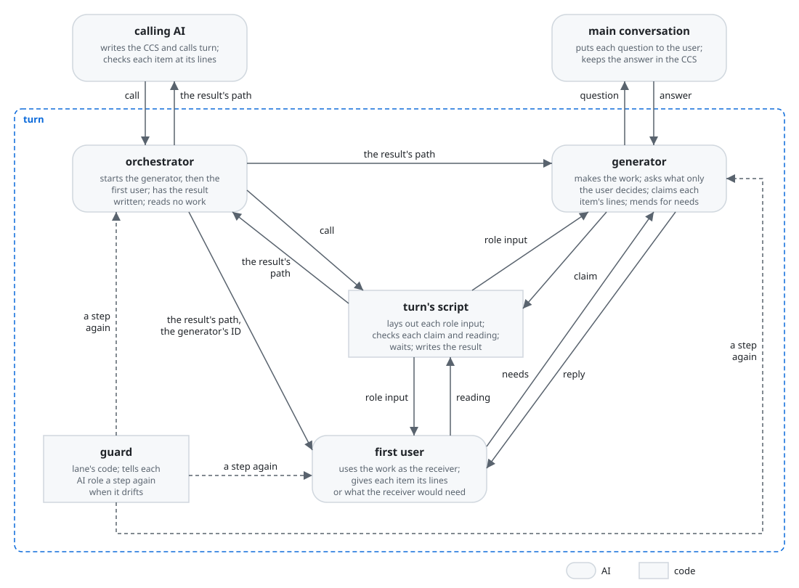
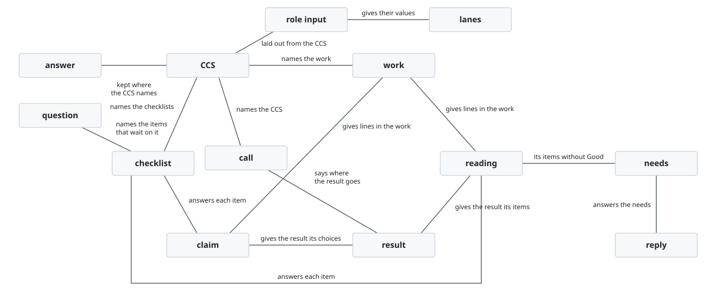
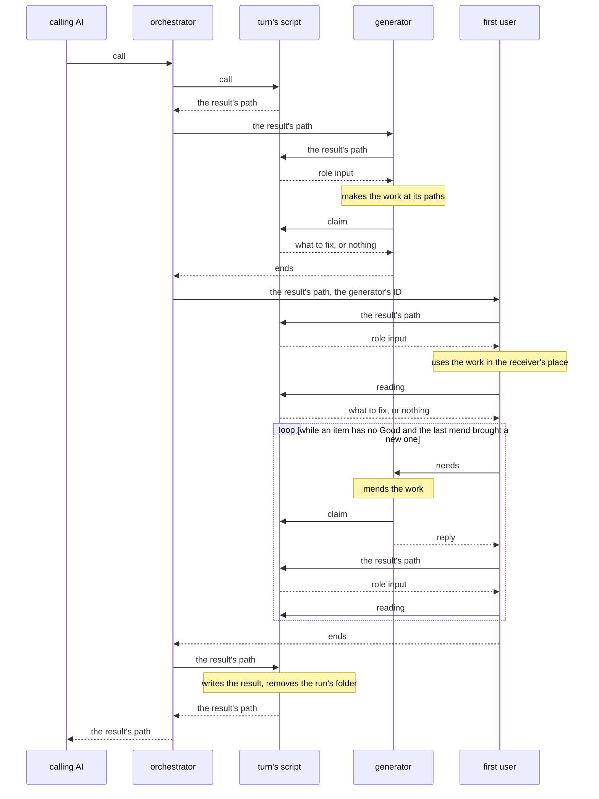
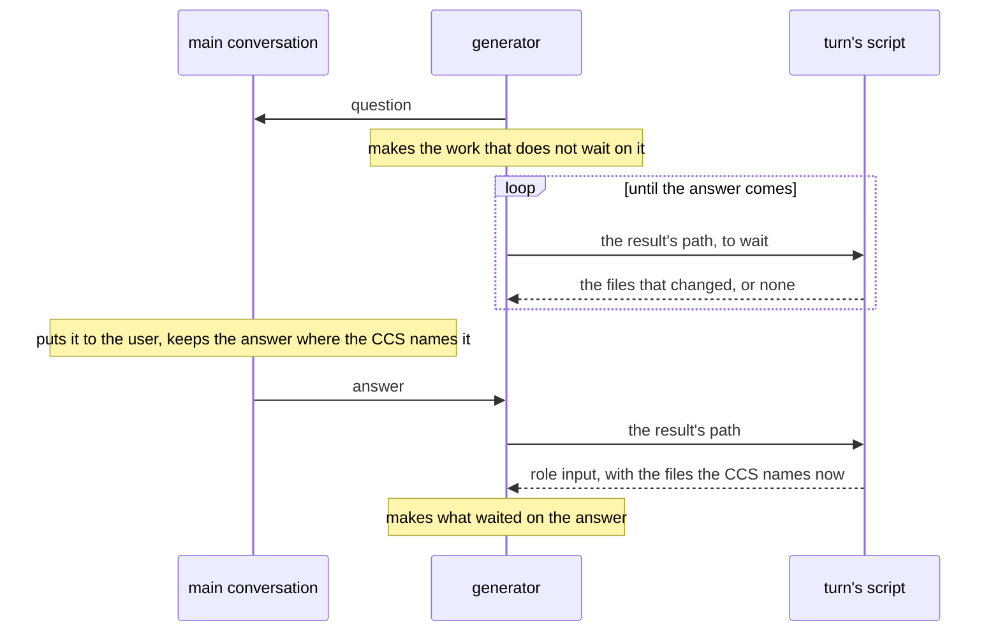
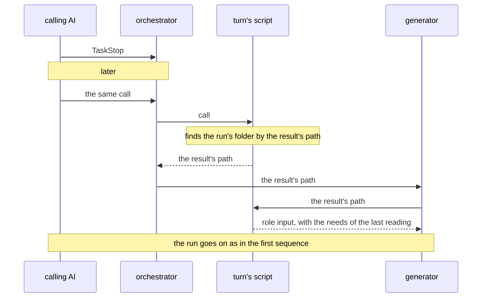
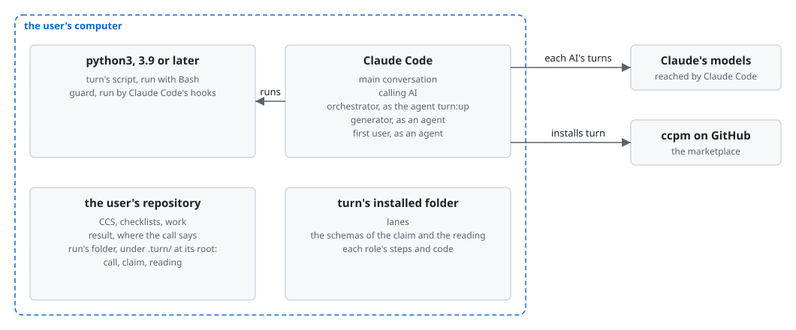

# turn architecture

turn is built on [how a plugin works](../architecture.md). Its orchestrator starts a generator,
which makes the work, and then a first user, which uses the work in the receiver's place and tells
the generator directly what would make each item Good; turn's script checks each claim and
reading and writes the result. The calling AI, the goal, the key results, and what a checklist, a
CCS, the receiver and a Good are, are in [turn's UX](ux.md).

turn holds the [principles every plugin holds](../architecture.md#principles), named below
Principle 1 to 9. It adds two of its own, named turn's Principle 1 and 2:

1. Every role that makes or reads the work looks only for each item's Good, and works only to give
   it.

   An AI that looks for what more the work needs finds more without end. Each find is patched in,
   and the work drifts from what it should be.
2. Each item is judged by what the receiver gets with what they have, not by whether the work
   matches its sources.

   What the receiver gets is the work's purpose. Matching the sources is only a means to it.
   Checked on its own, it pulls the work toward the sources' words instead of toward the receiver.

## User stories

- As the calling AI, I want to start `turn:up` with my call, and get back the work where it goes
  and the result: the lines of each item's Good, each item left with what the receiver would need,
  and each choice the work rests on.
- As the main conversation, I want to be sent each point only the user can decide as soon as the
  generator meets it, and to send back the answer.
- As the calling AI, I want to stop a run with TaskStop when the user asks, and to go on with it
  later by calling turn again with the same call.

## Architecture

### Logical view

#### Components



- The calling AI is the main conversation, or an agent that the main conversation started.
- The guard is lane's code, which lane lays in turn. It holds each of turn's AI roles to the lanes
  laid on its steps, and tells the role a step again when it drifts.
- The call gives the CCS's path, where the result goes, and `test`, the one command that checks the
  work. `test` is `null` where the work has none. The call also names the kinds the CCS uses for
  the work, the checklists, the receiver, what the receiver uses the work for, what they have
  with it, and the items asked of each part of the work, of which there may be none. turn defines
  nothing else of the CCS.

  The values stay in the CCS alone, so the call and the CCS cannot disagree. Without what the
  receiver uses the work for and has with it, no reader can stand in their place. `test` is
  required, and `null` means none, as a required field that may be null says "explicitly none" in
  structured outputs and OpenAPI 3.1. So a test left out by a slip is not taken for none. The kind
  of the items asked of each part is required for the same reason, though the CCS may hold none.
- The CCS names the work by files or folders. The generator writes only within them, and chooses
  each file inside a folder, its name and what it holds, as the project's practice says.

  Where the work goes is the caller's to settle, from its project or with the user. Which files
  make it up is a means, the generator's to choose as how the work gives each Good is
  (Principle 2). A lane holds the generator within them, as lane's write_only takes a folder as
  well as a file.
- turn keeps no state and has no course in a script. The orchestrator makes the same few moves on
  every run: it starts the generator, then the first user, then has the result written.

  The generator and the first user settle the work between them, so nothing between those moves
  needs a script to decide it, as
  [Where the course is kept](../architecture.md#where-the-course-is-kept) says.
- The orchestrator reads no work.

  The orchestrator would read the work with the call and the sources in mind. It would find the
  Good the work meant, not the one the receiver gets, and pull the mend toward its own view.
- Every question is the generator's, and the generator sends it to the main conversation.

  Only the main conversation can ask the user
  ([Where the orchestrator runs](../architecture.md#where-the-orchestrator-runs)). A subagent
  cannot know its own agent ID, so a question sent to a calling agent could not be answered back.
- turn's script checks the generator's claim and the first user's reading before the role ends,
  and a lane holds the role to that check: its form, each range of lines inside the work and, for
  an item asked of each part, one range in every part.

  What a machine can check is checked by a script (Principle 6). Checked before the role ends, a
  slip is mended by the role that made it, and the result is written only from a claim and a
  reading that hold.
- turn's script writes the result. It takes each item's lines and each need from the first user's
  last reading, and the choices from the generator's last claim that the finished work still rests
  on.

  A claim or a reading would otherwise have to be copied into a file by the calling AI, where a
  slip goes unseen.
- What fell short in a run is the calling AI's to find, as
  [Learning from each run](../architecture.md#learning-from-each-run) leaves it to the caller.

  A turn run is one move of the calling AI's run. What fell short in it shows beside the rest of
  what that run kept.

#### Data model



- The role input is what turn's script prints to a role when the role first runs it, naming each
  file the role works on and the command that checks its claim or reading.
- The claim is the generator's last judgment of its work, item by item, with the choices it made.
  The reading is the first user's last judgment of the work, item by item.
- The needs are what the first user sends the generator, and the reply is the generator's answer
  to them: the work mended, or a question back.
- The lanes are the lanes laid on the steps of turn's AI roles, which the guard reads.

#### Sequences

Starting `turn:up` and getting the work back:



Sending the main conversation a point only the user can decide:



Stopping a run and going on with it:



- The orchestrator starts each role in the foreground, and the Agent call returns when the role
  ends. It starts the first user with the agent ID the generator's start gave back.

  The first user can reach the generator only by its ID, because Claude Code gives a subagent no
  name to be reached by. Started in the foreground, a role's end is known without reading any
  record.
- The generator first finds what the CCS leaves open that only the user can decide. It asks each
  such point at once, and makes the rest of the work while it waits. Every other point the work
  rests on, it settles itself and names with why.

  A Good that rests on the user's decision cannot be made before the answer comes. Asked first, the
  point costs no making. A point that the purpose and the project's practice settle is the
  generator's to decide, as how the work gives each Good is (Principle 2).
- A role waits for a message without ending its turn. It runs turn's script in the foreground,
  which watches the files the message follows until one changes or a bound passes, and runs it
  again until the message comes. The generator watches the files of its role input, and the first
  user the work.

  A message reaches a subagent at its next tool call, so a role that waits in a tool call receives
  it without ending. The main conversation keeps the answer where the CCS names it before sending
  it, and the generator mends the work before it replies. So the wait ends near the time the
  message is sent. Claude Code refuses a bare `sleep` in the shell, and a wait in the background
  would end the role's turn.
- The main conversation keeps the answer where the CCS names it, adding to the CCS any file the
  answer brings, and sends the answer to the generator. The generator then runs turn's script
  again, which gives it the files the CCS names now.

  The guard reads a role's files from what turn's script prints, the latest print over the
  earlier, so a file the answer adds is held from then on. A run started again for an answer would
  make again what it had already made.
- Once the work is made, the generator checks every item and gives each by the lines of the work
  that give its Good. On a mend it gives only the items it was sent.

  Finding the lines makes the generator look at the place, and lines can be checked by a script.
- The first user reads the work on its own first, then writes its reading. For each item it gives
  the lines that give its Good, or one sentence of what the receiver would need to get it.

  A reader shown the maker's claim before its own reading finds the Good it was told to find
  (Principle 5). So the first user is never given the generator's claim.
- The first user sends the generator what the receiver would need for each item it found no Good
  for. The generator mends the work for the receiver's use, or asks back, and replies. The first
  user reads the mended work again and writes its reading again.

  The generator holds the sources and the Good it meant at each line, so how the work gives each
  Good is its to decide. Told what the receiver would need, not how to make it, it mends the work
  for the receiver and not toward the reader (Principle 5).
- The first user ends when every item has its Good, or when a mend brings no new Good. Its steps
  bound how many times it sends.

  A mend that brings no new Good shows the two cannot settle the item. The calling AI holds the
  step and makes such an item sooner than another exchange would.
- Each item the CCS asks of each part is answered in every part, by every role on every run. Every
  other item is answered at the lines that give it, wherever they are.

  A Good found where one part gives it passes a part that does not. Which items are asked of each
  part is the caller's to tell, as a checklist holds its questions alone and the caller knows how it
  uses each.
- A call again with the same call goes on from what the run's folder holds: the work at its paths,
  the first user's last reading, and the generator's last claim. The generator is started on the
  items the last reading left without Good.

  A conversation can end at any point, and what lived only in it is lost. The files hold all that
  the next call needs.

### Physical view

#### Deployment



- The calling AI starts `turn:up` in the background with the call as JSON, from the main
  conversation or from an agent it started. turn's agents take the two layers below it, within the
  three that [a plugin that uses another](../architecture.md#a-plugin-that-uses-another) allows.

  The calling AI can still take the user's word while it waits. The user sees the run's agents in
  Claude Code's panel of agents.
- The roles reach each other and the main conversation with SendMessage, loaded with ToolSearch.
- The run's folder is `.turn/<yyyymmdd>-<name>/` at the root of the repository that holds the
  result, as [Where a plugin writes its files](../architecture.md#where-a-plugin-writes-its-files)
  places the files the roles read with their tools. `<name>` is the result's path from the root,
  written so that two paths never give one name. The root is the nearest folder above the result
  that holds `.git`, or the result's own folder where none does. `<yyyymmdd>` is the day the run
  began, and a later call finds the folder by the name on any day.

  A call again with the same result finds the run, however long after and from whichever folder of
  the repository it is made. Two runs with different results do not meet.
- turn's script gives no role the run's own files, and gives the first user no CCS. It gives a
  folder that holds them as the folder's other entries.

  A lane lets a role read anything under a folder it is given.
- Each role makes what it uses the work with, such as an input to a command the work gives, in a
  folder of its own out of the repository, which turn's script makes and names by its whole path in
  the role input. It is the same folder at each print of a run, and apart from any other run's.

  A lane tells which file a command reads or writes only from a path written out, so a folder held
  in a shell variable, as one from `mktemp -d` is, leaves every command in it unchecked. Out of the
  repository, a command's write is not taken for a write of the work. A role's lanes take the
  folder of its last print, so a new folder at each print would cut the role off from what it made.

#### Directory structure

```text
plugins/turn/                the plugin, installed by Claude Code
├── agents/
│   ├── up.md                the orchestrator's entry, turn:up <agent>
│   ├── generator.md         the generator's entry <agent>
│   └── first-user.md        the first user's entry <agent>
├── prompts/
│   ├── orchestrator.md      the orchestrator's steps <Markdown>
│   ├── generator.md         the generator's steps <Markdown>
│   └── first-user.md        the first user's steps <Markdown>
├── docs/
│   └── calling.md           the call and the result, for the calling AI's maker <Markdown>
├── forms/
│   ├── claim.json           the claim's schema <JSON Schema>
│   └── reading.json         the reading's schema <JSON Schema>
├── scripts/                 turn's script <Python 3>
│   ├── turn.py              what the orchestrator and the roles run
│   ├── call.py              the call checked, and the run laid out of the CCS
│   ├── folder.py            the run's folder, and each role's folder to try the work in
│   ├── prompts.py           each role input
│   ├── forms.py             each claim and reading checked
│   ├── result.py            the result written from the claim and the reading
│   ├── parts.py             the files and the parts of the work
│   ├── wait.py              a role's wait for a message, on the files it follows
│   ├── items.py             a checklist's items, which are its headings
│   └── template.py          a link to lane's, Markdown read
└── hooks/
    ├── hooks.json           the hook of each agent and event, written by lane's lay.py <JSON>
    ├── lanes.json           the lanes, laid by lane's lay.py <JSON>
    ├── adapters/            items-checklist.py, which hands lane's items port to items.py,
    │                        with its cases, laid by lane's lay.py <Python 3>
    └── lane/                the guard, a link to lane's code <Python 3>

<where the call puts the result>
└── <result>                 the result <JSON>

<the root of the repository that holds the result>/
└── .turn/
    └── <yyyymmdd>-<name>/   the run's folder, removed once the result is written
        ├── call.json        the call <JSON>
        ├── generator.json   the claim <JSON>
        └── first-user.json  the reading <JSON>

<the system's temporary folder>/
└── turn/
    └── <run>-<key>/<role>/   what a role makes to use the work with
```

## Test

turn is tested as [Test](../architecture.md#test) says, and by nothing beyond it.

- turn's script is checked by those rules alone: its unit tests run every line and branch, the
  mutation testing set in `cosmic-ray.toml` leaves no mutant, and the property tests in
  `tests/properties.py` pass on new inputs each time.

  A fault in it reaches the calling AI unseen. A reading passed at lines the work does not hold
  gives a Good there, and a run's folder found wrong goes on from another run's claim and reading.
- The orchestrator, the generator and the first user are each tried on their own, and the whole of
  turn by trials of its user stories, as those rules say.

  A fault in a role shows only in what the role does, so only a run of it shows the fault.
