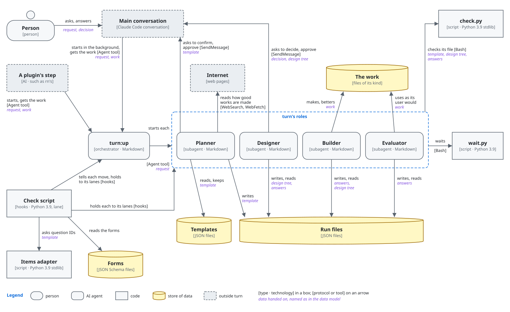
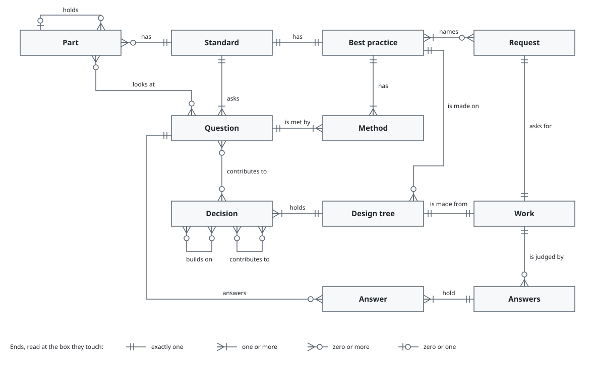
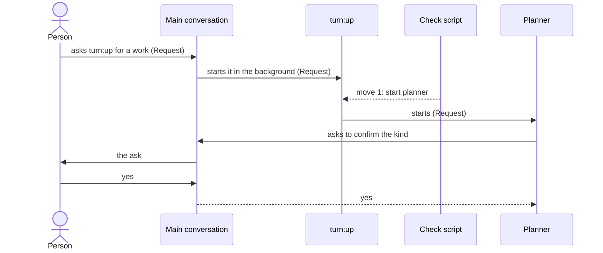
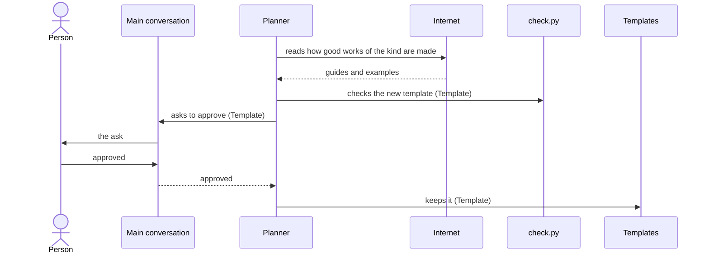
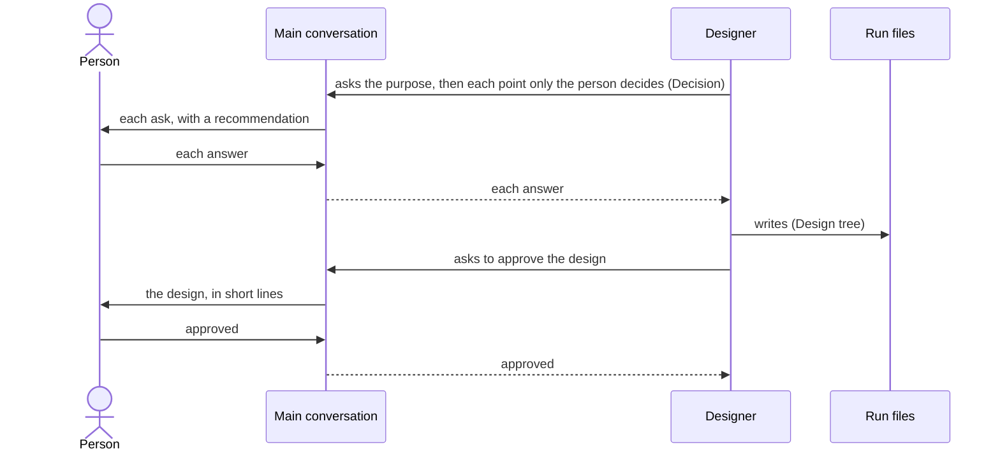
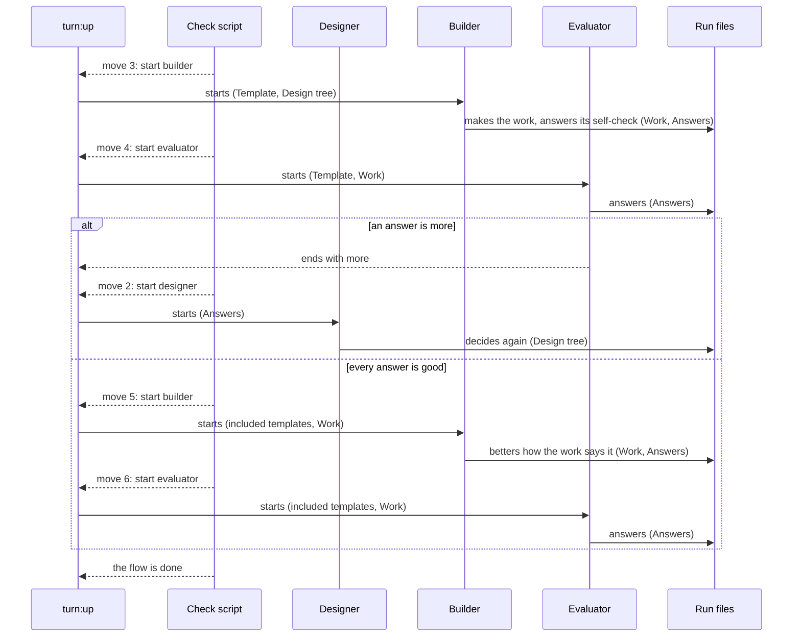
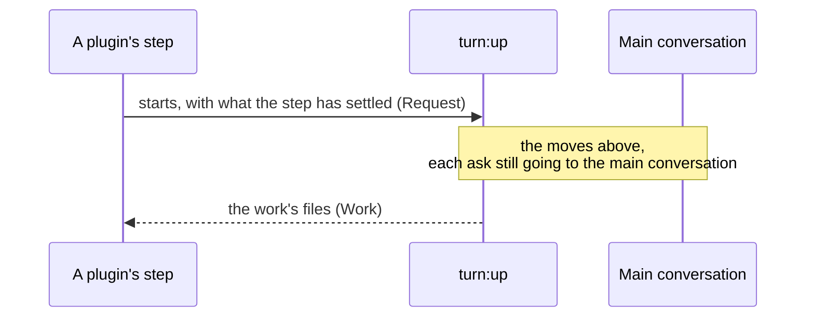
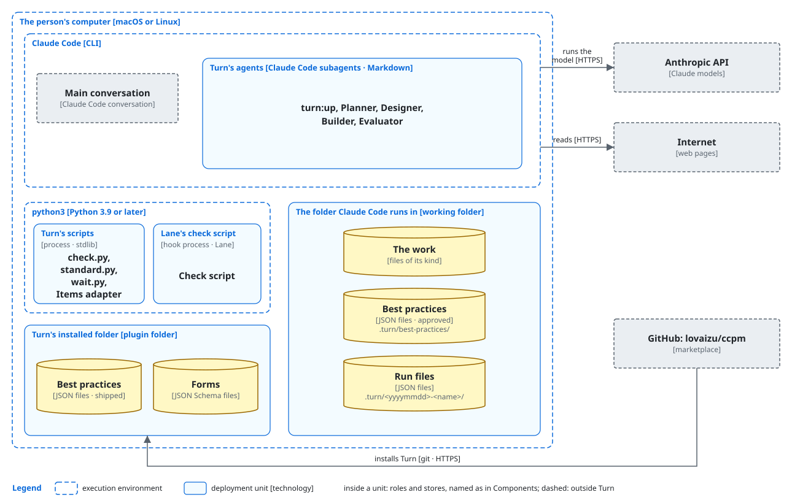

# Turn architecture

Turn makes a work from its kind's template and the person's answers. A template holds a kind's
format, the shape of the work, and its questions, each asking what the work's user gets. Four roles
make the work: planner gives the template, designer decides the design, builder makes the work, and
evaluator, which never sees the design, uses the work as its user would and answers each question
good or more. [Lane](../../plugins/lane/README.md) holds the order of the roles and the limits of
each. The experience this delivers is in [Turn's UX](ux.md).

## Principles

Turn follows [how a plugin works](../architecture.md#principles), except where a choice under
Components says why not. A **good** answer names the lines of the work that meet a question's aim; a
**more** says what the work's user gets once it is good, never how to make it.

### One way for every kind

Turn's roles hold no rule of any one kind; a kind's template holds all that the kind needs.

A new kind then needs only a template, and a rule for one kind would bend the work of every other.

### Nothing is needed beforehand

Planner asks the kind, and designer asks the work's purpose; Turn takes what a caller already
settled as decided.

Anyone can then ask for a work in a sentence, and no one is asked twice.

### The evaluator uses the work as its user would

The evaluator answers each question by what the work's user gets from using it. A template, as a
work, is used on its questions' examples.

A judge of words alone passes a headline that names the product while a reporter still cannot tell
what is new.

### The evaluator never sees the design

The evaluator gets the work and the templates, never the design tree.

The work's user never sees the design; an evaluator that has it judges whether the work follows it.

### One asker for each thing the person decides

Planner alone asks about the kind and its template; designer alone asks about the purpose and the
design, and alone changes the design.

The work is then made from one design, and the person is asked each point once.

### Decided from the purpose down

Designer decides in the order the decisions build on one another, the purpose first, and keeps them
in a design tree: the purpose at the root, the template's questions under it, the decisions under
each question.

A decision that serves no question is made and kept for nothing, and one made before what it builds
on must be made again.

### What the work says before how it says it

The content phase answers the kind's own questions from the design tree; the refactoring phase then
answers the questions of the templates the kind's template includes, such as `refactor-doc`, with
no design tree, changing only how the work says things. A point that would change what it says goes
back to designer.

Wording polished before the content settles is polished again each time the content changes.

### A more is mended at its decision

Designer traces each more of the kind's own questions to the decisions that serve the question, and
decides them again; no role adds onto the work to answer a more. A more that comes back after its
decision was made again goes to the person: decide it another way, or change the purpose.

A fault fixed where it shows is a patch, and patches pile up until the work no longer reads as one
design.

### Each role works from the run's files

Each role starts fresh at each move, and takes what earlier roles made from the run's files.

No role needs another's conversation, the evaluator reads each round as for the first time, and a
stopped run goes on from its files.

### `turn:up` tells the phase

`turn:up`, the orchestrator, tells the phase from the role that last ended and its answer: the
refactoring phase begins when the content phase's evaluator finds every question good, and the
content phase comes back whenever the move goes to designer.

The files cannot tell it: a point returned in the refactoring phase that designer keeps leaves the
files as they were, while the work must pass the content phase again.

### Lane holds the order and the limits

Turn declares its flow and each role's limits in a proposal to Lane, and its own scripts check only
what no lane holds.

A script of Turn's own for the order would read the roles' calls apart from Lane and drift from it.

### Turn knows others only by what they document

Turn uses Lane only as Lane's documents say, and a caller only as
[Calling Turn](../../plugins/turn/docs/calling.md) says.

Lane and each caller then change their code freely behind what they document.

## User stories

- As the person who wants a work, I want to ask `turn:up` for it and confirm its kind. Carries O1's
  request and "Is this a release for the press?".
- As that person, I want to approve who reads a new kind and for what, its format and its checklist,
  and have them kept. Carries O1's research and "Purpose … Approve?".
- As that person, I want to answer the purpose and each point only I decide, with a recommendation,
  and approve the design. Carries O1 from "What is the release for?" to the approved key points.
- As that person, I want the work only once an AI using it as its user would finds every question
  good. Carries O1's "Writes the release, and checks it" and "The press release".
- As a plugin's step, such as Rn's, I want to start `turn:up` with what my step has settled, and get
  the work back. Carries O1 when the person reaches Turn through such a plugin.

## Logical view

### Components



- `turn:up` alone holds a run: it names the run's folder from the request, takes each move Lane
  tells it, starts each role with the run's paths, tells the phase, and ends naming the work's files
  once Lane tells it the flow is done.
- Planner alone gives the kind's template: one kept in `.turn/templates/`, else one Turn ships, else
  one drawn from research and approved by the person before it is kept.
- Designer alone decides each point of the design, and alone brings to the person a more the
  decisions cannot make good.
- Builder alone decides the small points of making, and how the work says things in the refactoring
  phase. It returns a point the design leaves open, or one that would change what the work says, by
  ending with `open`.
- Evaluator alone decides each answer, from its own first reading, and ends with `more` while one is
  more.
- `check.py` alone checks what no lane holds: a template against its form, a design tree's joins
  and order, and that each line an answer names is in the work.
- The items adapter alone gives Lane the question IDs of a template, each named with its template,
  such as `readme/Q3`.
- A role asks the person by SendMessage to the main conversation, which puts the ask to the person
  and sends the answer back to that role; `wait.py` holds the role until the answer comes, as a
  role that ended would move the flow on.

Choices a reader would question:

- `turn:up` is a subagent, not a skill, as Lane lays a flow only on a subagent; one entry then
  serves the person and a plugin's step alike.
- The main conversation starts `turn:up` in the background, so it stays free to relay each ask. Only
  the main conversation can ask the person.
- The builder and the evaluator serve both phases: each role is split by what it alone decides.
- The evaluator's more in the refactoring phase goes back to the builder: it changes no decision.

### Data model



### Sequences

Asking for a work and confirming its kind:



Approving a new kind's template:



Deciding the design:



Making the work, in both phases:



Starting `turn:up` from a plugin's step:



## Physical view

### Deployment



- The person installs Turn as [the README](../../plugins/turn/README.md#installation) says and asks
  the main conversation to have `turn:up` make a work. A plugin's step starts `turn:up` as
  [Calling Turn](../../plugins/turn/docs/calling.md) says.
- A run's files lie in `.turn/<yyyymmdd>-<name>/`, and kept templates in `.turn/templates/`, in the
  folder Claude Code runs in, not at a repository's root as
  [Where a plugin writes its files](../architecture.md#where-a-plugin-writes-its-files) says: Turn
  needs no repository, and agents read and write there without asking. An update replaces Turn's
  installed folder, so templates are not kept there.
- Asked again for a work whose run stopped, `turn:up` finds the run's folder by its name, and each
  role takes up what the run's files hold.
- Lane's check script lies in Turn's own folder, so the person needs no Lane installed.

### Directory structure

```text
plugins/turn/
├── .claude-plugin/plugin.json      the manifest <JSON>
├── agents/up.md, agents/<role>.md  turn:up and each role <subagent · Markdown>
├── prompts/<name>.md               the steps of turn:up and each role <Markdown>
├── scripts/check.py, <check>.py    check.py <script · Python 3.9 stdlib>
├── scripts/wait.py                 wait.py <script · Python 3.9 stdlib>
├── forms/<file>.json               Forms <JSON Schema>
├── templates/<kind>.json           the Templates turn ships <JSON>
├── hooks/                          hooks.json, lanes.json, lane's check script and the Items adapter, laid by lane
├── docs/calling.md, README.md, CHANGELOG.md, *.svg

dev/turn/
├── ux.md, architecture.md, *.svg, README.md
├── tests/                          unit and property tests of turn's scripts <Python 3>
└── trials/                         trials of each role, of the roles together, and of the whole

<the folder Claude Code runs in>/.turn/
├── templates/<kind>.json           Templates the person approved <JSON>
└── <yyyymmdd>-<name>/              one run's files: design tree, self-checks, verifications <JSON>
```

## Test

Turn is tested by [Test](../architecture.md#test); what follows is what Turn adds. A trial is a run
of a role, or of the whole, judged from its records.

| Deployment unit | Unit | Integration | End-to-end |
|---|---|---|---|
| Turn's agents [subagents · Markdown] | a trial of one role, the rest mocked · ●●● · it keeps to its steps | a trial of the four roles under Lane's flow, the person mocked · ●●○ · the hand-offs and each way back | ▨[^1] |
| Turn's scripts [Python 3.9 stdlib] | unittest, Cosmic Ray, Hypothesis · ●●● · each check, `wait.py`, the items adapter | unittest with Lane's check script laid · ●○○ · the lanes run the checks, the flow tells each move | ▨[^1] |
| Turn's templates [JSON] | `check.py` · ●●○ · each in its form, each part looked at | ▨[^2] | ▨[^1] |
| Turn in Claude Code | ▨[^2] | ▨[^2] | a trial of each user story, the assistant as the person · ●●○ · the work, and what the person was asked |

[^1]: End-to-end tests run on the whole, in the last row.
[^2]: Nothing joins it to a neighbour, or its units are tested in their own rows.

- Trials run on Opus with Lane's check script laid, and pass in three runs of three, as what an AI does
  varies from run to run. A role's trial passes when the role keeps its steps and its file passes
  `check.py`; the roles' trial when the run ends with every question good and each more mended at
  its decision; a story's trial when the person is asked only what the README's Walkthrough asks.
- Scripts are tested as the shared rules set for code.
- The agents and scripts weigh ●●●: a stray role or a lax check gives the person a work that misses
  its purpose, or asks them what they need not decide.
