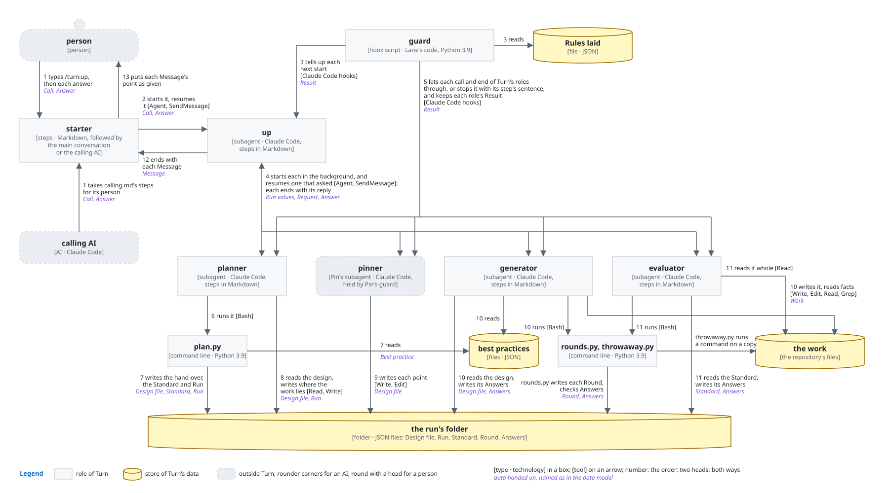
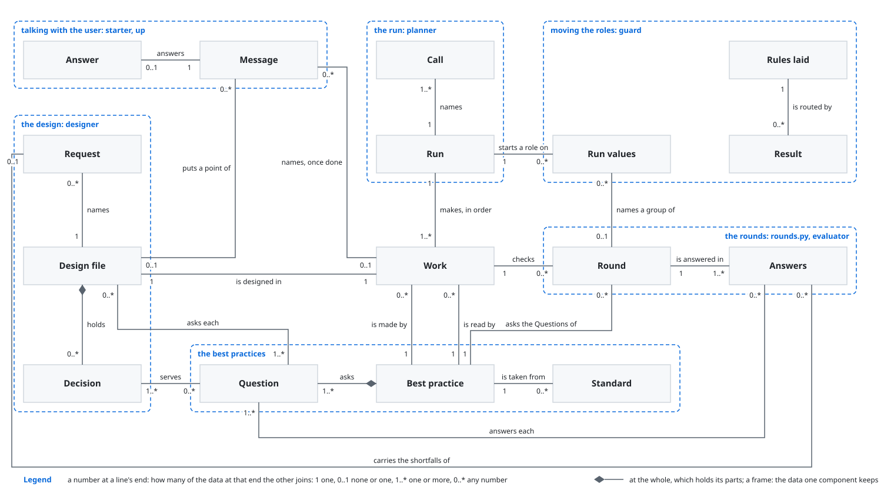
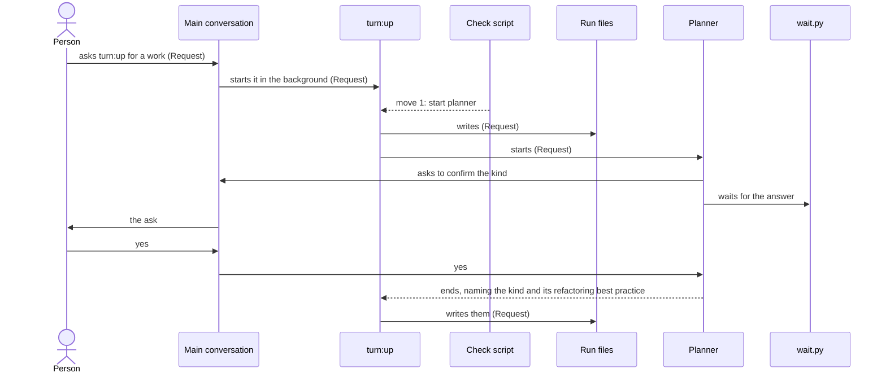
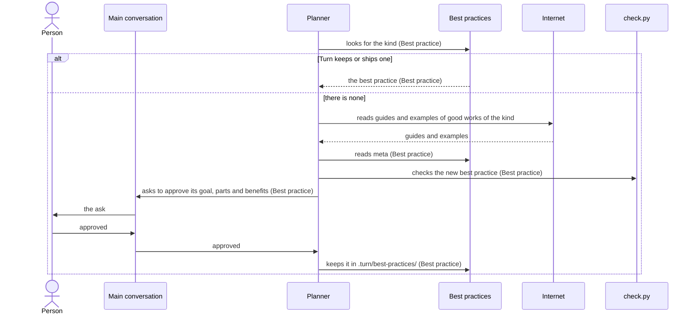
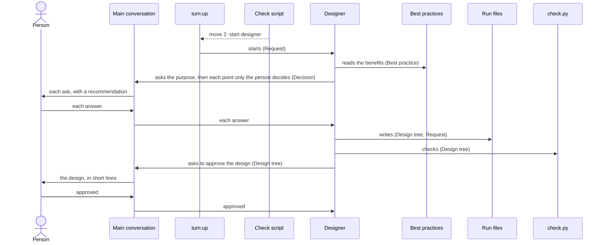
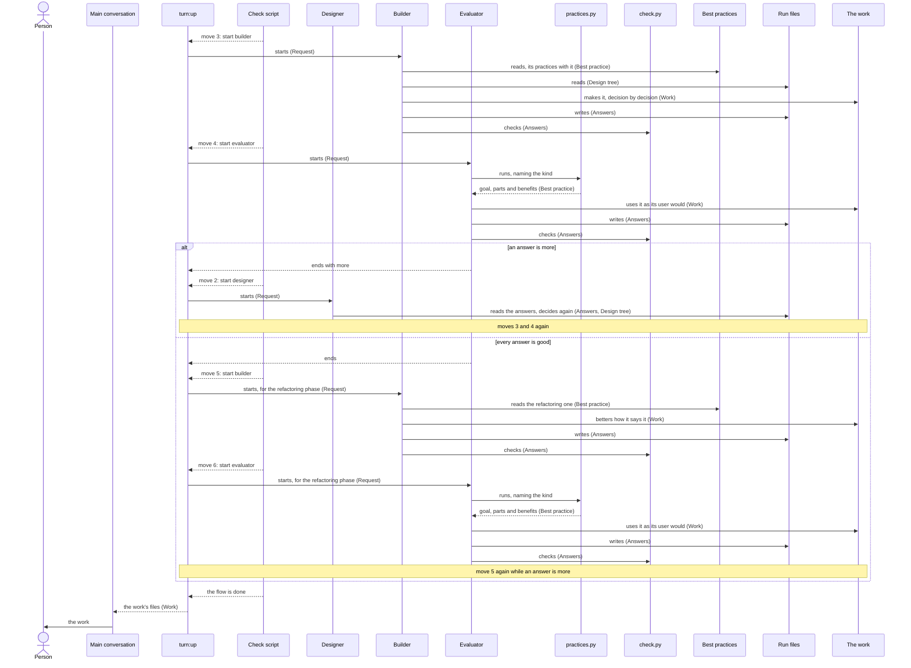
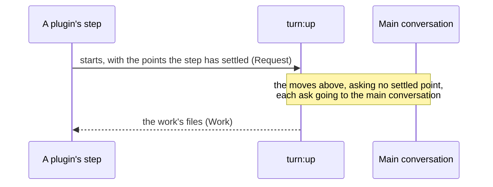
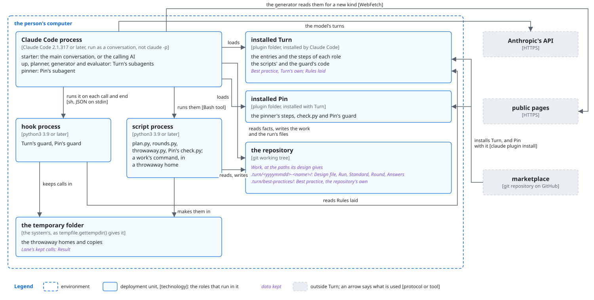

# Turn architecture

Turn delivers [its UX](ux.md) through four roles that take a work in turn. The planner gives the
best practice of the work's kind: its goal, parts and benefits, what a good work of the kind is,
and its practices, how to make one. The designer decides the work's design from it, the builder
makes the work from the design, and the evaluator, given only the goal, parts and benefits, uses
the work as its user would.
[Lane](../../plugins/lane/README.md)'s flow moves the work through the roles in two phases: first
what the work says, then how it says it.

## Principles

Turn follows [how a plugin works](../architecture.md#principles). This document uses the words of
that one, such as work, role and orchestrator; Turn's README calls the work the deliverable. Where
Turn departs from how a plugin works, a choice under Components or Deployment says why.

A best practice holds four things side by side. Its goal is the one thing the work's user
achieves. Its parts are what the work holds, in the order its user meets it. Its benefits are
questions, each asking what a part, a tie between parts or the whole brings the user. Its practices
give, for each benefit, a way of thinking that meets it, with steps where needed and their sources.

Each question gets one of two answers. A **good** gives the lines of the work that meet the
question, as the Good lines of how a plugin works do. A **more** says what the work's user gets once
the answer is good, never how to make it, as a need does there.

### One way for every kind

Turn's roles and scripts hold no rule of any one kind: a kind's best practice holds all that the
kind needs.

A new kind then needs only a best practice. A rule for one kind would bend the work of every other.

### Nothing is needed beforehand

The planner asks the work's kind, and the designer asks the work's purpose. A point that a caller
has already settled is taken as decided.

Anyone can then ask for a work in a sentence, and no one is asked a point twice.

### Decided from the purpose down

The designer keeps the decisions in a design tree: the work's purpose at the root, the questions
of the kind's benefits under it, and under each question the decisions that make its answer good.
It decides in the order the decisions build on one another, the purpose first.

A decision that serves no question is made for nothing, and one made before what it builds on is
made again. The person is asked only what no fact settles.

### One asker for each point the person decides

The planner alone asks the person about the kind and its best practice. The designer alone asks
about the purpose and the design, and alone changes the design. Each asks one point at a time, with
the answer it recommends.

The work is then made from one design, and the person is asked each point once.

### The evaluator has only what the work's user has

The evaluator gets the work and the goal, parts and benefits alone, never the practices or the
design tree. It answers each question by using the work as its user would.

The work's user never sees the design. An evaluator that has the design judges whether the work
follows it, not what its user gets.

### A more is mended at its decision

Every change to what the work says, a more or a point the person raises, enters by the design
tree. The designer traces it to the decisions that serve its question and decides them again.
The builder then makes the work again from those decisions and from the decisions built on them.
No role adds onto the work to answer a more.

A fault fixed where it shows is a patch, and patches pile up until the work no longer reads as one
design.

### What the work says before how it says it

The content phase makes the work answer its kind's own questions, from the design tree. The
refactoring phase then makes it answer the questions of `refactor-doc` for a document, or of
`refactor-code` for code, with no design tree, and changes only how the work says things. A point
that would change what the work says goes back to the designer and the content phase.

Wording bettered before the content settles is bettered again each time the content changes.
Kept apart, the phases keep the builder and the evaluator on the content while it is made.

### Each role starts fresh, from files

Each role starts fresh at each move, and takes what the roles before it made from files alone: the
run's files and the best practices.

No role then needs another's conversation. The evaluator reads each round as for the first time,
and a stopped run goes on from its files.

### Lane holds the order and the limits

Turn declares its flow and each role's limits as lanes, in a proposal to Lane. Turn's own scripts
check only what no lane holds.

A script of Turn's own that held the same would read the roles' calls apart from Lane, and drift
from it, as [Checks kept in Lane](../architecture.md#checks-kept-in-lane) says.

### Turn knows others only by what they document

Turn uses Lane only as Lane's documents say, and a caller only as
[Calling Turn](../../plugins/turn/docs/calling.md) says.

Lane and each caller can then change their code freely behind what they document.

## User stories

- As the person who wants a work, I want to ask `turn:up` for it and confirm its kind. Carries
  O1's request and "This is a press release, a document. Right?".
- As that person, I want to approve the goal, parts and benefits of a kind that Turn has no best
  practice for, and have the best practice kept for my next work of that kind. Carries O1's "I have
  no best practice for press releases yet. … Approve?".
- As that person, I want to answer what the work is for and each point that only I decide, each
  with a recommendation, and approve the design. Carries O1 from "What is this release for?" to the
  design approved.
- As that person, I want the work only once an AI that did not make it, using it as its user would,
  finds every question good. Carries O1's "The press release, which meets every benefit".
- As a plugin's step, such as Rn's, I want to start `turn:up` with the points that my step has
  settled, and get the work back. Carries O1's steps when the person reaches Turn through such a
  plugin, without the points that the plugin settled.

## Logical view

### Components



- `turn:up` alone holds a run. It names the run's folder from the request and writes the request
  there. It takes each move Lane tells it, starts each role with the request and the phase, and
  ends naming the work's files once Lane tells it that the flow is done. Each role finds its
  phase's best practice by the name the request gives it.
- `turn:up` alone tells the phase, from the role that last ended and its answer. The refactoring
  phase begins when the evaluator of the content phase ends with every question good. The content
  phase comes back whenever the move goes to the designer.
- The planner alone settles the kind and its best practice: one kept in `.turn/best-practices/`,
  else one that Turn ships, else one it makes and the person approves. It makes one from guides and
  examples it reads, by `meta`, the best practice of making best practices. With the kind, it
  settles whether the work is a document or code, and so which refactoring best practice the work
  takes. It ends naming both, and `turn:up` writes them into the request.
- The designer alone decides each point of the design, the place of the work's files among them,
  and writes that place into the request. It alone takes back what the builder or the evaluator
  returns. Where a decision cannot make its questions good, it decides it again, and asks the
  person where the point is theirs.
- The builder alone decides the small points of making, such as a phrase or a function's name, and,
  in the refactoring phase, how the work says things. It writes a point that the design leaves
  open, or one that would change what the work says, as a more in its self-check, and ends with
  `open`.
- The evaluator alone decides each answer, from its own first reading. It ends with `more` while an
  answer is more.
- Lane's check script alone tells `turn:up` each move of the flow, and holds each agent to its
  lanes. The flow has six positions: planner, designer, builder, evaluator, builder, evaluator.
  Three answers send the work back:
  - `open` from the builder at 3 or 5 sends it to the designer at 2;
  - `more` from the evaluator at 4 sends it to the designer at 2;
  - `more` from the evaluator at 6 sends it to the builder at 5.
- `check.py` alone checks what no lane holds. In a best practice, each part is looked at by a
  benefit, and each benefit has a practice. In a design tree, each question is served, each
  decision reaches the root, and the order of deciding follows what each decision builds on. In a
  self-check or a verification, each question is answered once, and each line it names is in the
  work.
- `practices.py` alone gives the evaluator a best practice's goal, parts and benefits, without its
  practices. A lane holds the evaluator to read nothing but the work, so the goal, parts and
  benefits are all it has of the best practice.
- The items adapter alone gives Lane the question IDs of a best practice, each named with its file,
  such as `readme/Q3`.
- A role that asks the person sends the ask to the main conversation. The main conversation puts it
  to the person in the language of their talk, and sends the answer back to that role, as
  [Languages](../architecture.md#languages) says for a plugin that an AI calls. `wait.py` holds the
  role until the answer comes, as a role that ended would move the flow on.

Choices a reader would question:

- `turn:up` is a subagent, not a skill, because Lane lays a flow only on a subagent. One entry then
  serves the person and a plugin's step alike. Here Turn departs from
  [Where the orchestrator runs](../architecture.md#where-the-orchestrator-runs), which runs the
  orchestrator of a plugin that a person calls in the main conversation.
- The main conversation starts `turn:up` in the background, so it stays free to put each ask to the
  person. A role's message reaches the main conversation only once the main conversation's current
  turn ends, as [Calling Turn](../../plugins/turn/docs/calling.md#asks) says, so a run in the
  foreground would wait on itself.
- The person approves the goal, parts and benefits of a new kind, and the design, by an answer
  that the main conversation passes on.
  [The caller approves what is theirs](../architecture.md#the-caller-approves-what-is-theirs)
  asks instead for an action of the person's own, such as a skill that the AI cannot call. A
  subagent reaches the person only through the main conversation. What the approval lets through
  is a file that the person can change or remove, and that Turn neither commits nor sends.
- The evaluator writes its answers into the run's files and ends, and the flow takes them to the
  designer. It does not tell the builder directly, as
  [Read by those who did not make it](../architecture.md#read-by-those-who-did-not-make-it) has a
  reader do. A reader in talk with the maker carries its earlier verdicts into the next reading,
  and a maker told the fault mends the work where the fault shows, not at its decision. No one
  relays: `turn:up` hands each role the request, and the files hold what passes.
- Turn's course lies in Lane's flow, not in a script of Turn's own, which
  [Where the course is kept](../architecture.md#where-the-course-is-kept) asks of a fixed loop.
  Lane's check script still holds the course in code, and is written and tested once for every
  plugin, as [Checks kept in Lane](../architecture.md#checks-kept-in-lane) has each check be.
- `turn:up` tells the phase from the roles' ends, not from the run's files or from the position
  Lane tells it. When the designer keeps every decision as it was, the files do not change, yet the
  work must pass the content phase again. A `turn:up` started again may not be told its position.
- The builder and the evaluator each serve both phases, as each role is cut by what it alone
  decides.
- The evaluator's more in the refactoring phase goes back to the builder, not the designer, as it
  changes no decision.
- Turn draws no lessons of its own. `turn:up` is always started by an AI, the main conversation or
  a plugin's step, and [Learning from each run](../architecture.md#learning-from-each-run) leaves
  the lessons of a plugin called by an AI to its caller. What fell short in a run stays in its
  files for that caller.

### Data model



- Each data is kept as JSON, in the form its file under `plugins/turn/forms/` gives. Lane holds
  each role's files to their forms.
- The request is `request.json`, the design tree `design-tree.json`, and a best practice
  `<kind>.json`. Answers are kept twice in one form: `self-check.json` from the builder, and
  `verification.json` from the evaluator. Each question in them is named with its best practice,
  such as `readme/Q3` or `refactor-doc/Q1`, so the answers of both phases lie side by side.
- A best practice for refactoring has no parts, as the work keeps its kind's shape.

### Sequences

Asking for a work and confirming its kind:



Approving the best practice of a new kind:



Deciding the design:



Making the work, in both phases:



Starting `turn:up` from a plugin's step:



## Physical view

### Deployment



- The person installs Turn as [the README](../../plugins/turn/README.md#installation) says, and
  asks the main conversation to have `turn:up` make a work. A plugin's step starts `turn:up` as
  [Calling Turn](../../plugins/turn/docs/calling.md) says.
- Asked again for a work whose run stopped, `turn:up` finds the run's folder by its name, and Lane
  starts the flow again from the planner. Each role takes up what the run's files hold, and the
  planner and the designer do not ask again what the request and the design tree hold.
- Lane's check script lies in Turn's own folder, so the person needs no Lane installed.

Choices a reader would question:

- Turn keeps its files in `.turn/` in the folder Claude Code runs in, not at the root of a
  repository, as
  [Where a plugin writes its files](../architecture.md#where-a-plugin-writes-its-files) says.
  Turn needs no repository, as a press release is made outside one, and agents read and write in
  that folder without asking.
- The best practices that the person approved lie in `.turn/best-practices/`, with no date, as each
  serves every later run of its kind. A run's files lie in `.turn/<yyyymmdd>-<name>/`. An update
  replaces Turn's installed folder, so the approved best practices are not kept there.

### Directory structure

```text
plugins/turn/
├── .claude-plugin/plugin.json   the manifest <JSON>
├── agents/up.md, <role>.md      the entries of turn:up and each role <subagent · Markdown>
├── prompts/up.md, <role>.md     the steps of turn:up and each role <Markdown>
├── scripts/check.py             check.py <script · Python 3.9 stdlib>
├── scripts/practices.py         practices.py <script · Python 3.9 stdlib>
├── scripts/wait.py              wait.py <script · Python 3.9 stdlib>
├── forms/<data>.json            Forms <JSON Schema files>
├── best-practices/<kind>.json   the Best practices Turn ships, meta among them <JSON files>
├── hooks/hooks.json, lanes.json  the hooks and lanes Lane lays <JSON>
├── hooks/lane/                  Check script, laid by Lane <hooks · Python 3.9, Lane>
├── hooks/adapters/items-*.py    Items adapter <script · Python 3.9 stdlib>
├── docs/calling.md              how a plugin's step calls Turn <Markdown>
└── README.md, CHANGELOG.md, images/

dev/turn/
├── ux.md, architecture.md, images/, README.md
├── cosmic-ray.toml              the mutation testing of Turn's scripts <TOML>
├── tests/                       unit and property tests of Turn's scripts <Python 3>
└── trials/                      trials of roles, alone and together, and of stories <Python 3>

<the folder Claude Code runs in>/.turn/
├── best-practices/<kind>.json   Best practices the person approved <JSON files>
└── <yyyymmdd>-<name>/           Run files: the request, design tree and answers <JSON files>
```

## Test

Turn is tested by [Test](../architecture.md#test). Below is only what Turn adds. A trial is a run of
a role, of the roles together or of a user story, judged from its records.

| Deployment unit | Unit | Integration | End-to-end |
|---|---|---|---|
| Turn's agents [Claude Code subagents · Markdown] | a trial of one role, the rest mocked · ●●● · it keeps to its steps | a trial of the four roles under Lane's flow, the person mocked · ●●○ · the hand-offs and each way back | a trial of each user story, the assistant as the person · ●●○ · the work, and what the person was asked |
| Turn's scripts [process · stdlib] | unittest, Cosmic Ray, Hypothesis · ●●● · each check of `check.py`, `practices.py`, `wait.py` and the items adapter | unittest with Lane's check script laid · ●○○ · the lanes run the checks, and the flow tells each move | ▨[^1] |
| Turn's installed folder [plugin folder] | `check.py` · ●●○ · each best practice Turn ships in its form, each part looked at, each benefit with a practice | ▨[^2] | ▨[^1] |

[^1]: The trials of each user story, in the first row, run the whole.
[^2]: Nothing joins the best practices to one another; the scripts that read them are tested in
    their own row.

Lane's check script is left out, as Lane's own tests cover it. The folder Claude Code runs in is
left out, as it holds only what runs make, and `check.py` checks those files in the trials.

- A trial runs on Opus with Lane's check script laid, and passes in three runs of three, as what an
  AI does varies from run to run.
- A role's trial passes when the role keeps its steps and each file it writes passes `check.py`.
- The roles' trial passes when the run ends with every question good, and each more was mended at
  a decision that serves its question.
- A story's trial passes when the person gets the work and is asked only what the UX's scenario
  asks.
- The agents and the scripts weigh ●●●. A stray role or a lax check gives the person a work they
  cannot put to use as delivered, or asks them a point they need not decide.
- The trials of the roles together and of each story weigh ●●○: each costs a whole run, and the
  trials of one role and the scripts' tests already hold most of what fails.
- The tests of the scripts with Lane laid weigh ●○○: Lane's own tests hold how a lane runs, and
  these check only that Turn's lanes are laid as Turn's proposal gives them.
