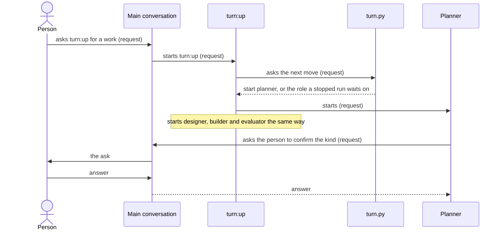
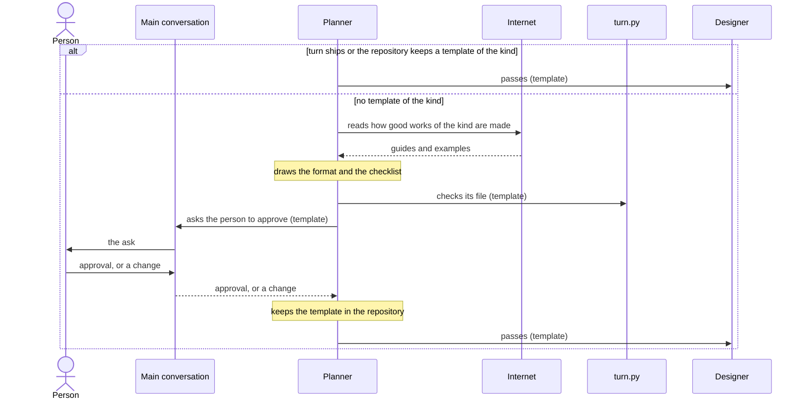
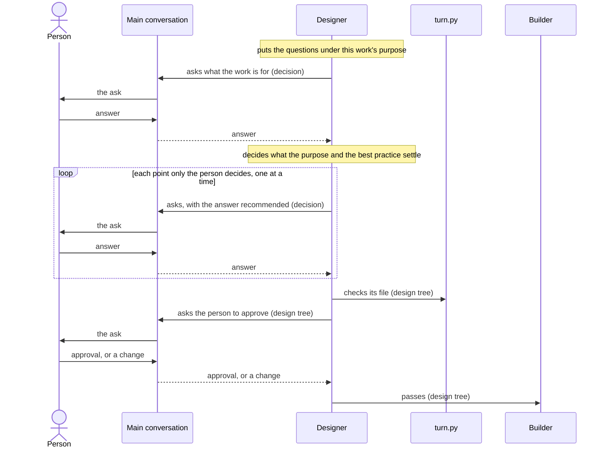
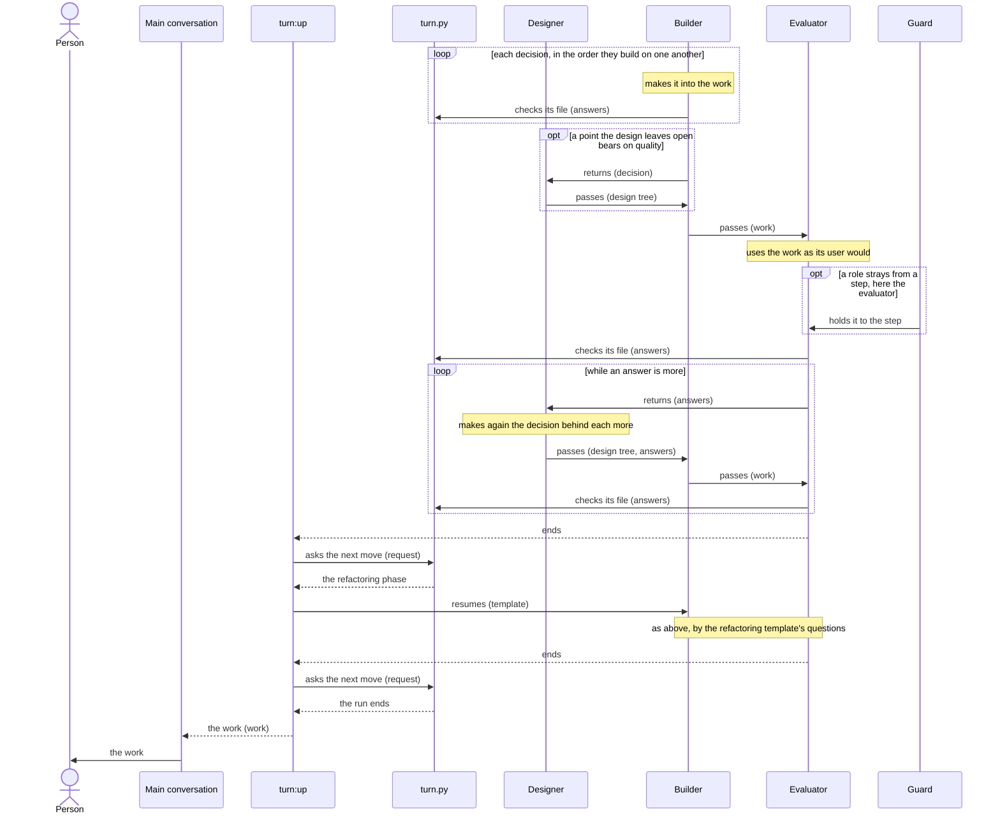
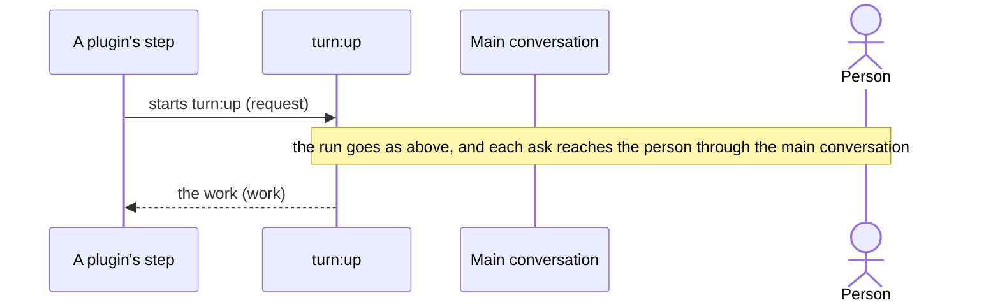

# turn architecture

turn makes a work of any kind, such as a press release or code, from that kind's template: the
kind's format, the shape of the work, and its checklist, the questions a work answers yes to when it
serves its user. Four AI roles take the work in order: planner gives the template, designer settles
with the person who wants the work what it is for and designs it, builder makes it, and evaluator
uses it as its user would and sends it back to designer until every question is good. The person
asks for the work in the main conversation, the Claude Code conversation they talk in, by naming
`turn:up`, the agent that starts the roles and ends the run. The
experience this delivers is in [ux.md](ux.md), and its promises are in
[turn's README](../../plugins/turn/README.md).

## Principles

turn holds every principle of [how a plugin works](../architecture.md#principles), with the
reasons under its [Why it is so](../architecture.md#why-it-is-so). In that document's words,
turn's builder is the maker and its evaluator the reader; a question of the checklist is an item.
An answer to a question is good when the work meets the question's aim, and it names the lines that
meet it. An answer is more when the work falls short, and it says what the work's user gets once it
is good, never how to make it. Good and more are what that document calls an item's Good and need.
The principles below are what turn adds.

### One way for every kind

turn's roles hold no rule of any one kind; all that a kind needs is in its template.

A new kind then needs only a template, and every kind gets the same care. A rule written into a role
for one kind, such as "a press release carries a date", bends the work of every other kind, and turn
stops being one way to make any work.

### The evaluator uses the work as its user would

The evaluator uses the work as its user would, and answers each question by what that user gets;
when the work is a template, the evaluator judges a real work of that kind with it.

A judge who reads only the work's words passes a work that meets them and misses its aim. A press
release whose headline names the product passes a reading of the words, while a reporter still
cannot tell from it what is new. A checklist read on its own looks sound; only a real work judged
with it shows whether its questions tell a good work from a bad one. The builder answers the checklist
on its own work the same way, so it finds first what the evaluator would find. turn's prompts for both roles
carry this rule.

### The evaluator never sees the design

The evaluator takes the work and the checklist, and nothing else.

The work's user never sees the design. An evaluator that has it judges whether the work follows the
design, and passes a work that follows a wrong one.

### One asker for each thing the person decides

Planner alone asks the person about the kind and its template; designer alone asks about this
work's purpose and its design, and alone changes the design.

The work is then always made from one design, and the person is asked each point once. Two roles
that asked would ask the person twice, or keep two answers that drift apart.

### Decided from the purpose down

Designer decides in the order the decisions build on one another, this work's purpose first, and
every decision serves a question of the checklist.

Designer keeps the decisions in a design tree: this work's purpose at the root, the checklist's
questions under it, and under each question the decisions that make it good. A decision made before
the one it builds on is made again once that one is made. A decision that serves no question is
made, kept and checked for nothing.

### A more is mended at its decision

Each more goes back to designer, who traces it to the decisions that serve its question and makes
again the one that is wrong; no role adds onto the work to answer a more.

A fault fixed where it shows is a patch, and patches pile up until the work no longer reads as one
design. The decision behind the part is where the work went wrong, and making it again changes every
part that rests on it. Where the decisions hold and the work strays from them, designer keeps the
decisions, and the builder makes the work to them again.

### What the work says before how it says it

turn settles what the work says, by the kind's own questions, before it betters how the work says
it, in the refactoring phase, by the questions of the refactoring template that the kind's template
includes, such as `refactor-doc` for every document.

The builder and the evaluator then keep to what the work says while it is made. Wording polished
before the content is settled is polished again at each new making. A polish that changed what the
work says would pass unchecked by the kind's own questions, so such a change goes back to the
kind's own questions and the decisions behind them.

## User stories

- As the person who wants a work, I want to ask `turn:up` for it in the main conversation, and
  confirm its kind. Carries O1's request, "Write a press release for our new meeting-room booking
  app", and its confirmation, "Is this a release for the press?" (the README's Walkthrough, steps 1
  and 2).
- As that person, I want to approve the format and the checklist turn draws for a kind it has not
  made before, and have them kept for my next work of that kind. Carries O1's research and "Format
  … Approve?" (step 3), and the README's line that the next press release skips step 3.
- As that person, I want to answer what this work is for and each point only I can decide, each
  with the answer turn recommends, and to approve the design. Carries O1 from "What is the release
  for?" to the approved key points (steps 4 and 5).
- As that person, I want the work only once a second AI, using it as its user would, finds every
  question good. Carries O1's last step, "The press release" (step 6), and the README's How it
  works.
- As a plugin's step, such as rn's, I want to start `turn:up` for a work my step needs, adding what
  my step has already settled where it has, and get the work back with the person asked only what
  is left to them. Carries the README's Documentation, "Calling turn".

## Logical view

### Components


- `turn:up` alone starts a run, or goes on with a stopped run from where `turn.py` says it stands.
  It ends the run when the evaluator finds every question of the last phase good. It reads no work.
- Planner alone decides the kind and gives its template: one turn ships or one the repository keeps,
  where there is one, and otherwise a new one drawn from how good works of the kind are made.
- Designer alone decides each point of the design, such as where the work goes and the language it
  is written in, from the purpose and the best practice or by asking the person. It alone finds
  where the cause of each more lies.
- Builder alone decides the small points of making, such as a phrase or a function's name. It
  returns to designer, as a decision left open, any point the design leaves open that bears on the
  work's quality.
- Evaluator alone decides each answer, good or more, from its own first reading of the work.
- `turn.py` alone checks what no lane holds in the files the roles write, such as that a decision
  serves every question. It also reads from the run files where a run stands.
- The guard, the code of [lane](../../plugins/lane/README.md) that Claude Code's hooks run, holds
  each role to the steps lane lays for it.
- An ask is a question or an approval that a role puts to the person. Each ask that reaches the main
  conversation says what it waits on and the answer turn recommends. A main conversation that
  knows nothing of turn then puts it to the person and sends back their words.
- `turn:up` is an agent, even when a person calls it, though
  [Where the orchestrator runs](../architecture.md#where-the-orchestrator-runs) starts such a plugin
  by a skill. One entry then serves the person and a plugin's step alike, and the main conversation
  stays free to put each ask to the person while the roles work.
- turn keeps its course in `turn.py` and its run in files, though
  [Where the course is kept](../architecture.md#where-the-course-is-kept) names turn as a plugin
  that keeps no state. turn's run is a fixed loop through designer, builder and evaluator, and its
  design tree and answers must outlive the conversation, so a stopped run goes on from where it
  stopped (Principle 7 of that document).
- The person approves a template and a design by their answer in the main conversation, not by the
  skill of their own that [The caller approves what is theirs](../architecture.md#the-caller-approves-what-is-theirs)
  asks for. Neither is hard to undo: a change sends planner or designer back to the decision it
  touches.
- A template is JSON, so `turn.py` checks that a question looks at every part of the format.

### Data model


- A request is what the person or a plugin's step asks `turn:up` to make. A request needs nothing
  more: planner asks the person the kind, and designer asks this work's purpose. A plugin's step
  may add what it has already settled, and planner and designer then take that as decided and do
  not ask it again.
- An answer is one question's good or more. Answers are one role's answers to the whole checklist:
  the builder's self-check or the evaluator's verification.

### Sequences

Asking `turn:up` for a work and confirming its kind:



Approving the template of a new kind:



Answering what only the person decides, and approving the design:



Making the work until every question is good:



Starting `turn:up` from a plugin's step:



- Every ask goes to the main conversation, even when a plugin's step started `turn:up`. Only the
  main conversation can ask the person, as
  [Where the orchestrator runs](../architecture.md#where-the-orchestrator-runs) says.
- In the refactoring phase, designer still takes each more first. It passes on to the builder a
  more that changes only how the work says a thing, and takes a more that would change what it says
  back to the decision behind it.

## Physical view

### Deployment


- The person installs turn as the README's Installation says. They start it by asking the main
  conversation to have `turn:up` make a work, as the README's Walkthrough shows. A plugin's step
  starts the `turn:up` agent itself, as `docs/calling.md` tells the step's maker.
- A person who asks `turn:up` again for a work whose run stopped goes on with that run, since
  `turn.py` finds the run's files by the work.
- A person stuck partway, such as one who wants to stop, to go on with a stopped run, or to change
  an answer they gave, finds what to do in `docs/during-a-run.md`, which the README's Documentation
  links. Each ask helps only with the point it asks, and the README holds only the Walkthrough, so
  what lies between asks has this one page.
- `docs/calling.md` holds only what a plugin's step does differently from the person: how it starts
  `turn:up` and what comes back. Everything else about a run is said once, in the README and in
  `docs/during-a-run.md`.
- A run's files lie in `.turn/<yyyymmdd>-<name>/` in the repository, and the templates planner makes
  lie in `.turn/templates/`, as
  [Where a plugin writes its files](../architecture.md#where-a-plugin-writes-its-files) places what
  may be kept. The templates' folder carries no date, as each template serves every later run.
- Planner keeps the templates it makes in the repository, not in turn's installed folder, which an
  update replaces, nor in the person's home folder, which agents cannot read without asking. A kept
  template is taken before a shipped one of the same kind, as the person approved it. It is also a
  general lesson, put to the person as
  [Learning from each run](../architecture.md#learning-from-each-run) says, so that turn may ship it
  to every user.

### Directory structure

```text
plugins/turn/                       turn, installed by Claude Code
├── .claude-plugin/plugin.json      the manifest <JSON>
├── agents/up.md                    turn:up's entry <Claude Code agent · Markdown>
├── agents/<role>.md                Planner's, Designer's, Builder's and Evaluator's entries <Claude Code agent · Markdown>
├── prompts/<role>.md               each role's steps, turn:up's included <Markdown>
├── scripts/                        turn.py and the checks it runs <Python 3.9 stdlib>
├── templates/<kind>.json           Templates that turn ships <JSON>
├── hooks/hooks.json, lanes.json    the hooks and the lanes, laid by lane <JSON>
├── hooks/lane/                     Guard, a link to lane's code <Python 3.9>
├── docs/calling.md                 for the maker of a plugin's step <Markdown>
├── docs/during-a-run.md            for a person stuck partway <Markdown>
├── README.md, CHANGELOG.md         for the person <Markdown>
└── how-it-works.svg, idea.svg      the README's figures <SVG>

dev/turn/                           what only turn's builders need
├── README.md                       how to run turn's tests and trials
├── ux.md, architecture.md, *.svg   turn's UX and this document
├── cosmic-ray.toml                 the mutation testing of turn's scripts <TOML>
├── tests/                          unit and property tests of turn's scripts <Python 3>
└── trials/                         trials of each role, of the roles together, and of the whole <Python 3>

<the repository the work is in>/.turn/
├── templates/<kind>.json           Templates that planner made in this repository <JSON>
└── <yyyymmdd>-<name>/              one run's Run files: its design tree and answers <JSON>
```

## Test

turn is tested by the project's shared test rules in [Test](../architecture.md#test). What follows
says only what turn adds to them. A trial is a run of a role, or of the whole of turn, made by the
assistant and judged from its records. A weight, from ●○○ to ●●●, says how heavily a unit is tested.

| Deployment unit | Unit | Integration | End-to-end |
|---|---|---|---|
| turn's agents [Claude Code subagents · Markdown] | a trial of one role, the rest mocked · ●●● · it keeps to its steps | a trial of designer, builder and evaluator together, the person mocked · ●●○ · hand-offs and the loop to all good | ▨[^1] |
| turn's scripts [process · stdlib] | unittest, Cosmic Ray, Hypothesis · ●●● · each check and where a run stands | unittest with lane's real guard and a real repository · ●○○ · the lanes call the checks | ▨[^1] |
| turn's installed folder [plugin folder] | `turn.py` · ●●○ · a question looks at every part of each template | ▨[^2] | ▨[^1] |
| turn on the person's computer [Claude Code] | ▨[^3] | ▨[^3] | a trial of each user story, the assistant as the person · ●●○ · the work and what the person was asked |

[^1]: End-to-end tests run on the whole alone, in the last row.
[^2]: A template has no neighbour to join it to, as nothing runs it; the evaluator judges a real
    work of its kind with it when the template itself is the work.
[^3]: The units it is made of are tested in their own rows.

- The guard is lane's code, tested in lane, so it has no row here.
- Unit tests: a trial of one role makes the role real and runs it on Opus; it mocks every other
  role and the person. Pass: in each of three runs, the role keeps to its steps and its file passes
  `turn.py`'s check. The unit tests of `turn.py` make it real and fake nothing but the files it
  reads. Pass: as the shared rules set for code.
- Integration tests: a trial of designer, builder and evaluator makes the three real, on Opus, and
  mocks the person with set answers. Pass: in each of three runs, the loop ends with every question
  good, and each more was mended by a changed decision in the design tree, not by an addition to the
  work alone. The test of `turn.py` with the guard makes lane's guard and a repository real. Pass:
  all pass.
- End-to-end tests: a trial of each user story makes the whole of turn real in Claude Code, on
  Opus, with the assistant standing in for the person. Pass: in each of three runs, the person is
  asked only what the README's Walkthrough asks of them, and gets a work the evaluator finds good on
  every question; the maintainer then judges it as the shared rules say.
- turn's agents weigh ●●●: a role that strays gives the person a work that misses its purpose, or
  asks them what they need not decide.
- turn's scripts weigh ●●●: a check that passes a missing answer hands the person a work before
  every question is good.
- turn's installed folder weighs ●●○: a part no question looks at goes into every work of the kind
  unchecked, and the evaluator still reads the parts the questions do look at.
- turn on the person's computer weighs ●●○: a story's trial takes many minutes and many tokens,
  and the rows above catch most faults first.
- A trial passes on three runs of three, not on one: what an AI does varies from run to run, and a
  role that keeps its steps once may stray in the next.
