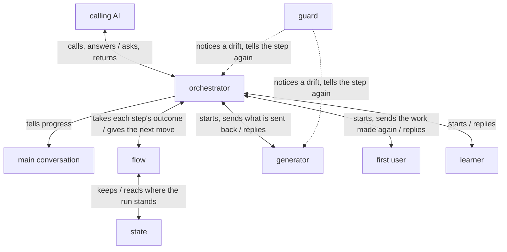

# turn architecture

turn is built on [how a plugin works](../architecture.md) so that the work the calling AI asks for
comes back meeting every item of the checklists it gave, with nothing left for it to fix; the
calling AI, the goal, the key results, and what a checklist, a CCS and its kinds, the receiver and a
Good are, are in [turn's UX](ux.md). The calling AI deals only with the orchestrator, through which
the generator and the first user go back and forth until the first user finds each item's Good;
each time that reading ends, the orchestrator checks each Good holds, and only the items that do not
are made again in the next round, so a run can end in one round.

turn holds the [principles every plugin holds](../architecture.md#principles), named below
Principle 1 to 8, and its own:

1. Every role that makes or reads the work looks only for each item's Good and works only to give
   it.

   An AI that looks for what more the work needs finds more without end, and each find is patched
   in, so the work drifts from what it should be.
2. Each item is judged by what the receiver gets with what they have, never by whether the work
   matches its sources.

   What the receiver gets is the work's purpose; matching the sources is a means to it, and checked
   on its own it draws the work toward the sources' words rather than toward the receiver.

## User stories

- As the calling AI, I want to start turn with the path of a CCS, its kinds and where the result
  goes, and get the work back where it goes, with each item's Good and its lines, and the lessons
  from the run to put to the user.
- As the calling AI, I want the user told, as the run goes, what it will do and what is done, in
  the main conversation, which alone talks with them.
- As the calling AI, I want to be sent each point only the user can decide as soon as the run meets
  it, and to send back the answer for the run to go on.
- As the calling AI, I want to call turn again with the same result after a run stopped anywhere,
  and have it go on from where it stopped.

## Architecture

### Logical view



- The calling AI is the main conversation, or an agent the main conversation started; the guard acts
  in every role as it does in the generator, and the figure draws it once.
- The call names, beside the CCS's path and where the result goes, the kinds the CCS uses for where
  the work goes, the checklists, the receiver, what the receiver uses the work for and what they
  have with it; turn defines nothing else of the CCS.

  The values stay in the CCS alone, so the call and the CCS cannot differ; without what the
  receiver uses the work for and has with it, no reader can stand in their place. Where the result
  goes is this call's answer, not the task's state, so it is not in the CCS.
- The flow, a script, keeps where the run stands in the state and gives the orchestrator each next
  move, and the orchestrator makes only that move and hands the flow its outcome.

  The run is a fixed loop, so its course and its bounds are kept in code, which holds them the same
  way each time where an AI counting may slip unseen (Principle 6). A call naming a result whose
  state is there goes on from its last move, since what lives only in a conversation is lost when
  it ends.
- Before any work is made, the orchestrator checks that the CCS holds everything the run needs, and
  each item that lacks it waits on a question.

  A Good the CCS cannot give, the generator cannot give either, and the making and the readings
  after it would be spent for nothing.
- A question goes to the calling AI as its reply as soon as it is met, from the CCS check, from the
  generator or from an item the rounds leave without Good, and the run waits for the answer.

  The point is the user's to decide (Principle 2), and settled when it is met it is not met again
  as rework, nor left in the result for the calling AI to fix (Principle 7); a subagent cannot ask
  the person ([Where the orchestrator runs](../architecture.md#where-the-orchestrator-runs)).
- The flow makes a line for the user before each move and after each outcome, and the orchestrator
  sends it to the main conversation.

  Only the main conversation talks with the user, and a run going a slow or wrong way shows before
  its time is spent; made from the move, the line says what the run does, not what an agent means
  to do.
- In a round, the generator makes the work and runs it, and the first user uses it in the receiver's
  place; the generator is sent back the items the first user found no Good for, as the first user
  gave them, and the first user is sent the work made again, until it finds every item's Good or
  the flow's bound ends its reading.

  The generator holds the sources and the Good it meant at each line, so it changes only what is
  sent back, and how the work gives the Good is its to decide, since an edit told per item broke
  other items.
- Through that back and forth the orchestrator reads no work, and the first user is not given the
  generator's reply.

  The orchestrator holds the sources and the call, so its own reading there finds the Good the work
  meant, not the one the receiver gets, and pulls the remake toward its view; a reader shown the
  maker's claim finds the Good it was told to find (Principle 4).
- Once the first user's reading ends, the orchestrator checks that each Good the first user gave
  holds, running what the Good says the receiver gets, and an item gets its Good only where the first user gave one and
  the orchestrator said yes; the result gives the first user's Good and its lines.

  Whether a found Good is true is a second question, and a reader asked both narrows the item to
  the Good it found; the orchestrator holds the whole run and decides (Principle 1). A Good only the
  orchestrator found would be judged by one that knew what the work meant.
- Only the items without Good are made again in the next round, with what was found lacking, and an
  item the rounds leave without Good becomes a question.

  An item the rounds leave lacks what neither the CCS nor the readings give, so it comes back as a
  point for the user to decide, not as work for the calling AI to fix (Principle 7).
- Each item is answered where its checklist's `Scope` line says, by every role and every run.

  A Good found where one part gives it passes a part that does not, and what lies between the parts
  is found only in the whole.
- Once the run is done, the learner of
  [Principle 8](../architecture.md#learning-from-each-run) reads the records of every agent of the
  run, not the work, and the flow puts its lessons into the result for the calling AI to put to the
  user.
- The flow writes the result where the call says, and the orchestrator ends only once it is there.

  A reply would be copied into a file by the calling AI, where a slip goes unseen.

### Physical view

```
turn/                      the plugin, installed by Claude Code
├── agents/
│   ├── up.md              the orchestrator <agent>
│   ├── generator.md       <agent>
│   ├── first-user.md      <agent>
│   └── learner.md         <agent>
├── forms/
│   └── *.json             each role's reply form <JSON Schema>
├── scripts/
│   ├── turn.py            the flow <Python 3>
│   └── *.py               the call's check, the forms, the parts, the records <Python 3>
└── hooks/
    ├── hooks.json         the lanes on every agent, laid by lane:up
    └── lane/              lane's code, the guard, a link to lane's <Python 3>

<where the call puts the result, in the calling AI's work folder>/
├── <result>               the result <JSON>
└── <result>.run.json      the state <JSON>, read and written by the flow alone
```

- turn runs on Claude Code, python3 3.9 or later, and git; each step of an agent that alone is not
  sure to hold is a lane laid with [lane](../../lane/README.md).
- The calling AI starts `turn:up` in the background with the call as JSON, from the main
  conversation or from an agent it started, and stops a run with TaskStop; turn's agents take the
  two layers below it, and Claude Code starts agents down to three layers below the main
  conversation.

  The calling AI can still take the user's pause while it waits; the user sees the run's agents in
  the panel below the prompt input. Each run's state is beside its own result, so several runs go at
  once without meeting.
- The orchestrator reaches each role and the main conversation with Claude Code's Agent and
  SendMessage, and its question is its reply, which the calling AI answers by SendMessage to it.
- Each role writes its reply to a file its prompt names, in a JSON form of its own, read by the flow
  alone.

  No AI copies a reply, and the first user's lane on what it reads keeps it from the generator's.
- The flow gives no role the run's own files, a folder holding them given as its other entries,
  as a lane lets a role read anything under a folder it is given.

## Verification

### Units

Each agent is checked on Claude Code's default model, the one users run turn on, and judged from
the records of every conversation and agent the check started.

- The flow: each move follows from the state and the outcome handed to it in this architecture's
  order, and each check it makes stops what it must and lets through what it must.
  - Flow: unittest in `dev/turn/tests/`, fed the calls, states and replies each receives, by
    [`dev/check.sh`](../check.sh) with lines and branches 100% covered and by
    [`dev/mutate.sh`](../mutate.sh) with no mutant surviving.
- The lanes: `hooks/hooks.json` holds the lanes the steps call for, and each agent's steps their
  sentences.
  - Flow: unittest reading the agents and `hooks/hooks.json`; each lane's check is tested in lane.
- The orchestrator: takes each move in this architecture's order, from the call to the result.
  - Flow: on a task of two items, one answered at its part and one in each part, with the three
    roles stood in for by agents that write a reply set beforehand, one set for each way a run goes:
    every Good found and held at once; an item found lacking and then given; the back and forth
    ending with an item without Good; a Good the check finds untrue; a question from the generator
    before and while making; an item the rounds leave without Good; a question from the CCS check;
    and a run stopped after the first user's reading and called again. Passes when its records show
    each move in this architecture's order, the orchestrator reading no work before the first user's
    reading ends and running what each Good says at its check, no lane stopping a call that keeps
    its step, a line sent to `main` before each move and after each outcome, and the result as the
    set replies make it.
- Each of the three roles: works to its aim with what it is given, writing its form.
  - Flow: started on its own with a prompt set beforehand, as the flow would give it, on the same
    task; passes when its record shows it read only and whole what it is given and its reply fills
    its form; the generator, on a CCS leaving one item's Good to the user, asks before making
    anything, runs what it wrote, and sent back remakes without reading its sources again; the first
    user runs what the receiver runs and, sent the work made again, gives the places it stopped at
    their Good; the learner quotes from the records the words each lesson rests on.
  - Content: what it makes in the acceptance trials below, by KR1.1's bar there, each item it falls
    short on read in its record for why.

### Acceptance

Each trial runs in a clone of `lovaizu/playground` of its own, on a branch of its own, pushing
nothing, removed after: a stand-in for the calling AI, run as the main conversation on Claude Code's
default model, is handed a small task's CCS and checklist and calls turn, and is judged from the
records of every agent it started and from the work. Each acceptance trial is run three times at
once.

What an AI does varies from run to run, and one run shows one of its ways; runs that push nothing
and keep their own folders do not touch each other.

- Flow: a stand-in for the calling AI calls turn on a task of one item, with every role real;
  passes when its records show each move in this architecture's order and the work comes back with
  the result in its form.
- The work back: it comes back where it goes, every item has a Good with its lines, and each lesson
  has the words it rests on; each Good is checked by reading its lines in the work, and each lesson
  against the records it quotes.
- Told as it goes: the main conversation is told a line before each move and after each outcome,
  read from the stand-in's record against the orchestrator's moves.
- A point asked: on a CCS that leaves the license open, the question reaches the stand-in before any
  work is made, and the run goes on with its answer, read from the records.
- Gone on: a run stopped during the first user's reading and called again with the same result goes
  on from that move and returns, the records showing no move before it made again.
- KR1.1: the items the work meets, as the UX's KR1.1 says.
  - Judged by one judge, an AI that took no part in either run, for turn and for the version in use
    on the same task by one bar: an item counts where the judge, reading the whole work each
    returns and not its result, finds the receiver gets what the item asks, as the two versions'
    results differ in form and a Good's words would lean the judge; kept with the trial in
    `dev/turn/trials/`.
- KR1.2: the time from the call to the work coming back.
  - Taken from the records' timestamps for a README-sized work, compared with the version in use on
    the same task, and read move by move; time that adds nothing to the stories or KR1.1 is cut
    first.

A change is taken when every story is still achieved and KR1.2 does not come closer at the cost of
KR1.1.
