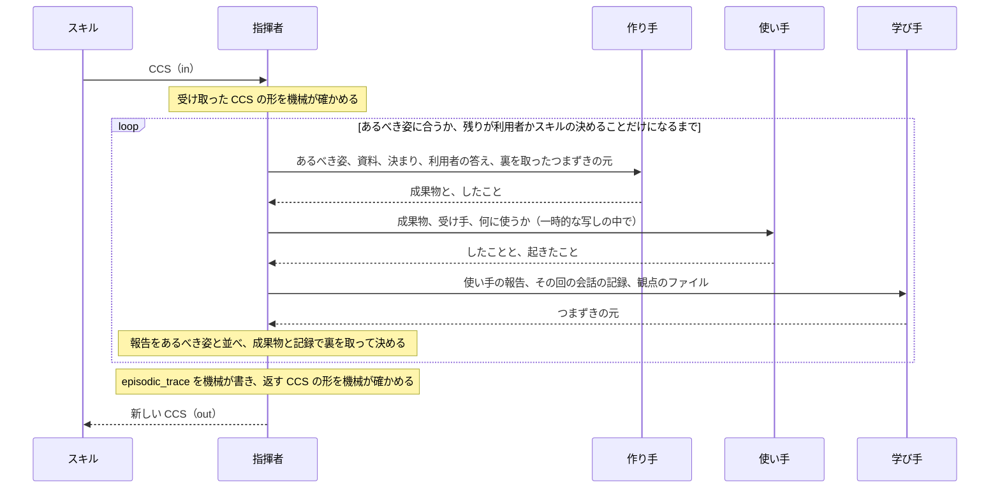

# turn の設計

この設計書は、turn を作る人と直す人のためのものです。[README](../../turn/README.md) の約束を、どの機能が利用者に届けるか、それをどう確かめるかを書きます。変更が設計に合うかは、下の方針に照らし、利用者が何を失うかで決めます。

turn の中で判断する役を、指揮者と呼びます。`turn:up` を動かしているメインの会話のことで、README で「判断するのは turn だけ」と書いているのは指揮者のことです。

## 1. 方針

指揮者は、CCS に書かれたあるべき姿に向けて、作り手に作らせ、使い手に受け手として使わせ、学び手につまずきの元を学ばせ、その元から作り直させます。これを、使ってみた結果があるべき姿に合うか、残りが利用者やスキルにしか決められないことだけになるまでくり返し、受け手が実際に使える成果物にします。次の5つは、このくり返しがそこにたどり着くために、いつも成り立っていることです。

- すべての判断の物差しは、CCS に書かれたあるべき姿です。

    あるべき姿は、プラグインが書く受け手（`receiver`）、合格の基準（`acceptance`）、何に使うか（`use`）、観点のファイル（`viewpoint`）です。ターンが知っていることは CCS だけなので、指揮者が自分で思い描いた姿は、次のターンにも続きにも渡りません。あるべき姿を決めるのはプラグインで、turn はそれを作りも変えもしません。これで「合格の基準や決まりが、タスクの途中で書き換わらない」が成り立ちます。あるべき姿だけでは判断できない時は、スキルに返します。

- 使い手は、受け手と同じ立場で使います。

    知らせるのは、成果物と、受け手が誰で何に使うかだけです。合格の基準や話し合いは知らせません。使う場所は、クローンしたばかりの一時的な写しに成果物だけを置いたもので、受け手の手元と同じです。こうすると、使い手がつまずく所と受け手がつまずく所が同じになり、「見せられる成果物は、すでに使われ、つまずいた所が直っている」が本当になります。基準を知っていると、使い手はそれに沿って使ってしまいます。作業中のリポジトリには受け手の手元にないファイルがあり、それに助けられて、つまずきが隠れます。

- 直すのは、つまずきの元です。成果物は、そこから作り直します。

    つまずいた箇所だけを継ぎ足すと、元が残ったまま別の所で同じつまずきが起き、成果物はあるべき姿から離れていきます。元から作り直せば、使い直すたびにあるべき姿に近づき、「見せられる成果物は、すでに使われ、つまずいた所が直っている」に届きます。あるべき姿に近づかない直しはしません。

- 判断するのは指揮者だけです。指揮者は、報告の1つ1つを、あるべき姿と並べ、成果物と事実で裏を取ってから決めます。

    作り手、使い手、学び手は、それぞれ1つの仕事をして、したことと起きたことを報告するだけです。良し悪しは付けません。作った本人が確かめると甘くなり、判断がエージェントに散ると、どの直しがあるべき姿のためかを誰も言えなくなります。報告の言い分は、したこと以上を言いうるので、指揮者は会話の記録（JSONL）と git で裏を取ります。良いという報告も、つまずいたという報告も、学び手が出したつまずきの元も、同じ厳しさで裏を取ります。良いという言い分を信じると、つまずきがそのまま受け手に届き、「見せられる成果物は、すでに使われ、つまずいた所が直っている」が崩れます。

    作る、使う、学ぶを指揮者がしないのは、その中身で指揮者の会話が膨らみ、README の冒頭にあるとおり、目的や決まりからずれていくからです。とくに学ぶには、その回の長い記録を読む必要があります。

- ターンが終わって残るのは、返す CCS と成果物だけです。

    次のターンは、それだけから始めます。会話の記録や、指揮者の頭の中には頼りません。受け取った CCS は書き換えず、新しい CCS を別のファイルに書きます。これで「途中で止めても、続きから進む」が成り立ち、CCS と成果物をコミットしておけば別のマシンでも続きから進みます。ターンが途中で切れても、同じ CCS で始めからやり直せます。プラグインも、返ってきた CCS だけで次の一手を決められます。

## 2. 機能

各機能が届ける約束は、README の「プラグインの作者にとって」と「プラグインの利用者にとって」の項です。働く場面は、README の「使う場面」と「返ってきた CCS で次を決める」です。

1つのターンの中で、誰が何を渡すかは次のとおりです。

### 受け手として使い、つまずきの元から直す

届ける約束は「見せられる成果物は、すでに使われ、つまずいた所が直っている」と「作って、使ってみて、直す流れを、自分のスキルに書かずに済む」です。

- 返す成果物は、最後に作り直したあと、使い手が始めから終わりまで使ったものです。

    作っただけで使っていない成果物や、直した所だけを使い直した成果物は、受け手が通る道を通っていません。元から作り直すと、つまずいた箇所以外も変わりうるからです。

- 使い手が使い終えるたびに、学び手がつまずきの元を学びます。

    使い手の報告だけでは、どこでつまずいたかは分かっても、なぜつまずいたかは分かりません。学び手は、報告と、その回に実際に起きたことの記録から元を探します。

- 指揮者は、裏を取ったつまずきの1つ1つを、あるべき姿と比べて、次のどれかに決めます。結末は、返す CCS の `difference` に書きます。
  - 受け手が合格の基準に届くのを妨げるつまずきは、元を作り手に渡して作り直させます（`fixed`）。
  - 受け手が合格の基準に届くのを妨げないつまずきは、理由を添えて見送ります（`let go`）。
  - あるべき姿だけでは決められないつまずきは、スキルに返します（`to the caller`）。利用者にしか決められないことなら、問いにして `gap` に入れます。
  - 作り直して使い直しても、同じ元のつまずきが残る時は、元の見立てが違うか、あるべき姿では決められないことです。スキルに返します（`to the caller`）。

    同じ直しをくり返しても、あるべき姿には近づかないからです。

- 進め方についての元は、決まり（`rule`）になります。指揮者はターンの残りで呼ぶどのエージェントにもそれを渡し、返す CCS の `constraints` に足します。

    スキルがそれを次のタスクの CCS に写せば、タスクをまたいでも同じつまずきをくり返しません。

### 利用者のほかの作業に触れない

届ける約束は「利用者のほかの作業に触れない」です。

- 使い手が使う一時的な写しは、使い終えたら消します。
- turn はコミットも push もしません。

    コミットするかどうかは、利用者とタスクの並びを知るプラグインが決めます。

### 利用者にしか決められないことだけを返す

届ける約束は「聞かれるのは、利用者にしか決められないことだけ」です。

- CCS とその資料、利用者の答え、観点から決まることは、指揮者が決めます。
- 決まらず、利用者にしか決められないことだけを、そのまま聞ける問いにして `gap` に入れ、`next` を `ask the user` にして返します。

    turn は利用者と話しません。ターンの外で利用者と何を合意しているかを、turn は知らないからです。聞くかどうかを turn が決めると、利用者は同じことを何度も聞かれたり、決めたつもりのないことが成果物に入ったりします。

### 返す CCS だけで次を決められる

届ける約束は「成果物を読まずに、次の一手を決められる」です。

- 指揮者は、つまずきごとの結末（`difference`）、利用者にしか決められないこと（`gap`）、学んだ決まり（`rule`）、成果物と資料のつながり（`link`）、次にすること（`next`）を書きます。
- 各エージェントが実際に読み、書き、実行したこと（`episodic_trace`）は、ターンを返す前に、会話の記録と git から機械が書きます。

    エージェントの言い分は、したこと以上を言いうるからです。

### あるべき姿が途中で書き換わらない

届ける約束は「合格の基準や決まりが、タスクの途中で書き換わらない」です。

- CCS を受け取った時と返す時に、形を機械が確かめます。合わなければ、何が合わないかを言って止まります。何を確かめるかは、README の「機械が確かめること」のとおりです。

    AI が書く CCS は、あるべき姿の行を言い換えたり、表にない項目を足したりしうるからです。機械の確かめは、毎回同じ答えを出します。

- 確かめには python3 を、CCS の読み書きには jq を使います。どちらかがなければ、CCS を返さずに、何をインストールすればよいかを会話で伝えて止まります。

    確かめを飛ばして進むと、書き換わったことに誰も気づかないからです。

### 止めた所から続ける

届ける約束は「途中で止めても、続きから進む」です。

- 利用者が会話で止めるよう言ったら、指揮者は新しいエージェントを呼ばずに、結末まで決まった所までを新しい CCS に書き、`next` を `stopped: <どこから>` にして返します。

    結末まで決まったつまずきと、作った成果物は、CCS とディスクに残ります。結末の決まっていない使ってみた回と学んだ回は、続きのターンでやり直します。それを CCS に残す形を足すより、やり直すほうが仕組みが少なく済みます。

- CCS を返さずに切れたターンは、何も書き残しません。スキルは同じ `in` でもう一度呼び、ターンを始めからやり直します。

    書きかけの CCS を頼りに続けると、半端な状態から進むことになるからです。受け取った CCS は元のままなので、やり直しはいつでもできます。

## 3. CCS の取り決め

CCS は、プラグインが書いて残し、turn が読み、次のバージョンの turn や別のマシンでも読まれます。形は README の「CCS の書き方」がすべてで、ここには、各部分を誰が読み、何がいつも成り立つかと、その理由を書きます。

- CCS は、ACC の9つの部分をすべて持ち、ほかの部分を持ちません。

    9つの部分は、ACC の論文が、次の一手に要る状態として決めたものです。部分を足すと ACC と食い違い、読む側がそのたびに変わります。

- プラグインが書く部分（`focal_entities`、`goal_orientation`、`retrieved_artifacts`）は、タスクの間ずっと変わりません。

    これがあるべき姿で、どのターンもこれを物差しにするからです。

- `constraints` は、書かれた行が変わらず、後ろに足されるだけです。

    利用者の答えと学んだ決まりは、一度決まったら後のターンでも守られるからです。

- turn が書く部分は、ターンごとに、そのターンが書き直します。読むのは、スキルと次のターンです。
  - スキルは、`next` と `gap` で次の一手を決め、`rule` を次のタスクに写します。
  - 次のターンは、すべての部分を、自分が始める状態として読みます。`stopped` のあとは、`difference` と `episodic_trace` から、どこまで済んだかを知ります。`link` からは、資料が変わった時に見直す所を知ります。

    次の一手に要るのは、直前のターンまでの結果だけだからです。

- 成果物や資料の中身は書かず、場所だけを書きます。

    中身を写すと、写しと実物が食い違い、CCS が膨らみます。

- 部分と種類の名前、`next` の値は英語のままで、決まったものだけです。値の中の言葉は自由です。

    スキルが `jq` で読み、次の一手を決める鍵だからです。名前や値を変えると、それを読むスキルが次を決められなくなります。

## 4. 確かめ方

約束が利用者に届いているかを、まず試走で確かめます。試走は `dev/turn/trials/` に置き、利用者がするとおりに turn を動かします。合格かどうかは、試走する人が、すべての会話とエージェントの記録（JSONL）を読んで決めます。

- 「見せられる成果物は、すでに使われ、つまずいた所が直っている」

    場面：受け手が手元でつまずく落とし穴のあるタスクです。たとえば、新しいクローンにはないフォルダを前提にしてしまいやすいセットアップ手順書です。turn なしで AI に書かせると、そのつまずきが残る場面です。合格は、turn が返した成果物を、turn と関わりのない新しいエージェントが受け手として一度使い、つまずかずに合格の基準に届くことです。

- 「作って、使ってみて、直す流れを、自分のスキルに書かずに済む」

    場面：上の試走を、CCS を書き、`turn:up` を呼び、`next` を読むだけの小さなプラグインから動かします。合格は、そのプラグインのスキルに作る、使う、直すの手順がなくても、上の合格に届くことです。

- 「成果物を読まずに、次の一手を決められる」

    場面：上の試走で返ってきた CCS です。合格は、CCS だけを読んで決めた次の一手が、成果物と会話の記録まで読んで決めた次の一手と同じになることです。

- 「聞かれるのは、利用者にしか決められないことだけ」

    場面：利用者しか知らないこと（たとえば、API トークンを誰が渡すか）を1つ含むタスクです。合格は、それが `gap` に入り、`gap` にほかの問いがなく、利用者の答えを足して呼び直すと、それを使った成果物になることです。

- 「途中で止めても、続きから進む」

    場面：作り手が作り終えたあとで、利用者が止めるよう言うタスクです。合格は、返ってきた CCS と成果物だけを別のクローンに置いて呼び直すと、作られた成果物から続き、同じ合格に届くことです。

「合格の基準や決まりが、タスクの途中で書き換わらない」と「利用者のほかの作業に触れない」は、スクリプトとそのテストで確かめます。CCS の形を確かめること、写しを消すこと、コミットしないことは、機械が決められるので、速く、毎回同じ答えになります。試走の手間は、ほかの約束が届いているかに使います。

## 5. 選ばなかったやり方

- くり返しの回数に上限を設けるやり方は選びません。

    同じ元のつまずきが残ればスキルに返すので、近づかないくり返しはそこで止まります。上限を足すと、あるべき姿に近づいている途中で止まり、受け手は使えない成果物を受け取ります。
