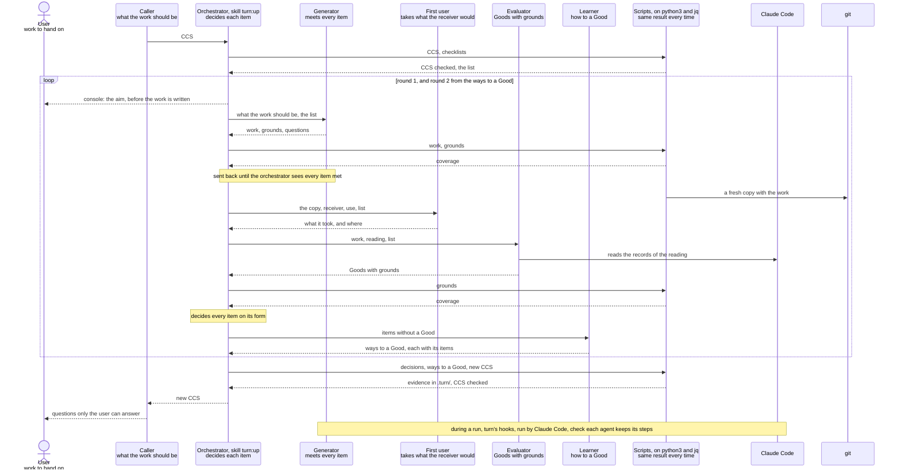

# turn design

This document is for whoever builds or changes turn: what turn must achieve, how each quality is
checked, and how turn is built to achieve it, for the benefits [turn](../../turn/README.md)
promises. How to use turn is in that README, and the forms a caller writes and reads are on the
callers' page, [Calling turn from a plugin's step](../../turn/calling-from-a-plugin.md); prompts'
wording and steps are left to the code. A statement no trial has checked yet is marked
"(assumption)".

The words used throughout:

- The caller: Claude in the user's conversation, or a step of the user's plugin. It hands turn one
  task in a CCS, a JSON file: the caller writes what the work should be (where it goes, the receiver
  it is for, their use of it when named, what they must be able to do with it, its sources and its
  checklists), and turn writes back what the caller needs next, as a function takes arguments and
  returns a value.
- A checklist says what a work of one kind must give its receiver: an opening on what such work is
  for, then items, each one question. The list is a task's checklists put together.
- A run goes from one CCS to the one turn writes back. A round makes the work, has it read and
  decides each item; a run has one round or two.
- The orchestrator runs a run and alone decides each item. Its agents give it what it decides from:
  the generator makes the work, the first user reads it in the receiver's place and hands back its
  reading, the evaluator shows which items the work meets, and the learner finds how an item without a
  Good would get one.
- A Good: an item the orchestrator has decided the work meets, with its grounds, the lines it rests
  on. More: an item without a Good when a run returns.
- Coverage: the lines of the work no grounds name, as test coverage finds the lines no test runs.

## Goals

### Attractive quality

- Read in the receiver's place: the work comes back already read in the receiver's place by an agent
  that did not write it, each Good shown in its lines, and what that reading could not take made
  again from its cause. The user hands the work on without first reading it as its receiver.
- Asked only what only the user can decide: nothing is asked that what the work should be, or its
  sources, already answers.
- Seeing the work as it goes: the user can tell from the console how far a run has come, and stop a
  run whose aim they do not want before the work is written, saying what they want instead.
- A plugin decides from what turn returns: a plugin hands turn one task and decides its next move
  from the returned CCS alone, without writing the loop of making, reading and making again.
- Following each item back: the user can later find, for each item, the lines its Good rests on or
  why it has none, and the version of the checklist it was judged by.

### One-dimensional quality

Each must be no worse than in the version in use.

- The first-round share: runs whose first round ends with every item Good. The more work is right
  when first made, the less the user waits and the less is spent.
- Time and tokens: what one run takes, from the call to the returned CCS.

### Must-be quality

- Nothing passes unshown: an item counts as met only with a Good whose grounds are lines the work
  holds; every other item is returned as More, with its cause.
- What the work should be unchanged: turn never rewrites what the caller wrote.
- Nothing unread: the work turn writes where the work goes is the version last read.
- Repository untouched: during a run, turn changes nothing but where the work goes and its folder
  `.turn/`, and never commits or pushes; a file where the work goes is written over only when git
  holds it as it stands. Outside its runs, turn blocks nothing.
- Stop and start over: a stopped run returns a CCS saying so, and called with it and the user's
  answer starts from the work as it stands; a run cut off leaves where the work goes untouched.
- Missing tools: without python3 or jq, turn ends before any work and says what to install; outside
  a run, a missing tool breaks nothing.

### Backward compatibility

- The call: plugins call the skill `turn:up` with the arguments the callers' page gives, and name
  `turn` in their dependencies. An argument may be added only if a call without it runs as before.
- The CCS: its parts, kinds of entry and values of `next`, as the callers' page gives them, are
  neither added to, removed nor renamed, since a caller breaks on one it does not know as on one
  that is gone; the wording in an entry may change, since callers do not act on it. A CCS an earlier
  version returned is accepted, so a stopped task carries on after an update.
- The checklist form the README's Requirements gives, since users and writ write checklists in it.
- `.turn/`: the user and the next run open what a returned CCS points to there, so every such place
  exists; the rest of `.turn/` may change.

### Non-goals

- Deciding what the work should be, or talking to the user: the caller does both, knowing what was
  already agreed.
- Running until every item is Good: what a second round leaves without a Good points to a fault in
  turn, the checklist or what the work should be, to be fixed there (assumption).
- Finding what no item asks, which goes into the checklist; holding checklists, which belong to
  whoever knows the kind of work, such as writ; and code, which is checked by its tests.

### Constraints

- turn is used by Claude, on a person's behalf, in a conversation or a plugin's step.
- turn runs in Claude Code and holds only skills, agents, hooks and scripts; installing copies only
  its folder; its hooks run in every session where it is installed; a subagent cannot start others.
- Users' machines run Python 3.9 or later with the standard library only, and jq.
- The work is in a git repository.

## Verification

### Attractive quality

Each is tried on real work, writ's and turn's own documents and prompts, and judged from the records
(the JSONL of every conversation and agent of the run), since a made-up task shows only that it
passes.

- Read in the receiver's place: tried on work for a receiver who lacks what the generator knows,
  where a writer checking their own work passes what a newcomer would miss (assumption). It passes
  when a fresh agent outside the run, reading the returned work as the same receiver on the same
  list, takes every item returned as Good, including each the first round left without one.
- Asked only what only the user can decide: on sources that settle some choices and leave one open,
  that one is asked, and no question is answered by what the work should be or its sources.
- Seeing the work as it goes: the console alone tells the round and step the records show; a run
  stopped on its aim has written no work of that aim, and then makes what the user said.
- A plugin decides from what turn returns: tried on runs that end in each value of `next`, the move
  decided from the returned CCS alone is the one decided after also reading the records.
- Following each item back: `.turn/` alone gives, for any item, the lines of its Good or why it has
  none, and the version of its checklist.

### One-dimensional quality

Both are measured from the records of the same tasks, run from the same CCS on this version and on
the version in use.

### Must-be quality

Each is a test on the script or hook that holds it, in the case that would break it: grounds naming
lines the work lacks; a returned CCS whose caller part differs; a version written after the last
reading; a write outside the work and `.turn/`, a commit or a push in a run; a file where the work
goes with changes git lacks; the same outside a run, with another session's run open; a run stopped
at each step, and one cut off; each tool missing, in a run and outside one.

### Backward compatibility

For each released version, a test calls turn as its callers did: the call runs; its CCS, a stopped
one included, is accepted and carried on; every `next` returned is one its callers know; its
checklists give a list with every opening and item; every place a returned CCS points to exists.

## Architecture

### Principles

- The orchestrator alone decides, from the work itself: for each item it reads the whole work for
  where the item is given, and what agents and scripts hand back only shows it where to look first,
  since a Good on one part does not show what the whole gives. Protects: nothing passes unshown,
  read in the receiver's place.
- Every role, the orchestrator included, looks only for Goods and aims at every item being Good;
  none finds fault, and none is set to find something, since one set to find something finds it
  whether it is there or not (assumption). Coverage, a script, is the one place that looks for what
  may be wrong. Each prompt sets as steps what its agent receives, hands back and must do in full,
  and leaves how it thinks within a step to it. Each answers, as the orchestrator decides, in a form
  with one place per item, handed on only once a script sees every place filled, since the form, not
  the wording, holds it to its aim; during a run, hooks catch a step not kept. Protects: nothing
  passes unshown, the first-round share.
- What must come out the same every time is done by a script or a hook. Protects: nothing passes
  unshown, what the work should be unchanged, repository untouched, following each item back.

### Structure

The figure shows who takes part and what each is for, what passes between them in order, and what
turn needs from outside: Claude Code, which runs the agents and hooks and keeps the records, and
git.

The orchestrator is a skill, so it runs in the caller's conversation, where it can start the agents
and the user sees its console and presses Esc. A subagent could not start the agents; the cost is
room in the caller's conversation, and no call from inside a subagent.

### The checklist as the measure

Achieves: read in the receiver's place, the first-round share, the checklist form.

A work that meets every item of its checklists serves its purpose (assumption, which the
attractive-quality trials test). Everything that measures the work, the orchestrator included, is
given the same list, with every opening, and the same receiver and use, so all measure alike.

- Must hold: nothing measures the work by anything but the list, the receiver and the use.
- Weighed: letting the first user also report what it missed outside the items was not chosen, since
  unbounded by an item it becomes a search for faults that varies from run to run (assumption). The
  cost: what no item asks is not found until the checklist changes.

### Making it right first

Achieves: the first-round share, time and tokens, asked only what only the user can decide.

The generator makes a work that meets every item and names the lines that meet each; what the
sources do not settle it raises as a question and keeps out of the work. The orchestrator reads the
whole work for each item, from those lines and coverage, drops questions the work or sources answer,
and sends the work back with each item it does not see met, saying how it would be, until all are
met, since what can be seen here costs a whole round when found in the reading.

- Must hold: no work reaches the first user with an item the orchestrator does not see met.
- Weighed: sending back has no limit, since a work sent on unsettled costs a round. The cost: a
  generator that never settles runs until the user stops it, and time and tokens show it.

### Reading in the receiver's place

Achieves: read in the receiver's place.

The first user starts where the receiver starts, as a new team member starts from a fresh clone: a
copy of the repository with the work added, removed afterwards. It is given the receiver, the use
and the list, and nothing of how the work was made, its sources or what the receiver must be able to
do, so it stops where the receiver would (assumption). Its reading says, for each item, what it took
and where.

- Must hold: the copy holds nothing the receiver would not have.
- Weighed: telling it what the receiver must be able to do was not chosen, since it would look for
  that rather than take what the work gives (assumption). The cost: only the evaluator and the
  orchestrator weigh the reading against it.

### Deciding every item

Achieves: nothing passes unshown, read in the receiver's place, following each item back, `.turn/`.

The evaluator gives a Good with grounds for each item the work meets, judged from the reading
against what the receiver must be able to do, and reads the records for the lines the reading took
each item from. Its form has places for Goods only, since in a trial an evaluator told in words to
write Goods only still wrote on other items. Coverage shows where a slip may be: a line no grounds
name does nothing for the receiver or holds one, since every useful line meets some item
(assumption). The orchestrator reads the whole work for each item, from the grounds and coverage,
and decides each on its form. A script keeps in `.turn/` each round's work, list and reading, each
Good, each item without one with its cause, and each checklist's commit, since a commit names a
version exactly.

- Must hold: every Good names lines the work holds and is decided by the orchestrator; no run
  returns before every item of every document is decided on its form.
- Weighed: coverage was chosen over an agent set to look for slips, since a script comes out the
  same every time. The cost: a slip in a line some grounds name is found only by the orchestrator.

### Making again toward a Good

Achieves: read in the receiver's place, nothing unread.

The learner asks, for each item left without a Good, how the work would give it, in the work and in
the process, and groups the items one way serves. The generator makes the work again on those ways
in a second round, read and decided as the first; what it leaves without a Good is returned as More
with its cause. A way that lies in how such work is made is returned as a rule the caller carries
into later tasks; one in what the caller wrote goes back to the caller.

- Must hold: a run has at most two rounds, and returns the version last read.
- Weighed: a third round was not allowed, since a loop that does not settle hides a fault in turn or
  the checklist. The cost: some work comes back with More, for the user to decide on.

### The console

Achieves: seeing the work as it goes.

The console serves a user who looks in now and then. It shows the plan of the run once, then each
line by round, named by its step. Before the generator writes, it shows what the work will let its
receiver do, so a wrong aim is stopped before a round is spent. It says in plain words what the
first user could not take, with the path of each, and ends with where the work is and what the user
must decide. Item IDs and counts are not shown, since the user would have to learn the checklist.

- Must hold: no work is written whose aim the console has not shown first.

### The CCS

Achieves: a plugin decides from what turn returns, what the work should be unchanged, stop and start
over, the call, the CCS.

The CCS (Compressed Cognitive State) takes the nine parts that [ACC (Agent Cognitive
Compressor)](https://arxiv.org/abs/2601.11653) sets as the state the next step needs. A script
checks it on receiving and on returning. Every change of course, such as the user's answer, goes
through the caller as a new run, which starts from nothing but its CCS and the places it points to.
Until a run returns, the work is only in `.turn/`, so a stopped or cut-off run leaves where the work
goes untouched, and a stopped CCS points to the work there.

- Must hold: the received CCS is never written over; the caller's part comes back the same.
- Weighed: handing agents the CCS itself was not chosen, since a change made for one agent would
  change what callers rely on. The cost: the orchestrator writes each agent's inputs from the CCS.

### Leaving the user's work alone

Achieves: repository untouched, missing tools.

During a run, hooks block a write outside where the work goes and `.turn/`, and any commit or push,
in the session whose run is open only; elsewhere they do nothing, even without python3. Before any
work, a script checks for python3 and jq, and for changes git does not hold in a file where the work
goes, and ends the run with why if either fails. Such a file is otherwise written over, since git
keeps the version before it and making a document again where it stands is common work.

- Must hold: during a run, the only changes are where the work goes and `.turn/`.
- Weighed: blocking, not checking afterwards, since the harm is done by then. The cost: a check on
  each write, commit and push. jq for the agents' changes to parts of the CCS, since agents know it.
  The cost: one more tool to install.
