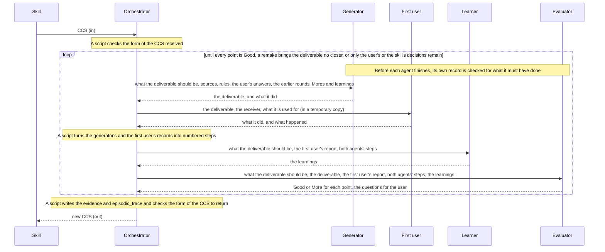

# turn design

This document is for the people who build and maintain turn. For each promise in the [README](../../turn/README.md), it says which feature keeps it and how that is checked. Whether a change fits the design is decided by the principles below and by what the plugin's users would lose.

The orchestrator is turn's main conversation, the one running `turn:up`. Where the README says "turn calls them", it is the orchestrator that calls.

## 1. Principles

turn exists so that the receiver can really use the deliverable, judged against what the CCS says it should be. The orchestrator has the generator make the deliverable, the first user use it in the receiver's place, the learner find why it came out away from what it should be, and the evaluator give each point of what it should be a Good or a More; then it has the generator remake the deliverable. It repeats this until every point is Good, until a remake brings the deliverable no closer, or until all that is left is for the user or the skill to decide. The five principles below always hold, so that this loop gets there.

- Every judgment is measured against what the CCS says the deliverable should be.

    What the deliverable should be is what the plugin writes: the receiver (`receiver`), the acceptance criteria (`acceptance`), what the deliverable is used for (`use`) and the viewpoint files (`viewpoint`). A turn knows only what is in the CCS, so a picture an agent forms on its own reaches neither the next turn nor a resumed one. The plugin decides what the deliverable should be; turn neither makes it up nor changes it. This keeps the promises that the deliverable is judged against what the plugin writes it should be and nothing else, and that what the deliverable should be and the rules do not change in the middle of a task. When that is not enough to decide, turn returns to the skill.

- The first user uses the deliverable as the receiver would, and reports only what it did and what happened.

    It is told only the deliverable, who the receiver is and what they use it for, and starts from where the receiver starts: a copy of the repository as the receiver gets it, with the deliverable added, holding nothing the receiver does not have, such as the CCS, its evidence or the plugin's own records of the task. Knowing the acceptance criteria or the discussion, it would use the deliverable the way they describe, and the places where the receiver stumbles would not show. A report that says what was good or missing is already a judgment, made by one who was told nothing to judge by.

- Only the generator changes the deliverable, and it decides itself what to change.

    It makes the deliverable from what it should be and the viewpoint files, and remakes it from what it should be, the evaluator's More and the learner's learnings. One maker keeps the deliverable whole, made from one understanding of what it should be. A change named by another agent is made at the spot that agent saw, and patching spot by spot moves the deliverable away from what it should be.

- Each of the other agents does one job, and none judges its own work.

    The learner finds why the deliverable came out away from what it should be; it neither judges nor says how to fix. The evaluator lays each point beside what the deliverable should be and the viewpoint files and gives it Good or More; it neither finds causes nor says how to fix. Whoever made the deliverable goes easy on it, and whoever found a cause goes easy on that cause, so the one who judges has made and found nothing. A report or a learning can claim more than was done, so the evaluator checks both against the facts, the deliverable and the steps taken from the conversation records (JSONL), and checks a Good as hard as a More. Taking "it worked" on trust passes the stumble on to the receiver.

    The orchestrator reads none of this content. It calls the agents and passes on what they return. Making, using, learning and judging all mean reading the deliverable and long records; held in the orchestrator's conversation, round after round, that content would fill it, and, as the README opens with, it would drift from its goal and rules. Each of the other agents starts in a new conversation every round.

- The next turn starts from the returned CCS and the deliverable alone.

    Not from the evidence, conversation records or anything an agent remembers: those show why, not where things stand. turn never rewrites the CCS it received; it writes a new CCS to a separate file. This keeps the promise that a task stopped partway carries on from where it stopped, and, once the CCS and the deliverable are committed, on another machine too. A turn cut off partway can start over from the same CCS. And everything the plugin needs for its next step can be traced from the returned CCS.

## 2. Features

The promises each feature keeps are those under "For plugin authors" and "For your plugin's users" in the README. The scenes where they work are "Calling turn" and "Deciding from the returned CCS".

Who passes what to whom within one turn:

### Using the deliverable as the receiver, and remaking it

Keeps the promises "the deliverable is judged against what you write it should be, and nothing else", "the deliverable shown has already been used, with its stumbles fixed" and "you do not write the make, try and fix loop in your own skill".

- The deliverable returned is the one the first user used from start to end after the last remake.

    A deliverable that was made but not used, or used again only at the changed spot, has not been down the receiver's path.

- Each time the first user finishes, the learner finds why the deliverable came out away from what it should be.

    The first user's report shows where it stumbled, not why. The learner looks for the why in the report and in the steps the generator and the first user took in that round, measured against what the deliverable should be.

- The evaluator gives each point of what the deliverable should be, each acceptance criterion and each point of the viewpoint files, a Good or a More. A point that what the deliverable should be does not settle gets neither: it is returned to the skill (`to the caller`), and, when only the user can settle it, as a question in `gap`. How each point ended goes into `difference` in the returned CCS.

    A Good or a More given to each point, and not only to what the first user's report names, keeps a point no one stumbled on from passing unchecked.

- The loop goes on while a point is More and each remake brings the deliverable closer: it turns at least one More into Good and no Good into More. It ends when every point is Good, when a remake brings the deliverable no closer, or when all that is left is for the user or the skill to decide.

    A remake that brings the deliverable no closer will not do so on the next try either, so the turn returns to the skill with the points still More. A remake that makes one point Good and another More has only moved the shortfall.

### Checking that each agent did its job

Keeps the promises "the deliverable shown has already been used, with its stumbles fixed", "the deliverable is judged against what you write it should be, and nothing else" and "everything your skill needs for its next step can be traced from the returned CCS".

- Whether an agent did its job is checked on its own conversation record, not on its account, when it tries to finish. If something is missing, the same agent is kept running and told what.

    "Read the deliverable and the records, and decide from the facts" asked in words is met by skimming, and an account can claim a read that never happened. The record is written by Claude Code, not by the agent, so it shows what was done. Claude Code's hooks are made for this: one runs before the call that hands back an agent's report and can refuse it with the reason, which keeps the agent running.

- No agent reads a conversation record or the CCS itself for what it must know whole. A script turns the generator's and the first user's records into their steps, numbered: what it ran or opened, and what came out. It writes out what the deliverable should be, the rules and the user's answers from the CCS the same way.

    A record is long and a CCS is read a part at a time, so whether either was read through cannot be told. The files the script makes hold the same facts, and a file read with Claude Code's Read tool leaves in the record which lines were read.

- Each agent must have read whole, before it finishes:

    | Agent | Read whole |
    |---|---|
    | Generator | What the deliverable should be with the rules and the user's answers, every viewpoint file and source, and the earlier rounds' Mores and learnings |
    | Learner | What the deliverable should be with the rules and the user's answers, every viewpoint file, the first user's report and both agents' steps |
    | Evaluator | What the deliverable should be with the rules and the user's answers, every viewpoint file, the deliverable, the first user's report, both agents' steps and the learnings |

    Read whole means every line is covered by its reads. A judgment made without the whole cannot be told from one made with it. The first user is not asked to read anything whole: it uses the deliverable as the receiver would, and its steps show how it did.

- What the first user is handed is checked when it is called: it never holds the acceptance criteria.

    Asked in words, the orchestrator can still pass them on; a script sees every word handed.

- What an agent must not do is stopped when it tries, as far as the call names it: the first user reading or changing anything outside its copy; any agent but the generator changing the deliverable; the generator changing anything in the repository but the deliverable; and any agent committing or pushing.

    Found afterwards, the harm is already done: a first user that read the repository has used knowledge the receiver does not have. A command can reach places its call does not name; those are judged from the records of real use.

- Each learning and each Good or More names the steps and the lines it rests on, and these are checked to exist.

    A conclusion that names its ground can be followed back to the facts.

- The evidence, each round's steps, learnings, and Goods and Mores with the steps and lines they rest on, is written beside the returned CCS, named after it (`task-4.json` gets `task-4.evidence.json`), and the CCS points to it in `episodic_trace`.

    Anyone who doubts the CCS can follow it back to what happened instead of taking it on trust. The plugin decides where its CCS lives, so the evidence stays with it, and is committed with it or not as the plugin decides.

### Leaving the user's other work untouched

Keeps the promise "their other work is left untouched".

- The temporary copy the first user works in is deleted when it is done.
- turn never commits or pushes.

    Whether to commit is decided by the plugin, which knows the user and the order of tasks.

### Returning only what only the user can decide

Keeps the promise "they are asked only what only they can decide".

- What the CCS and its sources, the user's answers and the viewpoints settle, the evaluator judges.
- Only what they do not settle and only the user can decide goes into `gap`, as a question that can be asked as it is, with `next` set to `ask the user`.

    turn does not talk to the user. It does not know what the plugin has agreed with the user outside the turn. If turn decided what to ask, users would be asked the same thing again, or find decisions in the deliverable they never meant to make.

### Tracing the next step from the returned CCS

Keeps the promise "everything your skill needs for its next step can be traced from the returned CCS".

- The orchestrator writes, from the evaluator's judgments, how each point ended (`difference`), what only the user can decide (`gap`), how the deliverable connects to its sources (`link`) and what to do next (`next`).
- What each agent actually read, wrote and ran (`episodic_trace`) is written by a script from the conversation records and git before the turn returns, with the place of the evidence.

    An agent's own account can claim more than it did.

### Keeping what the deliverable should be unchanged

Keeps the promise "what the deliverable should be and the rules do not change in the middle of a task".

- A script checks the form of the CCS when it is received and when it is returned. If something does not match, it says what and stops. What it checks is listed in "What a script checks" in the README.

    A CCS written by AI may reword a line of what the deliverable should be, or add entries not in the tables. A script gives the same answer every time.

- On receiving, the script also checks that the deliverable is none of the viewpoint files and sources, and holds none of them.

    A deliverable that is also its own measure changes the measure with every remake.

- The check uses python3. If it is missing, turn returns no CCS, says in the conversation what to install, and stops.

    Going on without the check, no one would notice a change.

### Carrying on from where it stopped

Keeps the promise "if they stop partway, the task carries on from where it stopped".

- When the user asks in the conversation to stop, the orchestrator calls no new agent. It writes a new CCS up to the last round the evaluator judged, and returns it with `next` set to `stopped: <where from>`.

    The judged points, and the deliverable made so far, remain in the CCS and on disk. A round not yet judged is done again in the next turn. That needs less machinery than adding a form to keep it in the CCS.

- A turn cut off without returning a CCS leaves nothing behind. The skill calls again with the same `in`, and the turn starts over.

    Carrying on from a half-written CCS would go on from a half-finished state. The CCS received is untouched, so starting over is always possible.

## 3. The CCS contract

The plugin writes the CCS and keeps it; turn reads it, and so do later versions of turn and other machines. Its form is defined entirely by "Writing a CCS" in the README. This section says who reads each part, what always holds, and why.

- A CCS has all nine parts of ACC and no others.

    The nine parts are what the ACC paper defines as the state needed for the next step. Adding a part departs from ACC, and every reader would have to change with it.

- The parts the plugin writes (`focal_entities`, `goal_orientation`, `retrieved_artifacts`) stay the same for the whole task.

    They are what the deliverable should be, and every turn measures against them.

- In `constraints`, written lines never change; new lines are only added after them.

    The user's answers and rules, once settled, are kept in later turns too.

- The parts turn writes are rewritten by each turn. They are read by the skill and by the next turn.
  - The skill decides its next step from `next` and `gap`.
  - The next turn reads every part as the state it starts from. After `stopped`, it learns from `difference` and `episodic_trace` how far the deliverable got. From `link`, it learns what to look at again when a source changes.

    The next step needs only the results up to the turn just before it.

- The content of the deliverable and of sources is never copied in; only where they are.

    A copy drifts from the real thing, and the CCS grows.

- Only the kinds in the README's tables are used. The names of parts and kinds, and the values of `next`, stay in English. The words inside values are free.

    The skill and the next turn find the entries they need by kind; the skill reads `next` and `gap` with `jq` to decide its next step. Renaming them leaves the skills that read them unable to decide.

## 4. How it is checked

The promises are checked where turn is really used: writ and rn are made through turn, one at a time. A made-up task shows only that the made-up task passes; making these is what turn is for, so the receivers, the stumbles and the time a turn takes are real. The work is done in a session of its own, and whoever builds turn reads every conversation and agent record (JSONL) of each turn and the returned deliverable as its receiver would. turn is fixed only for a cause found in the records and traced to this design; the one who does the work does not judge turn, for the same reason the evaluator is split from the generator.

A real task has no stumble set in advance, so a turn that finds nothing can mean the deliverable is fine or the stumble was missed. Each promise is judged from the records of the real work:

- "The deliverable shown has already been used, with its stumbles fixed": the deliverable returned was used from start to end after the last remake, and using it as its receiver shows no point the evaluator gave Good that falls short.
- "You do not write the make, try and fix loop in your own skill": the calling skill only writes the CCS, calls `turn:up` and acts on `next`.
- "The deliverable is judged against what you write it should be, and nothing else": what the CCS does not settle comes back as `to the caller` or `gap`, and is not settled in the deliverable.
- "Everything your skill needs for its next step can be traced from the returned CCS": the next step decided from the CCS and what it points to is the same as the one decided after also reading the records.
- "They are asked only what only they can decide": every question in `gap` is one only the user can answer.

Before turn is used, and again after every change to it, each part is checked alone where its behavior is decided, so that a slip is found in the part that made it.

- Each agent's prompt is run alone on set inputs and checked with writ's `prompt.md`.

    A run on unchecked prompts finds the prompts' slips, not whether the promises hold, and the slip it finds is hard to place among five agents.

- The whole flow is run as a trial in `dev/turn/trials/`, with stand-in agents that return set reports, from a small calling plugin: a More to remake, a question for the user, the user's answer added, a stop after the generator, and carrying on in another clone with only the CCS and the deliverable until it is done.

    Real work goes down only the paths its task leads to; the other paths, and "if they stop partway, the task carries on from where it stopped", would reach users unchecked.

"What the deliverable should be and the rules do not change in the middle of a task" and "their other work is left untouched" are checked by scripts and their tests: checking the form of the CCS, deleting the copy, and making no commit. A script can decide these, so the checks are fast and give the same answer every time.

## 5. Options not taken

- A limit on the number of rounds is not used.

    A remake that brings the deliverable no closer returns the turn to the skill, so a loop that is not getting closer stops there. A limit would stop a loop that is still getting closer, and the receiver would get a deliverable they cannot use.

- The learner and the evaluator are not merged into one agent.

    One agent would read the same steps once instead of twice, but it would then check the learnings it found itself, and go easy on them.
