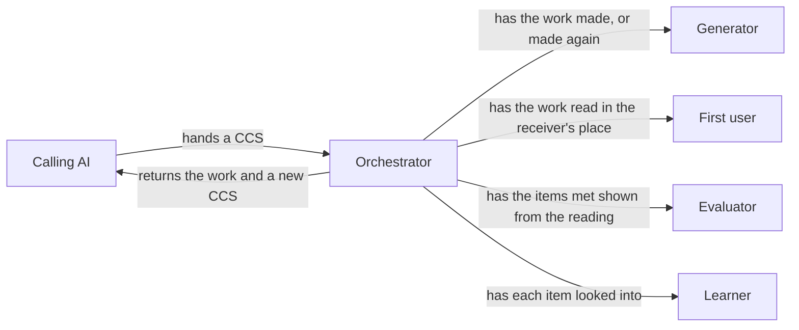

# turn design

turn is one turn of ACC: a calling AI hands it a CCS, and gets back the work, read inside turn by a
reader other than the one that made it and made again where it fell short, with a new CCS to go on
from. The goal and the key results it is built to reach are in [turn's UX](ux.md).

## User stories

- As the calling AI, I want to hand turn a CCS and get back the work and a new CCS.

  Reading, judging and making again are how turn makes the work, and lie in its components.

## Architecture

### Logical view



- The calling AI hands the orchestrator a CCS, and the orchestrator returns the work and a new CCS
  once it has decided every item of the checklists.

  The new CCS holds, for each item, whether the work meets it and the lines that do, what is not
  settled, and what the calling AI does next.
- The generator makes the work and names, for each item, the lines it meant to meet it.

  That is its claim, not a judgment; the orchestrator reads the work against every item and sends
  back what it can see falls short before the first user reads, so the costly reading is not spent
  on it.
- The first user reads the work in the receiver's place, with only what the receiver opens.

  A reader that did not make the work stops where the receiver would, where the maker reads in what
  it meant.
- The orchestrator reads the work against every item and settles its own judgment of each before
  the evaluator starts; the evaluator then shows, from the first user's reading, the items met and
  their lines; and the orchestrator decides each item where the two differ against what the first
  user opened and where it stopped.

  A judgment made after another's is pulled toward it, so the order, not a word of caution, keeps
  the orchestrator's judgment its own; the evaluator is there because the orchestrator alone did
  not settle its judgments.
- The learner looks at every item, met and not, in the work and in what every role of the run did,
  and the orchestrator sends what it finds back to the generator, which makes the work again.

  For an item not met it finds how the work would meet it, from what the work should give, since
  the generator alone patched where a shortfall showed; for an item met it finds what meets it, so
  the remake keeps it. What fell short often lies in what a role did, not only in the work.
- What is made again is read again before it returns, once at most.

  A second reading settles what the first found; what it still finds comes back as not met, for the
  calling AI to judge.

### Physical view

```
turn/                      the plugin, installed by Claude Code
├── agents/
│   ├── up.md              the orchestrator <agent>
│   ├── generator.md       <agent>
│   ├── first-user.md      <agent>
│   ├── evaluator.md       <agent>
│   └── learner.md         <agent>
├── skills/acc/SKILL.md    ACC's intent and the CCS's specification <skill>
├── scripts/               the CCS's checks, each role's input, the orchestrator's judgments <Python 3, jq>
└── hooks/
    ├── hooks.json         one entry per event
    └── *.py               one check each <Python 3>
```

- turn runs on Claude Code, python3 3.9 or later, jq and git.
- The calling AI starts the orchestrator in the background, so its context holds only what comes
  back.

  It can still take the user's pause while it waits, and stops a run by sending the orchestrator a
  message. The person sees the run's agents as a tree in the panel below the prompt input.
  `claude -p` is not used, since the docs say `--bare`, which reads no subscription login, will
  become its default.
- Several runs go at once, as rn starts them for work that can go in parallel, and the hooks tell
  them apart by the orchestrator's `agent_id`.

  Every agent of a conversation has the same `session_id`. A role's run is the `parentAgentId` in
  `subagents/agent-<agent_id>.meta.json` beside the conversation's transcript; tried with two runs
  at once, every role's tool use and reply was tied to its own orchestrator. The file is there from
  a role's first tool use, so what a role is started with is checked at the orchestrator's own call
  that starts it. The file is Claude Code's record, not a documented hook input, so the hooks'
  tests hold its shape.
- The calling AI reads the `turn:acc` skill before it writes a CCS; it holds ACC's intent first,
  then the CCS's specification, in its body.

  Knowing why ACC keeps one small state made anew each turn, the calling AI judges what to put in a
  CCS and what to leave out, and carries the new CCS, not the run. A skill is reached by name from
  any installed plugin, and a plugin built on turn names turn in `dependencies`.
- The CCS takes ACC's nine parts with the paper's names and meanings, and defines inside them only
  the kinds turn reads and writes.

  | Part | Kinds turn defines | Written by |
  |---|---|---|
  | `focal_entities` | `deliverable`, where the work goes; `receiver`, who reads it | the caller |
  | `goal_orientation` | `use`, what the receiver reads it for; `acceptance`, when it is enough | the caller |
  | `retrieved_artifacts` | `checklist`, `decisions`, `reference`, `receiver_opens` | the caller |
  | `constraints` | `language` | the caller |
  | `episodic_trace` | `item`, whether each item is met and the lines that meet it | turn |
  | `uncertainty_signal` | `question`, for the user; `unmet`, an item not met and why | turn |
  | `predictive_cue` | `next`: `done`, `ask the user` or `fix`, the caller fixes | turn |
  | `semantic_gist`, `relational_map` | none | the caller |

  Every other kind is the caller's to define. The caller's parts and every kind turn does not define
  come back as received, and turn's parts are written in place of the last turn's, so the CCS does
  not swell and can be handed to turn again as it is.
- A script checks the CCS at both ends: that the CCS received meets the specification, and, before
  it returns, that the new one does and that what must come back as received has not changed.

  A CCS that fails is stopped with what is wrong and where the specification is, and a new CCS that
  fails is not returned.
- Each role gives its answer as its reply to the orchestrator, in a JSON form of its own, not in a
  file, and a hook checks each role at both ends.

  Only the orchestrator holds the answers, so the first user cannot see the generator's claim. A
  hook lets a role start only with the input the orchestrator is to give it, and stops a reply that
  does not fill its form; the evaluator starts only once a script holds the orchestrator's own
  judgments.
- The hooks also stop a read outside a role's inputs, a write outside where the work goes, and a
  commit or a push.
- The work is made where it goes, and a run cut off leaves its writing as changes git shows.

  The calling AI undoes or finishes them, and calls turn again on what is there. No run resumes part
  way, since being cut off is rare and a reading again costs less than a resume to build and keep
  right.

## Verification

### Units

- The scripts and the hooks: each check stops what it must and lets through what it must.
  - Run by [`dev/check.sh`](../check.sh) in CI on every push:
    - unittest in `dev/turn/tests/`
    - Lines and branches 100% covered
    - Ruff's lint and format
    - Pyrefly's types for Python 3.9
- The orchestrator and the four roles: each step done in order, with its inputs, giving its output.
  - Run on its own on a small task, on Opus 5.5, and judged from its JSONL.

### Acceptance

Each trial runs in `lovaizu/playground`, one at a time, on a branch of its own removed after: a
stand-in for the calling AI is handed a small task's decisions and checklist and calls turn, and is
judged from the JSONL of every agent it started and from the work.

- The story: the work comes back where it goes, with an answer and lines for every item, and the
  stand-in takes its next move from the new CCS alone.
  - Each answer is checked by reading the work.
- KR1.1: the items the calling AI fixes after the work comes back.
  - Counted from the stand-in's own check in its JSONL, and compared with the target of none and
    with the last version.
- KR1.2: the time from the call to the work coming back.
  - Taken from the JSONL's timestamps for a README-sized work, and compared with the target of three
    minutes and with the last version.
