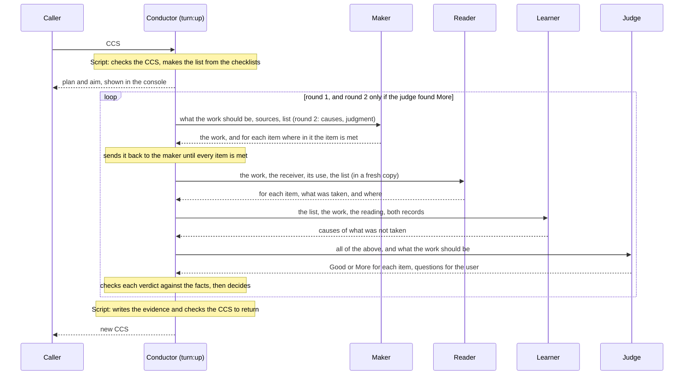

# turn design

This document says what turn must achieve for the user, how each part of that is checked, and how
turn is built to achieve it. It serves the benefits the [README](../../turn/README.md) promises.

## Goals

### Attractive quality

- Work comes back already read in the receiver's place, with what the reader missed made again from
  its cause, so the user can hand it on without first reading it as its receiver.
- The user is asked only what only they can decide.
- While turn works, the user sees how far it has come and what it means to make, and can stop it
  before a wrong aim is carried through.
- A plugin hands turn one task and decides its next step from what turn returns, without writing
  the loop of making, reading and making again itself.

### One-dimensional quality

- The share of tasks that end in the first round with nothing missed: the more work is right when
  first made, the less the user waits and the less is spent.
- The time and the tokens one task takes.

### Must-be quality

- turn changes nothing in the user's repository but the deliverable and its own records, and never
  commits or pushes.
- What the work should be does not change during a task: turn never rewrites what the caller wrote.
- No change reaches the user unread: every version returned is the one the reader last read.
- A task stopped partway carries on from where it stopped; one cut off starts over from what the
  caller wrote.
- Each judgment can be followed to what it rests on, including the version of each checklist it was
  made by.
- When python3 or jq is missing, turn stops before any work and says what to install.

### Backward compatibility

None: turn has not been released. From the first release, what calling plugins and later versions
of turn rely on is the CCS (its parts, kinds and the values of `next`) and `turn:up` with its two
arguments; the console wording and the agents' prompts may change.

### Non-goals

- Deciding what the work should be. The caller writes it; turn measures against it and returns what
  it cannot decide.
- Talking to the user. turn returns its questions to the caller, which knows what was already agreed
  with the user and asks them.
- Running until nothing is missed. Two rounds at most: what a second round still misses points to a
  fault in turn, in the checklist or in what the caller wrote, which is fixed there, not looped over.
- Holding checklists. They belong to whoever knows the kind of work, such as writ; turn reads the
  ones it is given.
- Code. A program is checked by running its tests, not by reading.

### Constraints

- turn runs inside Claude Code, and is built only from what a plugin can hold: skills, agents, hooks
  and scripts. Installing copies only turn's own folder.
- What runs on users' machines is Python 3.9 or later with the standard library only, and jq.
- The work is in a git repository, since the reader starts from a fresh copy of it.

## Verification

### Attractive quality

Each is tried on real work: writ's documents and prompts, and turn's own, are made through turn, and
whoever builds turn reads every conversation and agent record (JSONL) of the run. A made-up task
shows only that the made-up task passes.

- Read in the receiver's place: the returned work, read again by a fresh reader on the same
  checklist, shows nothing missed that the judge let through as Good.
- Asked only what only the user can decide: no returned question can be answered from what the
  caller wrote or from its sources.
- Seeing the work as it goes: the plan and the aim appear before anything is written, and each line
  of the console says which round and step it belongs to.
- A plugin decides from what turn returns: the next step decided from the returned CCS alone is the
  same as the one decided after also reading the records.

### One-dimensional quality

Measured on the same set of real tasks, against the version in use: the share ending in round 1,
and the time and tokens per task, from the records.

### Must-be quality

Each is checked by a test that runs the script or hook that keeps it:

- Repository untouched: a write outside the deliverable and turn's records, a commit and a push are
  each stopped.
- What the work should be unchanged: a returned CCS whose caller-written parts differ from those
  received is stopped.
- Nothing unread: a run whose last version was written after the last reading cannot be returned.
- Stop and start over: a stopped run returns `stopped`, and a run called again with it carries on
  from that point; a run called again with the same input after being cut off starts from the
  beginning.
- Traceable: every judgment names the lines it rests on and they exist, and the evidence names the
  commit of each checklist.
- Missing tools: with python3 or jq missing, turn stops and says what to install.

### Backward compatibility

None: turn has not been released.

## Architecture

### Principles

- Every judgment is measured against what the caller wrote the work should be, and nothing else.
  Protects: read in the receiver's place, what the work should be unchanged.
- Each role is given one aim it can work toward, set inputs and a set output. Protects: read in the
  receiver's place, the first-round share. An AI works toward the aim it is given; told the steps
  instead, it follows them and loses the aim.
- A shortfall is sent back to where it was made, as early as it can be seen. Protects: the
  first-round share, the time and tokens. What the conductor can see in the maker's work, the
  reader and the judge would find a round later.
- The conductor makes the final decision, and checks every verdict against the work and the
  records before acting on it. Protects: read in the receiver's place, asked only what only the user
  can decide. A verdict taken on trust passes its slip on to the user.
- What was missed is made again from its cause, and only what has been read is returned. Protects:
  read in the receiver's place, nothing unread. A patch at the spot leaves the cause to show again
  elsewhere.
- The next step starts from the returned CCS and the deliverable alone. Protects: a plugin decides
  from what turn returns, stop and start over.

### Structure

The caller is a plugin's step, or Claude in the user's conversation, which writes the CCS from the
request. The conductor is turn's own conversation, running in the caller's. Hooks watch each agent as
it finishes; scripts make what must come out the same every time. The copy the reader works in is
made from git and deleted when the reader is done.

| Role | Aim | Hands back |
|---|---|---|
| Maker | A work that meets every item of the checklists | The work, and for each item where in it the item is met |
| Conductor | The final decision: the work meets what it should be, by the shortest way | The maker's work sent back or passed on; each verdict checked against the facts; the next round or the CCS to return |
| Reader | Use the work as its receiver | For each item, what was taken from the work, and where |
| Learner | Why what the list asks was not taken | Each cause, with the items it explains and where it shows |
| Judge | Whether each item is met, without bias, from every input and the facts | Good or More for each item, with why, and the questions only the user can answer |

### The checklist as the measure

Achieves: read in the receiver's place, the first-round share.

The checklists are written so that a work meeting every item serves its purpose and is what it
should be; every role works against the same list, made by a script from them with each item's whole
text. A gap found that no item asks about belongs in the checklist, not in a role's answer.

- Must hold: every role's output has an entry for every item of the list, and nothing outside it.
- Weighed: letting the reader also say what it could not take was not chosen; with no item to bound
  it, it reads as a search for faults, and its answers vary from run to run.

### Making it right first

Achieves: the first-round share, the time and tokens.

The maker is given what the work should be, the sources and the list, and makes a work that meets
every item, saying for each where in the work it is met. The conductor reads the work and the list,
and sends the work back with each item not met until every item is. What the sources do not settle
goes to the user as a question and stays out of the work.

- Must hold: no work reaches the reader with an item the conductor sees unmet.
- Weighed: passing the maker's work straight to the reader was not chosen, since every shortfall
  it leaves then costs a full round to find.

### Reading in the receiver's place

Achieves: read in the receiver's place.

The reader starts where the receiver starts: a fresh copy of the repository with only the work added,
told who the receiver is, what they use it for, and the list. It is told nothing of how the work was
made, nor what the caller wrote it must achieve, so it stops where the receiver would. For each item
it says what it took from the work and where.

- Must hold: the reader's copy holds nothing the receiver would not have.
- Weighed: reading in the working repository was not chosen, since files the receiver lacks would
  help the reader along and hide what is missing.

### Making again from the cause

Achieves: read in the receiver's place, nothing unread.

The learner takes what each item asks less what the reader took, and finds why each remainder was
not taken, in the work and in the process, putting items that share a cause together. The judge
reads every input and the records, and decides each item Good or More from the facts. The conductor
makes the final decision: it checks each Good and More against the work, the reading and the
records, sends a verdict the facts do not bear out back to the judge with what does not hold, and
then decides from the aim, the judgment and the facts. When anything is More, the maker makes the work
again in round 2 from those causes, keeping what was Good, and it is read and judged once more. What
round 2 still judges More is returned as it is, with why.

- Must hold: nothing is written to the work after its last reading.
- Weighed: running until nothing is missed was not chosen, since a loop that does not settle hides a
  fault that belongs to turn or the checklist. Having the conductor fix round 2's More before
  returning was not chosen, since that change would reach the user unread. The learner and the judge
  are kept apart, since one who found a cause goes easy on it.

### Showing the work as it goes

Achieves: seeing the work as it goes.

Before the first round, the conductor shows the plan once: write, read, check, and once more if
something was missed, two rounds at most. Then each line, grouped by round, says its step and gives
the path of what was made: the aim before writing, what the reader could not take in plain words,
and at the end where the work is and what the user must decide. Three marks are used, each with one
meaning: ⚠️ something missed, ✅ nothing missed, ❓ the user must decide.

- Must hold: the aim is shown before the maker writes, so the user can stop it with Esc.
- Weighed: item IDs and counts were not shown, since the user would have to learn the checklist to
  read them. Circled numbers were not used, since terminals give them different widths.

### The CCS

Achieves: a plugin decides from what turn returns, what the work should be unchanged, stop and start
over, traceable.

A CCS is one JSON file in the nine parts of ACC, each a list of entries of a fixed kind; its full
form is in [ccs.md](../../turn/skills/up/ccs.md), which the caller's step names. The caller writes
what the work should be: where it goes, its receiver, what they use it for, what the receiver must
be able to do with it (`acceptance`), the checklists (`viewpoint`) and the sources. turn writes a
new CCS beside it: what to do next (`done`, `ask the user`, `to the caller`, `stopped`), the
questions only the user can answer, each item still More with why, the rules it learned, and where
the evidence is, including the commit of each checklist. Each round's work, lists and records are
kept in a folder named after the returned CCS. The caller adds the user's answers to a new CCS and
calls again.

- Must hold: the parts the caller wrote are the same in the returned CCS, except new lines added
  after the old in `constraints`; every part and kind is one of those defined; a script checks both
  on receiving and on returning, and stops with what does not match.
- The CCS is the caller's interface only. Inside turn, the conductor hands each role the parts it
  needs in forms set for that role, and changes them without touching the CCS.
- Weighed: a free-form handover was not chosen, since the caller and the next run find what they
  need by kind, and a form an AI chooses afresh breaks them. Copying the work into the CCS was not
  chosen; only places are written, since a copy drifts from the real thing.

### Leaving the user's work alone

Achieves: repository untouched, missing tools.

Hooks stop, as an agent tries them, a write outside the work and turn's records, and any commit or
push; the caller decides whether to commit. A script checks for python3 and jq before anything
starts.

- Must hold: after a run, the only changes in the repository are the work and turn's records.
- Weighed: checking afterwards was not chosen, since the harm is done by then.
