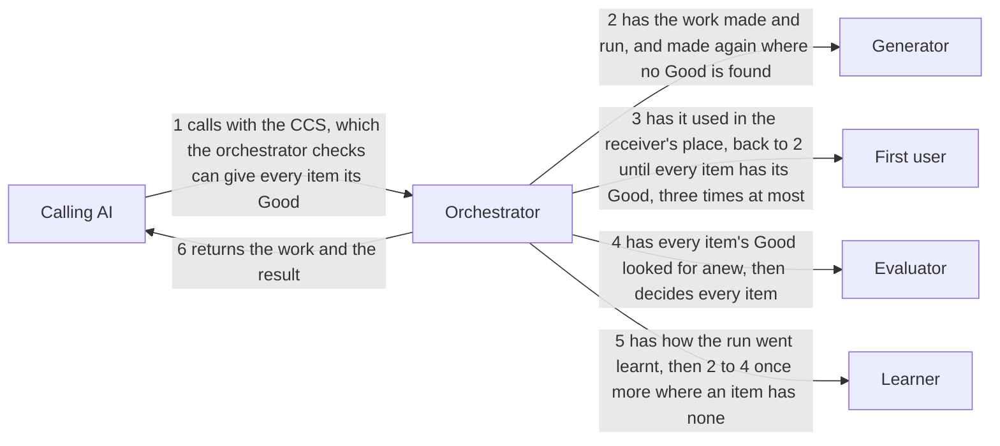

# turn design

turn is built from five AI roles, a few scripts and hooks: one role makes the work and makes it
again until another, using it in its receiver's place, finds every item's Good, and the rest decide
from those readings which items get their Good and have the work made again where one does not. The
goal, the key results, and what a checklist, the receiver and a Good are, are in
[turn's UX](ux.md).

## User stories

- As the calling AI, I want to hand turn the path of a CCS and get the work back, with each item's
  Good and its lines, the questions only the user can decide, each item still without Good, and the
  lessons on how the run went; or, when the CCS cannot give an item its Good, the questions alone,
  before any work is made.

  The UX's first and last scenes are the calling AI's own work around this call.

## Architecture

### Logical view



The orchestrator and the four roles it starts are AIs, each answering the orchestrator in its reply.

- Every role that judges the work looks only for the Good each item gets and the lines that give
  it; only a script, code that runs the same every time, doubts, and only by coverage: it names each
  item no role gave its Good.

  An AI that looks for what more the work needs finds more without end, and each find is patched
  in, so the work drifts from what it should be. Each role has one aim, so it works to the aim
  rather than to a list of steps.
- Each item is answered by what the receiver gets using the work with what they have, never by
  whether the work matches the sources it was made from.

  What the receiver gets is the work's purpose; matching the sources is a means to it, and checked
  on its own it draws the work toward the sources' words and the product's edge cases rather than
  toward the receiver. The receiver has no sources, so no reading in their place could answer it.
- Each item is answered where its checklist's `Scope` line says: `its part`, at the lines that give
  it; `each part`, in every part of the work on its own, a Good for each; `whole`, of the work at
  once. A script splits the work into its parts, a document's sections under its top headings with
  the title and opening as one, and each other file whole, stops a reply that gives an each-part
  item without every part, and gives such an item its Good only where every part has one.

  A Good found where one part gives it passes a part that does not, so a remake that breaks one
  part for another item goes unseen; what lies between the parts, such as one name for each thing,
  is found only in the whole. The checklist says it once, so every role and every run answers an
  item at the same place.
- The calling AI hands the orchestrator the CCS's path, where the result goes, and the kinds it uses
  in the CCS for where the work goes, the checklists and the receiver, and, if it has them, what the
  receiver reads the work for and what they have with it.

  The CCS is the calling AI's, and turn defines nothing of it: what turn needs is found by these
  kinds, and the values stay in the CCS alone, so the call and the CCS cannot differ. Where the
  result goes is this call's answer, not the task's state, so it is not in the CCS.
- Before any work is made, the orchestrator reads the CCS, the files it names and the checklists,
  and finds for every item what in them gives its Good; where nothing does, it returns the
  questions alone, each with the items it settles, and no work is made.

  A Good the CCS cannot give, the generator cannot give either, and the making and the readings
  after it would be spent for nothing; an answer may also change how the whole work is laid out.
  The calling AI asks the user and calls turn again with the answer in the CCS.
- The generator first sets, from the whole CCS, the Good the receiver is to get from the work for
  each item and where the work gives it, then makes the work to give each, runs what it wrote as
  the receiver would, and hands back each item's Good with its lines and the questions only the user
  can decide.

  A work made to Goods set first gives each where it was meant; one written first and matched to
  the items after is patched item by item. What is not run is not known to work, and a receiver who
  meets it failing gets nothing from the rest. It hands back once it has read the work and found
  each Good at its lines. What the CCS does not say becomes a question, not its own guess. Its Goods
  are its claim, not a judgment.
- The first user uses the work in the receiver's place, with everything the receiver has and doing
  all they do with it, as the CCS says of the receiver, such as the whole repository and running
  its tests for a maintainer of code, and gives for each item the Good it found in the work, with
  its lines, and for each it finds none, the places of the work where it looked for it, what it did
  there and what it did not get.

  A reader that did not make the work finds only the Good its lines give; the maker finds the Good
  it meant. What the receiver gets lies also in what they have and do beside the work: a reader
  with less misses a Good the receiver gets, and one that only reads passes what a run shows to
  fail. A place alone does not show the maker what was missing; what the reader did there and did
  not get does.
- The orchestrator sends the generator each item the first user found no Good for, as the first
  user gave it, and the first user reads the work made again, with no reading between, until it
  finds every item's Good, each item left waits on a question, or it has been sent back three times
  in a round. The generator and the first user stay started until then, and neither is sent
  anything after; the next round starts both anew.

  The generator holds the sources it read and the Good it meant at each line, so it changes only
  what is sent back, without reading the sources again; how the work gives the Good is the
  generator's to decide, since an edit told per item broke other items. A first user that stays
  started reads again whether the places it stopped at now give the Good, so what is left only
  shrinks. A bound keeps a reading that does not settle from going on without end, and what it
  leaves goes on to the evaluator, the decision and the second round.
- From the generator's first making to the evaluator's reply, the orchestrator only starts and
  messages the agents the script names, reading no work; it judges before the work is made and at
  the decision.

  The orchestrator holds the sources and the call, so its reading of the work finds the Good the
  work meant, not the one the receiver gets; put between the remake and the first user, it costs a
  reading each time and pulls the remake toward its own view.
- The evaluator, started anew and given what the first user was given and its last reading, looks
  through the whole work for every item's Good as the receiver first meets it, holding each Good of
  the reading to what its item asks, and gives every Good with its lines. The orchestrator then
  reads the work whole and decides every item from both readers' Goods: a Good only where a reader
  found one, none where neither did or a doubt stays inside a Good.

  One reader misses a Good the work gives, and an item judged without it is made again for nothing;
  a Good held to its item is one the calling AI can rely on. A Good held only at the lines the
  reading named passes a place elsewhere that does not give it. Readers that agree may still carry a
  doubt inside a Good, so agreement is decided too. A Good only the orchestrator found would be
  judged by one that read the work knowing what it meant, so a script stops it.
- Once the orchestrator has decided, the learner reads every item's finding and the record of every
  agent of the run, the orchestrator's included, and gives, from what they show, with the words it
  rests on quoted, how the run went: whether the Goods came without waste and not by chance, each
  lesson for the role it is for, on how it read, checked and replied, or that it found none and what
  it checked.

  A lesson on what the work should say tells the generator how to give a Good, which is the
  generator's to decide: told to put every change in the opening, it made the opening one sentence
  of five changes. What fell short often lies in what a role did, which only its record shows; a
  run where every item got its Good may still have got it by chance, or spent time for nothing, and
  what is not learnt from is met again. A lesson without the facts it rests on is a guess.
- Every agent of the run, before it starts its work, tells the calling AI what it will do, how far
  and how, and as each step ends, what is done and what comes next; no one answers it.

  The calling AI waits in the background and gets nothing else until the run returns, so a run
  going a slow or wrong way would show only once its time is spent. Only the agent doing the work
  knows how it will do it, so it says so itself; it is told, not asked, so no step waits on it.
- The orchestrator takes the lessons it finds hold: each goes to its role in the next round and into
  the result, for the calling AI to hand on to turn's makers.

  The learner sees what each agent did, but the orchestrator decided every step of the run, so it
  judges which lessons hold.
- When every item has its Good or is a question, the run returns; otherwise the generator, started
  anew, is given each item without Good with what the decision found, the work is made again and
  read once more, from the first user to the decision and the learner, and then the run returns,
  with each item still without Good, what the receiver gets once it has it and where it was not
  found.

  A Good the receiver is to get may fall short in one round; a second settles what the first found,
  and what is left costs the calling AI less to fix than more readings would.

### Physical view

```
turn/                      the plugin, installed by Claude Code
├── agents/
│   ├── up.md              the orchestrator <agent>
│   ├── generator.md       <agent>
│   ├── first-user.md      <agent>
│   ├── evaluator.md       <agent>
│   └── learner.md         <agent>
├── scripts/               the call's check, each role's input, the findings, the result <Python 3, jq>
└── hooks/
    ├── hooks.json         one entry per event
    └── *.py               one check each <Python 3>
```

- turn runs on Claude Code, python3 3.9 or later, jq and git.
- The calling AI starts the orchestrator, `turn:up`, in the background with the call as JSON, so its
  context holds only what comes back.

  It can still take the user's pause while it waits, and stops a run by sending the orchestrator a
  message. The user sees the run's agents in the panel below the prompt input. `claude -p` is not
  used, since the docs say `--bare`, which reads no subscription login, will become its default.
- A script checks the call and takes every entry of each kind it names from the CCS, so no AI
  copies a value; it stops a call that names a missing file or leaves where the work goes, the
  checklists or the receiver without an entry.
- What each role is given: the generator, the whole CCS, every checklist and what is sent back; the
  first user, the work, what the receiver has with it, who the receiver is and what for, and the
  checklists; the evaluator, the same and the last first user's reading; the learner, every item's
  finding and the JSONL of every agent of its run, the orchestrator's included; and each role of the
  second round, the lessons taken for it.
- The orchestrator starts the generator and the first user once a round and sends each what comes
  next with SendMessage, which it loads with ToolSearch, until the first user's reading ends; the
  evaluator and the learner it starts anew each time.

  Tried with an agent started by an agent started in the background, as turn's roles are: sent a
  message after its reply, the same agent answered from what it had read, using no tool.
- Each agent tells the calling AI with SendMessage to `main`, the conversation the calling AI runs
  in, and the hook that lets the orchestrator message only the agent the script names lets a
  message to `main` through.

  Tried with an agent started by an agent started in the background: its message to `main` reached
  the conversation while the agent that started it was still running.
- The reply of a role sent a message comes back later, not with the send, so the hook that checks
  each reply keeps it in the run, and the orchestrator waits for it with turn's script.

  Tried: an orchestrator that ended its turn after the send never got the reply; one that waited
  on a script reading what the hook kept got it word for word.
- A script counts the rounds and the first user's send-backs of each round, two rounds and three
  send-backs at most, and names the agent to start or message next with what it is given; a hook
  lets the orchestrator start or message only that agent, with that.

  A bound kept by the orchestrator's own count is broken by one slip, unseen; a script counts the
  same every time.
- Each role replies in a JSON form of its own, not in a file, and a hook checks each role at both
  ends.

  Only the orchestrator holds the replies, so the first user cannot see the generator's claim. A
  hook lets a role start only with what it is to be given, and stops a reply that does not fill its
  form.
- The hooks stop a read outside what a role is given, a write outside where the work goes, and a
  commit or a push; a stop says why and names what may be read.

  A role that reads only what it is given is not bent by what it was not meant to see.
- The hooks stop every role's reply, and the orchestrator's check and decision, until every input
  of its step is read whole since it last changed, and of what the receiver has, each file the first
  user or the evaluator opens; a script shows the learner each record page by page, as a record is
  too long for one read.

  An item judged on a part read is judged on a guess for the rest.
- A script writes the result where the call says, and checks its shape as it writes.

  A reply would be copied into a file by the calling AI, where a slip goes unseen.
- Several runs go at once, and the hooks tell them apart by the orchestrator's `agent_id`.

  Every agent of a conversation has the same `session_id`. A role's run is the `parentAgentId` in
  `subagents/agent-<agent_id>.meta.json` beside the conversation's transcript; tried with two runs
  at once, every role's tool use and reply was tied to its own orchestrator. The file is there from
  a role's first tool use, so what a role is started with is checked at the orchestrator's own call
  that starts it. The file is Claude Code's record, not a documented hook input, so the hooks'
  tests hold its shape.
- The work is made where it goes, and a run cut off leaves its writing as changes git shows.

  The calling AI undoes or finishes them and calls turn again on what is there. No run resumes part
  way, since being cut off is rare and a reading again costs less than a resume to build and keep
  right.

## Verification

### Units

- The scripts and the hooks: each check stops what it must and lets through what it must.
  - Flow: unittest in `dev/turn/tests/`, fed the calls, replies, events and records each receives,
    each step expected in the order this design gives, run by [`dev/check.sh`](../check.sh) in CI
    on every push, with lines and branches 100% covered, Ruff's lint and format, and Pyrefly's
    types for Python 3.9.
- The orchestrator: takes each step of the run in this design's order, from the call to the result.
  - Flow: on a task of two items, one answered at its part and one in each part, with the four roles
    stood in for by agents that read what their step reads and give a reply set beforehand, one set
    for each way a run goes: every item Good at the first reading, an item the first user finds no
    Good for given at its next reading, an item sent back three times going on to the evaluator, the
    evaluator differing from the first user, and an item left without Good through the second
    round, with the learner after each round; and, on the same task with its decision taken out,
    the questions returned before any work is made. On Opus 5.5; passes when its JSONL shows each
    step in this design's order, no reading by the orchestrator between the generator's first
    making and the evaluator's reply, each hook stopping where its check should, and the result as
    the set replies make it.
- Each of the four roles: works to its aim with what it is given, giving its form.
  - Flow: started on its own with a prompt set beforehand, as the orchestrator would give it, on a
    task of two items, one answered at its part and one in each part, on Opus 5.5; passes when its
    JSONL shows it read only and whole what its step reads, and its reply fills its form; the
    generator runs what it wrote and the first user what the receiver runs; the generator, sent
    back by message, remakes the work without reading its sources again, and the first user, sent
    the work made again, gives the places it stopped at their Good.
  - Content: what it makes in the acceptance trials below, read against its JSONL.

### Acceptance

Each trial runs in a clone of `lovaizu/playground` of its own, on a branch of its own, pushing
nothing, removed after: a stand-in for the calling AI is handed a small task's CCS and checklist and
calls turn, and is judged from the JSONL of every agent it started and from the work. Each
acceptance trial is run three times at once.

What an AI does varies from run to run, and one run shows one of its ways; runs that push nothing
and keep their own folders do not touch each other.

- Flow: a stand-in for the calling AI calls turn on a task of one item, with every role real, and
  the work comes back with the result in its form.
- The story: the work comes back where it goes, and every item has a Good with its lines, a
  question, or what the receiver gets once it has its Good.
  - Each Good is checked by reading its lines in the work.
- KR1.1: the items of the work the calling AI is not satisfied by when it comes back.
  - Each item the stand-in fixes in its JSONL, and each the work still misses, judged as the UX's
    KR1.1 says, and compared with the version in use on the same task, kept with the trial in
    `dev/turn/trials/`.
- KR1.2: the time from the call to the work coming back.
  - Taken from the JSONL's timestamps for a README-sized work, and compared with the version in use
    on the same task.
  - Read step by step from the same timestamps; time that adds nothing to the story or KR1.1 is
    cut first.

A change is taken when the story is still achieved and KR1.2 does not come closer at the cost of
KR1.1.
