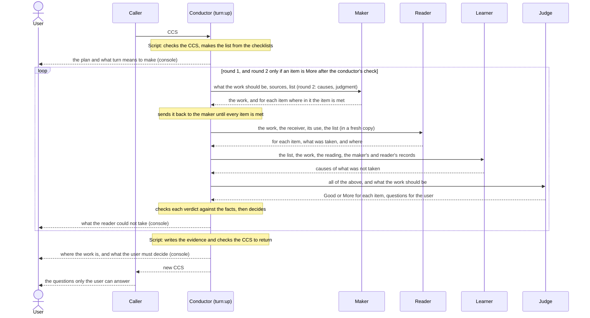

# turn design

This document says what turn must achieve for the user, how each part of that is checked, and how
turn is built to achieve it, for whoever changes turn. It serves the benefits the
[README](../../turn/README.md) promises. How to use turn is in the README, the full form of the CCS
in [ccs.md](../../turn/skills/up/ccs.md), and the wording of each role's prompt in the prompt itself;
none is repeated here.

The caller hands turn one task as a CCS, a JSON file in which the caller writes what the work
should be: for whom, for what use, from which sources and against which checklists. Inside turn, its
conductor has a maker make the work, a reader read it in the receiver's place, a learner find why
the reader could not take what it missed, and a judge give each checklist item a verdict, Good (met)
or More (not yet met); the verdicts with their reasons are its judgment. Like a review by a
first-time user, but run as a set process, every role works on the same list: every item of the
checklists with its whole text, made by a script. Each role's conversation is kept as a record
(JSONL), and a script writes the evidence: each verdict with the lines of the work and the records
it rests on, and the commit of each checklist.

## Goals

### Attractive quality

- Read in the receiver's place: work comes back already read in the receiver's place, with what
  the reader missed made again from its cause, so the user can hand it on without first reading it
  as its receiver.
- Asked only what only the user can decide: the user is asked nothing that what the work should be,
  or its sources, already answers.
- Seeing the work as it goes: while turn works, the user sees how far it has come and what it means
  to make, and can stop it before work on a wrong intent is carried through.
- A plugin decides from what turn returns: a plugin hands turn one task and decides its next step
  from what turn returns, without writing the loop of making, reading and making again itself.

### One-dimensional quality

- The first-round share: the share of tasks that end in the first round with nothing missed; the
  more work is right when first made, the less the user waits and the less is spent.
- Time and tokens: the time and the tokens one task takes.

### Must-be quality

- Repository untouched: turn changes nothing in the user's repository but the work and turn's
  folder, `.turn/`, and never commits or pushes.
- What the work should be unchanged: only the caller writes what the work should be, and turn never
  rewrites it during a task.
- Nothing unread: every version returned is the one the reader last read.
- Stop and start over: a task that stops partway, returning where it stopped, carries on from there
  when called again; one cut off before it returns anything starts over from the CCS the caller
  wrote.
- Traceable: each verdict can be followed to what it rests on, including the version of each
  checklist it was made by.
- Missing tools: when python3 or jq is missing, turn stops before any work and says what to
  install.

### Backward compatibility

- Calling plugins rely on `turn:up` with its two arguments, `in` and `out`, and on the CCS: its
  parts, its kinds of entry and the values of `next`. These must keep holding.
- A later version of turn relies on reading a CCS an earlier version returned, so that a stopped
  task carries on after an update. This must keep holding.
- The user and the next run rely on `.turn/`, which turn leaves in the repository; the next run
  reads only what a returned CCS points to. Every place a returned CCS points to must exist; what
  else is inside `.turn/`, and how it is laid out, may change between versions.
- The console wording and the roles' prompts may change; nothing reads them but the user.

### Non-goals

- Deciding what the work should be. The caller writes it; turn measures against it and returns what
  it cannot decide.
- Talking to the user. turn returns its questions to the caller, which knows what was already agreed
  with the user and asks them.
- Running until nothing is missed. Two rounds at most: what a second round still misses points to a
  fault in turn, in the checklist or in what the work should be, which is fixed there, not looped
  over.
- Holding checklists. They belong to whoever knows the kind of work, such as writ; turn reads the
  ones it is given.
- Code. A program is checked by running its tests, not by reading.

### Constraints

- turn runs inside Claude Code, and is built only from what a plugin can hold: skills, agents, hooks
  and scripts. Installing copies only turn's own folder.
- What runs on users' machines is Python 3.9 or later with the standard library only, and jq.
- The work is in a git repository, since the reader starts from a fresh copy of it.

## Verification

### Attractive quality

Each is tried on real work: writ's documents and prompts, and turn's own, are made through turn, and
whoever builds turn reads every conversation and agent record (JSONL) of the run. A made-up task
shows only that the made-up task passes.

- Read in the receiver's place: the returned work, read again by a fresh reader on the same
  checklist, shows nothing missed that the judge let through as Good.
- Asked only what only the user can decide: no returned question can be answered from what the
  work should be or from its sources.
- Seeing the work as it goes: the plan and what turn means to make appear before anything is
  written, and each line of the console says which round and step it belongs to.
- A plugin decides from what turn returns: the next step decided from the returned CCS alone is the
  same as the one decided after also reading the records.

### One-dimensional quality

Measured on the same set of real tasks, against the version in use: the first-round share, and
time and tokens per task, from the records.

### Must-be quality

Each is checked by a test that runs the script or hook that keeps it:

- Repository untouched: a write outside the work and `.turn/`, a commit and a push are each
  stopped.
- What the work should be unchanged: a returned CCS in which what the work should be differs from
  what was received is stopped.
- Nothing unread: a run whose last version was written after the last reading cannot be returned.
- Stop and start over: a stopped run returns `stopped`, and a run called again with it carries on
  from that point; a run called again with the same input after being cut off starts from the
  beginning.
- Traceable: every verdict names the lines it rests on and they exist, and the evidence names the
  commit of each checklist.
- Missing tools: with python3 or jq missing, turn stops and says what to install.

### Backward compatibility

For each released version, a test shows that turn, called as that version's callers call it and
with a CCS that version returned, accepts the call, and that every place the CCS points to exists.

## Architecture

### Principles

- Every verdict and decision is measured against what the work should be, and nothing else.
  Protects: read in the receiver's place, what the work should be unchanged.
- Each role is given one aim it can work toward, set inputs and a set output. Protects: read in the
  receiver's place, the first-round share. An AI works toward the aim it is given; told the steps
  instead, it follows them and loses the aim.
- A shortfall is sent back to where it was made, as early as it can be seen. Protects: the
  first-round share, time and tokens. What the conductor can see in the maker's work, the
  reader and the judge would find a round later.
- The conductor makes the final decision, and checks every verdict against the work and the
  records before acting on it. Protects: read in the receiver's place, asked only what only the user
  can decide. A verdict taken on trust passes its slip on to the user.

### Structure

The caller is a plugin's step, or Claude in the user's conversation, which writes the CCS from the
request. The conductor is the `turn:up` skill, running in the caller's conversation; the other roles
are agents it starts. Each round's work, lists, readings, conversation records (JSONL) and the
evidence are kept in turn's folder, `.turn/`.

| Part | Aim | Hands back |
|---|---|---|
| Maker | A work that meets every item of the checklists | The work, and for each item where in it the item is met |
| Conductor | The final decision: the work meets what it should be, by the shortest way | The maker's work sent back or passed on; each verdict checked against the facts; the next round or the CCS to return |
| Reader | Use the work as its receiver | For each item, what was taken from the work, and where |
| Learner | Why what the list asks was not taken | Each cause, with the items it explains and where it shows |
| Judge | Whether each item is met, without bias, from every input and the facts | Good or More for each item, with why, and the questions only the user can answer |
| Scripts | What must come out the same every time | The list from the checklists; the CCS checked on receiving and returning; the evidence |
| Hooks | Slips caught as an agent makes them | A stop, with what is missing, for an unfilled item, a write outside the work and `.turn/`, a commit or a push |

turn depends on Claude Code, which runs the skill, the agents and the hooks; on git, from which the
reader's copy is made and deleted when the reader is done; and on python3 and jq, which run the
scripts and read parts of the CCS.

### The checklist as the measure

Achieves: read in the receiver's place, the first-round share.

The checklists are written so that a work meeting every item serves its purpose and is what it
should be; every role works against the same list, made by a script from them with each item's whole
text. A gap found that no item asks about belongs in the checklist, not in a role's answer.

- Must hold: every role's output has an entry for every item of the list, and nothing outside it; a
  hook stops an agent that hands back an item unfilled.
- Weighed: letting the reader also say what it could not take was not chosen; with no item to bound
  it, it reads as a search for faults, and its answers vary from run to run. The cost: what no item
  asks is not found until the checklist is changed.

### Making it right first

Achieves: the first-round share, time and tokens, asked only what only the user can decide.

The maker is given what the work should be, the sources and the list, and makes a work that meets
every item, saying for each where in the work it is met. The conductor reads the work and the list,
and sends the work back with each item not met until every item is. What the sources do not settle
goes to the user as a question and stays out of the work.

- Must hold: no work reaches the reader with an item the conductor sees unmet.
- Weighed: passing the maker's work straight to the reader was not chosen, since every shortfall
  it leaves then costs a full round to find. The cost: the conductor reads every item of the work
  before each reading.

### Reading in the receiver's place

Achieves: read in the receiver's place.

The reader starts where the receiver starts: a fresh copy of the repository with only the work added,
told who the receiver is, what they use it for, and the list. It is told nothing of how the work was
made, nor what the work should be, so it stops where the receiver would. For each item it says
what it took from the work and where.

- Must hold: the reader's copy holds nothing the receiver would not have.
- Weighed: reading in the working repository was not chosen, since files the receiver lacks would
  help the reader along and hide what is missing. The cost: a fresh copy is made for each reading.

### Making again from the cause

Achieves: read in the receiver's place, asked only what only the user can decide, nothing unread,
traceable.

The learner takes what each item asks less what the reader took, and finds why each remainder was
not taken, in the work and in the process, putting items that share a cause together. The judge
reads every input and the conversation records, and gives each item a verdict, Good or More, naming
the lines of the work and the records it rests on; a question goes to the user only when nothing the
work should be, nor its sources, answers it. The conductor makes the final decision: it checks each
verdict and question against the work, the reading and the records, sends one the facts do not bear
out back to the judge with what does not hold, and then decides from what the work should be, the
judgment and the facts. When anything is More, the maker makes the work again in round 2 from those
causes, keeping what was Good, and it is read and judged once more. What round 2 still judges More is
returned as it is, with why. A cause found in the process rather than in the work is returned as a
rule, for the caller to keep in its later tasks.

- Must hold: nothing is written to the work after its last reading.
- Weighed: fixing each missed item where it shows was not chosen, since a patch at the spot leaves
  the cause to show again elsewhere; the cost is the learner's pass each round. Having one agent
  both find the causes and judge was not chosen, since one who found a cause goes easy on it; the
  cost is one more agent each round. Running until nothing is missed was not chosen, since a loop
  that does not settle hides a fault that belongs to turn or the checklist; the cost is that some
  work comes back with More, for the user to decide on. Having the conductor fix round 2's More
  before returning was not chosen, since that change would reach the user unread; the cost is
  again that such work comes back with More.

### Showing the work as it goes

Achieves: seeing the work as it goes.

The console serves a user who looks in now and then. The conductor shows the plan once, before the
first round, so that each later line, grouped by round, can be placed in it at a glance. What the
maker means to make is shown before it writes, so a wrong intent is stopped before a round is spent
on it. What the reader could not take is told in plain words, and each line gives the path of what
it is about, so the user can open the work or the reading. A few marks, each with one meaning, tell
at a glance whether something was missed, nothing was, or the user must decide.

- Must hold: what the maker means to make is shown before it writes, so the user can stop it with
  Esc.
- Weighed: item IDs and counts were not shown, since the user would have to learn the checklist to
  read them; the cost is that a user who wants the item reads it in `.turn/`.

### The CCS

Achieves: a plugin decides from what turn returns, what the work should be unchanged, stop and start
over, traceable.

A CCS (Compressed Cognitive State) is one JSON file in the nine parts that [ACC (Agent Cognitive
Compressor)](https://arxiv.org/abs/2601.11653) sets as the state the next step needs, each a list of
entries of a fixed kind; its full form is in ccs.md, which the caller's step names. The caller
writes what the work should be: where it goes, its receiver, what they use it for, what the receiver
must be able to do with it (`acceptance`), the checklists (`viewpoint`) and the sources. turn writes
a new CCS beside it: what the caller is to do next (`next`), the questions only the user can answer,
each item still More with why, the rules it learned, and where the evidence is. The caller adds the
user's answers to a new CCS and calls again. The next run starts from the returned CCS and the work
alone: a run that stopped returns `stopped` and where, and the next run carries on from there; a run
cut off returns nothing, and the caller calls again with the same CCS, which turn never rewrites.

- Must hold: what the work should be is the same in the returned CCS, except new lines added
  after the old in `constraints`; every part and kind is one of those defined; a script checks both
  on receiving and on returning, and stops with what does not match. The next step needs nothing
  beyond the returned CCS and the work.
- The CCS is the caller's interface only. Inside turn, the conductor hands each role the parts it
  needs in forms set for that role, and changes them without touching the CCS.
- Weighed: handing each role the CCS itself was not chosen, since each role is given set inputs for
  its one aim, and a change made for one role would change what callers rely on; the cost is that
  the conductor writes each role's inputs from the CCS. A free-form handover was not chosen, since
  the caller and the next run find what they need by kind, and a form an AI chooses afresh breaks
  them. Copying the work into the CCS was not chosen; only places are written, since a copy drifts
  from the real thing. The cost: the caller writes JSON in a set form, which a script may refuse.

### Leaving the user's work alone

Achieves: repository untouched, missing tools.

Hooks stop, as an agent tries them, a write outside the work and `.turn/`, and any commit or
push; the caller decides whether to commit. Before anything starts, a check looks for python3 and
jq.

- Must hold: after a run, the only changes in the repository are the work and `.turn/`.
- Weighed: checking afterwards was not chosen, since the harm is done by then. The cost: a check on
  each write, commit and push an agent tries.
