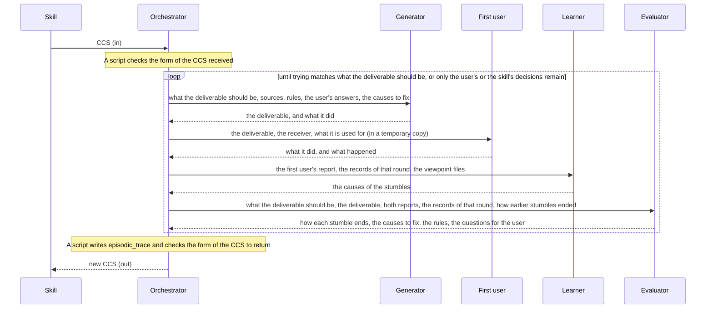

# turn design

This document is for the people who build and maintain turn. For each promise in the [README](../../turn/README.md), it says which feature keeps it and how that is checked. Whether a change fits the design is decided by the principles below and by what the plugin's users would lose.

The orchestrator is turn's main conversation, the one running `turn:up`. Where the README says "turn calls them", it is the orchestrator that calls.

## 1. Principles

The orchestrator works toward what the CCS says the deliverable should be. It has the generator make the deliverable, the first user try it in the receiver's place, the learner find the causes of the stumbles, and the evaluator decide each one; then it has the generator remake the deliverable from the causes to fix. It repeats this until trying the deliverable matches what it should be, or until all that is left is for the user or the skill to decide. The result is a deliverable the receiver can really use. The five principles below always hold, so that this loop gets there.

- Every decision is measured against what the CCS says the deliverable should be.

    What the deliverable should be is what the plugin writes: the receiver (`receiver`), the acceptance criteria (`acceptance`), what the deliverable is used for (`use`) and the viewpoint files (`viewpoint`). A turn knows only what is in the CCS, so a picture an agent forms on its own reaches neither the next turn nor a resumed one. The plugin decides what the deliverable should be; turn neither makes it up nor changes it. This keeps the promise that the acceptance criteria and rules do not change in the middle of a task. When that is not enough to decide, turn returns to the skill.

- The first user uses the deliverable as the receiver would.

    It is told only the deliverable, who the receiver is and what they use it for; never the acceptance criteria or the discussion. It works in a fresh clone in a temporary folder with only the deliverable added, the same state the receiver starts from. Then the first user stumbles where the receiver would, and the promise that the deliverable shown has already been used, with its stumbles fixed, holds for real. Knowing the criteria, the first user would use the deliverable the way they describe. In the deliverableing repository, files the receiver does not have would help it along and hide the stumbles.

- What gets fixed is the cause of a stumble, and the deliverable is remade from it.

    Patching only the spot leaves the cause in place, the same stumble comes back elsewhere, and the deliverable drifts away from what it should be. Remaking it from the cause brings it closer with every try, until the deliverable shown has been used with its stumbles fixed. No fix is made that does not bring the deliverable closer.

- Only the evaluator decides, and it checks each report against what the deliverable should be, the deliverable itself and the facts.

    The generator, the first user and the learner each do one job and report what they did and what happened. They do not judge. Whoever made the deliverable goes easy on it, and whoever found a cause goes easy on that cause; once decisions spread across agents, no one can say which fix serves what the deliverable should be. A report can claim more than was done, so the evaluator checks it against the deliverable, the conversation records (JSONL) and git. It checks a report that something worked as hard as one that it stumbled, and the learner's causes just as hard. Taking "it worked" on trust passes the stumble on to the receiver, and the deliverable shown is no longer a deliverable that has been used and fixed.

    The orchestrator reads none of this content. It calls the agents and passes on what they return. Making, trying, finding causes and checking them all mean reading the deliverable and long records; held in the orchestrator's conversation, round after round, that content would fill it, and, as the README opens with, it would drift from its goal and rules. Each of the other agents starts in a new conversation every round.

- Only the returned CCS and the deliverable remain after a turn.

    The next turn starts from these alone, not from conversation records or anything an agent remembers. turn never rewrites the CCS it received; it writes a new CCS to a separate file. This keeps the promise that a task stopped partway carries on from where it stopped, and, once the CCS and the deliverable are committed, on another machine too. A turn cut off partway can start over from the same CCS. And everything the plugin needs for its next step can be traced from the returned CCS.

## 2. Features

The promises each feature keeps are those under "For plugin authors" and "For your plugin's users" in the README. The scenes where they work are "An example" and "Deciding from the returned CCS".

Who passes what to whom within one turn:

### Trying the deliverable as the receiver, and fixing the cause

Keeps the promises "the deliverable shown has already been used, with its stumbles fixed" and "you do not write the make, try and fix loop in your own skill".

- The deliverable returned is the one the first user used from start to end after the last remake.

    A deliverable that was made but not used, or used again only at the fixed spot, has not been down the receiver's path. Remaking from a cause can change more than the spot where it stumbled.

- Each time the first user finishes, the learner finds the causes of its stumbles.

    The first user's report shows where it stumbled, not why. The learner looks for the cause in the report and in the records of what actually happened in that round.

- The evaluator checks each stumble and its cause, and decides it against what the deliverable should be as one of the following. How it ends goes into `difference` in the returned CCS.
  - A stumble that keeps the receiver from meeting the acceptance criteria: its cause goes to the generator, which remakes the deliverable (`fixed`).
  - A stumble that does not keep the receiver from meeting them: let go, with the reason (`let go`).
  - A stumble that what the deliverable should be cannot decide: returned to the skill (`to the caller`). If only the user can decide it, it goes into `gap` as a question.
  - A stumble with the same cause that remains after the deliverable was remade and tried again: the cause was misjudged, or what the deliverable should be cannot decide it. Returned to the skill (`to the caller`).

    Repeating the same fix does not bring the deliverable any closer. The evaluator starts in a new conversation every round, so the orchestrator passes it how earlier stumbles ended.

- A checked cause in the way of working becomes a rule (`rule`). The orchestrator passes it to every agent it calls for the rest of the turn and adds it to `constraints` in the returned CCS.

    When the skill copies it into the next task's CCS, the same stumble does not come back across tasks either.

### Leaving the user's other work untouched

Keeps the promise "their other work is left untouched".

- The temporary copy the first user works in is deleted when it is done.
- turn never commits or pushes.

    Whether to commit is decided by the plugin, which knows the user and the order of tasks.

### Returning only what only the user can decide

Keeps the promise "they are asked only what only they can decide".

- What the CCS and its sources, the user's answers and the viewpoints settle, the evaluator decides.
- Only what they do not settle and only the user can decide goes into `gap`, as a question that can be asked as it is, with `next` set to `ask the user`.

    turn does not talk to the user. It does not know what the plugin has agreed with the user outside the turn. If turn decided what to ask, users would be asked the same thing again, or find decisions in the deliverable they never meant to make.

### Tracing the next step from the returned CCS

Keeps the promise "everything your skill needs for its next step can be traced from the returned CCS".

- The orchestrator writes, from the evaluator's decisions, how each stumble ended (`difference`), what only the user can decide (`gap`), the rules (`rule`), how the deliverable connects to its sources (`link`) and what to do next (`next`).
- What each agent actually read, wrote and ran (`episodic_trace`) is written by a script from the conversation records and git before the turn returns.

    An agent's own account can claim more than it did.

### Keeping what the deliverable should be unchanged

Keeps the promise "the acceptance criteria and rules do not change in the middle of a task".

- A script checks the form of the CCS when it is received and when it is returned. If something does not match, it says what and stops. What it checks is listed in "What a script checks" in the README.

    A CCS written by AI may reword a line of what the deliverable should be, or add entries not in the tables. A script gives the same answer every time.

- The check uses python3, and the CCS is read and written with jq. If either is missing, turn returns no CCS, says in the conversation what to install, and stops.

    Going on without the check, no one would notice a change.

### Carrying on from where it stopped

Keeps the promise "if they stop partway, the task carries on from where it stopped".

- When the user asks in the conversation to stop, the orchestrator calls no new agent. It writes a new CCS up to the point where every stumble so far has an ending, and returns it with `next` set to `stopped: <where from>`.

    Stumbles with an ending, and the deliverable made so far, remain in the CCS and on disk. A round whose stumbles have no ending yet is done again in the next turn. That needs less machinery than adding a form to keep them in the CCS.

- A turn cut off without returning a CCS leaves nothing behind. The skill calls again with the same `in`, and the turn starts over.

    Carrying on from a half-written CCS would go on from a half-finished state. The CCS received is untouched, so starting over is always possible.

## 3. The CCS contract

The plugin writes the CCS and keeps it; turn reads it, and so do later versions of turn and other machines. Its form is defined entirely by "Writing a CCS" in the README. This section says who reads each part, what always holds, and why.

- A CCS has all nine parts of ACC and no others.

    The nine parts are what the ACC paper defines as the state needed for the next step. Adding a part departs from ACC, and every reader would have to change with it.

- The parts the plugin writes (`focal_entities`, `goal_orientation`, `retrieved_artifacts`) stay the same for the whole task.

    They are what the deliverable should be, and every turn measures against them.

- In `constraints`, written lines never change; new lines are only added after them.

    The user's answers and rules, once settled, are kept in later turns too.

- The parts turn writes are rewritten by each turn. They are read by the skill and by the next turn.
  - The skill decides its next step from `next` and `gap`, and copies `rule` into the next task.
  - The next turn reads every part as the state it starts from. After `stopped`, it learns from `difference` and `episodic_trace` how far the deliverable got. From `link`, it learns what to look at again when a source changes.

    The next step needs only the results up to the turn just before it.

- The content of the deliverable and of sources is never copied in; only where they are.

    A copy drifts from the real thing, and the CCS grows.

- Only the kinds in the README's tables are used. The names of parts and kinds, and the values of `next`, stay in English. The words inside values are free.

    The skill and the agents find the entries they need by kind; the skill reads `next` and `gap` with `jq` to decide its next step. Renaming them leaves the skills that read them unable to decide.

## 4. How it is checked

Whether the promises reach the plugin's users is checked first, by trials. The trials live in `dev/turn/trials/` and run turn the way its users do. Whoever runs a trial decides whether it passed by reading every conversation and agent record (JSONL).

- "The deliverable shown has already been used, with its stumbles fixed"

    Scene: a task with a pitfall the receiver would stumble on, such as a setup guide that is easy to write assuming a folder a fresh clone does not have. Without turn, an AI writing it leaves that stumble in. It passes when a new agent with no tie to turn, taking the receiver's place, uses the returned deliverable once and meets the acceptance criteria without stumbling.

- "You do not write the make, try and fix loop in your own skill"

    Scene: the trial above, run from a small plugin that only writes the CCS, calls `turn:up` and reads `next`. It passes when the trial above passes though that plugin's skill has no steps for making, trying or fixing.

- "Everything your skill needs for its next step can be traced from the returned CCS"

    Scene: the CCS returned in the trial above. It passes when the next step decided from the CCS and what it points to is the same as the one decided after also reading the conversation records. This shows that nothing needed for the next step was left only in the conversation.

- "They are asked only what only they can decide"

    Scene: a task with one thing only the user knows, such as who hands over the API token. It passes when that thing is in `gap`, `gap` holds no other question, and calling again with the user's answer added gives a deliverable that uses the answer.

- "If they stop partway, the task carries on from where it stopped"

    Scene: a task where the user asks to stop after the generator has finished. It passes when calling again with only the returned CCS and the deliverable placed in another clone carries on from the deliverable already made, and passes the same way.

"The acceptance criteria and rules do not change in the middle of a task" and "their other work is left untouched" are checked by scripts and their tests: checking the form of the CCS, deleting the copy, and making no commit. A script can decide these, so the checks are fast and give the same answer every time. The effort of the trials goes to whether the other promises reach the users.

## 5. Options not taken

- A limit on the number of rounds is not used.

    A stumble whose cause remains is returned to the skill, so a loop that is not getting closer stops there. A limit would stop a loop that is still getting closer, and the receiver would get a deliverable they cannot use.

- The learner and the evaluator are not merged into one agent.

    One agent would read the same records once instead of twice, but it would then check the causes it found itself, and go easy on them.
