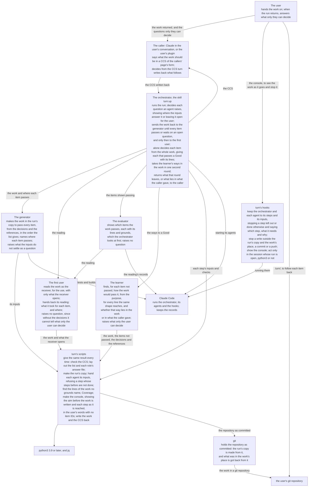

# turn design

turn keeps what [its README](../../turn/README.md) promises by one idea: the work is read in its
receiver's place by an agent that did not write it, and one orchestrator, the skill `turn:up` a
caller calls, decides each item of the checklists from the whole work, so nothing passes that the
work does not show.

A caller, Claude in the user's conversation or a step of the user's plugin, hands turn one task in
a CCS, a JSON file in the form [the callers' page](../../turn/calling-from-a-plugin.md) gives, and
turn writes back a CCS with what the caller needs next, as a function takes arguments and returns
a value. The CCS holds the run's inputs; among them are the work's place, where the work's files
go; the receiver, the person the work is for, and their use of it; the decisions, what the caller
decided the work must say or do, and leave out; and the references, what the work follows or
draws on, read in place of a copy. The CCS turn writes back carries the caller's parts, what the
caller wrote, as they were handed, beside what turn adds.

The work is what one task makes for one purpose, one file or several, such as code and its tests,
written, read and decided together, since the receiver may get what they need only from them
together. A checklist says what work of one kind must give its receiver: an opening on what such
work is for, then items, each one question; the list is a task's checklists put together. A Good
is an item the orchestrator decides the work meets, with its grounds: the lines of the work it
rests on; an item passes when it gets one. A run goes from one CCS to the one turn writes back: it
makes the work, has it read, decides each item, and finds how each item without a Good would get
one; then it takes those ways in the work in one second round, read and decided again like the
first, and returns the work as last read with what that round leaves.

## Goals

### Attractive quality

- Read in the receiver's place: the work comes back already read, as its receiver would read it.

  It is read by an AI that did not write it and has only what the receiver would open; each item
  that passes is shown in the lines that give it, and what that reading could not take is made
  again. The user hands the work on without first reading it in the receiver's place.

- Made from what you decided: the work follows your notes and checklist, not whatever turn happened
  to open.

  Your notes are the decisions; each run of the same task works from the same inputs.

- Asked only what only the user can decide, all at once at the end: nothing is asked that the
  decisions and checklist already answer, and nothing is asked while turn works.

  So the user can leave turn at work.

- Seeing the work as it goes: from turn's console, what turn shows as it works, the user can tell
  how far it has come.

  The console shows the aim, what the work will let its receiver do, before the work is written;
  when that is not what the user wants, they stop turn with Esc and say what they want instead.

- A plugin decides from what turn returns: a plugin's step hands turn one task and decides from the
  CCS turn writes back alone what to do next.

  The CCS names that move in `next`: finish the work itself, call turn again, ask the user or move
  on.

- Following each item back: the user can later find in `.turn/`, for each item, the lines that give
  it or how the work would give it, and the version of the checklist it was judged by.

  `.turn/` holds the run's evidence, what a run keeps in the repository for the user and later
  runs: the work, how it was read and decided, each way to a Good, and the list with each
  checklist's name and version.

### One-dimensional quality

Each must be no worse than in the version in use, the version users run now, against which this
version is measured.

- The first-run share: the share of tasks whose first run passes every item.

  The more work is right when first made, the less the user waits and the less is spent.

- Time and tokens: what one run takes, from the task handed to turn to the CCS written back.

### Must-be quality

- Nothing passes unshown: an item passes only where lines the work holds give it.

  Every other item comes back as not passed, with how the work would give it.

- What the caller gave unchanged: turn never rewrites the task a caller hands it or the files the
  task names as inputs.

- Nothing unread: the work turn writes is the version last read.

- Repository untouched: during a run, turn writes nothing in the repository but the work's place
  and `.turn/`, and never commits or pushes.

  In the work's place, it writes over a file only where git holds what is there, or where it is
  work an earlier run returned, unchanged since, so what was there can always be got back. It names
  to the user any other file a run's commands changed, so the user takes turn's change as one diff
  and decides what to commit. Outside its runs, turn blocks nothing.

- Stop and start over: a stopped run says so, and asked again with the user's words, turn makes the
  work anew from them.

  A run stopped or cut off leaves the work's place as it was before the run.

- Missing tools: without python3 or jq, turn ends before any work and says what to install.

  Outside a run, a missing tool breaks nothing.

### Backward compatibility

- The call: plugins call the skill `turn:up` with the arguments the callers' page gives, and name
  `turn` in their dependencies.

  An argument may be added only if a call without it runs as before.

- The CCS, relied on by every caller: its parts, kinds of entry and values of `next`, as the
  callers' page gives them, are neither added to, removed nor renamed from 0.2.0 on.

  A caller breaks on one it does not know as on one that is gone; the wording in an entry may
  change, since callers do not act on it. A CCS an earlier version from 0.2.0 on returned is
  accepted, so a stopped task carries on after an update. A CCS of 0.1.0 is not accepted, since no
  caller relies on one.

- The checklist form, relied on by users and by plugins built on turn, such as rn, which write
  checklists in it: a checklist in the form the README's Requirements give keeps being read.

  That form is a checklist that opens with its name and version and gives its items as headings
  with IDs. What turn takes from a checklist beyond that may change, as long as a checklist in that
  form needs nothing more.

- What a returned CCS points to, relied on by the user, who opens it to follow each item back:
  every place a returned CCS points to exists.

  The run's evidence is kept under `.turn/` at the top of the repository, since the README names
  that place to the user; how it is laid out inside `.turn/` may change.

### Non-goals

- Deciding what the work should say: the caller does it, knowing what was already agreed, and gives
  it as the decisions.

- Making the work from one already there: turn makes new work only.

  What it is handed it follows, wording and slips included, so the caller reads the existing work
  and puts what it says into the decisions, or gives it as a reference.

- Deciding whether to run again after a run's second round: the caller does it from what the run
  returns, knowing what was agreed.

- Finding what no item asks: that goes into the checklist.

- Holding checklists: they belong to whoever knows the kind of work, such as rn, a plugin built on
  turn.

### Constraints

- turn is used by Claude, on a person's behalf, in a conversation or a plugin's step.

- turn runs in Claude Code and holds only skills, agents, hooks and scripts.

  Installing copies only its folder; its hooks run in every session where it is installed; a
  subagent can neither ask the user nor hear from its caller while it works.

- Users' machines run Python 3.9 or later with the standard library only, and jq.

- The work is in a git repository.

- Tests and builds a work needs run by shell commands, in the run's copy, a working copy of the
  repository each run makes, so the agents' shell stays open.

## Verification

### Attractive quality

Each is judged from the records, the JSONL of every conversation and agent of the run. What the
work gives its receiver is tried on real work, rn's and turn's own documents and prompts, against
the items in question, since a made-up task shows only that it passes.

- Read in the receiver's place: a fresh agent outside the run, reading the returned work as the
  same receiver, takes every item returned as Good.

  It is tried on work for a receiver who lacks what the agent that wrote the work knows, since a
  writer checking their own work passes what a newcomer would miss; this is an assumption, not yet
  checked. The fresh agent has the same files the receiver opens and the same list, and its check
  includes each item an earlier run left without a Good.

- Made from what you decided: on a task in a repository holding files the inputs do not name, the
  records show no agent of the run reading one, and the work says nothing the inputs do not give.

  Tests show both stopped: a read outside the run's inputs, and a shell command of the
  orchestrator's other than turn's scripts.

- Asked only what only the user can decide, all at once at the end: on decisions that settle some
  choices and leaves one open, the run ends with `ask the user` and that one choice.

  Nothing is asked while the run works, and no question is answered by the inputs.

- Seeing the work as it goes: the console alone tells the step the records show, and a run stopped
  on its aim has written no work of that aim, and then makes what the user said.

- A plugin decides from what turn returns: on runs that end in each value of `next`, the move
  decided from the returned CCS alone is the one decided after also reading the records.

- Following each item back: the run's evidence alone gives, for any item, the lines of its Good or
  how it would get one, and the version of its checklist.

  A test shows a checklist without its name or version refused.

### One-dimensional quality

Both are measured from the records of the same tasks, run on this version and on the version in use
from the same CCS, written in each version's kinds where they differ, as from 0.1.0 to 0.2.0.

- The first-run share: the share of those tasks whose first run passes every item.

- Time and tokens: the time and tokens of each run, from the task handed to turn to the CCS
  written back.

### Must-be quality

Each is a test on the script or hook that holds it, in the case that would break it.

- Nothing passes unshown: grounds naming lines the work lacks.

- What the caller gave unchanged: a returned CCS whose caller part differs.

- Nothing unread: a version written after the last reading.

- Repository untouched: a write outside the work's place and the run's evidence, a commit or a push
  in a run; a shell command in a run that changes another file; a write over a file in the work's
  place that git does not hold and no earlier run returned unchanged; and each of these outside a
  run, with another session's run open.

- Stop and start over: a run stopped at each step, and one cut off.

- Missing tools: each tool missing, in a run and outside one.

### Backward compatibility

For each released version from 0.2.0 on, a test calls turn as its callers did.

- The call: the call runs.

- The CCS: its CCS, a stopped one included, is accepted and carried on, and every `next` returned
  is one its callers know.

- The checklist form: its checklists give a list with every opening and item.

- What a returned CCS points to: every place a returned CCS points to exists.

## Structure

An arrow points from one that takes part to what it cannot work without, labeled with what it
needs from it.

Each role's answer, the orchestrator's or an agent's, is a JSON file with one place per item, which
the agents read and change with jq.

The orchestrator runs as a skill, where its caller runs: in a conversation the user sees its
console and presses Esc there; in a subagent the caller reads what it returns, at the cost of room
in the caller's context.

## Principles

- The orchestrator alone decides whether each item passes, from the whole work.

  For each item it reads the whole work for where the item is given; what agents and scripts hand
  back only shows it where to look first, since an item shown passing in one part does not show
  what the whole gives. Protects: Nothing passes unshown, Read in the receiver's place.

- Every role looks only for where items pass, aims at every item passing, and answers in a file
  with one place per item.

  None finds fault, and none is set to find something, since one set to find something finds it
  whether it is there or not; this is an assumption, not yet checked. Coverage, a script, is the
  one place that looks for what may be wrong. The places of the answer file, not the wording,
  hold each role to its aim. Protects: Nothing passes unshown, The first-run share.

- Every role works from the inputs it is handed alone.

  Each prompt names them as the whole of what it reads, says in positive words to work from them
  and gives why, sets as steps what its agent receives, hands back and must do in full, and leaves
  how it thinks within a step to it. Protects: Made from what you decided, Read in the receiver's
  place.

- turn asks nothing while it works, and every question comes back at once when the run returns.

  So it runs the same wherever it is called, a subagent included, and is stopped or corrected only
  from where it was called. Protects: Asked only what only the user can decide, all at once at the
  end; A plugin decides from what turn returns.

- Everything that measures the work measures by the same list, with every checklist's opening, the
  same receiver and the same use.

  A checklist says its own name and version, so a Good is followed back to the text it was judged
  by. Protects: Read in the receiver's place, The first-run share, Following each item back, The
  checklist form.

- A run starts from its CCS alone, and the received CCS is never written over; the caller's parts
  come back the same.

  The run makes the work in the run's copy, taken from the repository as committed, so the tests
  and builds the work needs run in place, and keeps the work in the run's evidence until the run
  returns; the run's copy is gone by then. Protects: What the caller gave unchanged, Repository
  untouched, Stop and start over, The CCS.

- What must come out the same every time is held by a script or a hook, not by a prompt.

  What an AI does with a prompt varies from run to run, while a script or a hook gives the same
  result each time and stops a slip as it is made. Protects: Nothing passes unshown, What the
  caller gave unchanged, Repository untouched, Missing tools, Following each item back.

- What can be told before it happens is stopped then, and what cannot is named to the user when the
  run returns.

  A write, a commit or a push can be told before it happens; what a shell command changes as it
  runs, a test's or a build's side effect, cannot, and may reach past the run's copy. A change
  stopped before it happens leaves nothing to undo, and one named leaves the user to judge it. Protects: Repository untouched.
