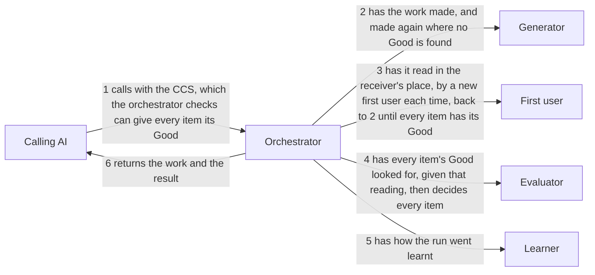

# turn design

turn is built from five AI roles, a few scripts and hooks: one role makes the work and makes it
again until another, reading it in its receiver's place, finds every item's Good, and the rest
decide from that reading which items get their Good. The goal, the key results, and what a
checklist, the receiver and a Good are, are in [turn's UX](ux.md).

## User stories

- As the calling AI, I want to hand turn the path of a CCS and get the work back, with each item's
  Good and its lines, the questions only the user can decide, each item still without Good, and the
  lessons on how the run went; or, when the CCS cannot give an item its Good, the questions alone,
  before any work is made.

  The UX's first and last scenes are the calling AI's own work around this call.

## Architecture

### Logical view



The orchestrator and the four roles it starts are AIs, each answering the orchestrator in its reply.

- Every role that judges the work looks only for the Good each item gets and the lines that give
  it; only a script, code that runs the same every time, doubts, and only by coverage: it names each
  item no role gave its Good.

  An AI that looks for what more the work needs finds more without end, and each find is patched
  in, so the work drifts from what it should be. Each role has one aim, so it works to the aim
  rather than to a list of steps.
- Each item is answered where its checklist's `Scope` line says: `its part`, at the lines that give
  it; `each part`, in every part of the work on its own, a Good for each; `whole`, of the work at
  once. A script splits the work into its parts, a document's sections under its top headings with
  the title and opening as one, and each other file whole, stops a reply that gives an each-part
  item without every part, and gives such an item its Good only where every part has one.

  A Good found where one part gives it passes a part that does not, so a remake that breaks one
  part for another item goes unseen; what lies between the parts, such as one name for each thing,
  is found only in the whole. The checklist says it once, so every role and every run answers an
  item at the same place.
- The calling AI hands the orchestrator the CCS's path, where the result goes, and the kinds it uses
  in the CCS for where the work goes, the checklists and the receiver, and, if it has them, what the
  receiver reads the work for and what they open with it.

  The CCS is the calling AI's, and turn defines nothing of it: what turn needs is found by these
  kinds, and the values stay in the CCS alone, so the call and the CCS cannot differ. Where the
  result goes is this call's answer, not the task's state, so it is not in the CCS.
- Before any work is made, the orchestrator reads the CCS, the files it names and the checklists,
  and finds for every item what in them gives its Good; where nothing does, it returns the
  questions alone, each with the items it settles, and no work is made.

  A Good the CCS cannot give, the generator cannot give either, and the making and the readings
  after it would be spent for nothing; an answer may also change how the whole work is laid out.
  The calling AI asks the user and calls turn again with the answer in the CCS.
- The generator first sets, from the whole CCS, the Good the receiver is to get from the work for
  each item and where the work gives it, then makes the work to give each, and hands back each
  item's Good with its lines, each statement the work makes of its subject with its grounds, and
  the questions only the user can decide. It marks each statement as a decision or as how the
  product behaves. The grounds of a decision are the words of the CCS or the files it names that
  say it, quoted as written; of how the product behaves, a command the generator ran and what it
  printed; a statement without its grounds is taken out of the work.

  A work made to Goods set first gives each where it was meant; one written first and matched to
  the items after is patched item by item. It hands back once it has read the work and found each
  Good at its lines. What the CCS does not say becomes a question, not its own guess. Its Goods are
  its claim, not a judgment. A reader without the sources takes a statement made from nothing as a
  fact, so the one that wrote it grounds each. A quote is the words themselves, not lines that hold
  them, so it shows what was read for the statement; a product's code and the decisions about it
  may say otherwise than it does, and only a run shows what it does.
- The generator stays started for the whole run: what is sent back reaches it as a message, and it
  makes the work again with what it has already read.

  It holds the sources it read and the Good it meant at each line, so it changes only what is sent
  back, without reading the sources again.
- The orchestrator reads the work, finding for every item the Good the receiver gets from it and, in
  each statement's grounds, what the statement says, and sends back the items whose Good it does not
  find, each said as what the receiver gets once it has it and the places of the work where it is
  not found, and each statement its grounds do not say; where a decision of the CCS and a file it
  names differ, it is a question. It marks each statement as a decision or as how the product
  behaves on its own, without running anything, and a script sends back each statement either mark
  calls how the product behaves that has no run. Once nothing is sent back, a script records its
  findings.

  A shortfall plain to see is sent back before the costly reading. How the work gets the Good is the
  generator's to decide, since an edit told per item broke other items; the places are what the work
  says there, not an edit, and show the generator what it does not give, which the maker, reading
  the Good it meant, misses. An item only the user's answer can give is not sent back; it is a
  question. Once the work is made, only the orchestrator holds the sources; the readers after it
  read as the receiver, who has none, so a statement made up passes them. A maker that means a
  statement as decided grounds it in the decision, while the product may do otherwise; a second mark
  by one that did not make the work catches it.
- The first user reads the work in the receiver's place, with what the receiver opens and the
  checklists, and gives for each item the Good it found in the work, with its lines, and for each
  item it finds none, the places of the work where it looked for it.

  A reader that did not make the work finds only the Good its lines give; the maker finds the Good
  it meant.
- The orchestrator sends the generator each item the first user found no Good for, with its places,
  and a new first user reads the work made again, until the first user finds every item's Good or
  a remake leaves an item's places as they were. An item whose Good rests on the sources, such as
  whether a statement said as fact was checked, is the orchestrator's, from its reading of the
  grounds, and is not sent back for the first user's reading.

  A remake aimed at where a reader stopped gives the Good there; an item restated over the whole
  work leaves the generator nothing to aim at, and the remake changes nothing. A first user that
  has read the work before reads what changed, not the work as the receiver meets it, so each
  reading is a new one. A remake that leaves the places as they were would meet the same reading
  again. The receiver has no sources, so no reading of theirs can tell whether a statement was
  checked.
- The evaluator, given the same and the last reading, looks through the whole work for every item's
  Good, holding each Good of the reading to what its item asks, and gives every Good with its
  lines. The orchestrator then reads the work whole and decides every item from its findings and
  both readers' Goods, finding the Good the receiver gets, and giving none where neither reader
  found one, but for an item whose Good rests on the sources.

  The orchestrator's findings are recorded before the evaluator starts, as a judgment made after
  another's is pulled toward it. One reader misses a Good the work gives; a Good held to its item
  only at the lines the reading named passes a place elsewhere that does not give it. Readers that
  agree may still carry a doubt inside a Good, so agreement is decided too. A Good only the
  orchestrator found would be judged by one that read the work knowing what it meant, so a script
  stops it.
- Once the orchestrator has decided, the learner reads every item's finding and the record of every
  agent of the run, the orchestrator's included, and gives, from what they show, with the words it
  rests on quoted, how the run went: whether the Goods came without waste and not by chance, each
  lesson for the role it is for, on how it read, checked and replied, or that it found none and what
  it checked.

  A lesson on what the work should say tells the generator how to give a Good, which is the
  generator's to decide: told to put every change in the opening, it made the opening one sentence
  of five changes. What fell short often lies in what a role did, which only its record shows; a
  run where every item got its Good may still have got it by chance, or spent time for nothing, and
  what is not learnt from is met again. A lesson without the facts it rests on is a guess.
- The orchestrator takes the lessons it finds hold into the result, for the calling AI to hand on to
  turn's makers, and the run returns, with each item still without Good, what the receiver gets
  once it has it and where it was not found.

  The learner sees what each agent did, but the orchestrator decided every step of the run, so it
  judges which lessons hold. Every remake is aimed at where a reader stopped, inside the reading
  before; the evaluator and the decision judge, and remake nothing, so going round them again gives
  no Good.

### Physical view

```
turn/                      the plugin, installed by Claude Code
├── agents/
│   ├── up.md              the orchestrator <agent>
│   ├── generator.md       <agent>
│   ├── first-user.md      <agent>
│   ├── evaluator.md       <agent>
│   └── learner.md         <agent>
├── scripts/               the call's check, each role's input, the findings, the result <Python 3, jq>
└── hooks/
    ├── hooks.json         one entry per event
    └── *.py               one check each <Python 3>
```

- turn runs on Claude Code, python3 3.9 or later, jq and git.
- The calling AI starts the orchestrator, `turn:up`, in the background with the call as JSON, so its
  context holds only what comes back.

  It can still take the user's pause while it waits, and stops a run by sending the orchestrator a
  message. The user sees the run's agents in the panel below the prompt input. `claude -p` is not
  used, since the docs say `--bare`, which reads no subscription login, will become its default.
- A script checks the call and takes every entry of each kind it names from the CCS, so no AI
  copies a value; it stops a call that names a missing file or leaves where the work goes, the
  checklists or the receiver without an entry.
- What each role is given: the generator, the whole CCS and what is sent back; the first user, the
  work, what the receiver opens, who the receiver is and what for, and the checklists; the
  evaluator, the same and the last first user's reading; the learner, every item's finding and the
  JSONL of every agent of its run, the orchestrator's included.
- The orchestrator starts the generator once a run and sends it what is sent back with
  SendMessage, which it loads with ToolSearch; every other role it starts anew each time.

  Tried with an agent started by an agent started in the background, as turn's roles are: sent a
  message after its reply, the same agent answered from what it had read, using no tool.
- Each role replies in a JSON form of its own, not in a file, and a hook checks each role at both
  ends.

  Only the orchestrator holds the replies, so the first user cannot see the generator's claim. A
  hook lets a role start only with what it is to be given, and stops a reply that does not fill its
  form; the evaluator starts only once a script holds the orchestrator's findings. A script checks
  that each quote is in its file or record as written, and that each command the generator gives
  is in its own record with what it printed, so a ground cannot be made up.
- The hooks stop a read outside what a role is given, a write outside where the work goes, and a
  commit or a push; a stop says why and names what may be read.

  A role that reads only what it is given is not bent by what it was not meant to see.
- The hooks stop every role's reply, and the orchestrator's check, reading and decision, until
  every input of its step is read whole since it last changed; a script shows the learner each
  record page by page, as a record is too long for one read.

  An item judged on a part read is judged on a guess for the rest.
- A script writes the result where the call says, and checks its shape as it writes.

  A reply would be copied into a file by the calling AI, where a slip goes unseen.
- Several runs go at once, and the hooks tell them apart by the orchestrator's `agent_id`.

  Every agent of a conversation has the same `session_id`. A role's run is the `parentAgentId` in
  `subagents/agent-<agent_id>.meta.json` beside the conversation's transcript; tried with two runs
  at once, every role's tool use and reply was tied to its own orchestrator. The file is there from
  a role's first tool use, so what a role is started with is checked at the orchestrator's own call
  that starts it. The file is Claude Code's record, not a documented hook input, so the hooks'
  tests hold its shape.
- The work is made where it goes, and a run cut off leaves its writing as changes git shows.

  The calling AI undoes or finishes them and calls turn again on what is there. No run resumes part
  way, since being cut off is rare and a reading again costs less than a resume to build and keep
  right.

## Verification

### Units

- The scripts and the hooks: each check stops what it must and lets through what it must.
  - Flow: unittest in `dev/turn/tests/`, fed the calls, replies, events and records each receives,
    run by [`dev/check.sh`](../check.sh) in CI on every push, with lines and branches 100%
    covered, Ruff's lint and format, and Pyrefly's types for Python 3.9.
- The orchestrator: takes each step of the run in its order, from the call to the result.
  - Flow: on a task of two items, one answered at its part and one in each part, with the four roles
    stood in for by agents that read what their step reads and give a reply set beforehand, one set
    for each way a run goes: every item Good at the first reading, an item sent back with the parts
    where it is not found, an item the first user finds no Good for given at the next first user's
    reading, a remake leaving an item's places as they were, and the evaluator differing from the
    findings, with the learner after the decision; and, on the same task with its
    decision taken out, the questions returned before any work is made. On Opus 5.5; passes when its
    JSONL shows each step in its order, each hook stopping where its check should, and the result as
    the set replies make it.
- Each of the four roles: works to its aim with what it is given, giving its form.
  - Flow: started on its own with a prompt set beforehand, as the orchestrator would give it, on a
    task of two items, one answered at its part and one in each part, on Opus 5.5; passes when its
    JSONL shows it read only and whole what its step reads, and its reply fills its form; the
    generator, sent back by message, remakes the work without reading its sources again.
  - Content: what it makes in the acceptance trials below, read against its JSONL.

### Acceptance

Each trial runs in a clone of `lovaizu/playground` of its own, on a branch of its own, pushing
nothing, removed after: a stand-in for the calling AI is handed a small task's CCS and checklist and
calls turn, and is judged from the JSONL of every agent it started and from the work. Each
acceptance trial is run three times at once.

What an AI does varies from run to run, and one run shows one of its ways; runs that push nothing
and keep their own folders do not touch each other.

- Flow: a stand-in for the calling AI calls turn on a task of one item, with every role real, and
  the work comes back with the result in its form.
- The story: the work comes back where it goes, and every item has a Good with its lines, a
  question, or what the receiver gets once it has its Good.
  - Each Good is checked by reading its lines in the work.
- KR1.1: the items of the work the calling AI is not satisfied by when it comes back.
  - Each item the stand-in fixes in its JSONL, and each the work still misses, judged as the UX's
    KR1.1 says, and compared with the version in use on the same task, kept with the trial in
    `dev/turn/trials/`.
- KR1.2: the time from the call to the work coming back.
  - Taken from the JSONL's timestamps for a README-sized work, and compared with the version in use
    on the same task.
  - Read step by step from the same timestamps; time that adds nothing to the story or KR1.1 is
    cut first.

A change is taken when the story is still achieved and KR1.2 does not come closer at the cost of
KR1.1.
