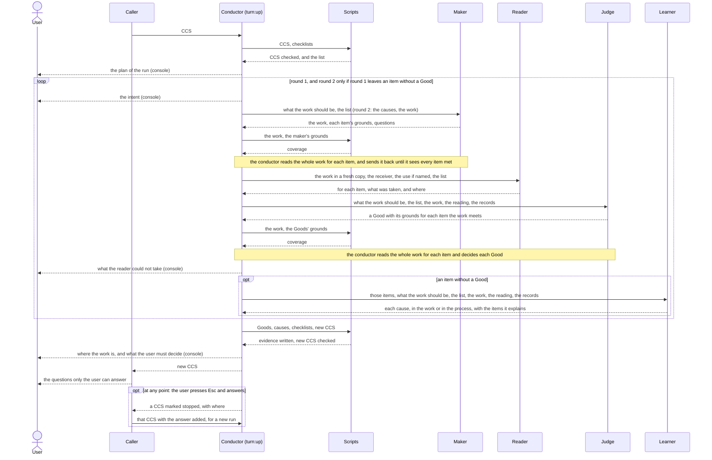

# turn design

This document is for whoever builds or changes turn. It says what turn must achieve, how each
quality is checked, and how turn is built to achieve it and why, in service of the benefits
[turn](../../turn/README.md) promises. How to use turn is in that README, and the forms a caller
writes and reads, the call and the CCS, are in [Calling turn from a plugin's
step](../../turn/calling-from-a-plugin.md), the callers' page; here they are named only as what must
keep holding. Each prompt's wording, the steps and the file layout are left to the code. A statement
not yet checked is marked "(assumption)", and what a trial has shown says how far it was seen.

The words used throughout:

- The caller: Claude in the user's conversation, or a step of the user's plugin; it hands turn one
  task at a time.
- The CCS: the JSON file in which the caller writes the task, and in which turn writes back what the
  caller needs next, as a function takes arguments and returns a value. What the work should be is
  the part the caller writes: where the work goes, whom it is for, what for, what they must be able
  to do with it, its sources and its checklists.
- The receiver: the person the work is for. The use: what the receiver uses the work for, when the
  CCS names one.
- A checklist says what a work of one kind must give its receiver: its opening says what such work
  is for, and each item asks one thing. The list is made by a script from the checklists the CCS
  names: each opening, and every item with its whole text.
- A run goes from one CCS to the one turn writes back. A round makes the work, reads it and judges
  it once, as a draft goes through one review; a run has one round or two.
- The conductor runs a run and alone decides whether each item is met, as an editor hands each part
  of a piece to one person and decides from what comes back. Its four agents give it what it decides
  from: the maker makes the work; the reader reads it as the receiver, for the use, and hands back
  its reading; the judge shows which items the work meets; the learner finds why an item has no
  Good.
- Grounds: the lines an answer to an item rests on, with their words.
- A Good: an item the conductor has decided the work meets, having read the whole work for it. The
  maker's grounds, the judge's and coverage show it where to look first.
- More: an item without a Good when a run returns, as the CCS names it for the caller, who reads
  each as a `difference` with its cause.
- Coverage: the lines of the work that no item's grounds name, found by a script, as test coverage
  finds the lines no test runs.
- The intent: what turn means the work to let its receiver do, shown before the maker writes.
- The answer: what the user says, to a question or when stopping a run.
- The records: the JSONL in which Claude Code keeps every conversation and agent.
- The evidence: what turn keeps in its folder `.turn/` so that each item can be followed back.

## Goals

### Attractive quality

- Read in the receiver's place: the work comes back read by an agent that did not write it, in the
  receiver's place, with each item that has a Good shown in the lines of the work, and what the
  reading could not take made again from its cause; so the user can hand the work on without first
  reading it as its receiver.
- Asked only what only the user can decide: nothing is asked that what the work should be, or its
  sources, already answers.
- Seeing the work as it goes: the user can tell from the console how far a run has come, and stop a
  run whose intent they do not want before the work is written, saying what they want instead.
- A plugin decides from what turn returns: a plugin hands turn one task and decides its next move
  from the returned CCS alone, without writing the loop of making, reading and making again itself.
- Following each item back: the user can later tell, for each item, the lines its Good rests on or
  why it has none, and the version of each checklist the work was made and judged by.

### One-dimensional quality

Neither has a fixed limit; each must be no worse than in the version in use.

- The first-round share: the share of runs whose first round ends with every item Good. The more
  work is right when first made, the less the user waits and the less is spent.
- Time and tokens: what one run takes, from the call to the returned CCS.

### Must-be quality

- Nothing passes unshown: an item counts as met, in the returned CCS and the evidence, only with a
  Good whose grounds are lines the work holds; every other item is returned as More, with its cause.
- Nothing overwritten unsaved: turn writes over a file already where the work goes only when git
  holds that file as it stands.
- Repository untouched: during a run, turn changes nothing in the user's repository but where the
  work goes and `.turn/`, and never commits or pushes.
- The user's own work alone: outside its runs, turn blocks nothing the user or Claude does in any
  session where it is installed, and a missing tool there breaks nothing.
- What the work should be unchanged: turn never rewrites what the caller wrote the work should be.
- Nothing unread: the work turn writes where the work goes is the version the reader last read.
- Stop and start over: a run the user stops with Esc returns a CCS marked stopped, and a run called
  with it and the user's answer starts from the work as it stands. A run cut off before it returns
  leaves where the work goes untouched, and called again with the same CCS it starts over.
- Missing tools: when python3 or jq is missing, turn ends before any work and says what to install.

### Backward compatibility

- The call: plugins' steps call the skill `turn:up` with the two arguments the callers' page gives,
  `in` and `out`, and name `turn` in their dependencies. These must keep holding. An argument may be
  added only if a call without it runs as before, since callers written for an earlier version do
  not pass it.
- The CCS: callers write and read it in the form the callers' page gives: its nine parts, the kinds
  of entry in each, and the values of `next`. None may be added, removed or renamed, since a caller
  breaks on one it does not know as much as on one that is gone. This holds for `viewpoint`, the
  CCS's kind for a checklist. What turn writes in its entries, other than `next`, may change in
  wording, since callers put it to the user or hand it on rather than act on its words.
- Carrying on across an update: a later version must accept a CCS an earlier version returned, so
  that a stopped task, or one with the user's answers, carries on after an update.
- The checklist form: users and writ write checklists in the form the README's Requirements gives.
  This must keep holding. How the list is made from it may change, since only turn's agents read the
  list.
- `.turn/`: the user and the next run open what a returned CCS points to there, and every such place
  must exist. What else is in `.turn/`, and how it is laid out, may change between versions.
- The console's wording and the agents' prompts may change: no program reads them.

### Non-goals

- Deciding what the work should be. The caller writes it; turn measures against it and returns what
  it cannot decide.
- Talking to the user. turn returns its questions to the caller, which knows what was already agreed
  with the user and asks them.
- Running until every item is Good. What a second round still leaves without a Good is returned as
  More with its cause, as a sign of a fault in turn, in the checklist or in what the work should be,
  to be fixed there (assumption).
- Finding what no item asks. A gap of that kind belongs in the checklist, where every later work is
  measured by it.
- Holding checklists. What they ask belongs to whoever knows the kind of work, such as writ.
- Code. A program is checked by running its tests, not by reading.

### Constraints

- turn is used by Claude, on a person's behalf, in their conversation or in a plugin's step.
- turn runs inside Claude Code and is built only from what a plugin can hold: skills, agents, hooks
  and scripts. Installing copies only turn's own folder. A plugin's hooks run in every session where
  it is installed, not only during its runs. A subagent cannot start other subagents (Claude Code's
  documentation on subagents).
- What runs on users' machines is Python 3.9 or later with the standard library only, and jq, as
  this repository's plugin rules set.
- The work is in a git repository.

## Verification

### Attractive quality

Each is tried on real work: writ's documents and prompts, and turn's own, are made through turn, and
whoever builds turn reads the records of every conversation and agent of the run. A made-up task
shows only that the made-up task passes.

- Read in the receiver's place: tried on work written for a receiver who lacks what the maker knows,
  where a writer checking their own work passes what a newcomer would miss (assumption). It passes
  when a fresh reader with no part in the run, reading the returned work as the same receiver, for
  the same use if one is named, on the same list, takes from it every item the run returned as
  Good. It also passes only when each item round 1 left without a Good has one on that reading, as
  has every other item its cause explains, so it was made again from its cause and not patched.
- Asked only what only the user can decide: tried on a task whose sources settle some choices and
  leave one open. It passes when the open choice is asked and no returned question can be answered
  from what the work should be or from its sources.
- Seeing the work as it goes: it passes when, at any point in a run, the user, reading the console
  alone, can tell which round and step it is at, as the records show, and when, given a task whose
  intent they do not want, the user stops it with Esc after the intent is shown, no work of that
  intent has been written, and the work then made is what they said.
- A plugin decides from what turn returns: it passes when the next move decided from the returned
  CCS alone is the same as the one decided after also reading the records.
- Following each item back: it passes when, for any item of a returned work, the user finds in
  `.turn/` alone the lines its Good rests on or why it has none, and the commit of the checklist it
  was judged by.

### One-dimensional quality

Both are measured from the records of the same tasks, each run from the same CCS on this version and
on the version in use: the first-round share, and the time and tokens per run.

### Must-be quality

Each is decided by a test, on the script or hook that holds it:

- Nothing passes unshown: given Goods some of whose grounds name lines the work does not hold, the
  returned CCS gives those items as More, and the evidence as without a Good.
- Nothing overwritten unsaved: with a file where the work goes that has changes git does not hold,
  turn ends before any work and says why, and the file is as it was.
- Repository untouched: during a run, a write outside where the work goes and `.turn/`, a commit and
  a push are each blocked.
- The user's own work alone: outside a run, including while one goes on in another session, a write
  anywhere, a commit and a push each go through, with python3 missing as well as present.
- What the work should be unchanged: a CCS to return in which what the work should be differs from
  the one received is blocked on returning.
- Nothing unread: with a version of the work written after the last reading, the version written
  where the work goes is the last-read one.
- Stop and start over: a run stopped at each of its steps returns `stopped` with where it was and
  leaves where the work goes untouched, and a run called with that CCS and an answer starts from the
  work it points to. With a run cut off, where the work goes is untouched, and a run called again
  with the same CCS starts from the beginning.
- Missing tools: with python3 or jq missing, turn ends before any work and says what to install.

### Backward compatibility

For each released version, a test calls turn as that version's callers call it:

- The call: `turn:up` called in that version's form runs, writes the new CCS to `out`, and leaves
  `in` as it was.
- The CCS: a CCS of that version's form is accepted, and every value of `next` this version can
  return is one that version's callers know.
- Carrying on across an update: a `stopped` CCS that version returned is accepted, and the run
  starts from the work it points to.
- The checklist form: the checklists that version's README points to give a list with each
  checklist's opening and every item, each with its whole text.
- `.turn/`: every place a CCS that version returned points to exists after the run.

## Architecture

### Principles

- The conductor alone decides, and decides from the work itself: for each item it reads the whole
  work, with what its agents hand back showing it where to look first. Its agents give it what it
  decides from, and decide nothing. In the by-hand runs of turn's flow, where the conductor took
  the agents' answers as they were, a slip of the same kind came back in every round. Protects:
  nothing passes unshown, read in the receiver's place, asked only what only the user can decide.
- Every agent aims at every item being Good, and thinks forward, from what would make an item Good,
  not from what is wrong. No agent is set to find something. Protects: read in the receiver's
  place, the first-round share. Assumption: an AI works toward the aim it is given, and one set to
  find something finds it whether it is there or not.
- Each agent answers in a form laid out from the list before it begins, with a place for each item,
  and hands it on only once a script has checked it. The form, not the wording, holds an agent to
  its aim: in one trial, a judge told in words to write Goods only still wrote on items
  without one. Protects: read in the receiver's place, the first-round share.
- Every part that measures the work, the conductor among them, measures from the same list and
  receiver, and the same use when the CCS names one. Protects: read in the receiver's place, the
  first-round share.
- An item the conductor does not yet see met goes back to the maker as soon as the conductor sees
  it. What can be seen in the maker's work costs a whole round when it is found in a reading
  instead. Protects: the first-round share, time and tokens.
- What must come out the same every time is done by a script or a hook, not by an agent. Protects:
  nothing passes unshown, what the work should be unchanged, repository untouched, nothing
  overwritten unsaved, following each item back.

### Structure

The figure shows what passes between the parts, in order. During a run, hooks watch every tool call
of the conductor and its agents, so they stand beside the sequence rather than in it.

Each part's aim, and what it cannot work without:

| Part | Aim | Depends on |
|---|---|---|
| User | Work they can hand on, deciding only what only they can | The caller, to ask them |
| Caller | What the work should be, written once for the task | The CCS's form |
| Conductor | Each item decided from the whole work | Claude Code, which runs it as a skill in the caller's conversation |
| Maker | A work that meets every item | Claude Code, which runs it as a subagent |
| Reader | Take from the work what the receiver would | A fresh copy made from git, removed when done |
| Judge | Every item the work meets, shown with its grounds | The records Claude Code keeps |
| Learner | Why no Good came out, for each item without one | The records Claude Code keeps |
| Scripts | What must come out the same every time | python3, jq, git |
| Hooks | A step not kept, caught as it is made, during a run only | Claude Code's hook events |

### The checklist as the measure

Achieves: read in the receiver's place, the first-round share, the checklist form.

The checklists are written so that a work meeting every item serves its purpose (assumption, which
the attractive-quality trials test). A script makes one list from the checklists the CCS names,
carrying each checklist's opening with the items. The maker, the conductor and the reader are each
given that list, the receiver, and the use when the CCS names one, so they measure under the same
condition. The opening says what such work is for, the receiver says whose place the work is read
in, and the use, when named, says what the receiver comes to it for. What no item asks goes into the
checklist, not into an agent's answer.

- Must hold: every agent that measures the work has the list with every opening, the same receiver,
  and the same use when one is named. No agent answers outside the list's items.
- Weighed: letting the reader take its standpoint from the openings alone was not chosen. Some
  openings name no reader (the document checklist says only that a document is read by the reader it
  is written for), so the reader would have no place to read from. The cost: the CCS must name the
  receiver. Letting the reader also say what it could not take outside the items was not chosen,
  since with no item to bound it, it reads as a search for faults and varies from run to run
  (assumption). The cost: what no item asks is not found until the checklist is changed.

### Making it right first

Achieves: the first-round share, time and tokens, asked only what only the user can decide.

The maker makes a work that meets every item. For each item it gives its grounds, the lines
themselves rather than the heading they sit under. What the sources do not settle the maker raises
as a question for the user, and keeps out of the work. The conductor then reads the whole work for
each item, starting from the maker's grounds and coverage, and drops any question the work or its
sources answer. It sends the work back with each item it does not yet see met, saying how it would
be, as many times as it takes, since settling the work is its own work.

- Must hold: no work reaches the reader with an item the conductor does not see met.
- Weighed: passing the maker's work straight to the reader was not chosen, since every item it
  leaves unmet then costs a round to find. Taking the maker's grounds as they are was not chosen: in
  the by-hand runs, grounds that named one place passed items asked of the whole work, and the
  reader found an exception elsewhere in every round. The cost of both: the conductor reads the
  whole work for each item before each reading. A limit on sending back was not chosen, since a work
  sent on unsettled costs a round. The cost: a round's length is not bounded; a maker that never
  settles runs until the user stops it with Esc, and time and tokens show it. Having the conductor
  raise the questions was not chosen, since the maker meets what the sources leave open while it
  writes. The cost: the conductor reads each question against the sources.

### Coverage

Achieves: read in the receiver's place, the first-round share.

Coverage is found by a script, twice in each round: when the maker hands the work over, from its
grounds, and when the judge hands back its Goods, from theirs. It shows the conductor where to look:
a line no grounds name may do nothing for the receiver or hold a mistake, since every line that does
something for the receiver meets some item (assumption, which rests on the checklists asking all
such work must give). The conductor reads each such line and decides which item, if any, it keeps
from being met. What no item asks about goes into the checklist.

- Must hold: no work reaches the reader, and no Good is decided, before the conductor has coverage.
- Weighed: an agent set to look for mistakes was not chosen, since it would be set to find
  something, while a script needs no AI and comes out the same every time. The cost: a mistake
  inside a line some grounds name is found only by the conductor's reading. A section or a paragraph
  as the unit was not chosen, since one line that meets an item would then cover the lines beside
  it; a line is also the unit grounds are given in. The cost: grounds name every line they rest on.

### Reading in the receiver's place

Achieves: read in the receiver's place.

The reader starts where the receiver starts, as a new team member starts from a fresh clone: a copy
of the repository with the work added, made from git and removed after the reading. It is given the
receiver, the list and the use when the CCS names one, since the receiver comes to the work with
that use, and reading in their place means reading for it. It is given nothing of how the work was
made, of the sources, or of what the receiver must be able to do with it, so that it stops where the
receiver would (assumption). For each item it says what it took from the work and where.

- Must hold: the reader's copy holds nothing the receiver would not have.
- Weighed: reading in the working repository was not chosen, since files the receiver lacks could
  carry the reader past what is missing (assumption). The cost: a copy for each reading. Telling the
  reader what the receiver must be able to do was not chosen, since it would then look for that
  rather than take what the work gives (assumption). The cost: only the judge and the conductor
  weigh the reading against what the receiver must be able to do.

### Deciding every item

Achieves: read in the receiver's place, nothing passes unshown, following each item back.

After the reading, the judge gives a Good, with its grounds, for each item the work meets, judged
from the reading against what the receiver must be able to do. It reads the records to see that the
reading was taken from the work, as the reader says, and writes nothing for an item it cannot
ground. The conductor then reads the whole work for each item, starting from the judge's grounds and
coverage, and decides whether it is met, as an editor decides on a piece from the reviews and the
piece itself. An item it decides is met is a Good; every other item goes to the learner, and is
returned as More if the run ends with it still without a Good. One judge is used.

- Must hold: every Good names the lines it rests on, and is decided by the conductor.
- Weighed: counting the judge's Goods by a rule on their grounds was not chosen. In the by-hand
  runs, Goods whose grounds named one place passed items asked of the whole work, a Good whose
  grounds named the whole work could never be counted, and the judge answered differently on lines
  that had not changed. The cost: the conductor reads the whole work for each item in each round.
  Having the judge also say which items are not met was not chosen, since one asked for what is
  missing finds it whether it is there or not (assumption). The cost: the judge says nothing of why
  an item has no Good, which the learner asks. Judging from the reading alone was not chosen, since
  a reading is an account, and may say more than the reader took from the work. The cost: the judge
  reads the records. Several judges were not chosen, since the conductor decides each item from the
  work. The cost: a judge's slip is caught only by the conductor's reading.

### Making again from the cause

Achieves: read in the receiver's place, nothing unread, following each item back.

Like a post-mortem that asks why something failed rather than where, the learner asks why no Good
came out, in the work and in the process, reading the records for the process. It takes only the
items the conductor has decided have no Good, after the judge, and puts those that share a cause
together. If round 1 leaves such items, the maker makes the work again in round 2 from those causes,
keeping what was Good. The work is then read, judged, decided and learned from once more. What round
2 leaves without a Good is returned as it is, as More, with its cause. A cause in the process is
returned as a rule for making such work, which the caller carries into its later tasks. A cause in
what the caller wrote the work should be is returned to the caller with its reason, since turn never
rewrites it.

- Must hold: the learner is given only items the conductor has decided have no Good. A run has at
  most two rounds. The work returned is the version last read.
- Weighed: fixing each item where it showed was not chosen, since a patch at the spot leaves the
  cause to show again elsewhere. The cost: the learner's pass in each round that leaves an item
  without a Good. Putting the learner before the judge was not chosen, since the learner would then
  be set to find something, and a Good resting on its account would judge the account rather than
  the work (assumption). Several learners, each given part of the items, were not chosen, since
  items that share a cause are seen together only by one given them all. The cost: one learner reads
  every such item. Running until every item is Good was not chosen, since a loop that does not
  settle hides a fault in turn or the checklist. Fixing round 2's items before returning was not
  chosen, since a change after the last reading reaches the user unread. The cost of both: some work
  comes back with More, for the user to decide on.

### Holding each agent to its steps

Achieves: read in the receiver's place, the first-round share.

Each agent's prompt says what is expected of it, and sets as steps what it receives, what it hands
back and what it must do in full; how it thinks within a step is left to it. Its form is made by a
script from the list, and a script checks it before it is handed on. During a run, hooks check that
each agent keeps the process its steps set: a step begun before the ones ahead of it, a step left
out, an input not read or an answer not written where its step says.

- Must hold: no agent's answer reaches the conductor before its form is checked, and nothing an
  agent writes is taken as met until the conductor decides it.
- Weighed: leaving the process to the prompts alone was not chosen, since a step not kept then shows
  only later, in a result that looks right. The cost: a check on each tool an agent uses during a
  run. Blocking reads beyond an agent's inputs was not chosen: the maker needs the repository it
  writes about, the reader's standpoint is held by its fresh copy, and the conductor decides from
  the work whatever an agent read. Setting how an agent thinks as steps too was not chosen, since a
  hook can see what an agent reads and hands back but not how it thinks, and an AI given room within
  a step works better than one told each move (assumption).

### The console

Achieves: seeing the work as it goes.

The console serves a user who looks in now and then. The conductor shows the plan of the run once,
before the first round: the steps of a round, and that a second may follow. Every later line,
grouped by round, names its step in the plan. The intent is shown before the maker writes, so a
wrong one is stopped with Esc before a round is spent on it. What the reader could not take is told
in plain words, and each line gives the path of what it is about, so the user can open the work or
the reading. At the end, the console says where the work is and what the user must decide. A few
marks set apart what the reader could not take, a round with nothing missing, and what the user must
decide, each mark with one meaning.

- Must hold: no work is written whose intent the console has not shown first.
- Weighed: item IDs and counts were not shown, since the user would have to learn the checklist to
  read them. The cost: a user who wants the item reads it in `.turn/`. Further marks were not used,
  since each is one more thing to learn before the console can be read. The cost: anything else is
  told in words.

### The CCS

Achieves: a plugin decides from what turn returns, what the work should be unchanged, stop and start
over, the call, the CCS, carrying on across an update.

A CCS (Compressed Cognitive State) is one JSON file in the nine parts that [ACC (Agent Cognitive
Compressor)](https://arxiv.org/abs/2601.11653) sets as the state the next step needs, each a list of
entries of a fixed kind. The caller writes what the work should be. turn adds the rest, and adds its
rules after the caller's in `constraints`. A script checks the CCS on receiving and on returning:
one received that does not match the form cannot be run, and one to return that does not match is
never returned. When `out` already exists, turn writes nothing and ends before any work, saying why,
as it does for a missing tool, since it never writes over a file. Inside turn, the conductor hands
each agent the parts it needs in a form set for that agent, and changes those forms without touching
the CCS.

Every change of course goes through the caller as a new run. When the user answers a question, or
stops a run with Esc and answers, turn returns a CCS, marked stopped with where in the second case.
The caller adds the answer and calls again. Until a run returns, the work is only in `.turn/`; a
stopped CCS points to it there, and the new run starts from it as it stands. turn returns the CCS to
the caller with a reason when it cannot be run, or when a cause lies in what the caller wrote the
work should be, which only the caller can change. A run starts from nothing of an earlier run but
the CCS it is given and the places that CCS points to, so a CCS an earlier version returned carries
on however the rest of `.turn/` was laid out.

- Must hold: `in` is never written, nor an `out` that already exists. What the work should be is the
  same in the returned CCS, and the received `constraints` entries stay first. Every part, kind and
  `next` value is one of those the callers' page gives. Every place the CCS points to exists. Where
  the work goes is written only with the last-read work, on a return that is not stopped.
- Weighed: ACC's nine parts were taken since ACC defines them as the state the next step needs.
  Adding a part departs from ACC, and every reader of the CCS would have to change with it. Handing
  each agent the CCS itself was not chosen, since a change made for one agent would change what
  callers rely on. The cost: the conductor writes each agent's inputs from the CCS. A free-form
  handover was not chosen, since the caller and the next run find what they need by kind, and a form
  an AI chooses afresh would not stay the same from run to run (assumption). Copying the work into
  the CCS was not chosen, since a copy drifts from the real thing, so only places are written.
  Folding the user's answer into the run they stopped was not chosen, since turn never rewrites what
  the caller wrote. The cost: the change is made in a new run, with rounds of its own.

### The conductor in the caller's conversation

Achieves: seeing the work as it goes, a plugin decides from what turn returns.

The conductor is a skill, so it runs in the caller's conversation: it starts the four agents, which
a subagent could not do, and its console lines and the user's Esc are where the user already is.

- Must hold: the conductor starts every agent of a run, and no agent starts another.
- Weighed: running the conductor as a subagent was not chosen, since it could not start the others.
  The cost: the run takes up room in the caller's conversation, and a caller inside a subagent
  cannot call turn.

### The evidence

Achieves: following each item back, `.turn/`.

A script writes into `.turn/`, for each run: each round's work, list and reading, each Good with
its grounds, each item without a Good with its cause, and the commit of each checklist, since git
already keeps every version and a commit names one exactly.

- Must hold: every Good, every item without a Good and every checklist of a run can be found in
  `.turn/`, and every place a returned CCS points to exists.
- Weighed: copying each checklist into `.turn/` was not chosen, since the commit names the same text
  without a second copy. The cost: following a checklist back needs the repository's history.

### Leaving the user's work alone

Achieves: repository untouched, the user's own work alone, nothing overwritten unsaved, missing
tools.

During a run, hooks block, as an agent tries them, a write outside where the work goes and `.turn/`,
and any commit or push. The caller decides whether to commit. The hooks act only on the tool calls
of the session whose run is open, so outside its runs, and in other sessions, turn blocks nothing.
Before anything starts, a check looks for python3 and jq, and for changes git does not hold in a
file already where the work goes; with either, turn ends before any work and says why. A file there
is written over with the work, as asked, since git keeps the version before it; to make the work
from it, the caller names it as a source too.

- Must hold: during a run, the only changes in the repository are where the work goes and `.turn/`.
  Outside one, turn blocks nothing and a missing tool breaks nothing. No change git does not hold is
  written over.
- Weighed: checking afterwards was not chosen, since the harm is done by then. The cost: a check on
  each write, commit and push an agent tries. Blocking outside runs too was not chosen, since the
  hooks run in every session where turn is installed, and the user's own work is theirs. jq was
  chosen for the agents' reading and changing of parts of the CCS over a script of turn's own, since
  agents already know jq, and a script's use would be one more thing in each prompt. The cost: jq is
  one more thing the user installs. Refusing a file already where the work goes was not chosen,
  since making a document again where it stands is common work. The cost: the caller commits first
  what it wants kept, or turn ends.
