# turn design

turn keeps what its [README](../../turn/README.md) promises by one idea: the work is read in its
receiver's place, the place of the person it is for, by an AI that did not write it, and one part
of turn alone decides each checklist item from the whole work, so nothing passes that the work does
not show.

How to use turn is in that README, and how a caller writes the CCS and reads it back is on the
[callers' page](../../turn/calling-from-a-plugin.md). The caller is Claude in the user's
conversation, or the user's plugin. It hands turn one task in a CCS, a JSON file, and turn writes
back a new CCS saying what the caller needs next, as a function takes arguments and returns a value;
one such call is a run. The work is what one task makes for one purpose: one file or several, such
as code and its tests, written, read and decided together, since what the receiver needs may be
given only by them together. A checklist says what a work of one kind must give its receiver: an
opening on what such work is for, then items, each one question. The list is a task's checklists put
together. All the caller gives in the CCS for the work are the run's inputs: where each file of the
work goes, the receiver it is for and their use of it, what they must be able to do with it, the
checklists, the content, what the work says item by item, the references, the files or folders it
follows or draws on, what the receiver opens with the work, and the constraints, such as the
language to write in.

## Goals

### Attractive quality

#### Read in the receiver's place

The work comes back already read, as the receiver would read it, by an AI that did not write it and
has only what the receiver would open; each item passed is shown in the lines that give it, and what
that reading could not take is made again. The user hands the work on without first reading it in
the receiver's place.

#### Made from what the caller decided

The work follows the run's inputs, not whatever turn happened to open, and each run of the same
request works from the same inputs.

#### Asked only what only the user can decide, all at once at the end

Nothing is asked that the inputs already answer, and nothing is asked while turn works, so the user
can leave it at work.

#### Seeing the work as it goes

The user can tell from what turn shows how far it has come, and stop it with Esc when what the work
will let its receiver do is not what they want, before the work is written, saying what they want
instead.

#### A plugin decides from what turn returns

A plugin hands turn one task and decides from the CCS turn writes back alone whether to finish the
work itself, call turn again, ask the user or move on.

#### Following each item back

The user can later find in `.turn/`, for each item, the lines that give it or how the work would give
it, and the version of the checklist it was judged by.

### One-dimensional quality

Each must be no worse than in the version in use.

#### The first-run share

The share of requests whose first run passes every item. The more work is right when first made, the
less the user waits and the less is spent.

#### Time and tokens

What one run takes, from the request to the result.

### Must-be quality

#### Nothing passes unshown

An item counts as passed only where lines the work holds give it; every other item comes back as not
passed, with how the work would give it.

#### What the caller gave unchanged

turn never rewrites the CCS a caller hands it or the files the CCS names as inputs.

#### Nothing unread

The work turn writes is the version last read.

#### Repository untouched

During a run, turn writes nothing in the repository but where the work's files go and `.turn/`,
names to the user any other file a run's commands changed, and never commits or pushes, so the user
takes turn's change as one diff and decides what to commit. What was where each file of the work goes
can always be got back. Outside its runs, turn blocks nothing.

#### Stop and start over

A stopped run says so; asked again with the user's words, turn makes the work anew from them. A run
stopped or cut off leaves where the work's files go as they were before the run.

#### Missing tools

Without python3 or jq, turn ends before any work and says what to install; outside a run, a missing
tool breaks nothing.

### Backward compatibility

#### The call

Plugins call the skill `turn:up` with the arguments the callers' page gives, and name `turn` in their
dependencies. An argument may be added only if a call without it runs as before.

#### The CCS

Relied on by every caller. Its parts, the kinds of entry a caller writes in them, and the values of
`next`, the part that names the caller's next move, as the callers' page gives them, are neither
added to, removed nor renamed from 0.2.0 on, since a caller breaks on one it does not know as on one
that is gone; the wording in an entry may change, since callers do not act on it. A CCS an earlier
version from 0.2.0 on returned is accepted, so a stopped task carries on after an update. A CCS of
0.1.0 is not accepted, since no caller relies on one.

#### How checklists are written

Relied on by users and writ, who write checklists as the README's Requirements says: a checklist
that opens with its name and version and gives its items as headings with IDs keeps being read.
What turn takes from a checklist beyond that may change, as long as a checklist so written needs
nothing more.

#### What a returned CCS points to

Relied on by the user, who opens it to follow each item back: every place a returned CCS points to
exists. What a run keeps for the user and later runs, the run's evidence, is kept under `.turn/` at
the top of the repository, since the README names that place to the user; how it is laid out inside
`.turn/` may change.

### Non-goals

- Deciding what the work should say.

  The caller does it, knowing what was already agreed, and gives it in the run's inputs.

- Making the work from one already there.

  The caller reads it and puts what it says into the run's inputs; turn makes new work only, since
  what it is handed it follows, wording and slips included.

- Deciding whether to call turn again once a run returns.

  The caller does it from what the run returns, knowing what was agreed.

- Finding what no item asks.

  It goes into the checklist.

- Holding checklists.

  They belong to whoever knows the kind of work, such as writ.

### Constraints

- turn is used by Claude, on a person's behalf, in a conversation or in a plugin.
- turn runs in Claude Code and holds only skills, agents, hooks and scripts.
- Installing copies only turn's folder.
- turn's hooks run in every session where turn is installed.
- A subagent can neither ask the user nor hear from its caller while it works.
- Users' machines run Python 3.9 or later with the standard library only, and jq.
- The work is in a git repository.
- Tests and builds a work needs run by shell commands, so a shell for them stays open while the
  work is made.

## Verification

### Attractive quality

Each is judged from the records, the JSONL Claude Code keeps of the run and of everything it
started. What the work gives its receiver is tried on real work, writ's and turn's own documents and
prompts, against the items in question, since a made-up task shows only that it passes.

#### Read in the receiver's place

Tried on work for a receiver who lacks what the work's maker knows, where a writer checking their own
work passes what a newcomer would miss (assumption). It passes when a fresh Claude outside the run,
reading the returned work as the same receiver with the same files the receiver opens and the same
list, takes every item the run passed as passed, including each an earlier run left unpassed.

#### Made from what the caller decided

On a task in a repository holding files the inputs do not name, the records show none of them read
in the run, and the work says nothing the inputs do not give.

Beside this trial, a test in each case that would break it: a read outside the run's inputs; a shell
command that is not one of turn's scripts, run by the part of turn that decides each item rather
than by one that makes the work.

#### Asked only what only the user can decide, all at once at the end

On content that settles some choices and leaves one open, nothing is asked while the run works, and
the run ends with `next` set to `ask the user` and that one choice; no question is answered by the
inputs.

#### Seeing the work as it goes

On any run, what turn shows alone tells where the run is, as the records show it. A run stopped on
what turn showed the work would let its receiver do has written no work toward that, and the next run
makes what the user said.

#### A plugin decides from what turn returns

Tried on runs that end in each value of `next`, the move decided from the returned CCS alone is the
one decided after also reading the records.

#### Following each item back

On any run, the run's evidence alone gives, for any item, the lines that give it or how the work
would give it, and the version of its checklist.

### One-dimensional quality

Both are measured from the records of the same tasks, run on this version and on the version in use
from the same CCS, written in each version's kinds of entry where they differ, as from 0.1.0 to
0.2.0.

#### The first-run share

Compared with the share on the version in use.

#### Time and tokens

Compared with what one run takes on the version in use.

### Must-be quality

Each is a test, in the case that would break it.

#### Nothing passes unshown

An item passed on lines the work does not hold.

#### What the caller gave unchanged

A returned CCS whose parts the caller wrote differ from those it handed.

#### Nothing unread

Work written that is not the version last read.

#### Repository untouched

A write outside where the work's files go and `.turn/`; a commit or a push in a run; a shell command
in a run that changes another file and is not named to the user; a file where the work goes with
changes git lacks; the same outside a run, with another session's run open.

#### Stop and start over

A run stopped at each point of its course, and one cut off.

#### Missing tools

Each tool missing, in a run and outside one.

### Backward compatibility

For each released version from 0.2.0 on, a test calls turn as that version's callers did.

#### The call

The call runs.

#### The CCS

Its CCS, a stopped one included, is accepted and carried on; every `next` returned is one its callers
know.

#### How checklists are written

Its checklists give a list with every opening and item. A checklist without its name or version is
tried too, as the case that would break this.

#### What a returned CCS points to

Every place a returned CCS points to exists.

## Architecture

### Structure

A run goes the same course every time: the work is read against every item before anyone else reads
it, then read in the receiver's place, then each item is decided from the whole work, and what is
left is made again once before the caller gets the result.

```mermaid
sequenceDiagram
    actor U as user<br/>hands the work on
    participant C as caller<br/>says what the work should be<br/>needs: the callers' page
    participant O as orchestrator, the skill turn:up<br/>alone decides each item<br/>needs: the CCS, turn's scripts, Claude Code to start its agents
    participant G as generator<br/>makes the work to meet every item<br/>needs: its inputs, a shell for tests and builds
    participant F as first user<br/>takes from the work what the receiver would<br/>needs: the work, what the receiver opens with it
    participant E as evaluator<br/>shows which items the work meets<br/>needs: what the first user hands back, and its records
    participant L as learner<br/>finds how the work would give what it does not yet<br/>needs: the work, the items not yet met, the content, the references
    participant S as turn's scripts<br/>the same result every time<br/>needs: python3 3.9 or later, jq
    participant H as turn's hooks<br/>hold each part of the run to this course<br/>needs: Claude Code to run them, a run open in their session
    participant GIT as git<br/>needs: the work in a git repository

    Note over O,L: roles: the orchestrator and its four agents, the generator, the first user, the evaluator and the learner. Claude Code runs each of them and turn's hooks, and keeps the records
    C->>O: CCS: one task, with the run's inputs
    O->>S: aim: what the work will let its receiver do, read from each item against the inputs
    H->>U: console, what turn shows the user, made by turn's scripts: the aim, where the run is, in plain words
    U-->>O: Esc, before the work is written, when the aim is not what the user wants
    loop round: one pass from making the work to the learner's answer. A second round takes in the work what the first found
        O->>G: where each file goes, the receiver and their use of it, what they must be able to do, the list, the content: what the work says item by item, the references: what it follows or draws on, constraints such as the language, and in a second round what the learner found to take in the work
        G->>O: work, its form, a role's answer: a JSON file with one place per item, read and changed with jq, here the lines that meet each item, and questions
        O->>G: what the whole work does not yet give, until every item is met or waits on a question
        O->>S: the work and its form
        S->>O: coverage: the lines of the work no form names, as test coverage finds the lines no test runs. Only then, the first user's inputs
        O->>F: work, what the receiver opens with it, receiver, use, list
        F->>O: reading: its form, what it took from the work for each item and where
        O->>E: work, reading and its records, list, what the receiver must be able to do
        E->>O: Goods with grounds: the items it finds the work meets, each with the lines it rests on and why
        O->>S: the Goods
        S->>O: coverage of the Goods
        Note over O: decides each item from the whole work. An item it decides met keeps its Good, what Goals calls passed
        O->>S: each decision
        O->>L: work, items without a Good, content, references, records
        L->>O: ways to a Good: how the work would give an item, every line the same shape reaches and the change at each, and questions
    end
    Note over S: the run's evidence, under .turn/: every form and decision, the work until the run returns, the list with each checklist's name and version
    H->>GIT: before the work is written where it goes: does git hold each file there as it stands
    O->>C: new CCS: the next move, the ways in what the caller gave, every question left open
    H->>U: console: where the work is, every question left open, any other file a command changed
```

Beside what the figure shows:

- turn's scripts and hooks hold each role to this very course and to the inputs the figure shows it
  handed, so a run goes as drawn, not only as the prompts say.
- The orchestrator is a skill, so it runs where its caller runs and can start the agents there.

  In a conversation, the user sees its console and presses Esc; in a subagent, which may start
  agents of its own, the caller reads what it returns. The cost is room in the caller's context.

### Principles

- The orchestrator alone decides each item, from the whole work.

  For each item it reads the whole work for where the item is given, and what agents and scripts hand
  back only shows it where to look first, since a Good on one part does not show what the whole
  gives. Protects: Nothing passes unshown, Read in the receiver's place.

- Every role, the orchestrator included, looks only for Goods and works toward every item being Good.

  None finds fault, and none is set to find something, such as slips, since one set to find
  something finds it whether it is there or not (assumption). Coverage, a script, is the one place
  that looks for what may be wrong. Each role answers, as the orchestrator decides, in a form with
  one place per item, since the form, not the wording, holds it to every item. Protects: Nothing
  passes unshown, The first-run share.

- Every role works from the inputs it is handed alone.

  So the work follows what the caller decided, without bias from what was not given. Each prompt
  names them as the whole of what it reads, says in positive words to work from them, and gives that
  reason. Each prompt sets as steps what its role receives, hands back and must do in full, as
  instructions with their reasons, and leaves how it thinks within a step to it. Protects: Made from
  what the caller decided, Read in the receiver's place.

- A question for the user comes only from the roles given the content: the orchestrator, the
  generator and the learner.

  The orchestrator decides each, showing where it is answered or leaving it open, and the run returns
  every open one at its end. The first user and the evaluator raise none, since without the content
  they cannot tell what only the user can decide, and a place for what they did not find would be a
  place for faults; what they did not take reaches the learner as an item without a Good. Protects:
  Asked only what only the user can decide, all at once at the end.

- turn asks nothing while it works.

  A subagent can neither ask the user nor hear from its caller, so only a run that asks nothing runs
  the same wherever it is called, a subagent included; it is stopped or corrected only from where it
  was called. Protects: Asked only what only the user can decide, all at once at the end; A plugin
  decides from what turn returns.

- What must come out the same every time is done by a script or a hook.

  A script does what a step asks, and refuses a step whose steps before it are not done; a hook sees,
  as Claude Code runs the run, that a step was not left out or done otherwise, and stops it saying
  which step, what it needs, and why. Protects: Nothing passes unshown, What the caller gave
  unchanged, Repository untouched, Made from what the caller decided, Following each item back.

- turn's hooks act only in the session whose run is open, and do nothing elsewhere, even without
  python3.

  They run in every session where turn is installed. Protects: Repository untouched, Missing tools.

### The checklist as the measure

Brings about: Read in the receiver's place, The first-run share, Following each item back, How
checklists are written.

A work that meets every item of its checklists serves its purpose (assumption, which the
attractive-quality trials test), so everything that measures the work, the orchestrator included,
measures by the same list, with every opening, and the same receiver and use, and so all measure
alike. A checklist says its own name and version, so a Good can be followed back to the text it was
judged by, wherever the checklist is kept.

Who takes part: the caller, who names the checklists; turn's scripts, which read them into the list;
every role.

- Letting the first user also report what it missed outside the items: not chosen.

  Unbounded by an item, it becomes a search for faults that varies from run to run (assumption).

### Working from the inputs alone

Brings about: Made from what the caller decided, Read in the receiver's place.

Rests on: every role works from the inputs it is handed alone. turn's hooks stop a role's read of
anything else, and any shell command of the orchestrator's that is not one of turn's scripts. The
agents' shell stays open, since tests and builds need it, and what they read by it shows in the
records.

Who takes part: turn's scripts, turn's hooks, every role.

- Telling the roles in words only: not chosen.

  In a trial on 2026-10-15 the orchestrator read files not given, and what it read shaped the work.

### Making it right first

Brings about: The first-run share, Time and tokens, Asked only what only the user can decide, all at
once at the end.

What can be seen before the reading costs a whole run when found in it, so the work is settled
against every item before the first user is handed it. What the inputs do not settle is kept out of
the work and left as a question.

Who takes part: the orchestrator, the generator, turn's scripts.

- A limit on sending the work back to the generator: not chosen.

  A work sent on unsettled costs a run.

### Keeping each role to its steps

Brings about: Nothing passes unshown, The first-run share.

Rests on: what must come out the same every time is done by a script or a hook. Each role's steps are
what make its answer usable, so a step left out or done otherwise is stopped as it happens, not found
later in an answer that looks right.

Who takes part: turn's scripts, turn's hooks, every role.

- Telling each role its steps in words only: not chosen.

  A step left out still gives an answer that looks right (assumption).

### Reading in the receiver's place

Brings about: Read in the receiver's place.

The first user reads the work with only what the receiver opens with it, so it stops where the
receiver would (assumption), and takes from the work only what it gives.

Who takes part: the caller, who names what the receiver opens; the first user, handed nothing of how
the work was made, its content or references, or what the receiver must be able to do.

- A fresh copy of the whole repository: not chosen.

  A receiver opens the work and what it links, not every file, and the copy let the reader take from
  the sources what the work did not give.

- Telling the first user what the receiver must be able to do: not chosen.

  It would look for that rather than take what the work gives (assumption).

### Deciding every item

Brings about: Nothing passes unshown, Read in the receiver's place, Following each item back, What a
returned CCS points to.

Rests on: the orchestrator alone decides each item, from the whole work. The evaluator's Goods are
judged from the reading, and coverage shows the lines no Good names, since every useful line meets
some item (assumption). Every decision is kept, so each item can be followed back from the returned
CCS, which points to them.

Who takes part: the evaluator, turn's scripts, the orchestrator.

### Making again toward a Good

Brings about: Read in the receiver's place, Nothing unread.

A change made from the place a slip showed fixes that place and leaves the same shape elsewhere, so
a way to a Good is made from the purpose: what the whole work gives once the item is met, every line
the same shape reaches, and the change taken at each. A way in the work is taken by the generator in
a second round within the same call, read again in the receiver's place as the first was; a way in
what the caller gave, or in how such work is made, goes back to the caller, who decides what
follows. Each round ends with the reading and the learner, and the ways the second round leaves go
back to the caller rather than into the work, so the work written is the version last read.

Who takes part: the learner, which finds each way and where it lies; the generator; the caller.

- No second round by default: not chosen.

  The first round is where the generator first sees where the receiver stops, and in every run of
  writ's rebuild it left ways in the work.

- A third round: not chosen.

  The caller knows what was agreed and decides from what a second round leaves, while further rounds
  without that knowledge raise finer points the purpose does not need (assumption; three calls on a
  CSV tool's README, 2026-10-14, each raised finer questions than the last).

- Adding each rule learned to the caller's constraints: not chosen.

  Rules piled up over runs and pushed into the work what the caller had not asked (eleven rules on
  writ's README, 2026-10-15).

### The console

Brings about: Seeing the work as it goes.

The console serves a user who looks in now and then. The aim comes before the work is written, so a
wrong aim is stopped before a run is spent; what the work does not yet give is said in plain words;
no item IDs or counts are shown, since the user would have to learn the checklist.

Who takes part: the orchestrator, turn's scripts, turn's hooks.

- The orchestrator telling the user where it is in its own words: not chosen.

  In four trials of four (2026-10-12) it did not write the aim between its tool calls.

### The CCS

Brings about: A plugin decides from what turn returns, What the caller gave unchanged, Stop and
start over, The call, The CCS.

The CCS (Compressed Cognitive State) takes the nine parts that ACC (Agent Cognitive Compressor,
https://arxiv.org/abs/2601.11653) sets as the state the next move needs. Each kind of entry the
caller writes says what the input is for, so turn decides from it which role is handed it. Every
change of course goes through the caller as a new run, which starts from its CCS alone; until a run
returns, the work is only in the run's evidence.

Who takes part: the caller, the orchestrator, turn's scripts.

- Handing agents the CCS itself: not chosen.

  A change made for one agent would change what callers rely on.

### Leaving the user's work alone

Brings about: Repository untouched, Missing tools.

What can be told before it happens is stopped then by turn's hooks; a write over a file where the
work goes passes only where git holds that file as it stands, or it is the work a run returned,
unchanged since. What cannot, a side effect of a shell command, is named to the user when the run
returns. A missing tool ends the run before any work.

Who takes part: turn's scripts and hooks, git.

- Checking afterwards only: not chosen.

  The harm is done by then.

- python3 alone for the agents' changes to the forms: not chosen.

  Agents already know jq.
