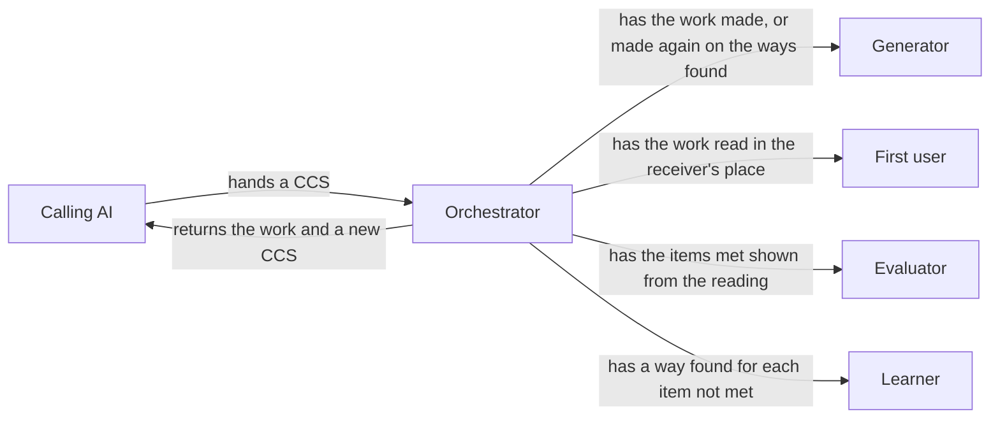
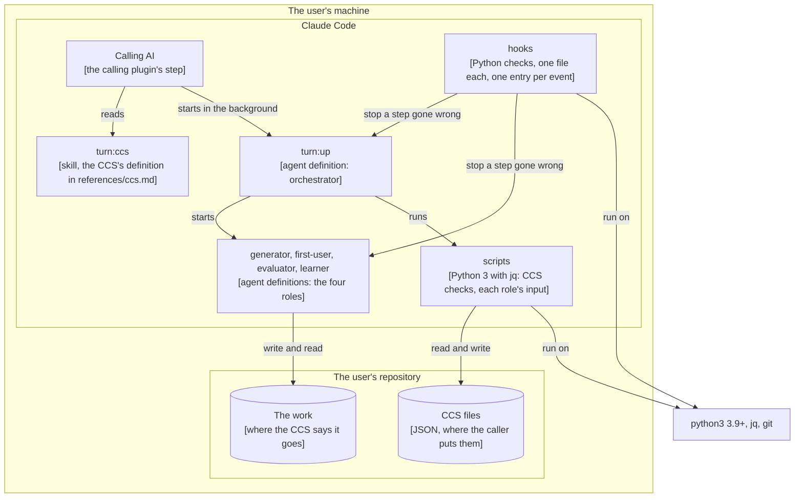

# turn design

turn is one turn of ACC: a calling AI hands it a CCS, and gets back the work, read inside turn by a
reader other than the one that made it and made again where it fell short, with a new CCS to go on
from. The experience this gives is in [turn's UX](ux.md).

## User stories

- As the calling AI, I want to hand turn a CCS and get back the work and a new CCS.

  Reading, judging and making again are how turn makes the work, and lie in its components.

## Architecture

### Logical view

- The calling AI hands the orchestrator a CCS, and the orchestrator returns the work and a new CCS
  once it has decided every item of the checklists.

  The new CCS holds, for each item, whether the work meets it and the lines that do, what is not
  settled, and what the calling AI does next.
- The generator makes the work and names, for each item, the lines it meant to meet it.

  That is its claim, not a judgment; the orchestrator reads the work against every item and sends
  back what it can see falls short before the first user reads, so the costly reading is not spent
  on it.
- The first user reads the work in the receiver's place, with only what the receiver opens.

  A reader that did not make the work stops where the receiver would, where the maker reads in what
  it meant.
- The evaluator shows, from that reading, the items the work meets and their lines.

  It is there so that each judgment rests on the reading, since the orchestrator alone did not
  settle its judgments.
- The orchestrator reads the work against every item itself, the items the evaluator shows met and
  those it does not, and decides each.

  It takes neither the generator's claim nor the evaluator's lines on trust.
- The learner finds, for each item not met, how the work would meet it, and the orchestrator sends
  that back to the generator, which makes the work again.

  It is there so that what falls short is made again from what the work should give, since the
  generator alone patched where a shortfall showed.
- What is made again is read again before it returns, once at most.

  A second reading settles what the first found; what it still finds comes back as not met, for the
  calling AI to judge.

### Physical view

- The orchestrator is an agent definition, started by the calling AI in the background, so the
  calling AI's context holds only what comes back.

  The calling AI can still take the user's pause while it waits, and stops a run by sending the
  orchestrator a message. The person sees the run's agents in the panel below the prompt input,
  which shows nested agents as a tree. Several runs go at once, as rn starts them for work that can
  go in parallel; the hooks tell them apart by `agent_id`, since every agent of a conversation has
  the same `session_id`, and how a role's `agent_id` is tied to its run is tried when built.
  `claude -p` is not used, since the docs say `--bare`, which reads no subscription login, will
  become its default.
- The CCS's definition is `turn/skills/ccs/references/ccs.md`, read by the calling AI through the
  `turn:ccs` skill, whose SKILL.md says only to read it.

  `plugin-dev`'s `skill-development` keeps an API's specification in a skill's `references/`. A
  skill is called by name from any installed plugin, and a plugin built on turn names it in
  `dependencies`, so the calling AI reaches the definition wherever plugins are installed.
- The CCS takes ACC's nine parts with the paper's names and meanings, and defines inside them only
  the kinds turn reads and writes.

  | Part | Kinds turn defines | Written by |
  |---|---|---|
  | `focal_entities` | `deliverable`, where the work goes; `receiver`, who reads it | the caller |
  | `goal_orientation` | `use`, what the receiver reads it for; `acceptance`, when it is enough | the caller |
  | `retrieved_artifacts` | `checklist`, `decisions`, `reference`, `receiver_opens` | the caller |
  | `constraints` | `language` | the caller |
  | `episodic_trace` | `item`, whether each item is met and the lines that meet it | turn |
  | `uncertainty_signal` | `question`, for the user; `unmet`, an item not met and why | turn |
  | `predictive_cue` | `next`: `done`, `ask the user` or `fix`, the caller fixes | turn |
  | `semantic_gist`, `relational_map` | none | the caller |

  Every other kind is the caller's to define. The new CCS is the state after the turn: the
  caller's parts and every kind turn does not define come back as received, and turn's parts are
  written in place of the last turn's, so the CCS does not swell and can be handed to turn again as
  it is.
- A script checks the CCS at both ends: that the CCS received meets the definition, and, before it
  returns, that the new one does and that what must come back as received has not changed.

  A CCS that fails is stopped with what is wrong and where the definition is, and a new CCS that
  fails is not returned.
- The work is made where it goes, in the user's repository.

  A run cut off leaves its writing as changes git shows, which the calling AI undoes or finishes;
  the calling AI calls turn again, and the generator makes the work again from what is there. No
  run resumes part way, since being cut off is rare and a reading again costs less than a resume to
  build and keep right. Runs at once make different files. Nothing of a run is put outside the
  repository.
- Each role gives its answer as its reply to the orchestrator, in a JSON form of its own, not in a
  file.

  A run leaves nothing behind, and only the orchestrator holds the answers, so the first user
  cannot see the generator's claim. A hook lets a role start only with the input the orchestrator
  is to give it, and stops a reply that does not fill its form, every item answered and each line
  named in the work; how a hook reads a reply is tried when built.
- The hooks also stop a read outside a role's inputs, a write outside where the work goes, and a
  commit or a push.

## Quality

- The calling AI goes on from the new CCS alone, carrying it instead of the whole conversation.
  - Must-be: the new CCS alone tells the calling AI what to do next, without reading what went on
    inside the run.
  - Must-be: however many times turn is called, the CCS does not swell, since what turn writes
    replaces the last turn's.
  - Must-be: what must come back as received does not change.
  - Better the more: what each call adds to the calling AI's context, the CCS and the
    orchestrator's last reply, the less the better.
- The calling AI gets the work already read by a reader other than the one that made it, as its own
  readers would, and made again where that reading found it short.
  - Must-be: the first user is not the generator and reads only what the work's receiver opens.
  - Must-be: the first user reads the whole work, for every item.
  - Must-be: the work returned is as it was last read, what is made again read again before it
    returns.
  - Must-be: the orchestrator decides each item by reading the work itself.
  - Must-be: an answer comes back for every item, and each line named is in the work and meets the
    item.
  - Must-be: what only the user can decide comes back as a question, not filled by a guess.
  - Must-be: nothing but where the work goes is changed, and nothing is committed or pushed.
  - Better the more: the time a run takes, since the calling AI cannot go on while it waits.
  - Better the more: the cost of a run, since the four roles and the orchestrator run every time.
  - Better the more: how much the calling AI fixes after the work returns, counted as the items it
    fixes itself.

## Verification

### Units

- The scripts: each check of the CCS and of each role's input stops what it must and lets through
  what it must.
  - unittest in `dev/turn/tests/`, fed what the calling AI hands over, every line and branch counted
    in CI on every push.
- The hooks: each check stops a step where it must and lets it through where it must.
  - unittest in `dev/turn/tests/`, fed what Claude Code hands each hook, counted the same way.
- The orchestrator and the four roles: each does what its steps say.
  - Run on its own on a small task, on Opus 5.5, and judged from the JSONL.

### Acceptance

The trials run in the private `lovaizu/rn-try`, one at a time: a stand-in for the calling AI is
handed a small task's decisions and checklist and calls turn, and each is judged from the JSONL of
every agent it started and from the work.

- The story: the work comes back where it goes, with an answer and lines for every item.
  - Each answer is checked by reading the work.
- The new CCS alone tells what to do next.
  - The stand-in takes its next move from the new CCS, with nothing of the run's inside in its
    context.
- The CCS does not swell.
  - A test that the script writes turn's parts in place of the last turn's; in a trial calling turn
    twice, the second CCS is no larger than the first beyond what the new turn says.
- What must come back as received does not change.
  - A test that the script returns nothing when it has changed.
- The first user apart, reading only what the receiver opens.
  - A test that the hook stops any other read; in a trial, everything the first user opened is
    what the receiver opens.
- The whole work read for every item.
  - A test that the hook stops a reply that leaves an item out; in a trial, the first user opened
    all of the work.
- The work returned as last read.
  - In a trial, nothing is written to the work after the last reading begins.
- The orchestrator deciding by its own reading.
  - In a trial, it opens the work before it decides.
- An answer for every item, with lines that are in the work.
  - A test that the script checks each line named is in the work; in a trial, each line is read for
    whether it meets its item.
- A question, not a guess.
  - A trial on a task with one decision left out returns a question.
- Nothing changed but where the work goes, no commit or push.
  - A test that the hooks stop them; after a trial, git shows changes to the work alone.
- What each call adds to the calling AI's context, the time and the cost of a run, and the items
  the calling AI fixes.
  - Measured from each trial's JSONL, its usage and timestamps, and compared with the last version.
