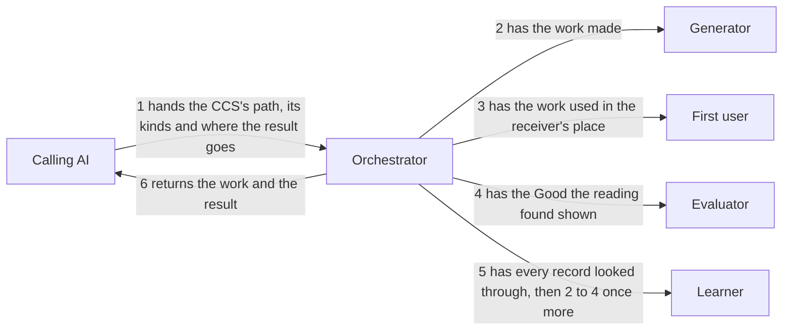

# turn design

turn makes the work a calling AI's CCS asks for, has it read in its receiver's place by a reader
that did not make it, makes it again where that reading finds no Good, and returns it with each
item's Good and the lines that give it. The goal and the key results it is built to reach, and what
the words CCS, receiver and Good mean, are in [turn's UX](ux.md).

## User stories

- As the calling AI, I want to hand turn the path of a CCS and get the work back, with each item's
  Good and its lines, the questions only the user can decide, and what each item still without Good
  would give.

  Reading, judging and making again are how turn makes the work, and lie in its components.

## Architecture

### Logical view



Each role, the orchestrator and the four it starts, answers the orchestrator in its reply.

- Every role looks only for the Good each item of the checklists gives and the lines that give it;
  only a script, code that runs the same every time, doubts, such as by naming the lines no Good
  rests on.

  An AI that looks for what more the work needs finds more without end, and each find is patched
  in, so the work drifts from what it should be. Each role's part is one aim, so it works to the aim
  rather than to a list of steps.
- The calling AI hands the orchestrator the CCS's path, the kinds it uses in it for where the work
  goes, the checklists, the receiver, what the receiver reads the work for and what they open with
  it, and where the result goes.

  The CCS is the calling AI's, with the names it chooses, and turn defines nothing of it: what it
  needs is found by these kinds, and the values stay in the CCS alone, so the call and the CCS
  cannot differ. Where the result goes is not in the CCS, as it is this call's answer, not the
  task's state.
- The generator makes the work from the CCS whole, so that every item gives its Good, and hands
  back, for each item, the lines that give it, and the questions only the user can decide.

  It hands back only once it has read the work against each item. What the CCS does not say is not
  filled in from its own guess but becomes a question. The lines are its claim, not a judgment.
- The orchestrator reads the work against every item, and sends back to the generator the items
  whose Good it does not find, each said as what the receiver gets once it is Good; once it sends
  nothing back, a script records its findings.

  A shortfall plain to see is sent back while it costs least, before the costly reading. How the
  work becomes Good is the generator's to decide, since an edit told per item broke other items.
  An item only the user's answer can give is not sent back: it comes back as a question.
- The first user uses the work in the receiver's place, with the work, what the receiver opens, who
  the receiver is and what for, and the checklists, and says for each item the Good it took and
  where.

  A reader that did not make the work stops where the receiver would, where the maker reads in what
  it meant.
- The evaluator, given the same and the first user's reading, shows the Good the first user found,
  and any other Good the work gives, with their lines; the orchestrator then decides each item
  where its own finding and the evaluator's differ, against what the first user opened and where it
  stopped.

  The orchestrator's finding is recorded before the evaluator starts, as a judgment made after
  another's is pulled toward it, which no word of caution prevents. The evaluator is there because
  one reader misses Good the work gives, and an item judged without Good by that miss is made again
  for nothing.
- When every item has its Good or a question, the run returns; otherwise the learner looks through
  every item's finding and every role's record of the run for what makes the Good, and the generator
  makes the work again from what it found.

  For an item without Good it finds how the work would give it; for an item with Good, what gives
  it, so that making again keeps it; and about making, such as what to read or ask before writing.
  What fell short often lies in what a role did, which only its record shows.
- The work made again is read once more, and then the run returns, with each item still without
  Good and what the receiver gets once it is Good.

  A reading is the orchestrator's finding, the first user, the evaluator and the decision. A second
  reading settles what the first found; what is left is the calling AI's to fix, which costs less
  than more readings.

### Physical view

```
turn/                      the plugin, installed by Claude Code
├── agents/
│   ├── up.md              the orchestrator <agent>
│   ├── generator.md       <agent>
│   ├── first-user.md      <agent>
│   ├── evaluator.md       <agent>
│   └── learner.md         <agent>
├── scripts/               the call's check, each role's input, the orchestrator's findings, the result <Python 3, jq>
└── hooks/
    ├── hooks.json         one entry per event
    └── *.py               one check each <Python 3>
```

- turn runs on Claude Code, python3 3.9 or later, jq and git.
- The calling AI starts the orchestrator, `turn:up`, in the background with the call as JSON, so its
  context holds only what comes back.

  It can still take the user's pause while it waits, and stops a run by sending the orchestrator a
  message. The person sees the run's agents as a tree in the panel below the prompt input.
  `claude -p` is not used, since the docs say `--bare`, which reads no subscription login, will
  become its default.
- A script checks the call and takes from the CCS every entry of each kind the call names, and
  hands each role what it is given; the generator reads the CCS whole.

  A call that names a missing file, or no entry for where the work goes, the checklists or the
  receiver, is stopped with what is wrong. No AI copies a value from the CCS, so none is copied
  wrong.
- The learner reads the record, the JSONL, of each role of its run, which the hooks let it read.

  A role's JSONL lies beside the conversation's transcript, tied to its run as below.
- Each role gives its answer as its reply to the orchestrator, in a JSON form of its own, not in a
  file, and a hook checks each role at both ends.

  Only the orchestrator holds the answers, so the first user cannot see the generator's claim. A
  hook lets a role start only with the input it is to be given, and stops a reply that does not
  fill its form; the evaluator starts only once a script holds the orchestrator's own findings.
- The hooks stop a read outside a role's inputs, a write outside where the work goes, and a commit
  or a push.

  Each role works from what it is given alone, so its work is not bent by what it was not meant to
  see; a stop says so, and names what may be read.
- A script writes the result where the call says, and checks its shape as it writes.

  A reply would be copied into a file by the calling AI, where a slip goes unseen.
- Several runs go at once, as rn starts them for work that can go in parallel, and the hooks tell
  them apart by the orchestrator's `agent_id`.

  Every agent of a conversation has the same `session_id`. A role's run is the `parentAgentId` in
  `subagents/agent-<agent_id>.meta.json` beside the conversation's transcript; tried with two runs
  at once, every role's tool use and reply was tied to its own orchestrator. The file is there from
  a role's first tool use, so what a role is started with is checked at the orchestrator's own call
  that starts it. The file is Claude Code's record, not a documented hook input, so the hooks'
  tests hold its shape.
- The work is made where it goes, and a run cut off leaves its writing as changes git shows.

  The calling AI undoes or finishes them, and calls turn again on what is there. No run resumes part
  way, since being cut off is rare and a reading again costs less than a resume to build and keep
  right.

## Verification

### Units

- The scripts and the hooks: each check stops what it must and lets through what it must.
  - Run by [`dev/check.sh`](../check.sh) in CI on every push:
    - unittest in `dev/turn/tests/`
    - Lines and branches 100% covered
    - Ruff's lint and format
    - Pyrefly's types for Python 3.9
- The orchestrator and the four roles: each works to its aim, with its inputs alone, giving its
  form.
  - Run on its own on a small task, on Opus 5.5; passes when its JSONL shows it read only its
    inputs and worked to its aim, and its reply fills its form.

### Acceptance

Each trial runs in `lovaizu/playground`, one at a time, on a branch of its own removed after: a
stand-in for the calling AI is handed a small task's CCS and checklist and calls turn, and is judged
from the JSONL of every agent it started and from the work.

- The story: the work comes back where it goes, with a Good and its lines, a question or what the
  receiver gets once it is Good, for every item.
  - Each Good is checked by reading its lines in the work.
- KR1.1: the items the calling AI fixes after the work comes back.
  - Counted from the stand-in's own check in its JSONL, and compared with the target of none and
    with the last version's, kept with the trial in `dev/turn/trials/`.
- KR1.2: the time from the call to the work coming back.
  - Taken from the JSONL's timestamps for a README-sized work, and compared with the target of three
    minutes and with the last version's.
