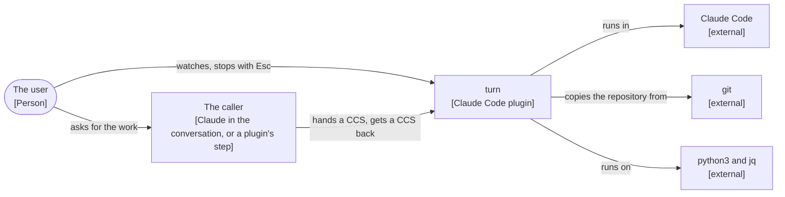
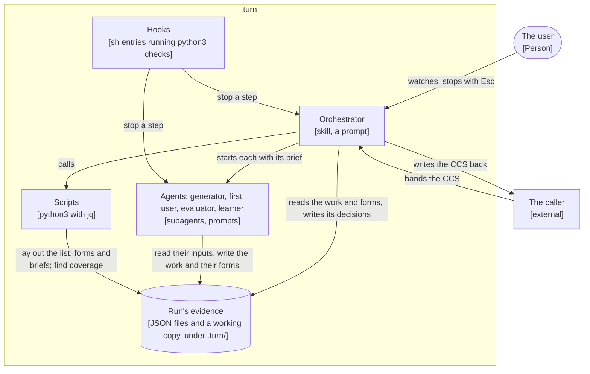
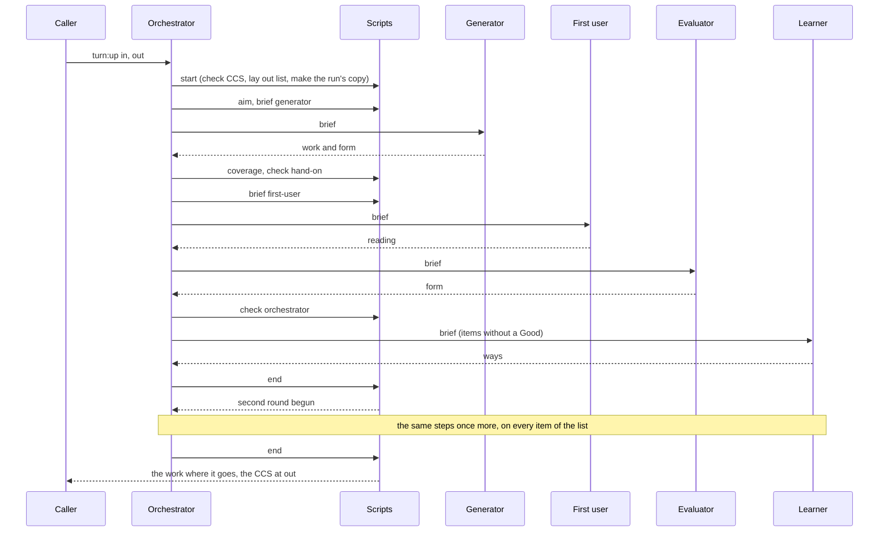
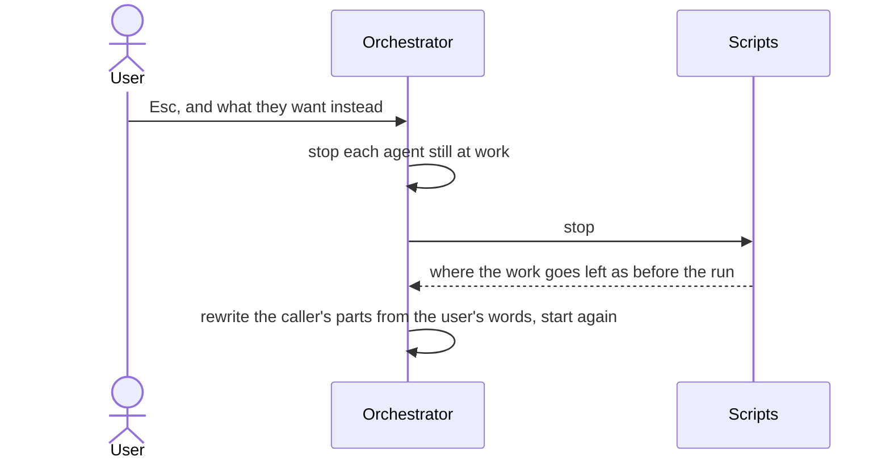
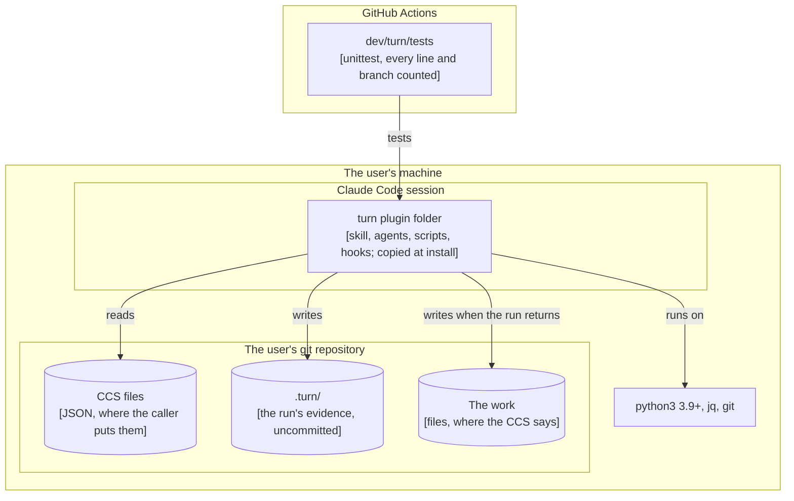

# turn architecture

This document follows the [arc42](https://arc42.org) template, with C4's levels drawn as Mermaid
flowcharts, which GitHub shows in place. How turn is used
is in its [README](../../turn/README.md), and what a caller writes and reads is on the
[callers' page](../../turn/calling-from-a-plugin.md); this document says how turn is built to keep
what they promise.

## 1. Introduction and goals

### 1.1 Requirements overview

turn has Claude make a work, such as a README, a design document, a skill or code with its tests,
that passes the caller's checklists of what the work must give the person it is for. The work is
read in that person's place by an agent that did not write it, and every item of the checklists is
decided from that reading and the whole work, so the user can hand the work on without first reading
it as that person themselves.

### 1.2 Quality goals

| ID | Quality goal | What it means for the user |
|---|---|---|
| QG-1 | Read in the receiver's place | A Good is given only where a reader who did not write the work, holding only what the receiver holds, finds the item given. |
| QG-2 | Made from what the caller decided | The work follows the caller's inputs alone, so each run of the same request works from the same inputs. |
| QG-3 | A pass that can be checked | Every Good names the lines of the work that give it, kept in the repository. |
| QG-4 | Left at work | turn asks nothing while it works, and asks every open question at the end. |
| QG-5 | The user's repository kept | A run writes only where the work goes, never commits, and a stopped run leaves the repository as it was. |

### 1.3 Stakeholders

| Who | Expects |
|---|---|
| The user, in a Claude Code conversation | Work that serves its receiver, without reading it in the receiver's place first. |
| A plugin author whose step calls turn, such as rn's | A call and a CCS written back that keep working across turn's releases. |
| Whoever builds or changes turn | To know where each quality goal is held before changing a part. |

## 2. Constraints

| Kind | Constraint |
|---|---|
| Technical | turn is a Claude Code plugin: skills, agents, hooks and scripts only; installing copies only its folder. |
| Technical | A subagent can neither ask the user nor hear from its caller while it works. |
| Technical | A plugin's hooks run in every session where it is installed. |
| Technical | Scripts run on Python 3.9 or later with the standard library only, and jq. |
| Technical | The work is in a git repository. |
| Organizational | turn is built by `.claude/rules/plugin.md`: every line of its scripts and hooks is run by the tests in `dev/turn/tests/`, counted in CI on every push. |
| Convention | Documents are in English; JSON the agents read and write is changed with jq. |

## 3. Context and scope

| Neighbour | Input to turn | Output from turn |
|---|---|---|
| The caller | A CCS: where the work goes, the receiver, the use, the checklists, decisions, references, what the receiver opens, constraints | The work where it goes, and a CCS with `next`, questions, unmet items and where the evidence is |
| The user | Esc and what they want instead | The console: the plan, the aim, each step |
| git | The repository as committed | Nothing; turn never commits or pushes |

## 4. Solution strategy

| Quality goal | Approach |
|---|---|
| QG-1 | The work is read by the first user, an agent apart from the generator that reads only the work and what the receiver opens; the orchestrator alone decides each item from that reading and the whole work (ADR-2, ADR-3). |
| QG-2 | Every role reads only the inputs the CCS names; hooks stop any other read (ADR-4). |
| QG-3 | Each role answers in a form with one place per item, naming lines; scripts check each form is filled, and keep it under `.turn/` (ADR-4). |
| QG-4 | The orchestrator runs as a skill in the caller's session and keeps each open question to the end of the run (ADR-1). |
| QG-5 | The work is made in a copy of the repository and written where it goes only when the run returns; hooks stop a write elsewhere, a commit and a push (ADR-5). |

## 5. Building block view

### 5.1 Level 1

| Block | Responsibility | Interface | Source |
|---|---|---|---|
| Orchestrator | Runs a run; reads the whole work and every form, and alone decides each item; keeps questions to the end. | The skill `turn:up` with `in:` and `out:`. | `turn/skills/up/SKILL.md` |
| Generator | Makes the work to every item of the list, and names in its form the lines that give each. | Its brief, a path. | `turn/agents/generator.md` |
| First user | Reads the work as the receiver, with only what the receiver opens, and writes what it took for each item and where. | Its brief, a path. | `turn/agents/first-user.md` |
| Evaluator | Shows from the reading which items the work gives, with their lines. | Its brief, a path. | `turn/agents/evaluator.md` |
| Learner | For each item without a Good, finds how the work would give it, and where. | Its brief, a path. | `turn/agents/learner.md` |
| Scripts | Check the CCS, lay out the list, forms and briefs, check each form, find coverage, show the console, make the run's copy, and write the work and the CCS back or restore on a stop. | `up.py start / aim / brief / coverage / check / end / stop`. | `turn/scripts/` |
| Hooks | Stop a read outside a role's inputs, a write outside the run's copy, a commit or a push, an agent started without its brief, an agent ending with its form unfilled, and the orchestrator ending before the run returns. | Claude Code's PreToolUse, PostToolUse, SubagentStop and Stop events. | `turn/hooks/` |
| Run's evidence | Holds the list with each checklist's name and version, each form, the work and the run's copy. | Files read and changed with jq. | `.turn/` in the user's repository |

### 5.2 Level 2: Hooks

Each check is its own file under `turn/hooks/checks/`, and each hook event has one entry file, as
the official `hookify` plugin does.

| Check | Holds |
|---|---|
| `read_in_inputs` | QG-2: a role reads only its inputs, turn's files and its own tool output. |
| `orchestrator_shell` | QG-2: the orchestrator's shell runs only `up.py`, and jq, mv and cd on the run's files. |
| `brief_handed` | QG-2: an agent is handed only the brief the scripts wrote for it. |
| `form_filled` | QG-3: an agent hands back only once every place of its form is filled. |
| `write_in_run` | QG-5, QG-1: a write lands only in the run's evidence, and not in the work once the first user has it. |
| `no_commit` | QG-5: no commit and no push during a run. |
| `run_ended` | QG-4: the orchestrator does not stop before the run returns. |
| `console_shown` | Shows the user each console line as the run reaches it. |
| `open_run`, `inputs` | Find the session's open run and each role's inputs; with no open run, every check lets everything through. |

## 6. Runtime view

### 6.1 A run with a second round

### 6.2 The user stops the run

### 6.3 A run that cannot start

`up.py start` ends before any work, writing nothing, when `out` exists, the CCS cannot be run, a
file at a `deliverable` has changes git does not hold, or jq is missing; the orchestrator says why.
Without python3, the orchestrator says to install it, and the hooks let everything through.

## 7. Deployment view

Nothing of turn runs in CI; only its tests do. A plugin built on turn names it in `dependencies`,
so installing that plugin installs turn.

## 8. Crosscutting concepts

- Forms: every role answers in a JSON form with one place per item, which the scripts lay out and
  check (ADR-3, ADR-4).
- What must come out the same every run is done by a script or held by a hook, never left to a
  prompt (ADR-4).
- Coverage: the lines of the work no form names, as test coverage finds lines no test runs; the
  orchestrator reads it as where to look first (ADR-3).
- The console is shown by a hook, not by the orchestrator's text, since text between tool calls
  does not reach the user on every run (ADR-1).

## 9. Architecture decisions

| ADR | Title | Status |
|---|---|---|
| ADR-1 | The orchestrator runs as a skill in the caller's session | Accepted |
| ADR-2 | A separate first user reads the work | Accepted |
| ADR-3 | Every role looks only for where items pass | Accepted |
| ADR-4 | Same-every-time steps in scripts and hooks | Accepted |
| ADR-5 | The work is made in a copy of the repository | Accepted |
| ADR-6 | At most one second round | Accepted |

### ADR-1: The orchestrator runs as a skill in the caller's session

- Context: the user must see the run and stop it with Esc (QG-4); a subagent shows no console.
- Decision: the orchestrator is the skill `turn:up`; each agent is a subagent.
- Consequences: the run takes room in the caller's context (R-003).

| Criterion | Skill | Subagent |
|---|---|---|
| User sees and stops the run | +1 | -1 |
| Caller's context kept small | -1 | +1 |
| Agents can be started | 0 | 0 |

### ADR-2: A separate first user reads the work

- Context: the writer knows what each line means and misses what the receiver would not take in
  (QG-1).
- Decision: an agent that did not write the work reads it with only what the receiver opens.
- Consequences: one more agent per round (R-003); the reader runs on the same model as the writer
  (R-001).

| Criterion | Separate reader | Writer checks itself |
|---|---|---|
| Finds what the receiver misses | +1 | -1 |
| Time and tokens | -1 | +1 |

### ADR-3: Every role looks only for where items pass

- Context: a role set to find faults finds them whether they are there or not, and the work is made
  again for faults it does not have.
- Decision: each role names where items pass; coverage is the one place that looks for what may be
  wrong, and the orchestrator alone decides.
- Consequences: a fault no item asks about is not found; it goes into the checklist.

| Criterion | Look for passes | Look for faults |
|---|---|---|
| Work not remade for false faults | +1 | -1 |
| Faults outside the checklist found | -1 | +1 |

### ADR-4: Same-every-time steps in scripts and hooks

- Context: an AI follows a prompt differently from run to run, so a slipped step shows only later
  (QG-2, QG-3, QG-5).
- Decision: laying out, checking, writing back and restoring are scripts; holding each role to its
  steps and inputs is hooks.
- Consequences: the hooks run in every session where turn is installed (R-002).

| Criterion | Scripts and hooks | Prompt steps |
|---|---|---|
| Same result every run | +1 | -1 |
| Tested in CI | +1 | -1 |
| Less to build | -1 | +1 |

### ADR-5: The work is made in a copy of the repository

- Context: a run stopped part way must leave where the work goes as it was (QG-5), and the work's
  tests and builds must run as they would in place.
- Decision: the work is made in a working copy under `.turn/`, and written where it goes only when
  the run returns.
- Consequences: a shell command in the copy may still change a file elsewhere (R-004).

| Criterion | Copy | In place |
|---|---|---|
| Stop leaves things as they were | +1 | -1 |
| Tests and builds run as in place | +1 | +1 |
| Disk and time | -1 | +1 |

### ADR-6: At most one second round

- Context: each round costs minutes and tokens; whether to go on is the caller's to judge from what
  it knows was agreed.
- Decision: a run ends after one second round, returning what is left as `unmet`.
- Consequences: work that needs a third pass comes back to the caller.

| Criterion | One second round | Until every item passes |
|---|---|---|
| Time and tokens bounded | +1 | -1 |
| Every item met in one call | -1 | +1 |

## 10. Quality requirements

### 10.1 Quality tree

| Quality | Kind |
|---|---|
| Read in the receiver's place | Concretises QG-1 |
| Made from what the caller decided | Concretises QG-2 |
| A pass that can be checked | Concretises QG-3 |
| Made again, keeping every item it gave | Derived |
| Asked only at the end | Concretises QG-4 |
| Seen and stopped as it goes | Concretises QG-4 |
| Repository kept | Concretises QG-5 |
| Time and tokens | Derived |
| Callers keep working | Derived |
| Nothing in the way outside a run | Derived |

### 10.2 Quality scenarios

Each scenario is checked as its last line says: a trial in `dev/turn/trials/`, judged from the JSONL
of every agent of the run, or a test in `dev/turn/tests/`, run on every push.

| ID | Source | Stimulus | Artifact | Environment | Response | Response measure |
|---|---|---|---|---|---|---|
| QS-1 (QG-1) | A caller | Hands a task on one of rn's or turn's own documents | A run | Normal | A fresh agent outside the run reads the returned work as the same receiver | 100% of the items returned as Good are found given; trial |
| QS-2 (QG-2) | A caller | Hands a task in a repository with files the inputs do not name | A run | Normal | No role reads those files | 0 reads outside the inputs in the JSONL; trial, and a test on the hooks |
| QS-3 (QG-3) | The user | Opens the evidence of a finished run | `.turn/` | After the run | Finds for any Good its lines and its checklist's version | 100% of Goods; trial, and a test that a Good naming lines the work lacks is refused |
| QS-4 (derived) | A caller | Hands a task whose first round leaves an item the work can give | A run | Normal | The work is made again in the same run | 100% of the items the first round gave a Good have one again; test on the scripts |
| QS-5 (QG-4) | A caller | Hands decisions that leave one choice open | A run | Normal | Nothing is asked while it works; the run ends asking that choice | 0 questions before the end, 1 at the end; trial |
| QS-6 (QG-4) | The user | Presses Esc when the console shows what the work will let its receiver do | A run | Running | No work is written; the work is made from what the user said | 0 files changed where the work goes before the restart; trial, and a test on the scripts |
| QS-7 (QG-5) | An agent | Writes outside the run's copy, commits or pushes | The hooks | During a run | The step is stopped | 100% stopped; test on the hooks |
| QS-8 (QG-5) | A shell command | Changes a file outside the work | A run | During a run | The file is named in what the run returns | 100% named; test on the scripts |
| QS-9 (derived) | A caller | Hands the same CCS to this version and the last release | A run | Normal | The run ends | Minutes and tokens no more than the last release's; first-round share of all-Good tasks no lower; trial |
| QS-10 (derived) | A plugin built on turn 0.2.0 | Calls turn as the callers' page gives, and reads the CCS back | The call and the CCS | After an update | Works as before | Every part, kind of entry and value of `next` is one 0.2.0's callers know; a CCS from 0.2.0 on is carried on; test |
| QS-11 (derived) | The user | Works in a session with no run open, or without python3 | The hooks | Outside a run | Nothing is stopped | 0 stops; test on the hooks |

## 11. Risks and technical debt

### 11.1 Risks

| ID | Risk | Probability | Impact | Priority | Mitigation |
|---|---|---|---|---|---|
| R-001 | The first user runs on the same model as the generator and shares its blind spots, so a Good stands that the real receiver would not give | Medium | High | 1 | QS-1, a fresh agent outside the run; the user's own reading at hand-on |
| R-003 | A run takes many minutes and tokens, and room in the caller's context | High | Medium | 2 | ADR-6; QS-9 |
| R-002 | A hook misfires in a session where the user is not running turn | Low | High | 3 | `open_run`: checks act only on the session's open run; QS-11 |
| R-004 | A test or build the work runs changes a file outside the work | Low | Medium | 4 | QS-8, named when the run returns |

### 11.2 Technical debt

None recorded.

## 12. Glossary

| Term | Meaning |
|---|---|
| Caller | Claude in the user's conversation, or a step of the user's plugin, that hands turn a task. |
| CCS | The JSON file a caller hands turn, and the one turn writes back. |
| Work | What one task makes for one purpose, one file or several. |
| Checklist | A file of items, each one question the work must answer yes to for its receiver; the list is a task's checklists put together. |
| Run | From one CCS to the one turn writes back, in one or two rounds. |
| Round | The work made, read and decided, and a way found for each item without a Good. |
| Good | An item the orchestrator decided the work gives, with the lines it rests on. |
| Form | The JSON answer of a role, one place per item. |
| Reading | The first user's form: what it took from the work for each item, and where. |
| Coverage | The lines of the work no form names. |
| Run's evidence | What a run keeps under `.turn/`: the list, the forms, the work and the run's copy. |
