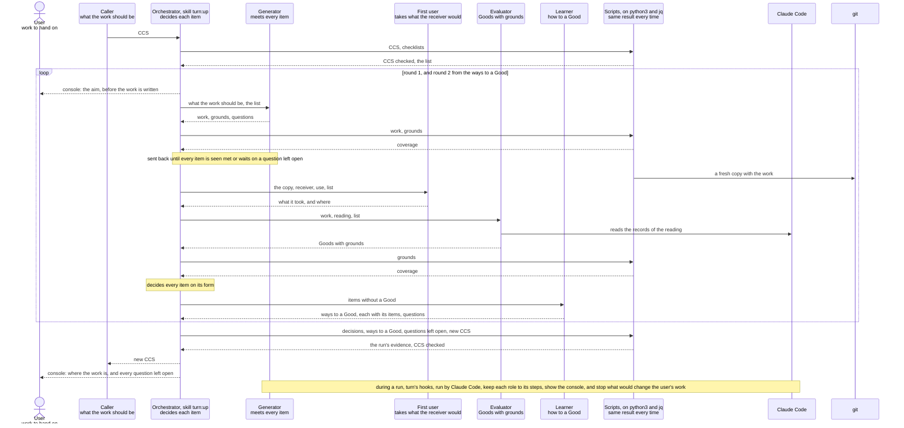

# turn design

This document is for whoever builds or changes turn: what turn must achieve, how each quality is
checked, and how turn is built to achieve it, for the benefits [turn](../../turn/README.md)
promises. How to use turn is in that README, and the forms a caller writes and reads are on the
callers' page, [Calling turn from a plugin's step](../../turn/calling-from-a-plugin.md); prompts'
wording and steps are left to the code. A statement no trial has checked yet is marked
"(assumption)".

The words used throughout:

- The caller: Claude in the user's conversation, or a step of the user's plugin. It hands turn one
  task in a CCS, a JSON file: the caller writes what the work should be (where it goes, the receiver
  it is for, their use of it when named, what they must be able to do with it, its sources and its
  checklists), and turn writes back what the caller needs next, as a function takes arguments and
  returns a value.
- A checklist says what a work of one kind must give its receiver: an opening on what such work is
  for, then items, each one question. The list is a task's checklists put together.
- A run goes from one CCS to the one turn writes back. A round makes the work, has it read and
  decides each item; a run has one round or two.
- The orchestrator runs a run and alone decides each item. Its agents give it what it decides from:
  the generator makes the work, the first user reads it in the receiver's place and hands back its
  reading, the evaluator shows which items the work meets, and the learner finds how an item without a
  Good would get one.
- A Good: an item the orchestrator has decided the work meets, with its grounds, the lines it rests
  on. More: an item without a Good when a run returns.
- Coverage: the lines of the work no grounds name, as test coverage finds the lines no test runs.
- The run's evidence: what a run keeps in the repository for the user and the next run: each round's
  work, reading and decisions, each way to a Good, and the list with each checklist's name and
  version. The work stays there until the run returns.

## Goals

### Attractive quality

- Read in the receiver's place: the work comes back already read in the receiver's place by an agent
  that did not write it, each Good shown in its lines, and what that reading could not take made
  again on how it would be given. The user hands the work on without first reading it as its
  receiver.
- Asked only what only the user can decide, all at once at the end: nothing is asked that what the
  work should be, or its sources, already answers, and nothing is asked while the run works, so the
  user can leave turn at work.
- Seeing the work as it goes: the user can tell from the console how far a run has come, and stop a
  run whose aim they do not want before the work is written, saying what they want instead.
- A plugin decides from what turn returns: a plugin hands turn one task and decides its next move
  from the returned CCS alone, without writing the loop of making, reading and making again.
- Following each item back: the user can later find, for each item, the lines its Good rests on or
  how it would get one, and the version of the checklist it was judged by.

### One-dimensional quality

Each must be no worse than in the version in use.

- The first-round share: runs whose first round ends with every item Good. The more work is right
  when first made, the less the user waits and the less is spent.
- Time and tokens: what one run takes, from the call to the returned CCS.

### Must-be quality

- Nothing passes unshown: an item counts as met only with a Good whose grounds are lines the work
  holds; every other item is returned as More, with how it would get a Good.
- What the work should be unchanged: turn never rewrites what the caller wrote.
- Nothing unread: the work turn writes where the work goes is the version last read.
- Repository untouched: during a run, turn changes nothing in the repository but where the work goes
  and the run's evidence, and never commits or pushes, so the user takes turn's change as one diff
  and decides themselves what to commit; a file where the work goes is written over only when git
  holds it as it stands, or it is the work a run returned and is unchanged since, so what was there
  can be got back; a change a shell command of the run
  makes elsewhere as a side effect is named to the user. Outside its runs, turn blocks nothing.
- Stop and start over: a stopped run returns a CCS saying so, and called again with the request
  rewritten from what the user said, starts from the work as it stands; a run cut off leaves where
  the work goes untouched.
- Missing tools: without python3 or jq, turn ends before any work and says what to install; outside
  a run, a missing tool breaks nothing.

### Backward compatibility

- The call: plugins call the skill `turn:up` with the arguments the callers' page gives, and name
  `turn` in their dependencies. An argument may be added only if a call without it runs as before.
- The CCS: its parts, kinds of entry and values of `next`, as the callers' page gives them, are
  neither added to, removed nor renamed, since a caller breaks on one it does not know as on one
  that is gone; the wording in an entry may change, since callers do not act on it. A CCS an earlier
  version returned is accepted, so a stopped task carries on after an update.
- The checklist form the README's Requirements gives, since users and writ write checklists in it.
- What a returned CCS points to: the user opens it to follow each item back, and the next run starts
  from the work a stopped CCS points to, so every place a returned CCS points to exists; where the
  run's evidence is kept, and the rest of it, may change.

### Non-goals

- Deciding what the work should be: the caller does it, knowing what was already agreed.
- Running until every item is Good: what a second round leaves without a Good points to a fault in
  turn, the checklist or what the work should be, to be fixed there (assumption).
- Finding what no item asks, which goes into the checklist; and holding checklists, which belong to
  whoever knows the kind of work, such as writ.

### Constraints

- turn is used by Claude, on a person's behalf, in a conversation or a plugin's step.
- turn runs in Claude Code and holds only skills, agents, hooks and scripts; installing copies only
  its folder; its hooks run in every session where it is installed; a subagent can neither ask the
  user nor hear from its caller while it works.
- Users' machines run Python 3.9 or later with the standard library only, and jq.
- The work is in a git repository.

## Verification

### Attractive quality

Each is tried on real work, writ's and turn's own documents and prompts, and judged from the records
(the JSONL of every conversation and agent of the run), since a made-up task shows only that it
passes.

- Read in the receiver's place: tried on work for a receiver who lacks what the generator knows,
  where a writer checking their own work passes what a newcomer would miss (assumption). It passes
  when a fresh agent outside the run, reading the returned work as the same receiver on the same
  list, takes every item returned as Good, including each the first round left without one.
- Asked only what only the user can decide, all at once at the end: on sources that settle some
  choices and leave one open, nothing is asked while the run works, the run ends with `ask the user`
  and that one choice, and, run again with the answer, it ends with `done` and the answer in the
  work; no question is answered by what the work should be or its sources.
- Seeing the work as it goes: the console alone tells the round and step the records show; a run
  stopped on its aim has written no work of that aim, and then makes what the user said.
- A plugin decides from what turn returns: tried on runs that end in each value of `next`, the move
  decided from the returned CCS alone is the one decided after also reading the records.
- Following each item back: the run's evidence alone gives, for any item, the lines of its Good or
  how it would get one, and the version of its checklist.

### One-dimensional quality

Both are measured from the records of the same tasks, run from the same CCS on this version and on
the version in use.

### Must-be quality

Each is a test on the script or hook that holds it, in the case that would break it: grounds naming
lines the work lacks; a returned CCS whose caller part differs; a version written after the last
reading; a write outside the work and the run's evidence, a commit or a push in a run; a shell
command in a run that changes another file; a file where the work goes with changes git lacks; the
same outside a run, with another session's run open; a run stopped at each step, and one cut off;
each tool missing, in a run and outside one; a checklist without its name or version.

### Backward compatibility

For each released version, a test calls turn as its callers did: the call runs; its CCS, a stopped
one included, is accepted and carried on; every `next` returned is one its callers know; its
checklists give a list with every opening and item; every place a returned CCS points to exists.

## Architecture

### Principles

- The orchestrator alone decides, from the work itself: for each item it reads the whole work for
  where the item is given, and what agents and scripts hand back only shows it where to look first,
  since a Good on one part does not show what the whole gives. Protects: nothing passes unshown,
  read in the receiver's place.
- Every role, the orchestrator included, looks only for Goods and aims at every item being Good;
  none finds fault, and none is set to find something, since one set to find something finds it
  whether it is there or not (assumption). Coverage, a script, is the one place that looks for what
  may be wrong. Each prompt sets as steps what its agent receives, hands back and must do in full,
  and leaves how it thinks within a step to it. Each answers, as the orchestrator decides, in a form
  with one place per item, since the form, not the wording, holds it to its aim. Protects: nothing passes unshown, the first-round share.
- A question for the user may come from the roles given the sources: the orchestrator, the
  generator and the learner; the orchestrator decides each, showing where it is answered or leaving
  it open, and the run returns every open one at its end. The first user and the evaluator raise
  none, since without the sources they cannot tell what only the user can decide, and a place for
  what they did not find would be a place for faults; what they did not take reaches the learner as
  an item without a Good. Protects: asked only what only the user can decide.
- turn asks nothing while it works, so it runs the same wherever it is called, a subagent included,
  and is stopped or corrected only from where it was called. Protects: asked only what only the user can
  decide, a plugin decides from what turn returns.
- What must come out the same every time is done by a script or a hook: a script does what a step
  asks, and refuses a step whose steps before it are not done; a hook sees, as Claude Code runs the
  run, that a step was not left out or done otherwise, and stops it saying which step and what it
  needs. Protects: nothing passes unshown, what the work should be unchanged, repository untouched,
  following each item back.
- turn's hooks act only in the session whose run is open, and do nothing elsewhere, even without
  python3, since they run in every session where turn is installed. Protects: repository untouched,
  missing tools.

### Structure

The figure shows who takes part and what each is for, what passes between them in order, and what
turn needs from outside: Claude Code, which runs the agents and hooks and keeps the records, and
git.

The orchestrator is a skill, so it runs where its caller runs and can start the agents there: in a
conversation, the user sees its console and presses Esc; in a subagent, which may start agents of
its own, the caller reads what it returns (assumption). The cost is room in the caller's
context.

### The checklist as the measure

Achieves: read in the receiver's place, the first-round share, following each item back, the
checklist form.

A work that meets every item of its checklists serves its purpose (assumption, which the
attractive-quality trials test). Everything that measures the work, the orchestrator included, is
given the same list, with every opening, and the same receiver and use, so all measure alike.

- When a run starts, a script reads each checklist into the list and refuses one that does not
  open with its name and version, since a checklist may be kept outside the repository, as a
  plugin's are, and only what it says of itself names the version a Good was judged by.
- Must hold: nothing measures the work by anything but the list, the receiver and the use.
- Weighed: letting the first user also report what it missed outside the items was not chosen, since
  unbounded by an item it becomes a search for faults that varies from run to run (assumption). The
  cost: what no item asks is not found until the checklist changes.

### Making it right first

Achieves: the first-round share, time and tokens, asked only what only the user can decide.

What can be seen before the reading costs a whole round when found in it, so the work reaches the
first user only once nothing in it is left open.

- Before the work is first written, the orchestrator reads each item against what the work should
  be and its sources, and leaves open as a question what they do not settle.
- The generator makes a work that meets every item, and names on its form the lines that meet each;
  what the sources do not settle it keeps out of the work and raises as a question, which the
  orchestrator leaves open unless the work or the sources answer it.
- When the generator hands back, a script prints its coverage, and the orchestrator reads the whole
  work for each item from the lines named and coverage, and sends the work back with each item it
  does not see met, saying how it would be.
- A script hands the first user nothing until every item is seen met or waits on a question left
  open.
- When the run returns, each question left open goes to the caller with the item it keeps from a
  Good, and `next` is `ask the user`; the caller asks the user and calls turn again with the
  answers, from the work as it stands.
- Must hold: no work reaches the first user with an item the orchestrator does not see met, but
  one that waits on a question left open; no run returns `done` with a question left open.
- Weighed: sending back has no limit, since a work sent on unsettled costs a round. The cost: a
  generator that never settles runs until the user stops it, and time and tokens show it.
- Weighed: every question at the end, not each as it is seen, since a subagent cannot ask the user,
  so only a run that asks nothing runs the same wherever it is called, and the user can leave it at
  work. The cost: a work with a question left open is made again in a run with the answer.

### Keeping each role to its steps

Achieves: nothing passes unshown, the first-round share.

Each role's steps are what make its answer usable, so a step left out or done otherwise is stopped
as it happens, not found later in an answer that looks right.

- A script writes what each agent is handed, and refuses to while the steps before it are not done.
- A hook, before an agent of turn is called, stops a call made with anything but what the script
  wrote for it.
- A hook, as an agent of the run stops, keeps it at work until a script sees every place of its
  form filled.
- A hook, as the orchestrator stops, keeps it at work while the run is open; it says so once, so
  the orchestrator is never held in a loop.
- Must hold: every answer the orchestrator decides from fills every place of its form.

### Reading in the receiver's place

Achieves: read in the receiver's place.

The first user starts where the receiver starts, as a new team member starts from a fresh clone, so
it stops where the receiver would (assumption).

- When the first user is handed the work, a script makes a copy of the repository from git with the
  work added, and removes it once the reading is handed back.
- The first user is given the receiver, the use and the list, and nothing of how the work was made,
  its sources or what the receiver must be able to do. Its reading says, for each item, what it took
  and where.
- Must hold: the copy holds nothing the receiver would not have.
- Weighed: telling it what the receiver must be able to do was not chosen, since it would look for
  that rather than take what the work gives (assumption). The cost: only the evaluator and the
  orchestrator weigh the reading against it.

### Deciding every item

Achieves: nothing passes unshown, read in the receiver's place, following each item back.

- The evaluator gives a Good with grounds for each item the work meets, judged from the reading
  against what the receiver must be able to do, and reads the records for the lines the reading
  took each item from. Its form has places for Goods only, since in a trial an evaluator told in
  words to write Goods only still wrote on other items.
- A script prints the coverage of the Goods' grounds. A line no grounds name does nothing for the
  receiver or holds a slip, since every useful line meets some item (assumption).
- The orchestrator reads the whole work for each item, from the grounds and coverage, and decides
  each on its form, naming the lines of each Good.
- A script keeps every form in the run's evidence, and the returned CCS points to the decisions, the
  ways to a Good and the list, so each item can be followed back.
- Must hold: every Good names lines the work holds and is decided by the orchestrator; no run
  returns before every item of every document is decided on its form.
- Weighed: coverage was chosen over an agent set to look for slips, since a script comes out the
  same every time. The cost: a slip in a line some grounds name is found only by the orchestrator.

### Making again toward a Good

Achieves: read in the receiver's place, nothing unread.

A change made from the place a slip showed fixes that place and leaves the same shape elsewhere, so
a way to a Good is made from the purpose: what the whole work gives the receiver once the item is
met, every line the same shape reaches, and the change of shape taken at each of them.

- The learner gives, for each item left without a Good, that way, and says whether it lies in the
  work, in what the caller wrote, or in how such work is made; it groups the items one way serves.
  A script refuses a way said of lines rather than of the whole work. Where a way needs what only
  the user can decide, the learner raises a question, which the orchestrator leaves open unless the
  work or the sources answer it.
- A script refuses to end the run after round 1 while a way lies in the work. The generator makes
  the work again on those ways in a second round, read and decided as the first.
- What round 2 leaves without a Good is returned as More with its way; a way in how such work is
  made is returned as a rule the caller carries into later tasks, and one in what the caller wrote
  goes back to the caller.
- Must hold: a run has at most two rounds, and returns the version last read.
- Weighed: a third round was not allowed, since a loop that does not settle hides a fault in turn or
  the checklist. The cost: some work comes back with More, for the user to decide on.

### The console

Achieves: seeing the work as it goes.

The console serves a user who looks in now and then: it shows where the run is by step, what the
work will let its receiver do before it is written, so a wrong aim is stopped before a round is
spent, what the work does not yet give, said as what the receiver will be able to do once it does,
in plain words, and at the end where the work is and what the user must decide. Item IDs and counts
are not shown, since the user would have to learn the checklist.

- A script refuses the generator its brief until the round's aim is set.
- A hook, after each shell command of the run, shows the user the lines of the console not yet
  shown, made by a script from the run's evidence, and the run's last lines once it ends or stops.
  What the orchestrator writes between its tool calls does not reach the user on every run (seen in
  trials), so the console does not rest on it.
- Must hold: no work is written whose aim the console has not shown first.

### The CCS

Achieves: a plugin decides from what turn returns, what the work should be unchanged, stop and start
over, the call, the CCS.

The CCS (Compressed Cognitive State) takes the nine parts that [ACC (Agent Cognitive
Compressor)](https://arxiv.org/abs/2601.11653) sets as the state the next step needs. Every change of
course the user makes by stopping a run goes through the caller as a new run, which starts from
nothing but its CCS and the places it points to.

- A script checks the CCS when a run starts and when it returns, and writes the returned one with
  the caller's part as received.
- Until a run returns, the work is only in the run's evidence, so a stopped or cut-off run leaves
  where the work goes untouched. When the user stops a run, a script writes a CCS saying where it
  stopped and pointing to the work as it stands, from which the next run starts. A run that returns
  points to the work it returned in the same way, so a run called again with the user's answers
  starts from it.
- Must hold: the received CCS is never written over; the caller's part comes back the same.
- Weighed: handing agents the CCS itself was not chosen, since a change made for one agent would
  change what callers rely on. The cost: the orchestrator writes each agent's inputs from the CCS.

### Leaving the user's work alone

Achieves: repository untouched, missing tools.

- Before any work, the orchestrator ends the run saying what to install if python3 is missing, and
  a script, if jq is missing or a file where the work goes has changes git does not hold, unless it
  is the work the CCS's run returned, unchanged since, which that run's evidence keeps. Such a file
  is otherwise written over, since git or the evidence keeps the version before it, and making a
  document again where it stands is common work.
- A hook, before a file is written or edited in a run, stops a write anywhere but where the work
  goes and the run's evidence.
- A hook, before a shell command in a run, stops a git commit or push.
- What a shell command changes as a side effect, such as a file its tests leave, cannot be told
  before it runs, so a script, when the run returns, names each file changed since the run started
  anywhere but where the work goes and the run's evidence.
- Must hold: during a run, the only changes are where the work goes and the run's evidence, or they
  are named to the user.
- Weighed: blocking, not checking afterwards, wherever the change can be told beforehand, since the
  harm is done by then. The cost: a check on each write and shell command. jq for the agents'
  changes to parts of the CCS, since agents know it. The cost: one more tool to install.
